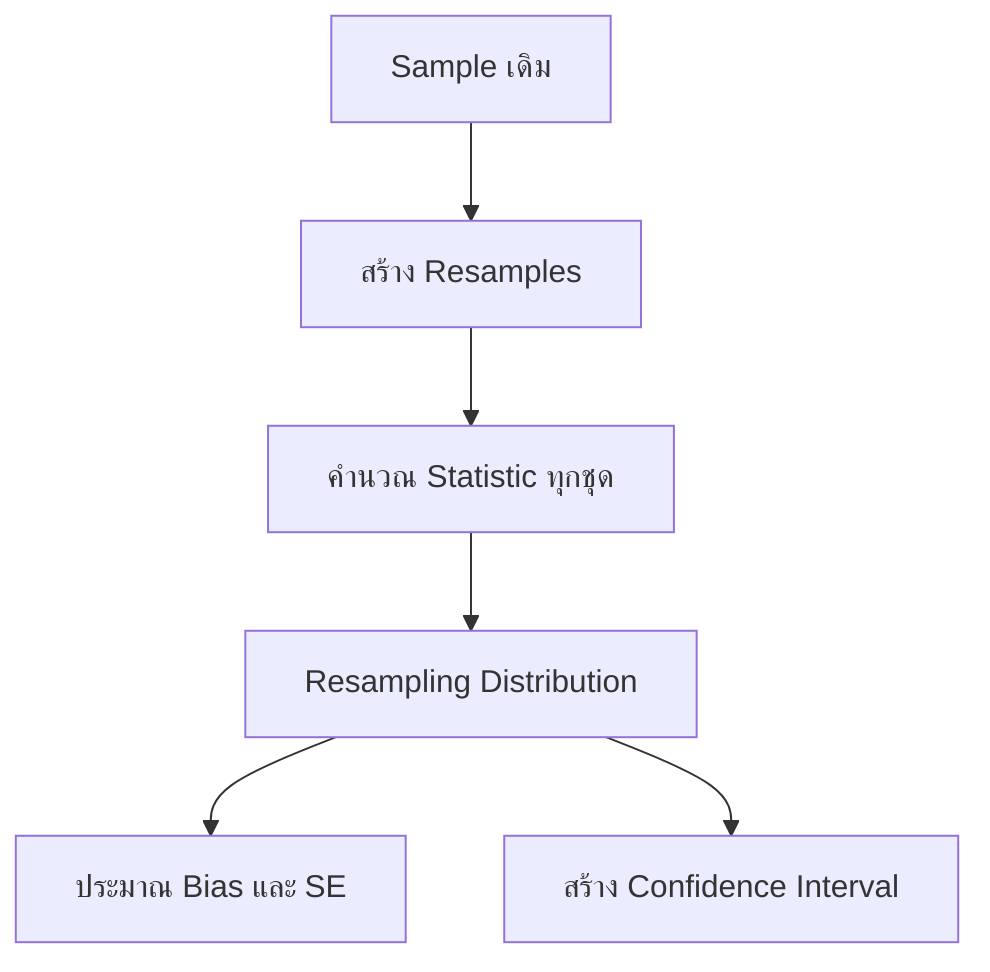

# Jackknife และ Bootstrap: เรียนรู้ความไม่แน่นอนจากข้อมูลที่มีอยู่

> **Course:** DADS6001 Applied Modern Statistical Analysis  
> **Lecture:** 03 Jackknife and Bootstrap Method for Estimation  
> **บทก่อนหน้า:** [02 Interval Estimation](02_interval_estimation.md)

ในบท Interval Estimation เราสร้าง confidence interval จากโครงสร้าง

$$
\text{Estimate} \pm \text{Critical value}\times SE
$$

ส่วนที่สำคัญที่สุดส่วนหนึ่งคือ standard error เพราะมันบอกว่า estimate จะเปลี่ยนมากเพียงใดหากสุ่ม sample ใหม่จาก population แต่ในงานจริงเราเห็น sample เพียงชุดเดียว และสำหรับ statistic บางชนิด เช่น median, percentile, correlation หรือ regression coefficient สูตรของ standard error อาจซับซ้อนหรือไม่มีสูตรที่สะดวกใช้

Jackknife และ Bootstrap จึงใช้ sample ที่สังเกตได้สร้างชุดข้อมูลใหม่หลายชุด แล้วดูว่า statistic เปลี่ยนไปอย่างไร ทั้งสองวิธีไม่ได้สร้างข้อมูลใหม่หรือเพิ่มขนาดตัวอย่างจริง แต่ช่วยประมาณ sampling variability จากข้อมูลที่มีอยู่

## 1. จาก Sampling Distribution สู่ Resampling Distribution

สมมติว่าโรงพยาบาลเก็บเวลารอรับยาของผู้ป่วยมา 10 คน แล้วคำนวณ mean ได้หนึ่งค่า หากสุ่มผู้ป่วยจาก population ใหม่อีกหลายครั้ง ค่า mean ย่อมเปลี่ยนไป การแจกแจงของ sample means จากการสุ่มซ้ำเรียกว่า **sampling distribution**

ปัญหาคือเราไม่สามารถย้อนกลับไปสุ่มจาก population ซ้ำได้หลายพันครั้ง Resampling จึงให้ sample เดิมทำหน้าที่เป็น population จำลองชั่วคราว แล้วสร้างชุดข้อมูลใหม่จาก sample นั้น



Resampling distribution เป็นค่าประมาณของ sampling distribution ไม่ใช่ population distribution จริง หาก sample เดิมไม่เป็นตัวแทนของ population หรือ observations มีโครงสร้างพึ่งพากันที่วิธีสุ่มไม่ได้รักษาไว้ ผลจาก resampling ก็จะสืบทอดปัญหานั้น

## 2. Bias และ Standard Error ที่ Resampling ต้องการประมาณ

ให้ $\theta$ เป็น population parameter และ $\hat{\theta}$ เป็น estimator ที่คำนวณจาก sample

Bias วัดแนวโน้มที่ estimator จะสูงหรือต่ำกว่า parameter โดยนิยามเป็น

$$
Bias(\hat{\theta})=E(\hat{\theta})-\theta
$$

ถ้าประมาณ bias ได้ ค่า bias-corrected estimate คือ

$$
\hat{\theta}_{BC} = \hat{\theta} - Bias_{est}
$$

ส่วน standard error คือ standard deviation ของ sampling distribution ของ estimator

$$
SE(\hat{\theta}) = \sqrt{Var(\hat{\theta})}
$$

Standard deviation และ standard error จึงตอบคนละคำถาม Standard deviation อธิบายการกระจายของ observations ส่วน standard error อธิบายการกระจายของ estimator ระหว่างการสุ่ม sample ซ้ำ

## 3. Jackknife: ตัดข้อมูลออกทีละหนึ่งค่า

Jackknife ถามว่า ถ้าตัด observation แต่ละตัวออกทีละหนึ่ง ค่า estimate จะเปลี่ยนไปมากเพียงใด

ถ้า sample เดิมมีขนาด $n$ Jackknife จะสร้าง leave-one-out samples จำนวน $n$ ชุด แต่ละชุดมีขนาด $n-1$

ตัวอย่าง sample ขนาด 4:

$$
(x_1,x_2,x_3,x_4)
$$

Jackknife samples คือ

$$
(x_2,x_3,x_4), (x_1,x_3,x_4), (x_1,x_2,x_4), (x_1,x_2,x_3)
$$

ให้ $\hat{\theta}_{(i)}$ เป็น estimate จาก sample ที่ตัด observation ลำดับที่ $i$ ออก และให้ค่าเฉลี่ยของ leave-one-out estimates เป็น

$$
\bar{\theta}_{jack} = \frac{1}{n}\sum_{i=1}^{n}\hat{\theta}_{(i)}
$$

Jackknife estimate of bias คือ

$$
Bias_{jack} = (n-1)(\bar{\theta}_{jack}-\hat{\theta})
$$

Bias-corrected Jackknife estimate คือ

$$
\hat{\theta}_{BC,jack} = \hat{\theta}-Bias_{jack}
$$

หรือเขียนได้เป็น

$$
\hat{\theta}_{BC,jack} = n\hat{\theta}-(n-1)\bar{\theta}_{jack}
$$

Jackknife estimate of standard error คือ

$$
SE_{jack} = \sqrt{\frac{n-1}{n}\sum_{i=1}^{n}(\hat{\theta}_{(i)}-\bar{\theta}_{jack})^2}
$$

ถ้าตัด observation เพียงหนึ่งตัวแล้ว estimate เปลี่ยนมาก ค่า Jackknife SE จะสูง และยังบอกเป็นนัยว่า observation นั้นมีอิทธิพลต่อ estimate มาก

Jackknife เหมาะกับ statistic ที่เปลี่ยนอย่างค่อยเป็นค่อยไปเมื่อข้อมูลเปลี่ยนเล็กน้อย เช่น mean และ regression coefficient แต่สำหรับ statistic ที่เปลี่ยนเป็นขั้น เช่น median, quantile หรือ maximum การตัดข้อมูลหนึ่งตัวอาจทำให้ estimate ไม่เปลี่ยนเลยหรือกระโดดมาก จึงอาจประมาณ uncertainty ได้ไม่ดี

## 4. Exercise 1: Fuel Efficiency ด้วย Jackknife

ข้อมูล fuel efficiency ของรถ SUV จำนวน 10 คันมีหน่วยเป็น miles per gallon หรือ mpg:

$$
26,23,21,23,19,29,15,26,19,26
$$

โจทย์ต้องการ Jackknife point estimate ของ population mean และ standard error

### 4.1 วิเคราะห์โจทย์ก่อนรัน R

Estimator ที่สนใจคือ sample mean

$$
\hat{\theta}=\bar{x}
$$

เพราะมีข้อมูล $n=10$ ค่า Jackknife จะสร้าง leave-one-out samples จำนวน 10 ชุด แต่ละชุดมี 9 ค่า จากนั้นคำนวณ mean ของแต่ละชุด

### 4.2 เตรียม Google Colab

รันคำสั่งนี้ใน Python cell หนึ่งครั้ง:

```python
%load_ext rpy2.ipython
```

ติดตั้งและเรียกใช้ package ที่ใช้ในบทนี้:

```r
%%R
# ติดตั้ง package ที่ใช้ใน Lab
if (!requireNamespace("bootstrap", quietly = TRUE)) {
  install.packages("bootstrap", repos = "https://cloud.r-project.org")
}

if (!requireNamespace("boot", quietly = TRUE)) {
  install.packages("boot", repos = "https://cloud.r-project.org")
}

# เรียกใช้ package และกำหนดรูปแบบตัวเลข
library(bootstrap)
library(boot)
options(scipen = 999, digits = 4)
```

### 4.3 รัน R เพื่อหาคำตอบ

```r
%%R
# ข้อมูล fuel efficiency หน่วย mpg
fuel <- c(26, 23, 21, 23, 19, 29, 15, 26, 19, 26)

# Sample mean
mean(fuel)
```

ผลจากเอกสารเฉลย:

```text
[1] 22.7
```

จากนั้นใช้ `jackknife()` ตัดข้อมูลออกทีละหนึ่งค่าและคำนวณ mean ใหม่

```r
%%R
# Jackknife sample mean
jack_mean <- jackknife(fuel, mean)
print(jack_mean)
```

ผลสำคัญ:

```text
$jack.se
[1] 1.342055

$jack.bias
[1] 0

$jack.values
[1] 22.33333 22.66667 22.88889 22.66667 23.11111
[6] 22.00000 23.55556 22.33333 23.11111 22.33333
```

ค่า `jack.values` คือ leave-one-out means ทั้ง 10 ค่า ส่วน `jack.bias` และ `jack.se` คือ estimated bias และ standard error

Bias-corrected estimate คำนวณได้จาก

```r
%%R
# Bias-corrected Jackknife estimate
mean(fuel) - jack_mean$jack.bias
```

ผลลัพธ์คือ 22.7 mpg เพราะ estimated bias เท่ากับศูนย์

### 4.4 ตรวจคำตอบด้วยสูตร

Sample mean คือ

$$
\bar{x}=22.7
$$

ค่าเฉลี่ยของ leave-one-out means เท่ากับ 22.7 เช่นกัน ดังนั้น

$$
Bias_{jack} = (10-1)(22.7-22.7) = 0
$$

สำหรับ sample mean ค่า Jackknife SE จะเท่ากับ classical standard error

$$
SE_{jack} = \frac{s}{\sqrt{n}} = 1.3421
$$

### 4.5 เขียนตอบข้อสอบ

> ใช้ Jackknife โดยตัดข้อมูลออกทีละหนึ่งค่าจาก sample ขนาด 10 จึงได้ leave-one-out samples จำนวน 10 ชุด แล้วคำนวณ mean ของแต่ละชุด ผลได้ sample mean 22.7 mpg, Jackknife estimated bias เท่ากับ 0 และ Jackknife standard error เท่ากับ 1.3421 mpg ดังนั้น bias-corrected Jackknife estimate ของ population mean ยังคงเท่ากับ 22.7 mpg

## 5. Bootstrap: สุ่มจาก Sample เดิมแบบคืนที่

Bootstrap ใช้ sample เดิมแทน population ชั่วคราว แล้วสุ่มข้อมูลขนาด $n$ **แบบคืนที่** ทำซ้ำจำนวน $B$ รอบ

คำว่าแบบคืนที่หมายความว่า หลังจากเลือก observation หนึ่งค่าแล้ว ค่านั้นยังสามารถถูกเลือกซ้ำได้ในรอบเดียวกัน Bootstrap sample จึงอาจมีบางค่าซ้ำหลายครั้ง และบางค่าจาก sample เดิมอาจไม่ปรากฏเลย

หากสุ่มข้อมูลครบ $n$ ค่าโดยไม่คืนที่ ทุกชุดจะมีข้อมูลเดิมครบ เพียงสลับลำดับ Statistic เช่น mean จะไม่เปลี่ยน และไม่เกิด distribution ที่ใช้ประมาณ uncertainty ได้

ให้ $\hat{\theta}^{(b)}$ เป็น estimate จาก Bootstrap sample รอบที่ $b$ ค่าเฉลี่ยของ Bootstrap estimates คือ

$$
\bar{\theta}_{boot} = \frac{1}{B}\sum_{b=1}^{B}\hat{\theta}^{(b)}
$$

Bootstrap estimate of bias คือ

$$
Bias_{boot} = \bar{\theta}_{boot}-\hat{\theta}
$$

Bootstrap estimate of standard error คือ

$$
SE_{boot} = \sqrt{\frac{1}{B-1}\sum_{b=1}^{B}(\hat{\theta}^{(b)}-\bar{\theta}_{boot})^2}
$$

สูตรนี้คือ sample standard deviation ของ Bootstrap estimates จำนวน $B$ ค่า ถ้าเพิ่ม $B$ ผลจะเสถียรขึ้นเพราะความผันผวนจากการจำลองลดลง แต่ไม่ได้เพิ่มจำนวน observations อิสระหรือแก้ selection bias ใน sample เดิม

## 6. Bootstrap Confidence Interval

### 6.1 Normal approximation interval

ถ้า Bootstrap distribution ใกล้สมมาตรและ approximately normal สามารถใช้

$$
\hat{\theta} \pm z_{\alpha/2}SE_{boot}
$$

สำหรับ 95% confidence interval ใช้ critical value ประมาณ 1.96

$$
\hat{\theta} \pm 1.96SE_{boot}
$$

ช่วงนี้สมมาตรรอบ point estimate จึงอาจไม่เหมาะเมื่อ Bootstrap distribution เบ้มาก

### 6.2 Percentile interval

Percentile method เรียง Bootstrap estimates จากน้อยไปมาก แล้วใช้ quantiles ที่ต้องการเป็นขอบเขตโดยตรง

สำหรับ 95% confidence interval:

$$
CI_{percentile} = [q_{0.025},q_{0.975}]
$$

ดังนั้นขอบล่างคือ percentile ที่ 2.5 และขอบบนคือ percentile ที่ 97.5 ของ Bootstrap estimates

### 6.3 BCa interval

`boot.ci()` ใน Lab คำนวณ BCa interval เพิ่มเติม BCa ย่อมาจาก Bias-Corrected and Accelerated ซึ่งปรับตำแหน่ง percentile จากทั้ง estimated bias และความไม่สมมาตรของ standard error วิธีนี้ซับซ้อนกว่า percentile interval และใช้ Jackknife estimates ส่วนหนึ่งในการคำนวณ acceleration

ในการตอบข้อสอบควรระบุชื่อวิธีของ confidence interval เสมอ เพราะ Normal, Percentile และ BCa สามารถให้ขอบเขตต่างกันได้

## 7. `boot()` ทำงานอย่างไร

Lab ใช้ฟังก์ชัน `boot()` จาก package `boot` โดยต้องสร้าง statistic function ที่รับข้อมูลและ index

```r
mean_stat <- function(data, index) {
  mean(data[index])
}
```

ในแต่ละรอบ `boot()` จะสร้าง index ที่สุ่มแบบคืนที่ แล้วส่ง index เข้า `mean_stat()` คำสั่ง `data[index]` จึงเป็น Bootstrap sample และ `mean(data[index])` คือ Bootstrap estimate หนึ่งค่า

ตัวอย่างข้อมูลขนาดเล็ก:

- ข้อมูลเดิม: `c(10, 20, 30)`
- index ที่สุ่มได้: `c(2, 2, 1)`
- Bootstrap sample: `c(20, 20, 10)`
- Bootstrap mean: 16.6667

ถ้าเขียน `mean(data)` แทน `mean(data[index])` ทุก replicate จะใช้ข้อมูลเดิมและได้ค่าเท่ากัน ทำให้ Bootstrap SE เท่ากับศูนย์

## 8. Exercise 2: Annual Family Income

ข้อมูล annual income ของครอบครัว 29 ครอบครัวมีหน่วยเป็นร้อยดอลลาร์ โจทย์ให้ตรวจ distribution หาค่า mean และ standard deviation สร้าง classical 95% confidence interval แล้วเปรียบเทียบกับ Bootstrap confidence interval

### 8.1 ใส่ข้อมูลและดูรูปร่าง

```r
%%R
# Annual family income หน่วยร้อยดอลลาร์
family_income <- c(
  90, 77, 100, 83, 64, 78, 92, 73, 122, 96,
  60, 85, 86, 108, 70, 139, 56, 94, 84, 111,
  93, 120, 70, 92, 100, 124, 59, 112, 79
)

boxplot(
  family_income,
  main = "Annual Family Income",
  ylab = "Income in Hundreds of Dollars"
)
```

จาก boxplot ในเฉลย ข้อมูลมีค่าด้านบนค่อนข้างสูง แต่ไม่เห็นความเบ้รุนแรงมากพอที่จะทำให้การประมาณ mean ด้วย classical t interval และ Bootstrap ให้ข้อสรุปต่างกันชัดเจน

### 8.2 หาค่า point estimates

```r
%%R
# Sample mean และ sample standard deviation
print(mean(family_income))
print(sd(family_income))
```

ค่าที่ได้คือ

$$
n=29, \bar{x}=90.2414, s=20.9926
$$

เนื่องจากข้อมูลมีหน่วยเป็นร้อยดอลลาร์ ค่าเฉลี่ยประมาณ 90.2414 หมายถึง 9,024.14 ดอลลาร์

### 8.3 Classical 95% t interval

```r
%%R
# Classical confidence interval ของ population mean
t.test(family_income, conf.level = 0.95)
```

ผลจากเอกสารเฉลย:

```text
mean of x = 90.24138
df = 28
95 percent confidence interval:
82.25622 98.22654
```

### 8.4 Bootstrap ด้วย R

```r
%%R
# ฟังก์ชันคำนวณ mean ของ Bootstrap sample
mean_stat <- function(data, index) {
  mean(data[index])
}

# สุ่มซ้ำได้ผลเดิมและสร้าง Bootstrap replicates 2,000 รอบ
set.seed(11)
boot_family <- boot(
  data = family_income,
  statistic = mean_stat,
  R = 2000
)

print(boot_family)
```

ผลจากเอกสารเฉลย:

```text
original = 90.24138
bias = -0.08084483
std. error = 3.935964
```

`original` คือ sample mean จากข้อมูลเดิม `bias` คือค่าเฉลี่ยของ Bootstrap means ลบด้วย original mean และ `std. error` คือ standard deviation ของ Bootstrap means

ตรวจ Bootstrap distribution ได้จาก

```r
%%R
# Diagnostic plots ของ Bootstrap estimates
plot(boot_family)
```

สร้าง confidence intervals:

```r
%%R
# Normal, Percentile และ BCa confidence intervals
boot.ci(
  boot.out = boot_family,
  conf = 0.95,
  type = c("norm", "perc", "bca")
)
```

ผลจากเอกสารเฉลย:

```text
Normal      (82.61, 98.04)
Percentile  (82.52, 97.90)
BCa        (82.90, 98.33)
```

### 8.5 เปรียบเทียบผล

Classical t interval เท่ากับ

$$
[82.2562,98.2265]
$$

ส่วน Bootstrap intervals ทั้งสามวิธีอยู่ใกล้เคียงกันและใกล้กับ classical interval จึงให้ข้อสรุปเหมือนกันเกี่ยวกับช่วงที่เป็นไปได้ของ population mean

### 8.6 เขียนตอบข้อสอบ

> จากครอบครัวตัวอย่าง 29 ครอบครัว ได้ mean annual income เท่ากับ 90.2414 ร้อยดอลลาร์ Classical 95% t interval เท่ากับ 82.2562 ถึง 98.2265 ร้อยดอลลาร์ เมื่อสุ่ม Bootstrap samples ขนาด 29 แบบคืนที่จำนวน 2,000 รอบ ได้ Bootstrap SE เท่ากับ 3.9360 และ 95% percentile interval เท่ากับ 82.52 ถึง 97.90 ร้อยดอลลาร์ ช่วงจากสองวิธีใกล้เคียงกัน จึงให้ข้อสรุปสอดคล้องกันเกี่ยวกับ population mean ภายใต้เงื่อนไขว่า sample เป็นตัวแทนและ observations เป็นอิสระ

## 9. Exercise 3: ข้อมูลเบ้ขวา

ข้อมูลชุดนี้มีค่าขนาดใหญ่หลายค่า เช่น 110, 123, 126, 137, 152 และ 165 จึงมีลักษณะเบ้ขวา โจทย์ให้เปรียบเทียบ classical t interval กับ Bootstrap confidence intervals ของ population mean

### 9.1 จุดที่ต่างกันระหว่าง Lecture กับเฉลย

สไลด์ Exercise 3 แสดงข้อมูลเพียง 49 ค่าและเริ่มต้นด้วย 5 แต่โจทย์ระบุว่า sample size เท่ากับ 50 ส่วนเฉลย R เพิ่มค่า 54 เป็น observation แรก ทำให้ครบ 50 ค่าและได้ mean 43.04 ตาม output

วิธีทำต่อไปนี้จึงใช้ชุดข้อมูล 50 ค่าจากเฉลย R:

```r
%%R
# ข้อมูล 50 ค่าตามไฟล์เฉลย R
x <- c(
  54, 5, 35, 137, 31, 27, 152, 2, 123, 81,
  74, 27, 11, 19, 126, 110, 110, 29, 61, 35,
  94, 31, 26, 5, 12, 4, 165, 32, 29, 28,
  29, 26, 25, 1, 14, 13, 13, 10, 5, 27,
  4, 52, 30, 22, 36, 26, 20, 23, 33, 68
)

boxplot(
  x,
  main = "Exercise 3 Data",
  ylab = "Observed Value"
)
```

### 9.2 Point estimates และ Classical interval

```r
%%R
# Sample mean และ sample standard deviation
print(mean(x))
print(sd(x))
```

ผลสำคัญ:

$$
n=50, \bar{x}=43.04
$$

ใช้ `t.test()` สร้าง classical confidence interval:

```r
%%R
# Classical confidence interval ของ population mean
t.test(x, conf.level = 0.95)
```

ผลจากเอกสารเฉลย:

```text
mean of x = 43.04
df = 49
95 percent confidence interval:
31.12475 54.95525
```

แม้ข้อมูลรายหน่วยจะเบ้ขวา Sampling distribution ของ mean มีแนวโน้มเข้าใกล้ normal มากขึ้นเมื่อ sample size เพิ่มขึ้นตาม Central Limit Theorem แต่ยังควรตรวจ outliers และเปรียบเทียบกับ Bootstrap distribution

### 9.3 Bootstrap ด้วย R

```r
%%R
# Bootstrap population mean
set.seed(11)
boot_x <- boot(
  data = x,
  statistic = mean_stat,
  R = 2000
)

print(boot_x)
```

ผลจากเอกสารเฉลย:

```text
original = 43.04
bias = 0.04051
std. error = 5.698286
```

ดู Bootstrap distribution:

```r
%%R
# Diagnostic plots ของ Bootstrap estimates
plot(boot_x)
```

สร้าง confidence intervals:

```r
%%R
# Normal, Percentile และ BCa confidence intervals
boot.ci(
  boot.out = boot_x,
  conf = 0.95,
  type = c("norm", "perc", "bca")
)
```

ผลจากเอกสารเฉลย:

```text
Normal      (31.83, 54.17)
Percentile  (32.32, 54.68)
BCa        (32.81, 55.12)
```

ไฟล์เฉลยบางบรรทัดแสดง `boot.out = b` ซึ่งเป็น object ของ Family Income แต่ Exercise 3 ต้องส่ง object ของข้อมูลชุดนี้ เช่น `boot_x` มิฉะนั้น R อาจรันได้แต่คืน confidence interval ของข้อมูลผิดชุด

### 9.4 เปรียบเทียบผล

Classical t interval คือ

$$
[31.1248,54.9553]
$$

Bootstrap percentile interval คือ

$$
[32.32,54.68]
$$

ช่วงทั้งสองใกล้เคียงกัน แม้ observations จะเบ้ขวา เหตุผลสำคัญคือ parameter ที่สนใจเป็น mean และ sample size เท่ากับ 50 อย่างไรก็ตาม Bootstrap ไม่ได้ทำให้ปัญหา outlier หรือ sample bias หายไป แต่ใช้ empirical distribution ของ sample เพื่อประมาณความผันผวนของ estimator

### 9.5 เขียนตอบข้อสอบ

> ข้อมูล 50 ค่ามีลักษณะเบ้ขวาและมีค่าด้านบนสูงหลายค่า Sample mean เท่ากับ 43.04 Classical 95% t interval เท่ากับ 31.1248 ถึง 54.9553 เมื่อสุ่ม Bootstrap samples ขนาด 50 แบบคืนที่จำนวน 2,000 รอบ ได้ Bootstrap SE เท่ากับ 5.6983 และ 95% percentile interval เท่ากับ 32.32 ถึง 54.68 ช่วงจากสองวิธีใกล้เคียงกัน จึงให้ข้อสรุปสอดคล้องกันเกี่ยวกับ population mean แต่การตีความยังขึ้นกับการเป็นตัวแทนของ sample และความเป็นอิสระของ observations

## 10. Jackknife กับ Bootstrap ใช้ต่างกันอย่างไร

### 10.1 ใช้ Jackknife เมื่อใด

Jackknife เหมาะเมื่อ estimator เปลี่ยนอย่างราบรื่น และต้องการประมาณ bias, standard error หรือดูว่า observation ใดมีอิทธิพล การสร้างเพียง $n$ ชุดทำให้คำนวณเร็วและให้ผลเดิมทุกครั้งเพราะไม่มีการสุ่ม

### 10.2 ใช้ Bootstrap เมื่อใด

Bootstrap เหมาะเมื่อสูตร standard error ซับซ้อน ต้องการประมาณ resampling distribution หรือสร้าง confidence interval ของ statistic ที่หลากหลาย Bootstrap ยืดหยุ่นกว่า Jackknife แต่ต้องกำหนดจำนวน replicates และ seed เพื่อให้ทำซ้ำได้

### 10.3 เลือกหน่วย Resampling ให้ตรงกับโครงสร้างข้อมูล

Ordinary Jackknife และ Bootstrap ในบทนี้ตั้งอยู่บนแนวคิดว่า observations เป็น iid หากข้อมูลเป็น repeated measures, clustered data หรือ time series ห้ามสุ่มแต่ละ row แยกจากกัน เพราะจะทำลาย dependence structure ต้องเลือกหน่วย resampling เช่น ผู้ป่วยทั้งคน cluster ทั้งกลุ่ม หรือช่วงเวลาทั้ง block

สรุปการเลือกวิธี:

| สถานการณ์ | วิธีที่ควรพิจารณา |
|---|---|
| Mean และสูตร classical ใช้ได้ | Classical method เป็นจุดเริ่มต้น |
| ต้องการ Bias หรือ SE ของ smooth estimator | Jackknife หรือ Bootstrap |
| ต้องการดูอิทธิพลจากการตัด observation | Jackknife |
| Median, percentile หรือ statistic ซับซ้อน | Bootstrap มักเหมาะกว่า Jackknife |
| ต้องการ confidence interval จาก resampling distribution | Bootstrap |
| ข้อมูลมี dependence | ใช้ resampling scheme ที่รักษา dependence |

## 11. จุดที่ควรตรวจเมื่อรัน R

### Bootstrap SE เท่ากับศูนย์

ตรวจว่า statistic function ใช้ `data[index]` จริง หากใช้ `data` โดยไม่ใช้ index ทุก replicate จะคำนวณจากข้อมูลเดิม

### ผลเปลี่ยนทุกครั้งที่รัน

Bootstrap มี randomness จึงควรกำหนด `set.seed()` ก่อนเรียก `boot()` และรายงานจำนวน replicates `R`

### Confidence interval มาจากข้อมูลผิดชุด

ตรวจ object ที่ส่งให้ `boot.ci()` เช่น Exercise 2 ต้องใช้ `boot_family` ส่วน Exercise 3 ต้องใช้ `boot_x`

### R หา `boot()` หรือ `jackknife()` ไม่พบ

ตรวจว่าเรียก `library(boot)` และ `library(bootstrap)` แล้ว หรือใช้ชื่อแบบระบุ package เช่น `boot::boot()` และ `bootstrap::jackknife()`

### ข้อมูลมี Missing Values

ต้องตัดสินใจวิธีจัดการก่อน resampling และอธิบายเหตุผล ไม่ควรเติม `na.rm = TRUE` โดยไม่พิจารณาว่าการหายของข้อมูลมีผลต่อการเป็นตัวแทนของ sample อย่างไร

## 12. สูตรที่ควรหาให้เจอในห้องสอบ

### Jackknife average

$$
\bar{\theta}_{jack} = \frac{1}{n}\sum_{i=1}^{n}\hat{\theta}_{(i)}
$$

### Jackknife bias

$$
Bias_{jack} = (n-1)(\bar{\theta}_{jack}-\hat{\theta})
$$

### Bias-corrected Jackknife estimate

$$
\hat{\theta}_{BC,jack} = \hat{\theta}-Bias_{jack}
$$

### Jackknife standard error

$$
SE_{jack} = \sqrt{\frac{n-1}{n}\sum_{i=1}^{n}(\hat{\theta}_{(i)}-\bar{\theta}_{jack})^2}
$$

### Bootstrap average

$$
\bar{\theta}_{boot} = \frac{1}{B}\sum_{b=1}^{B}\hat{\theta}^{(b)}
$$

### Bootstrap bias

$$
Bias_{boot} = \bar{\theta}_{boot}-\hat{\theta}
$$

### Bootstrap standard error

$$
SE_{boot} = \sqrt{\frac{1}{B-1}\sum_{b=1}^{B}(\hat{\theta}^{(b)}-\bar{\theta}_{boot})^2}
$$

### Bootstrap percentile confidence interval

$$
CI_{percentile} = [q_{\alpha/2},q_{1-\alpha/2}]
$$

สำหรับ 95% confidence interval:

$$
CI_{95} = [q_{0.025},q_{0.975}]
$$

## 13. แนวคำถามที่ควรทำได้ก่อนสอบ

### คำถาม 1

Jackknife และ Bootstrap ต่างกันอย่างไร

**แนวเขียนตอบ:**

> Jackknife สร้าง resamples จำนวน $n$ ชุดโดยตัด observation ออกทีละหนึ่งค่า แต่ Bootstrap สร้าง resamples ขนาด $n$ ด้วยการสุ่มแบบคืนที่จำนวน $B$ รอบ Jackknife ไม่มี randomness และเหมาะกับการประมาณ bias, SE หรือ influence ของ smooth estimator ส่วน Bootstrap ยืดหยุ่นกว่าในการประมาณ SE, resampling distribution และ confidence interval แต่ต้องกำหนด seed และจำนวน replicates

### คำถาม 2

เหตุใด Bootstrap จึงต้องสุ่มแบบคืนที่

**แนวเขียนตอบ:**

> หากสุ่มข้อมูลครบ $n$ ค่าโดยไม่คืนที่ แต่ละ resample จะมี observations เดิมครบ เพียงเปลี่ยนลำดับ ทำให้ statistic ที่ไม่ขึ้นกับลำดับ เช่น mean ไม่เปลี่ยน การสุ่มแบบคืนที่ทำให้บาง observation ซ้ำและบาง observationไม่ถูกเลือก จึงเกิดความแปรผันที่ใช้ประมาณ sampling distribution ของ estimator ได้

### คำถาม 3

การเพิ่มจำนวน Bootstrap replicates จาก 2,000 เป็น 20,000 ช่วยอะไร

**แนวเขียนตอบ:**

> การเพิ่ม $B$ ช่วยลด Monte Carlo error ทำให้ค่า Bootstrap SE และ confidence interval เสถียรขึ้น แต่ไม่เพิ่มจำนวนข้อมูลอิสระ ไม่แก้ selection bias และไม่สร้างข้อมูลในส่วนของ population ที่ sample เดิมไม่เคยสังเกต

### คำถาม 4

หากข้อมูลเป็นการวัดผู้ป่วยคนเดิมหลายเวลา ควร Bootstrap แต่ละ row หรือไม่

**แนวเขียนตอบ:**

> ไม่ควรสุ่มแต่ละ row แยกจากกัน เพราะการวัดภายในผู้ป่วยคนเดียวกันสัมพันธ์กัน การสุ่ม row จะทำลาย dependence structure และอาจประเมิน standard error ต่ำเกินจริง ควร resample ผู้ป่วยทั้งคนหรือใช้วิธีที่รักษาโครงสร้าง longitudinal data

## 14. สรุปความคิดของบท

Jackknife และ Bootstrap พยายามประมาณพฤติกรรมของ estimator เมื่อไม่สามารถเห็น sampling distribution จริง Jackknife ทำโดยตัด observation ออกทีละหนึ่งค่า ส่วน Bootstrap ทำโดยสุ่มข้อมูลขนาดเท่าเดิมแบบคืนที่หลายรอบ

ทั้งสองวิธีช่วยประมาณ bias และ standard error ส่วน Bootstrap ยังใช้สร้าง confidence interval จาก resampling distribution ได้ อย่างไรก็ตาม Resampling ไม่ได้สร้างข้อมูลใหม่และไม่สามารถแก้ sample ที่ไม่เป็นตัวแทน การเลือกหน่วย resampling ให้ตรงกับโครงสร้างข้อมูลจึงสำคัญพอ ๆ กับการเลือกสูตรหรือคำสั่ง R

## 15. References

### เอกสารประกอบรายวิชา

1. `lecture03_jackknife_bootstrap(1).pptx`, 14 slides.
2. `lab03_jackknife_bootstrap_solution_r.pdf`, 9 pages.
3. `lab03_confident_interval_solution.pdf`, classical confidence interval results used for comparison.

### References ที่ระบุใน Lecture

1. Efron, B. (1979). *Bootstrap Methods: Another Look at the Jackknife*. The Annals of Statistics, 7, 1-26.
2. Efron, B. (1982). *The Jackknife, the Bootstrap, and Other Resampling Plans*. SIAM.
3. Efron, B., and Tibshirani, R. J. (1993). *An Introduction to the Bootstrap*. Chapman & Hall.
4. Quenouille, M. H. (1949). Approximate Tests of Correlation in Time Series. *Journal of the Royal Statistical Society, Series B*, 11, 18-44.
5. Quenouille, M. H. (1956). Notes on Bias in Estimation. *Biometrika*, 43, 353-360.
6. Tukey, J. W. (1958). Bias and Confidence in Not Quite Large Samples. *The Annals of Mathematical Statistics*, 29, 614.
