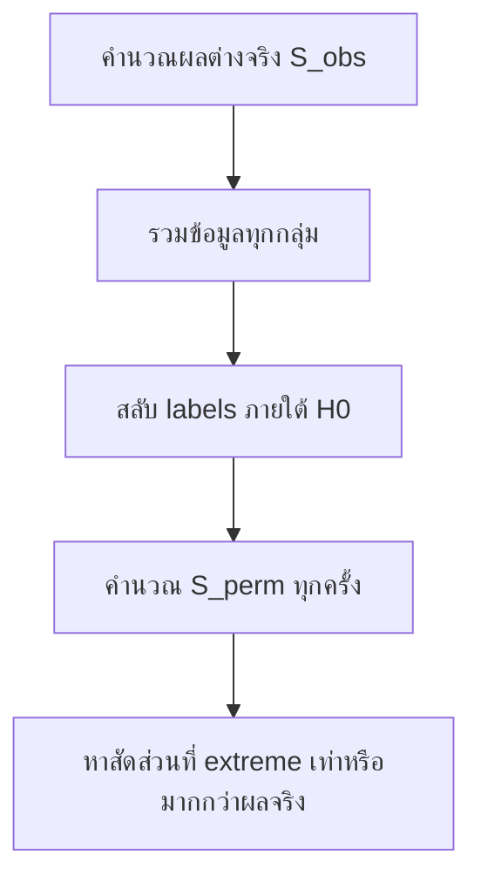

# 05 Permutation Test

Permutation Test เป็นเนื้อหาสำหรับการสอบปลายภาคต่อจาก Classical hypothesis testing ในบทก่อนหน้า แก่นของบทนี้ยังเป็นคำถามเดิมว่า “ผลจาก sample ขัดกับ $H_0$ มากพอหรือไม่” สิ่งที่เปลี่ยนคือวิธีสร้าง null distribution

Classical test อาศัย distribution ทางทฤษฎี เช่น t distribution เพื่อบอกว่า test statistic ควรกระจายอย่างไรเมื่อ $H_0$ เป็นจริง ส่วน Permutation Test สร้าง null distribution จากข้อมูลที่สังเกตได้ โดยสลับ group labels หรือจับคู่ข้อมูลใหม่ในรูปแบบที่ $H_0$ อนุญาต แล้วดูว่าผลจริงสุดโต่งเพียงใดเมื่อเทียบกับผลจากการสลับเหล่านั้น

บทนี้เริ่มจากตัวอย่างผู้ป่วย 5 คน เพราะสามารถแจกแจงทุก assignment ด้วยมือได้ เมื่อเข้าใจตัวอย่างนี้แล้ว โจทย์ขนาดใหญ่และ R code จะเป็นเพียงการให้คอมพิวเตอร์ทำขั้นตอนเดิมซ้ำจำนวนมาก

---

## 1. เริ่มจากคำถามที่ Classical t test ตอบได้ไม่มั่นใจ

สมมติทดลองยากับผู้ป่วยภูมิแพ้ 5 คน โดยสุ่ม 2 คนให้ High dose และอีก 3 คนให้ Low dose ผลลัพธ์คือจำนวนวันที่ไม่มีอาการ

- High dose: 12, 13 วัน
- Low dose: 6, 6, 7 วัน

ต้องการตรวจว่า High dose ทำให้จำนวนวันที่ไม่มีอาการเฉลี่ยมากกว่า Low dose หรือไม่

ข้อมูลมีเพียง 2 คนกับ 3 คน การตรวจ Normality แทบไม่มีพลัง และการอาศัย t distribution ต้องใช้ assumptions ที่ประเมินจากข้อมูลได้ยาก Permutation Test จึงย้อนกลับไปใช้สิ่งที่การทดลองให้มาโดยตรง นั่นคือการสุ่มว่าใครอยู่กลุ่มใด

ถ้า $H_0$ เป็นจริงและ dose ไม่มีผลต่อ response แล้ว ค่า 12, 13, 6, 6 และ 7 ไม่ควรผูกติดกับ label High หรือ Low ผู้ป่วยที่ได้ 12 วันอาจถูกจัดเป็น Low dose ได้เช่นเดียวกับ High dose การสลับ labels จึงจำลองโลกที่ $H_0$ เป็นจริง

นี่คือภาพรวมของกระบวนการ:



ค่าในขั้นสุดท้ายคือ permutation p-value

---

## 2. สิ่งที่ถูกสลับคือ label ไม่ใช่ค่าข้อมูล

ใน two-sample permutation test เราคงค่าที่วัดได้ไว้ครบทุกค่า แล้วสลับว่า observation ใดอยู่กลุ่ม 1 หรือกลุ่ม 2 โดยรักษาขนาดของแต่ละกลุ่มเท่าเดิม

สำหรับตัวอย่างยา เรารวมข้อมูลเป็น

```text
12 13 6 6 7
```

จากนั้นเลือก 2 ค่าให้เป็น High dose ส่วนอีก 3 ค่าเป็น Low dose จำนวน assignments ที่แตกต่างกันคือ

$$
\binom{5}{2}=10
$$

ไม่จำเป็นต้องใช้ $5!=120$ เพราะการสลับลำดับภายใน High dose หรือภายใน Low dose ไม่สร้าง assignment ใหม่ ตัวอย่างเช่น High = 12, 13 กับ High = 13, 12 คือกลุ่มเดียวกัน

หลักนี้ใช้กับ two-sample test ทั่วไป ถ้ามีข้อมูลรวม $N$ ค่าและกลุ่มแรกมี $n_1$ ค่า จำนวนวิธีแบ่งกลุ่มคือ

$$
\binom{N}{n_1}
$$

ส่วน $N!$ เป็นจำนวนการเรียงลำดับ observations ทั้งหมด ซึ่งอาจมีการนับ assignment เดิมซ้ำหลายครั้ง

---

## 3. Observed test statistic คือสิ่งที่เห็นจากข้อมูลจริง

โจทย์ถามว่า High dose ให้ค่าเฉลี่ยมากกว่า Low dose จึงกำหนด test statistic เป็น

$$
S_{obs}=\bar{x}_{high}-\bar{x}_{low}
$$

จากข้อมูลจริง

$$
S_{obs}=12.50-6.33=6.17
$$

เครื่องหมายของ test statistic ต้องตรงกับคำถาม หากกำหนด High minus Low แล้ว $H_1$ คือ High มากกว่า Low ค่า test statistic ที่สนับสนุน $H_1$ จะอยู่ทางขวาหรือมีค่ามาก

Permutation Test ไม่ได้บังคับว่าต้องใช้ผลต่างค่าเฉลี่ย เราเลือก statistic ให้ตรงกับคำถามได้ เช่น

- Difference in means เมื่อสนใจค่าเฉลี่ย
- Difference in medians เมื่อข้อมูลเบ้และสนใจค่ากลาง
- Pearson correlation เมื่อสนใจความสัมพันธ์เชิงเส้น
- Difference in proportions เมื่อ outcome เป็น binary
- Variance ratio เมื่อสนใจความแตกต่างของการกระจาย

หลังเลือก statistic แล้ว ต้องใช้ definition เดิมทั้งข้อมูลจริงและทุก permuted sample

---

## 4. Null distribution เกิดจาก assignments ที่เป็นไปได้ภายใต้ H0

เมื่อแจกแจงครบ 10 assignments ตัวอย่างยาให้ผลต่างค่าเฉลี่ย High minus Low ดังนี้

```text
6.17, 0.33, 0.33, 1.17, 1.17,
1.17, 2.00, -4.67, -3.83, -3.83
```

ค่า 6.17 จาก assignment จริงเป็นค่ามากที่สุด ถ้า $H_0$ เป็นจริง แต่ละ assignment มีโอกาสเท่ากัน $1/10$ ดังนั้น one-sided p-value คือสัดส่วนของ assignments ที่ได้ $S_{perm}\ge S_{obs}$

$$
p\text{-value}=\frac{1}{10}=0.10
$$

ค่า 0.10 มีความหมายว่า ถ้า dose ไม่ได้ทำให้ response distribution แตกต่างกัน การสุ่มแบ่งผู้ป่วย 2 คนกับ 3 คนจะให้ผลต่างค่าเฉลี่ยอย่างน้อย 6.17 วันได้ประมาณ 10% ของ assignments ทั้งหมด

ที่ระดับนัยสำคัญ 0.05 เราจึงไม่ปฏิเสธ $H_0$ ข้อมูลยังไม่มีหลักฐานเพียงพอว่า High dose ให้จำนวนวันที่ไม่มีอาการเฉลี่ยมากกว่า Low dose

สาเหตุที่ผลต่าง 6.17 ดูใหญ่มากแต่ยังไม่ significant คือ sample เล็กจน p-value มีค่าที่เป็นไปได้แบบขั้นบันได สำหรับ 10 assignments ค่า one-sided p-value ที่เล็กที่สุดคือ $1/10=0.10$ จึงไม่มีทางปฏิเสธ $H_0$ ที่ระดับ 0.05 ด้วย permutation test ชุดนี้ แม้ assignment จริงจะสุดโต่งที่สุดแล้วก็ตาม

---

## 5. Exchangeability คือ assumption สำคัญที่สุด

Permutation Test ไม่ต้องสมมติว่า population เป็น Normal แต่ไม่ได้แปลว่าไม่มี assumptions

ภายใต้ $H_0$ observations หรือ labels ที่นำมาสลับต้องมีสมบัติ **exchangeable** หมายถึง หลังจากพิจารณาโครงสร้างการทดลองแล้ว assignments ที่นำมาสลับต้องมีโอกาสเกิดเท่าเทียมกันภายใต้ $H_0$

สำหรับ randomized experiment แบบสองกลุ่ม ถ้าผู้เข้าร่วมถูกสุ่มเข้ากลุ่มจริง labels ของสองกลุ่มมักสลับกันได้ภายใต้สมมติฐานว่า treatment ไม่มีผล

สำหรับ observational study ต้องระวังมากขึ้น เพราะความแตกต่างระหว่างกลุ่มอาจเกิดจากปัจจัยอื่นตั้งแต่ก่อนเก็บข้อมูล เช่น อายุหรือความรุนแรงของโรค การสลับ labels โดยไม่รักษาโครงสร้างเหล่านี้อาจไม่สอดคล้องกับกระบวนการสร้างข้อมูล

หลักที่ควรตรวจมีดังนี้

- Observations ระหว่างหน่วยทดลองเป็นอิสระตามการออกแบบ
- รูปแบบการ permutation ตรงกับวิธีสุ่มหรือโครงสร้างของข้อมูล
- ข้อมูล independent groups ต้องสลับ group labels โดยรักษาขนาดกลุ่ม
- ข้อมูล paired ต้องรักษาคู่ไว้ แล้วสลับทิศทางหรือ signs ภายในคู่
- Correlation test ต้องตรึงตัวแปรหนึ่งไว้แล้ว permute อีกตัว เพื่อทำลายความสัมพันธ์แต่รักษาค่าของแต่ละตัวแปร

จึงควรถามว่า “ภายใต้ $H_0$ เราสลับอะไรได้โดยไม่ทำลายโครงสร้างข้อมูล” ก่อนเขียน code ทุกครั้ง

---

## 6. Exact permutation กับ Monte Carlo permutation

### 6.1 Exact permutation

Exact test คำนวณ statistic จาก assignments ที่เป็นไปได้ทั้งหมด p-value จึงเกิดจาก null distribution ที่ครบถ้วน

ตัวอย่างยาใช้เพียง 10 assignments จึงแจกแจงครบได้ง่าย ตัวอย่างสุนัข 14 ตัว แบ่งเป็นกลุ่มละ 7 ตัว มี

$$
\binom{14}{7}=3432
$$

assignments ซึ่งคอมพิวเตอร์ยังคำนวณครบได้

### 6.2 Monte Carlo permutation

เมื่อจำนวน assignments มากเกินไป เราสุ่ม assignments มาจำนวน $B$ ครั้ง เช่น 5,000 หรือ 50,000 ครั้ง แล้วใช้สัดส่วนของ random permutations ที่ extreme เท่าหรือมากกว่าผลจริงเป็น approximate p-value

ยิ่ง $B$ มาก Monte Carlo error ยิ่งลดลง แต่เวลาในการคำนวณเพิ่มขึ้นด้วย การกำหนด `set.seed()` ทำให้รันซ้ำได้ผลเดิม

ใน lecture และ solution คำนวณ approximate p-value เป็น

$$
\frac{\text{จำนวน permutations ที่ extreme}}{B}
$$

ใน code สมัยใหม่มักใช้ plus-one correction เพื่อป้องกันการรายงาน p-value เป็นศูนย์

$$
\frac{\text{จำนวน permutations ที่ extreme}+1}{B+1}
$$

ถ้าตอบตามผลจาก package หรือคำสั่งที่อาจารย์ให้ ให้รายงานค่าจาก output นั้นโดยตรง หากเขียน simulation เอง ควรบอกสูตรที่ใช้เพื่อให้ตรวจสอบได้

---

## 7. ทิศทางของ p-value

สมมติใช้ statistic เป็น group 1 minus group 2

- $H_1:$ group 1 มากกว่า group 2 ใช้สัดส่วน $S_{perm}\ge S_{obs}$
- $H_1:$ group 1 น้อยกว่า group 2 ใช้สัดส่วน $S_{perm}\le S_{obs}$
- $H_1:$ สองกลุ่มแตกต่างกัน ใช้สัดส่วน $|S_{perm}|\ge|S_{obs}|$

Two-sided p-value ไม่ควรคำนวณด้วยการคูณ one-sided p-value ด้วย 2 โดยอัตโนมัติในทุก permutation distribution เพราะ distribution อาจไม่สมมาตร การเปรียบเทียบ absolute values เป็นวิธีที่ชัดเจนเมื่อ statistic มีศูนย์เป็นค่ากลางภายใต้ $H_0$

---

## 8. เตรียม Google Colab สำหรับ R

รัน Python cell นี้ครั้งเดียว:

```python
%load_ext rpy2.ipython
```

จากนั้นรัน R setup cell:

```r
%%R
# ปิด scientific notation และแสดงผลประมาณ 4 significant digits
options(scipen = 999, digits = 4)
```

Code หลักในบทนี้ใช้ Base R จึงไม่ต้องติดตั้ง package เพิ่ม

---

## 9. R pattern สำหรับ two-sample permutation test

### 9.1 Exact test เมื่อจำนวน assignments ไม่มาก

ตัวอย่าง High-dose กับ Low-dose:

```r
%%R
high_dose_91 <- c(12, 13)
low_dose_91 <- c(6, 6, 7)

all_scores_91 <- c(high_dose_91, low_dose_91)
n_high_91 <- length(high_dose_91)

# Observed statistic: High minus Low
observed_diff_91 <- mean(high_dose_91) - mean(low_dose_91)

# แต่ละ column คือ index ของผู้ป่วยที่ถูกกำหนดเป็น High dose
high_assignments_91 <- combn(
  seq_along(all_scores_91),
  n_high_91
)

permuted_diff_91 <- apply(
  high_assignments_91,
  2,
  function(high_index) {
    mean(all_scores_91[high_index]) -
      mean(all_scores_91[-high_index])
  }
)

exact_p_value_91 <- mean(permuted_diff_91 >= observed_diff_91)

print(c(
  observed_difference = observed_diff_91,
  total_assignments = length(permuted_diff_91),
  extreme_assignments = sum(permuted_diff_91 >= observed_diff_91),
  exact_p_value = exact_p_value_91
))
```

ค่าที่ควรได้:

```text
observed_difference    6.1667
total_assignments     10.0000
extreme_assignments    1.0000
exact_p_value          0.1000
```

### 9.2 Monte Carlo test เมื่อ assignments มีจำนวนมาก

```r
%%R
group1_92 <- c(8, 9, 11, 12, 13)
group2_92 <- c(3, 5, 6, 7, 8)

combined_92 <- c(group1_92, group2_92)
n_group1_92 <- length(group1_92)
B_92 <- 10000

observed_diff_92 <- mean(group1_92) - mean(group2_92)

set.seed(6001)
permuted_diff_92 <- replicate(B_92, {
  shuffled_92 <- sample(combined_92, replace = FALSE)

  mean(shuffled_92[1:n_group1_92]) -
    mean(shuffled_92[(n_group1_92 + 1):length(shuffled_92)])
})

# One-sided H1: group 1 mean is greater than group 2 mean
mc_p_value_92 <-
  (sum(permuted_diff_92 >= observed_diff_92) + 1) / (B_92 + 1)

print(c(
  observed_difference = observed_diff_92,
  extreme_permutations = sum(permuted_diff_92 >= observed_diff_92),
  approximate_p_value = mc_p_value_92
))

hist(permuted_diff_92,
     main = 'Permutation distribution under H0',
     xlab = 'Difference in sample means')
abline(v = observed_diff_92, col = 'red', lwd = 2)
```

แต่ละรอบต้องสุ่มโดย `replace = FALSE` เพราะเรากำลังแบ่ง observations เดิมกลับเป็นกลุ่มใหม่ ไม่ใช่สร้าง bootstrap sample

### 9.3 ใช้ `permTS()` ตาม solution

Solution ใช้ package `perm` ซึ่งเขียนสั้นกว่า แต่ต้องติดตั้ง package ก่อน

```r
%%R
if (!requireNamespace('perm', quietly = TRUE)) {
  install.packages('perm', repos = 'https://cloud.r-project.org')
}
library(perm)
```

Exact test:

```r
%%R
high_dose_93 <- c(12, 13)
low_dose_93 <- c(6, 6, 7)

score_93 <- c(high_dose_93, low_dose_93)
group_93 <- factor(rep(
  c('High', 'Low'),
  c(length(high_dose_93), length(low_dose_93))
))

permTS(
  score_93 ~ group_93,
  alternative = 'greater',
  method = 'exact.ce',
  control = permControl(p.conf.level = 0.95)
)
```

Monte Carlo test 5,000 permutations:

```r
%%R
permTS(
  score_93 ~ group_93,
  alternative = 'greater',
  method = 'exact.mc',
  control = permControl(
    nmc = 5000,
    p.conf.level = 0.95,
    seed = 123
  )
)
```

ต้องตรวจว่า factor level แรกเป็นกลุ่มที่ต้องการให้อยู่ด้านซ้ายของผลต่าง ในตัวอย่างนี้ `High` เป็น level แรก จึงตีความ `alternative = 'greater'` เป็น High มากกว่า Low

---

## 10. One-sample และ paired permutation test ใช้ sign flipping

One-sample test ไม่มีกลุ่ม labels สองชุดให้สลับ ภายใต้ $H_0$ เราพิจารณาว่าค่าคลาดจากค่าที่กำหนดสามารถเปลี่ยนเครื่องหมายบวกหรือลบได้

Paired test ลดรูปเป็น one-sample test ของ differences ก่อน เช่น $d=$ after minus before แล้วสลับ sign ของแต่ละ difference โดยไม่แยกคู่

ถ้ามี differences จำนวน $n$ ค่า จำนวน sign assignments ทั้งหมดคือ $2^n$

Monte Carlo code สำหรับ paired test:

```r
%%R
before_10 <- c(72, 68, 75, 80, 77, 69, 74, 71)
after_10 <- c(76, 71, 78, 86, 80, 74, 78, 75)

difference_10 <- after_10 - before_10
observed_mean_10 <- mean(difference_10)
B_10 <- 10000

set.seed(6001)
permuted_mean_10 <- replicate(B_10, {
  random_sign_10 <- sample(
    c(-1, 1),
    size = length(difference_10),
    replace = TRUE
  )

  mean(difference_10 * random_sign_10)
})

# H1: mean difference after minus before is greater than 0
p_value_10 <-
  (sum(permuted_mean_10 >= observed_mean_10) + 1) / (B_10 + 1)

print(c(
  observed_mean_difference = observed_mean_10,
  approximate_p_value = p_value_10
))
```

การ sign flipping อาศัยสมมติฐานว่าภายใต้ $H_0$ เครื่องหมายบวกและลบของ differences แลกเปลี่ยนกันได้ ถ้า distribution ของ differences เบ้รุนแรง assumption นี้อาจไม่เหมาะสม

---

## 11. Permutation test สำหรับ correlation

Lecture ยกตัวอย่างการทดสอบความสัมพันธ์ทางบวกระหว่างราคา $P$ และอุปทาน $Q$ โดยใช้ Pearson correlation เป็น statistic

- $H_0:$ ราคาและอุปทานไม่มีความสัมพันธ์
- $H_1:$ ราคาและอุปทานมีความสัมพันธ์ทางบวก
- Observed statistic: $r_{obs}=0.6183$

หลักการคือ fix $Q$ และ permute $P$ การสลับทำลายการจับคู่ระหว่างราคาและอุปทาน แต่ยังรักษาค่าทั้งหมดของแต่ละตัวแปรไว้ จาก 50,000 permutations lecture รายงาน p-value เท่ากับ 0.0016 จึงปฏิเสธ $H_0$ และสรุปว่าข้อมูลมีหลักฐานของความสัมพันธ์ทางบวก

R pattern ต่อไปนี้ใช้ข้อมูลตัวอย่างขนาดเล็กชุดใหม่เพื่อให้คัดลอกไปรันได้ทันที หลักการเดียวกับตัวอย่างราคาและอุปทานใน lecture:

```r
%%R
P_11 <- c(10, 12, 11, 15, 14, 16, 18, 17, 20, 19)
Q_11 <- c(30, 38, 31, 42, 36, 50, 46, 55, 49, 60)

observed_r_11 <- cor(P_11, Q_11, method = 'pearson')
B_11 <- 50000

set.seed(6001)
permuted_r_11 <- replicate(
  B_11,
  cor(sample(P_11), Q_11, method = 'pearson')
)

# H1: positive correlation
p_value_11 <-
  (sum(permuted_r_11 >= observed_r_11) + 1) / (B_11 + 1)

print(c(
  observed_correlation = observed_r_11,
  approximate_p_value = p_value_11
))
```

ถ้า $H_1$ เป็น correlation แตกต่างจากศูนย์แบบสองด้าน ให้เปลี่ยนบรรทัด p-value เป็น

```r
%%R
p_value_two_sided_11 <-
  (sum(abs(permuted_r_11) >= abs(observed_r_11)) + 1) /
  (B_11 + 1)
```

---

## 12. Permutation, Bootstrap และ Classical test ต่างกันตรงไหน

| วิธี | ทำอะไรกับข้อมูล | เป้าหมายหลัก |
|---|---|---|
| Classical test | ใช้ theoretical distribution | คำนวณ p-value หรือ CI ภายใต้ assumptions ของแบบจำลอง |
| Permutation test | สลับ labels หรือโครงสร้างโดยไม่ใส่คืน | สร้าง null distribution ภายใต้ $H_0$ |
| Bootstrap | สุ่ม observations แบบใส่คืน | ประมาณ sampling distribution, bias, SE หรือ CI |

จุดที่มักสับสนคือทั้ง Permutation และ Bootstrap เป็น resampling methods แต่ถามคนละคำถาม

- Permutation ถามว่า “ถ้า $H_0$ เป็นจริง ผลแบบนี้สุดโต่งแค่ไหน”
- Bootstrap ถามว่า “ถ้าเราสุ่ม sample ใหม่จาก population ที่ sample นี้เป็นตัวแทน estimate จะเปลี่ยนมากเพียงใด”

ดังนั้น Permutation Test ใช้ `replace = FALSE` ส่วน Bootstrap ใช้ `replace = TRUE`

---

## 13. Exercise 1: Comparing Dosages

### 13.1 วิเคราะห์โจทย์

ผู้ป่วย 5 คนถูกสุ่มให้ High dose 2 คนและ Low dose 3 คน Outcome คือจำนวนวันที่ไม่มีอาการ โจทย์ถามว่า High dose ให้ mean symptom-free days มากกว่า Low dose หรือไม่

กำหนด

$$
H_0:\text{response distributions ของ High และ Low dose เหมือนกัน}
$$

$$
H_1:\mu_{high}>\mu_{low}
$$

ใช้ statistic เป็น High mean minus Low mean และใช้ exact permutation เพราะมีเพียง 10 assignments

### 13.2 R code เพื่อหาคำตอบ

```r
%%R
high_dose_131 <- c(12, 13)
low_dose_131 <- c(6, 6, 7)

combined_131 <- c(high_dose_131, low_dose_131)
observed_diff_131 <- mean(high_dose_131) - mean(low_dose_131)

high_index_131 <- combn(
  seq_along(combined_131),
  length(high_dose_131)
)

permuted_diff_131 <- apply(
  high_index_131,
  2,
  function(index_131) {
    mean(combined_131[index_131]) -
      mean(combined_131[-index_131])
  }
)

print(round(permuted_diff_131, 4))

print(c(
  observed_difference = observed_diff_131,
  total_assignments = length(permuted_diff_131),
  extreme_assignments = sum(permuted_diff_131 >= observed_diff_131),
  exact_p_value = mean(permuted_diff_131 >= observed_diff_131)
))
```

### 13.3 อ่านผล

- High mean = 12.50 วัน
- Low mean = 6.33 วัน
- Observed difference = 6.17 วัน
- Total assignments = 10
- Extreme assignments = 1
- Exact one-sided p-value = 0.10

### 13.4 เฉลยละเอียด

การเลือกผู้ป่วย 2 จาก 5 คนให้เป็น High dose ทำได้ 10 วิธี ภายใต้ $H_0$ แต่ละวิธีมีโอกาสเท่ากัน Assignment จริงให้ผลต่าง 6.17 วัน และไม่มี assignment อื่นให้ผลต่างมากกว่านี้ จึงมี 1 จาก 10 assignments ที่ extreme เท่าหรือมากกว่าผลจริง

ที่ $\alpha=0.05$ ค่า p-value 0.10 มากกว่า 0.05 จึงไม่ปฏิเสธ $H_0$ แม้ sample mean ของ High dose สูงกว่าอย่างเห็นได้ชัด แต่จำนวน assignments น้อยเกินไปที่จะได้ p-value ต่ำกว่า 0.05

### 13.5 ตัวอย่างเขียนตอบข้อสอบ

> กำหนด $H_0$ ว่า response distributions ของ High-dose และ Low-dose groups เหมือนกัน และ $H_1:\mu_{high}>\mu_{low}$ ใช้ difference in sample means เป็น test statistic ได้ $S_{obs}=12.50-6.33=6.17$ วัน การแบ่งผู้ป่วย 5 คนเป็น High dose 2 คนกับ Low dose 3 คนมีทั้งหมด 10 assignments และมีเพียง 1 assignment ที่ให้ผลต่างอย่างน้อย 6.17 วัน จึงได้ exact permutation p-value เท่ากับ $1/10=0.10$ เนื่องจาก 0.10 มากกว่า 0.05 จึงไม่ปฏิเสธ $H_0$ ข้อมูลยังไม่มีหลักฐานเพียงพอว่า High dose ให้ population mean symptom-free days มากกว่า Low dose

---

## 14. Exercise 2: Waiting at Parking Space

### 14.1 วิเคราะห์โจทย์

โจทย์เปรียบเทียบเวลาที่ผู้ขับรถใช้ก่อนออกจากช่องจอดระหว่าง

- No one waiting: 20 คน
- Someone waiting: 20 คน

ข้อมูลเบ้ขวาเพราะเวลาออกจากช่องจอดมีขอบล่าง แต่บางคนใช้เวลานานมาก จึงไม่สบายใจกับ Normality assumption ของ two-sample t test โจทย์ต้องการทดสอบว่าการมีคนรอทำให้ใช้เวลานานขึ้นหรือไม่

กำหนด statistic เป็น Someone waiting minus No one waiting และใช้ one-sided permutation test

### 14.2 R code เพื่อหาคำตอบ

```r
%%R
no_waiting_142 <- c(
  36.30, 42.07, 39.97, 39.33, 33.76,
  33.91, 39.65, 84.92, 40.70, 39.65,
  39.48, 35.38, 75.07, 36.46, 38.73,
  33.88, 34.39, 60.52, 53.63, 50.62
)

someone_waiting_142 <- c(
  49.48, 43.30, 85.97, 46.92, 49.18,
  79.30, 47.35, 46.52, 59.68, 42.89,
  49.29, 68.69, 41.61, 46.81, 43.75,
  46.55, 42.33, 71.48, 78.95, 42.06
)

# ตรวจรูปทรงของข้อมูล
boxplot(
  no_waiting_142,
  someone_waiting_142,
  names = c('No one waiting', 'Someone waiting'),
  ylab = 'Time to leave parking space (seconds)'
)

print(shapiro.test(no_waiting_142))
print(shapiro.test(someone_waiting_142))

# Observed statistic: Someone waiting minus No one waiting
observed_diff_142 <-
  mean(someone_waiting_142) - mean(no_waiting_142)

combined_142 <- c(someone_waiting_142, no_waiting_142)
n_waiting_142 <- length(someone_waiting_142)
B_142 <- 5000

set.seed(1086)
permuted_diff_142 <- replicate(B_142, {
  shuffled_142 <- sample(combined_142, replace = FALSE)

  mean(shuffled_142[1:n_waiting_142]) -
    mean(shuffled_142[(n_waiting_142 + 1):length(shuffled_142)])
})

extreme_142 <- sum(permuted_diff_142 >= observed_diff_142)
p_value_142 <- (extreme_142 + 1) / (B_142 + 1)

print(c(
  mean_no_waiting = mean(no_waiting_142),
  mean_someone_waiting = mean(someone_waiting_142),
  observed_difference = observed_diff_142,
  extreme_permutations = extreme_142,
  approximate_p_value = p_value_142
))

hist(permuted_diff_142,
     main = 'Permutation distribution under H0',
     xlab = 'Mean difference: waiting minus no waiting')
abline(v = observed_diff_142, col = 'red', lwd = 2)
```

### 14.3 อ่านผล

- Mean ของ No one waiting = 44.4210 วินาที
- Mean ของ Someone waiting = 54.1055 วินาที
- Observed difference = 9.6845 วินาที
- Shapiro p-values ของทั้งสองกลุ่มต่ำกว่า 0.05 และกราฟแสดง right skewness
- Approximate one-sided permutation p-value ควรอยู่ประมาณ 0.02

จำนวน extreme permutations และหลักทศนิยมท้ายของ p-value อาจต่างกันตาม random seed เพราะโจทย์ใช้ random permutations 5,000 ครั้ง

### 14.4 เฉลยละเอียด

ถ้า $H_0$ เป็นจริงและการมีคนรอไม่เกี่ยวกับ response distribution labels Someone waiting และ No one waiting สามารถสลับกันได้ เราจึงรวมเวลา 40 ค่า สุ่ม labels ใหม่โดยรักษากลุ่มละ 20 คน แล้วคำนวณ mean difference ซ้ำ 5,000 ครั้ง

ผลต่างจริง 9.6845 วินาทีอยู่ด้านขวาของ permutation distribution และมี random permutations ประมาณ 2% ที่ให้ผลต่างอย่างน้อยเท่านี้ p-value จึงต่ำกว่า 0.05

### 14.5 ตัวอย่างเขียนตอบข้อสอบ

> กำหนด $H_0$ ว่า response distributions ของเวลาออกจากช่องจอดเหมือนกันไม่ว่าจะมีคนรอหรือไม่ และ $H_1$ ว่าผู้ขับรถใช้เวลาเฉลี่ยนานขึ้นเมื่อมีคนรอ ข้อมูลทั้งสองกลุ่มเบ้ขวา จึงใช้ two-sample permutation test โดยกำหนด statistic เป็น mean ของ Someone waiting minus No one waiting ได้ $S_{obs}=54.1055-44.4210=9.6845$ วินาที จาก 5,000 random permutations ได้ approximate p-value ประมาณ 0.02 ซึ่งน้อยกว่า 0.05 จึงปฏิเสธ $H_0$ ข้อมูลมีหลักฐานว่าผู้ขับรถใช้เวลาออกจากช่องจอดเฉลี่ยนานขึ้นเมื่อมีรถคันอื่นรอ

---

## 15. Exercise 3: Dogs Prefer Petting or Vocal Praise

### 15.1 วิเคราะห์โจทย์

สุนัข 14 ตัวถูกสุ่มเป็นสองกลุ่ม กลุ่มแรกเจ้าของลูบสุนัข ส่วนกลุ่มที่สองเจ้าของชมด้วยเสียง Outcome คือจำนวนวินาทีที่สุนัขใช้ปฏิสัมพันธ์กับเจ้าของ

- Petting: 114, 203, 217, 254, 256, 284, 296
- Vocal praise: 4, 7, 24, 25, 48, 71, 294

ข้อมูลแต่ละกลุ่มมีเพียง 7 ค่าและมีลักษณะเบ้ จึงใช้ exact permutation test ทั้งหมด $\binom{14}{7}=3432$ assignments

### 15.2 R code เพื่อหาคำตอบ

```r
%%R
petting_152 <- c(114, 203, 217, 254, 256, 284, 296)
vocal_praise_152 <- c(4, 7, 24, 25, 48, 71, 294)

combined_152 <- c(petting_152, vocal_praise_152)
n_petting_152 <- length(petting_152)

observed_diff_152 <- mean(petting_152) - mean(vocal_praise_152)

petting_assignments_152 <- combn(
  seq_along(combined_152),
  n_petting_152
)

permuted_diff_152 <- apply(
  petting_assignments_152,
  2,
  function(petting_index_152) {
    mean(combined_152[petting_index_152]) -
      mean(combined_152[-petting_index_152])
  }
)

exact_p_value_152 <-
  mean(permuted_diff_152 >= observed_diff_152)

print(c(
  mean_petting = mean(petting_152),
  mean_vocal_praise = mean(vocal_praise_152),
  observed_difference = observed_diff_152,
  total_assignments = length(permuted_diff_152),
  extreme_assignments = sum(permuted_diff_152 >= observed_diff_152),
  exact_p_value = exact_p_value_152
))
```

### 15.3 อ่านผล

- Mean ของ Petting = 232.0000 วินาที
- Mean ของ Vocal praise = 67.5714 วินาที
- Observed difference = 164.4286 วินาที
- Total assignments = 3,432
- Extreme assignments = 13
- Exact one-sided p-value = $13/3432=0.0038$

### 15.4 เฉลยละเอียด

ภายใต้ $H_0$ ถ้าวิธีปฏิสัมพันธ์ไม่เปลี่ยน response distribution ค่าเวลาทั้ง 14 ค่าสามารถแบ่งเป็นกลุ่มละ 7 ได้ทุกแบบอย่างเท่าเทียมกัน มีเพียง 13 จาก 3,432 assignments ที่ให้ mean difference อย่างน้อย 164.4286 วินาที ผลจริงจึงอยู่ไกลในหางขวาของ null distribution

### 15.5 ตัวอย่างเขียนตอบข้อสอบ

> กำหนด $H_0$ ว่า distribution ของเวลาที่สุนัขอยู่กับเจ้าของเหมือนกันระหว่าง Petting และ Vocal-praise conditions และ $H_1:\mu_{petting}>\mu_{vocal}$ ใช้ difference in sample means เป็น statistic ได้ $S_{obs}=232.0000-67.5714=164.4286$ วินาที จาก assignments ทั้งหมด 3,432 แบบ มี 13 แบบที่ให้ผลต่างอย่างน้อยเท่าผลจริง จึงได้ exact permutation p-value เท่ากับ $13/3432=0.0038$ ซึ่งน้อยกว่า 0.05 จึงปฏิเสธ $H_0$ มีหลักฐานว่าการลูบทำให้ population mean interaction time ของสุนัขกับเจ้าของสูงกว่าการชมด้วยเสียง

---

## 16. ตัวอย่างจาก Lecture: Alpaca Shampoo

Lecture เปรียบเทียบ wool quality ระหว่าง Treatment ซึ่งใช้ shampoo ใหม่กับ Control โดยใช้ difference in means เป็น statistic

- Treatment mean = 6.300
- Control mean = 4.525
- Observed difference = 1.775

หลักการคือรวม response values แล้วสลับ labels Treatment และ Control หาก observed difference อยู่ในหางขวาของ permutation distribution และ p-value ต่ำกว่า $\alpha$ ให้ปฏิเสธ $H_0$

Lecture ใช้ตัวอย่าง random permutations เพื่อแสดงภาพ null distribution จึงควรอ่านค่าจำนวน permutations และ p-value จาก output ของการรันจริง ไม่ควรถือว่าผล Monte Carlo ต้องได้ทศนิยมเหมือนเดิมทุกครั้งถ้าไม่ได้กำหนด seed

ตัวอย่างเขียนตอบ:

> ใช้ Treatment mean minus Control mean เป็น statistic ได้ $S_{obs}=1.775$ หาก permutation p-value `[ค่าจาก output]` น้อยกว่า `[\alpha=0.10]` จึงปฏิเสธ $H_0$ และสรุปว่าข้อมูลมีหลักฐานว่า shampoo ใหม่เพิ่ม population mean wool quality

---

## 17. วิธีเขียนตอบ Permutation Test ในห้องสอบ

ใช้โครงนี้ทุกครั้ง:

1. ระบุ $H_0$ และ $H_1$ พร้อมทิศทาง
2. บอกว่าสลับอะไรและรักษาโครงสร้างใดไว้
3. ระบุ test statistic และทิศทางผลต่าง
4. รายงาน observed statistic
5. บอก exact หรือจำนวน random permutations
6. รายงานจำนวน extreme permutations และ p-value
7. เปรียบเทียบกับ $\alpha$ แล้วสรุปในบริบทของ population

ประโยคต้นแบบ:

> ภายใต้ $H_0$ `[group labels]` สามารถสลับกันได้โดยรักษา `[ขนาดกลุ่ม]` คงเดิม ใช้ `[group 1 mean minus group 2 mean]` เป็น test statistic ได้ $S_{obs}=$ `[ค่าจริงพร้อมหน่วย]` จาก `[จำนวน]` permutations มี `[จำนวน]` permutations ที่ให้ statistic extreme เท่าหรือมากกว่าผลจริง จึงได้ p-value เท่ากับ `[ค่า]` เนื่องจาก p-value `[น้อยกว่า/มากกว่า]` $\alpha=$ `[ค่า]` จึง `[ปฏิเสธ/ไม่ปฏิเสธ]` $H_0$ ข้อมูล `[มี/ยังไม่มี]` หลักฐานว่า `[ข้อความตาม H_1 ในบริบท population]`

---

## 18. จุดที่มักทำผิด

### 18.1 สลับค่าผิดโครงสร้าง

Independent groups สลับ labels ระหว่างหน่วยทดลองได้ แต่ paired data ต้องรักษาคู่ไว้แล้วสลับ signs ของ differences การรวมค่าก่อนและหลังทั้งหมดแล้วแบ่งใหม่จะทำลาย pairing

### 18.2 เครื่องหมายของ statistic ไม่ตรงกับ alternative

ถ้า code คำนวณ Waiting minus No waiting แต่คำตอบตีความเป็น No waiting minus Waiting เครื่องหมายและหางของ p-value จะกลับด้าน ต้องเขียนนิยามผลต่างก่อนรัน R

### 18.3 ใช้ `replace = TRUE`

นี่เป็น Bootstrap ไม่ใช่ Permutation Test การ permutation ใช้ observations เดิมครบทุกค่าในแต่ละรอบ จึงใช้ `replace = FALSE`

### 18.4 ลืมนับ observed assignment

Exact p-value ต้องรวม assignment จริงเมื่อมันเข้าเกณฑ์ extreme จึงทำให้ p-value ไม่เป็นศูนย์

### 18.5 เขียนว่า Permutation Test ไม่มี assumptions

วิธีนี้ไม่ต้องสมมติ Normality แต่ยังต้องอาศัย exchangeability, independence ตามการออกแบบ และ permutation scheme ที่ถูกต้อง

### 18.6 สรุปว่าไม่แตกต่างเมื่อไม่ปฏิเสธ H0

การไม่ปฏิเสธหมายถึงหลักฐานยังไม่เพียงพอ ไม่ได้พิสูจน์ว่าสอง population distributions เหมือนกัน

### 18.7 รายงาน Monte Carlo p-value เหมือนเป็นค่าคงที่

Random permutations ทำให้ p-value เปลี่ยนเล็กน้อยตาม seed และ $B$ ต้องระบุจำนวน permutations และใช้ `set.seed()` หากต้องการทำซ้ำ

---

## 19. สรุปก่อนทำโจทย์

เมื่อเห็นโจทย์ Permutation Test ให้คิดตามลำดับนี้

1. Outcome คืออะไร และ groups เป็น independent หรือ paired
2. $H_1$ ถามมากกว่า น้อยกว่า หรือแตกต่าง
3. Statistic ใดตอบคำถาม และนิยามผลต่างทิศทางใด
4. ภายใต้ $H_0$ สามารถสลับอะไรได้
5. จำนวน assignments ทั้งหมดพอทำ exact test หรือควรใช้ Monte Carlo
6. Permutation statistic แบบใดถือว่า extreme
7. p-value เทียบกับ $\alpha$ แล้วสรุปถึง population อย่างไร

ประโยคที่ควรจำคือ:

> Permutation Test วัดว่าผลจริงสุดโต่งเพียงใดเมื่อเทียบกับผลที่เกิดจากการสลับข้อมูลในรูปแบบที่ $H_0$ อนุญาต

---

## Sources

- Lecture 05: Permutation Test
- Exercise: Waiting at Parking Space
- Exercise: Comparing Dosages and Dogs Prefer Petting to Vocal Praise
- R solution: manual permutation loop and `permTS()` examples

