# Big Data, Hadoop และ MapReduce

เมื่อข้อมูลใหญ่และเร็วเกินกว่าคอมพิวเตอร์เครื่องเดียวจะรับไหว เราต้องแบ่งทั้งข้อมูลและงานคำนวณไปให้คอมพิวเตอร์หลายเครื่องทำพร้อมกัน และต้องออกแบบระบบให้ทำงานต่อได้แม้บางเครื่องพังกลางทาง Hadoop คือระบบที่ทำเรื่องนี้ บทนี้เริ่มจากลักษณะของ Big Data และสถาปัตยกรรมข้อมูล แล้วเข้าสู่แกนกลางคือ HDFS, YARN และ MapReduce และจบด้วยการต่องานหลายงานเป็น workflow ด้วย Oozie และ Airflow

ตัวอย่างที่ใช้ตลอดบท: log การใช้งานแอปวันละหลายเทราไบต์ ถ้าดิสก์หนึ่งลูกอ่านได้ 200 MB ต่อวินาที ไฟล์ 10 TB ใช้เวลาอ่านราว 14 ชั่วโมงก่อนจะเริ่มคำนวณได้ ถ้านำคอมพิวเตอร์ 100 เครื่องมาต่อเครือข่ายกัน กระจายข้อมูลไปเก็บทุกเครื่อง แล้วให้แต่ละเครื่องอ่านส่วนของตัวเองพร้อมกัน เวลาอ่านจะลดลงราวร้อยเท่า คอมพิวเตอร์แต่ละเครื่องเรียกว่า **node** และกลุ่มของ node ที่ทำงานร่วมกันเป็นระบบเดียวเรียกว่า **cluster** แต่ยิ่งมีเครื่องมาก โอกาสที่จะมีเครื่องใดเครื่องหนึ่งพังในแต่ละวันก็ยิ่งสูง ระบบจึงต้องรับมือกับเครื่องพังได้ตั้งแต่การออกแบบ

---

## Part 1 ข้อมูล Big Data และการวิเคราะห์

### 1.1 ข้อมูลสามประเภท

ข้อมูลแบ่งเป็นสามประเภทตาม **schema** ซึ่งคือคำอธิบายโครงสร้างของข้อมูล ว่ามีช่องอะไรบ้างและแต่ละช่องเก็บข้อมูลชนิดใด เช่น ตาราง PO มีคอลัมน์ เลขที่ PO (ข้อความ), วันที่ (วันที่), ยอดเงิน (ตัวเลข)

**Structured data (ข้อมูลมีโครงสร้าง)** กำหนด schema ไว้ก่อนเก็บ ทุกแถวมีคอลัมน์ชุดเดียวกัน เช่น ตารางใน relational database อย่าง SQL Server หรือข้อมูลแบบ record ที่ทุกรายการมีฟิลด์เหมือนกัน ข้อมูลแบบนี้ query ด้วย SQL ได้ทันที แต่ข้อมูลที่รูปร่างไม่ตรงกับ schema จะเก็บได้ก็ต่อเมื่อแก้ schema ก่อน

**Semi-structured data (ข้อมูลกึ่งมีโครงสร้าง)** ฝังป้ายกำกับโครงสร้างไว้ในตัวข้อมูลเอง และแต่ละ record มีฟิลด์ไม่เท่ากันได้ เช่น HTML, XML, JSON ใน JSON ด้านล่าง ข้อความหน้าเครื่องหมาย `:` คือป้ายกำกับ (key) และสิ่งที่ตามหลังคือค่า ค่าเป็นได้ทั้งข้อความ ตัวเลข กลุ่มข้อมูลซ้อนใน `{ }` หรือรายการใน `[ ]`

```json
{
  "name": "Kyle",
  "age": 24,
  "friends": [
    { "name": "Jerry", "age": 28 },
    { "name": "Sally" }
  ]
}
```

record ของ Sally ไม่มี `age` ก็ยังเก็บได้ การอ่านข้อมูลแบบนี้ต้องใช้โปรแกรมแยกโครงสร้าง (parser) ออกมาก่อนแล้วจึง query

**Unstructured data (ข้อมูลไม่มีโครงสร้าง)** ไม่มีโครงสร้างแถว-คอลัมน์ให้ query ได้ตรงๆ เช่น ข้อความอิสระ log file รูปภาพ เสียง วิดีโอ ต้องสกัดสิ่งที่ต้องการออกมาเองก่อน เช่น ตัดคำจากข้อความ ข้อมูลกราฟ คือจุดที่เชื่อมกันด้วยเส้น เช่น เครือข่ายเพื่อนใน social media หรือลิงก์ระหว่างหน้าเว็บ วิชานี้จัดไว้ในกลุ่มนี้

Big Data ส่วนใหญ่เป็นสองประเภทหลัง ระบบสำหรับ Big Data จึงต้องรับข้อมูลได้หลายรูปแบบ

### 1.2 ลักษณะของ Big Data: 5Vs

Big Data นิยามด้วยลักษณะห้าข้อที่ทำให้เครื่องมือแบบเดิมรับไม่ไหว ([TechTarget](https://searchcloudcomputing.techtarget.com/tip/Cost-implications-of-the-5-Vs-of-big-data))

**Volume** คือปริมาณข้อมูลมหาศาลจนเก็บในเครื่องเดียวไม่พอและอ่านทั้งหมดใช้เวลานาน เช่น ประวัติการเบิกจ่ายยาทุกสาขาย้อนหลังหลายปีในระดับรายรายการ

**Variety** คือข้อมูลมาจากหลายแหล่งและหลายชนิด ทั้งมีและไม่มีโครงสร้าง เช่น ตาราง PO จาก ERP ไฟล์ PDF ใบแจ้งหนี้ และ JSON จากระบบของผู้ขายที่ต้องใช้ร่วมกัน

**Velocity** คือข้อมูลไหลเข้ามาเร็วและต่อเนื่องจนต้องประมวลผลแบบ real-time เช่น สัญญาณจากเซนเซอร์ตู้เย็นเก็บวัคซีนที่ส่งทุกไม่กี่วินาที

**Veracity** คือความน่าเชื่อถือของข้อมูล ครอบคลุมอคติ (bias) สัญญาณรบกวน (noise) ค่าผิดปกติ และคุณภาพข้อมูล เช่น ยาตัวเดียวกันมีหลายรหัส

**Value** คือความสามารถเปลี่ยนข้อมูลเป็นคุณค่า เช่น ใช้ข้อมูลการใช้ยาจริงพยากรณ์จุดสั่งซื้อเพื่อลดของขาดและของหมดอายุ

สามตัวแรกเป็นเรื่องทางเทคนิค (ขนาด รูปแบบ ความเร็ว) และเป็นเหตุผลโดยตรงที่ต้องใช้ระบบหลายเครื่อง เวลาจับคู่สถานการณ์กับ V ให้ดูว่าปัญหาเกิดจากอะไร ถ้าเกิดจากความเร็วที่ข้อมูลเข้ามา คำตอบคือ Velocity แม้ข้อมูลจะเยอะด้วยก็ตาม

### 1.3 ระดับของการวิเคราะห์ข้อมูล

Gartner จัดการวิเคราะห์ข้อมูลเป็นสี่ระดับ ยิ่งสูงยิ่งทำยากและยิ่งมีคุณค่า ระดับสูงต้องอาศัยระดับที่ต่ำกว่าเสมอ ตัวอย่างต่อไปนี้ใช้เรื่องถุงมือทางการแพทย์เรื่องเดียวกันทั้งสี่ระดับ

**Descriptive analytics** ตอบว่า What happened? เช่น เดือนที่แล้วสาขาใดใช้ถุงมือมากที่สุด รายงานและ dashboard ส่วนใหญ่อยู่ระดับนี้

**Diagnostic analytics** ตอบว่า Why did it happen? เช่น ยอดใช้เพิ่มเพราะมีการผ่าตัดมากขึ้น หรือเพราะเปลี่ยนไปใช้ยี่ห้อที่ขาดง่าย

**Predictive analytics** ตอบว่า What will happen? เช่น พยากรณ์ความต้องการถุงมือไตรมาสหน้า

**Prescriptive analytics** ตอบว่า How can we make it happen? เช่น แนะนำปริมาณและเวลาสั่งซื้อที่ทำให้ต้นทุนรวมต่ำที่สุด

### 1.4 Data Product และ Data Science

**Data product** คือแอปพลิเคชันหรือเครื่องมือที่ใช้ข้อมูลช่วยให้ธุรกิจตัดสินใจและทำงานได้ดีขึ้น และระหว่างถูกใช้งานก็สร้างข้อมูลใหม่ป้อนกลับเข้ามาทำให้ตัวมันดีขึ้นอีก มันจึงเรียนรู้จากข้อมูล ปรับตัวเองได้ (self-adapting) และนำไปใช้ได้กว้าง (broadly applicable)

ระบบแนะนำสินค้าของ Amazon ดูสินค้าที่ลูกค้าซื้อ แล้วแนะนำสินค้าที่ลูกค้าซึ่งมีพฤติกรรมการซื้อคล้ายกันเคยซื้อ การคลิกหรือไม่คลิกคำแนะนำกลายเป็นข้อมูลรอบใหม่ Facebook ใช้อัลกอริทึมบนกราฟเครือข่ายสังคมหากลุ่มชุมชนจากเพื่อนร่วมกัน (mutual friends) ซึ่ง Part 4 จะคำนวณด้วย MapReduce และข้อมูลเซนเซอร์จากรถยนต์ไร้คนขับถูกนำกลับมาปรับปรุงระบบขับขี่

ในงานจัดซื้อ dashboard แสดงยอดสต็อกเป็นรายงาน ส่วนระบบที่คำนวณจุดสั่งซื้อแล้วนำผลการสั่งซื้อจริงกลับมาปรับการคำนวณเป็น data product

**Data science** คือศาสตร์ที่รวมหลายสาขาเพื่อสร้าง data product ที่มีประสิทธิภาพ (ใช้ทรัพยากรคุ้ม) และมีประสิทธิผล (ได้ผลตามเป้าหมาย) ได้แก่ Machine Learning (สร้างโมเดลที่เรียนรู้รูปแบบจากข้อมูล), Software Engineering (ทำโมเดลให้เป็นระบบที่ใช้งานจริงได้), Statistics (การอนุมานและความไม่แน่นอน), Database Management (เก็บและเรียกข้อมูล) และ Distributed Computing (แบ่งงานคำนวณให้หลายเครื่องทำพร้อมกัน ซึ่งเป็นหัวใจของวิชานี้)

### 1.5 จาก Data Science Pipeline สู่ Big Data Pipeline

**Pipeline** คือลำดับขั้นที่ข้อมูลไหลผ่าน ผลของขั้นหนึ่งเป็นข้อมูลเข้าของขั้นถัดไป **Data Science Pipeline** เป็นลำดับขั้นสร้าง data product แบบดั้งเดิม คนเป็นผู้ลงมือในแต่ละขั้นโดยใช้ภาษาสคริปต์อย่าง Python หรือ R ช่วย

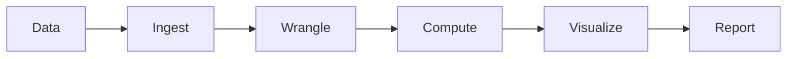

นำข้อมูลเข้า ทำความสะอาดและจัดรูป (Wrangle) คำนวณหรือสร้างโมเดล แสดงผล แล้วออกรายงาน แบบนี้ใช้ได้เมื่อข้อมูลมีขนาดที่คนจัดการทัน เมื่อข้อมูลใหญ่ขึ้น เร็วขึ้น และหลากหลายขึ้น ทุกขั้นที่รอคนลงมือกลายเป็นคอขวด เช่น ข้อมูลเข้ามาทุกนาทีแต่คนทำรายงานได้วันละครั้ง จึงต้องมีเครื่องมือที่หา insight หรือรูปแบบในข้อมูลได้เองโดยไม่ต้องให้คนลงมือทุกรอบ

**Big Data Pipeline (Big Data Workflow)** ปรับ pipeline เดิมให้ทำงานอัตโนมัติและวนซ้ำ (iterative) มีสี่ระยะ และมีเส้นวนจาก insight กลับไปปรับโมเดลแล้วป้อนเข้าระยะแรกอีกครั้ง

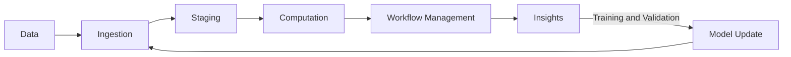

ลองไล่สี่ระยะด้วยระบบพยากรณ์จุดสั่งซื้อ

**Ingestion** คือหาแหล่งข้อมูลแล้วนำเข้าระบบ รวมถึงรับข้อมูลป้อนกลับจากผู้ใช้ที่ใช้ผลของโมเดล เช่น ดึงรายการเบิกจ่ายจาก ERP ทุกชั่วโมง พร้อมบันทึกว่าผู้ซื้อทำตามจุดสั่งซื้อที่ระบบแนะนำหรือไม่

**Staging** คือแปลงข้อมูลให้พร้อมใช้ (normalization, standardization) แล้วเก็บไว้ให้พร้อมประมวลผล เช่น แปลงหน่วยกล่อง แพ็ก ชิ้น ให้เป็นหน่วยฐานเดียวกัน

**Computation** คือรัน machine learning เพื่อให้ได้ insight หรือโมเดล เช่น ฝึกโมเดลพยากรณ์ความต้องการรายสินค้า

**Workflow Management** คือทำให้ทุกขั้นข้างต้นรันได้เองในระบบงานจริงผ่าน abstraction (ซ่อนรายละเอียดทางเทคนิคไว้หลังขั้นตอนที่เรียกใช้ง่าย), orchestration (กำหนดลำดับและเงื่อนไขของแต่ละขั้น) และ automation (รันเองตามตารางเวลา) เช่น ตั้งให้ขั้นดึงข้อมูล แปลง และพยากรณ์ รันต่อกันเองทุกคืน

---

## Part 2 สถาปัตยกรรมข้อมูล: Lambda Architecture และ Data Lake

### 2.1 Lambda Architecture

การประมวลผลข้อมูลมีสองวิธี **Batch processing** สะสมข้อมูลไว้ก่อนแล้วประมวลผลทั้งก้อนในรอบเดียว เช่น รันทุกเที่ยงคืน เห็นข้อมูลครบจึงได้ผลถูกต้อง แต่ต้องรอถึงรอบถัดไปจึงเห็นผล **Stream processing** ประมวลผลข้อมูลทีละรายการทันทีที่เข้ามา ได้ผลแทบทันที แต่ในแต่ละขณะเห็นเฉพาะข้อมูลที่เพิ่งเข้ามา เวลาตั้งแต่ข้อมูลเกิดจนได้ผลเรียกว่า **latency** batch มี latency ระดับนาทีถึงชั่วโมง stream มี latency ระดับวินาที

ผู้บริหารมักต้องการทั้งรายงานย้อนหลังทั้งปีที่ถูกต้อง และตัวเลข "ยอดเบิกยาวันนี้ถึงตอนนี้" ระบบ batch ที่รันทุกเที่ยงคืนตอบคำถามที่สองไม่ทัน ส่วนระบบ stream ไม่เหมาะกับการคำนวณย้อนหลังทั้งปี **Lambda Architecture** แก้ด้วยการรัน batch processing และ stream processing ควบคู่กันบนข้อมูลชุดเดียวกัน แล้วรวมผลทั้งสองตอนผู้ใช้เรียกดู ข้อมูลทุกชิ้นที่เข้ามาจึงถูกส่งไปสองทางพร้อมกัน

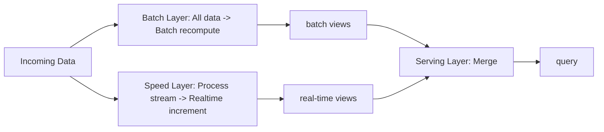

ผลของแต่ละทางเก็บเป็น **view** คือตารางผลลัพธ์ที่คำนวณไว้แล้วพร้อมให้อ่าน

**Batch layer** ถือ master raw dataset คือข้อมูลดิบทั้งหมดทั้งอดีตและล่าสุด เก็บแบบ **immutable** คือเพิ่มข้อมูลใหม่ได้อย่างเดียว ข้อมูลที่บันทึกแล้วไม่ถูกแก้ จากข้อมูลดิบนี้ batch layer คำนวณ batch view ไว้ล่วงหน้าเป็นรอบๆ เช่น ยอดรวมและตัวชี้วัดทางธุรกิจ ถ้าการคำนวณรอบใดผิด ก็คำนวณใหม่ทั้งหมดจากข้อมูลดิบได้ เพราะข้อมูลดิบยังอยู่ครบ ชั้นนี้จึงให้ความถูกต้อง

**Speed layer** ถือเฉพาะข้อมูลที่เข้ามาหลังรอบ batch ล่าสุด และประมวลผล stream ทีละส่วน (incremental) เพื่อให้ real-time view ที่มี latency ต่ำ ชั้นนี้จึงให้ความสดใหม่ ถ้าชั้นนี้ล่ม ผู้ใช้จะดูข้อมูลล่าสุดไม่ได้ชั่วคราว แต่ข้อมูลยังอยู่ใน batch layer และรอบ batch ถัดไปจะครอบคลุมช่วงนั้น

**Serving layer** เป็นจุดเดียวที่ผู้ใช้ติดต่อ ถือทั้ง batch view และ real-time view แล้วรวมผลเพื่อตอบ query ทำหน้าที่เป็นชั้น dashboard และรายงาน

ตัวอย่างยอดเบิกยาสะสม batch layer รันทุกคืนเวลา 02:00 ได้ batch view ยอดสะสมถึงสิ้นวันก่อนหน้า 1,250,000 หน่วย ตั้งแต่เที่ยงคืนถึง 14:00 มีรายการเบิกเข้ามา 3,400 หน่วย speed layer บวกสะสมไว้ใน real-time view เมื่อผู้ใช้เปิด dashboard เวลา 14:00 serving layer ตอบ 1,250,000 + 3,400 = 1,253,400 หน่วย คืนถัดไป batch layer คำนวณใหม่จากข้อมูลดิบซึ่งรวมรายการของวันนี้แล้ว real-time view ของวันนี้จึงทิ้งได้ และถ้าระหว่างวัน speed layer นับตกไปบางรายการ ตัวเลขจะถูกต้องเองเมื่อ batch รอบถัดไปเสร็จ

ในระบบ Hadoop ข้อมูลจากระบบต้นทาง (ฐานข้อมูล log ไฟล์) ถูกดึงด้วย Sqoop หรือ Flume ไปพักในคิวกลางอย่าง Kafka แล้วแยกสองทาง batch layer ใช้ HDFS, MapReduce, Hive, Pig โดยมี Oozie คุมลำดับงาน speed layer ใช้ Spark Streaming หรือ Flink ส่วน serving layer ให้ผู้ใช้ query ผ่าน Hive, Impala หรือบริการเว็บ ข้อมูลถาวรเก็บใน HDFS และ HBase

สิ่งที่ต้องแลกกับ Lambda คือทีมต้องเขียนและดูแลตรรกะเดียวกันสองชุด ชุดหนึ่งสำหรับ batch อีกชุดสำหรับ stream และต้องให้ผลตรงกันเสมอ เมื่อกฎธุรกิจเปลี่ยนต้องแก้ทั้งสองที่ ([StreamSets](https://streamsets.com/?p=16819))

### 2.2 Data Lake

**Data warehouse** คือฐานข้อมูลกลางสำหรับการวิเคราะห์ ที่รวมข้อมูลจากหลายระบบมาจัดเป็นตารางตาม schema ที่ออกแบบไว้ การสร้าง warehouse ต้องตกลงก่อนว่าจะใช้ข้อมูลทำอะไร แล้วแปลงข้อมูลให้เข้า schema ก่อนโหลด ข้อมูลที่ยังไม่รู้ว่าจะใช้ทำอะไร หรือรูปแบบไม่เข้ากับตาราง เช่น ภาพ PDF log ดิบ จึงไม่ถูกเก็บ

**Data lake** คือที่เก็บข้อมูลกลางแห่งเดียวที่เก็บข้อมูลในรูปแบบดั้งเดิมตามที่มาจากต้นทาง ทั้ง structured (ตารางจากฐานข้อมูล), semi-structured (CSV, log, XML, JSON), unstructured (อีเมล PDF) และ binary (รูปภาพ เสียง วิดีโอ) ([Wikipedia: Data lake](https://en.wikipedia.org/wiki/Data_lake)) data lake สร้างบนที่เก็บข้อมูลแบบกระจาย เช่น HDFS, Amazon S3, Azure Data Lake

ความต่างหลักอยู่ที่ลำดับของสามขั้น Extract (ดึงจากต้นทาง), Transform (แปลง) และ Load (โหลดเข้าที่เก็บ)

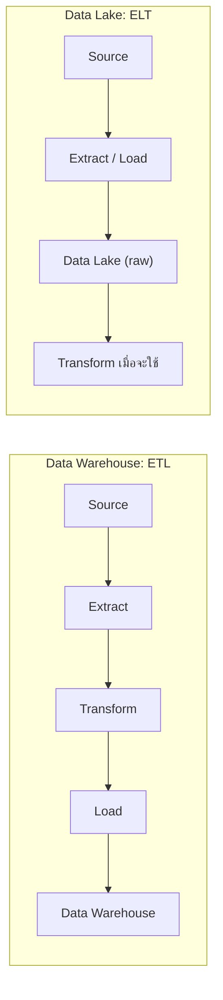

Data warehouse ใช้ **ETL** แปลงข้อมูลก่อนโหลด วิธีนี้เรียกว่า **schema-on-write** คือกำหนด schema ก่อนแล้วเขียนข้อมูลให้ตรงกับ schema query จึงเร็วและคุณภาพข้อมูลสม่ำเสมอ เหมาะกับรายงาน BI ที่นิยามตัวชี้วัดไว้ชัดแล้ว Data lake ใช้ **ELT** โหลดข้อมูลตามสภาพที่มาก่อน แล้วแปลงตอนดึงไปใช้ วิธีนี้เรียกว่า **schema-on-read** คือตีความโครงสร้างตอนอ่าน จึงเก็บข้อมูลไว้ได้ก่อนรู้ว่าจะใช้ทำอะไร และย้อนกลับไปคำนวณใหม่จากข้อมูลดิบได้เสมอ

ในองค์กรจริงสองแบบนี้ใช้ต่อกัน

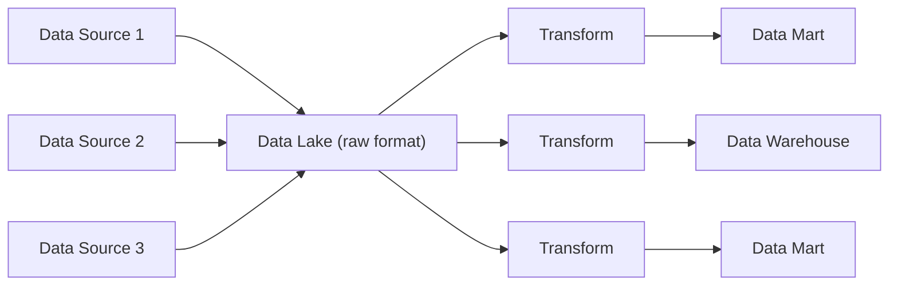

ข้อมูลจากหลายแหล่งไหลเข้า data lake ในรูปดิบ จากนั้นถูกดึงออกไปแปลงด้วยกระบวนการ ETL (เช่น ใช้ Hive หรือ HBase) หลายสายตามความต้องการของผู้ใช้แต่ละกลุ่ม ได้เป็น data warehouse หรือ **data mart** คือ warehouse ขนาดเล็กเฉพาะหน่วยงานหรือเรื่องใดเรื่องหนึ่ง เช่น data mart ของฝ่ายจัดซื้อ ให้เครื่องมือวิเคราะห์ใช้ต่อ

---

## Part 3 Hadoop: HDFS และ YARN

### 3.1 Hadoop และความต้องการของระบบกระจาย

**Hadoop** คือ framework โอเพนซอร์สของ Apache สำหรับเก็บและประมวลผลข้อมูลขนาดใหญ่บน cluster สร้างขึ้นจากแนวคิดในบทความวิจัยของ Google สองชิ้น คือ The Google File System (2003) และ MapReduce (2004) ([BigDATAwire](https://www.bigdatawire.com/2016/01/28/happy-birthday-hadoop-celebrating-10-years-of-improbable-growth/)) Hadoop กระจายงานคำนวณที่ใช้ข้อมูลมหาศาลไปให้เครื่องจำนวนมาก แต่ละเครื่องทำงานกับข้อมูลชิ้นที่อยู่ในเครื่องตัวเองพร้อมกัน งานทั้งหมดจึงเสร็จเร็วขึ้น การทำแบบนี้ต้องมีอัลกอริทึมที่แบ่งงานเป็นชิ้นได้ เครื่องจำนวนมากใน cluster และเครือข่ายที่เชื่อมเครื่องเหล่านั้น Hadoop จัดการทรัพยากร (ดิสก์ หน่วยความจำ CPU) ของทั้ง cluster ให้โปรแกรมอื่นใช้ จึงถูกเรียกว่า Operating System for Big Data

**ระบบกระจาย (distributed system)** คือระบบที่ข้อมูลหรืองานกระจายอยู่หลายเครื่องแต่ผู้ใช้เห็นเป็นระบบเดียว Hadoop ออกแบบให้ตอบความต้องการสี่ข้อของระบบแบบนี้

**Fault tolerance** คือเมื่อส่วนประกอบหนึ่งล้ม ระบบทั้งหมดยังทำงานต่อได้ โดยลดระดับลงเป็นสถานะที่ช้าลงแต่ยังใช้ได้ (graceful degradation) และเมื่อส่วนที่ล้มกลับมาได้ ก็กลับเข้าระบบได้อีก

**Recoverability** คือเมื่อเกิดความล้มเหลว ข้อมูลต้องไม่หาย

**Consistency** คือแม้งานย่อยชิ้นหนึ่งล้มระหว่างทาง ผลลัพธ์สุดท้ายยังถูกต้องเหมือนไม่มีอะไรล้ม

**Scalability** มีสองด้าน เมื่อภาระเพิ่ม (ข้อมูลมากขึ้น คำนวณมากขึ้น) ระบบแค่ช้าลงแต่ไม่ล้ม และเมื่อเพิ่มทรัพยากร ประสิทธิภาพเพิ่มตามสัดส่วน เช่น เพิ่มเครื่องเป็น 2 เท่า ควรเร็วขึ้นราว 2 เท่า

Hadoop ใช้แนวคิดแปดข้อเพื่อให้ได้สี่ข้อนี้ ศัพท์ที่ต้องใช้คือ **block** ชิ้นส่วนขนาดคงที่ที่ไฟล์ถูกตัดแบ่ง, **job** งานคำนวณทั้งก้อนที่ผู้ใช้ส่งเข้าระบบ เช่น นับการเบิกยาแต่ละรายการทั้งปี และ **task** ชิ้นย่อยของ job ที่เครื่องหนึ่งรับไปทำ

1. ข้อมูลถูกกระจายไปเก็บหลายเครื่องทันทีที่เพิ่มเข้า cluster เครื่องใดพังข้อมูลก็ยังอยู่ (Recoverability, Fault tolerance)
2. เครื่องเลือกประมวลผลข้อมูลที่อยู่ในเครื่องตัวเอง เรียกว่า **data locality** เพราะการส่งโปรแกรมขนาดเล็กไปหาข้อมูลประหยัดกว่าย้ายข้อมูลขนาดใหญ่ข้ามเครือข่าย (Scalability)
3. ข้อมูลเก็บเป็น block ขนาดคงที่ ปกติ 128 MB ใน Hadoop 2 แต่ละ block ถูกทำสำเนาไว้หลายเครื่อง ใน Hadoop 3 เลือกป้องกันกลุ่มของ block ด้วย parity block (erasure coding) ได้ (Recoverability)
4. job ถูกแบ่งเป็น task ให้แต่ละเครื่องทำกับ block หนึ่ง จำนวน task จึงเพิ่มตามจำนวน block และทุก task ทำพร้อมกันได้ (Scalability)
5. ผู้ใช้เขียน job ในระดับสูง ระบบจัดการเรื่องเครือข่ายและการสื่อสารระหว่างเครื่องให้
6. ลดการรับส่งข้อมูลระหว่างเครื่อง และแต่ละ task ทำงานอิสระ ไม่ต้องคุยกับ task อื่นระหว่างประมวลผล จึงไม่เกิด **deadlock** (task สองตัวรอกันและกันจนไม่มีใครทำต่อได้) (Scalability, Consistency)
7. job ทนความล้มเหลวด้วยการรัน task ซ้ำ (task redundancy) task ที่ล้มจะถูกรันใหม่บนเครื่องอื่น (Fault tolerance, Consistency)
8. โปรแกรมควบคุมกลาง (master) แจกงานให้เครื่องทำงาน (worker) หลายเครื่องทำพร้อมกัน แต่ละเครื่องทำกับข้อมูลส่วนของตัวเอง (Scalability)

ข้อ 6 กับข้อ 7 ทำงานคู่กัน เพราะ task อิสระต่อกัน เมื่อ task หนึ่งล้ม ระบบรัน task นั้นใหม่บนเครื่องอื่นด้วยข้อมูลชุดเดิมได้ผลเท่าเดิม ผลลัพธ์รวมจึงยังถูกต้อง

### 3.2 สถาปัตยกรรม Hadoop

Hadoop มีสองส่วนหลัก **HDFS (Hadoop Distributed File System)** เป็นระบบไฟล์กระจาย ดูแลข้อมูลบนดิสก์และการเข้าถึงข้อมูลทั่ว cluster **YARN (Yet Another Resource Negotiator)** เป็นผู้จัดการทรัพยากรของ cluster แบ่ง CPU และหน่วยความจำบน worker node ให้โปรแกรมที่ขอใช้

สองส่วนนี้ทำงานประสานกันเพื่อลดการรับส่งข้อมูลบนเครือข่าย HDFS รู้ว่าแต่ละ block อยู่เครื่องไหน และ YARN ใช้ข้อมูลนั้นวาง task ไว้บนเครื่องที่มี block ที่ task ต้องใช้ HDFS ทำสำเนา block ไว้หลายเครื่องเพื่อให้ทนความล้มเหลวและกู้คืนได้ และ Hadoop ใช้ **speculative execution** คือเมื่อ task ใดไม่คืบหน้า (เช่น เครื่องนั้นดิสก์เริ่มเสื่อม) ระบบเปิด task ซ้ำบนเครื่องอื่น ตัวไหนเสร็จก่อนใช้ผลตัวนั้น แล้วยกเลิกตัวที่เหลือ เครื่องช้าเครื่องเดียวจึงไม่ถ่วงทั้ง job

ทั้ง HDFS และ YARN ทำงานผ่าน **daemon** คือโปรแกรมที่รันค้างอยู่เบื้องหลังตลอดเวลา รับคำขอและส่งผลตอบกลับทางเครือข่าย เครื่องแต่ละเครื่องมีบทบาทตาม daemon ที่รันอยู่ **Master node** รัน daemon ที่ประสานงานและมักเป็นจุดที่ผู้ใช้เข้าถึง cluster **Worker node** รัน daemon ที่รับงานจาก master มาทำ เช่น เก็บและส่งข้อมูล หรือรันโปรแกรม

ฝั่ง HDFS มี master คือ NameNode และ Secondary NameNode และ worker คือ DataNode ฝั่ง YARN มี master คือ ResourceManager และ ApplicationMaster (หนึ่งตัวต่อโปรแกรม) และ worker คือ NodeManager worker node หนึ่งเครื่องมักรันทั้ง DataNode และ NodeManager task ที่ YARN วางบนเครื่องนั้นจึงอ่าน block จาก DataNode บนเครื่องเดียวกันได้โดยตรง นี่คือ data locality ในทางปฏิบัติ

### 3.3 HDFS

HDFS เป็นชั้นซอฟต์แวร์ที่ทำงานอยู่บนระบบไฟล์ปกติของแต่ละเครื่อง แต่ละ DataNode เก็บ block เป็นไฟล์ธรรมดาในดิสก์ของตัวเอง ส่วนการรู้ว่า block ไหนเป็นของไฟล์ใดเป็นหน้าที่ของ NameNode ([HDFS Architecture](https://hadoop.apache.org/docs/r2.8.5/hadoop-project-dist/hadoop-hdfs/HdfsDesign.html))

HDFS ทำงานดีที่สุดกับไฟล์ขนาดใหญ่จำนวนไม่มาก เพราะ NameNode เก็บรายละเอียดของทุกไฟล์และทุก block ไว้ในหน่วยความจำ ไฟล์เล็กจำนวนมหาศาลจะใช้หน่วยความจำของ NameNode จนเต็มก่อนดิสก์ของ cluster จะเต็ม HDFS ใช้รูปแบบ **WORM (Write Once, Read Many)** ไฟล์ที่เขียนเสร็จแล้วแก้ข้อมูลกลางไฟล์ไม่ได้ (no random writes) ทำได้เพียงต่อท้ายไฟล์ HDFS จึงเหมาะกับงานอ่านข้อมูลก้อนใหญ่เพื่อวิเคราะห์ ส่วนงานที่แก้ไขรายเรคคอร์ดตลอดเวลา เช่น ระบบบันทึกการขาย เหมาะกับฐานข้อมูลอย่าง SQL Server

ไฟล์ถูกตัดเป็น block ขนาด 128 MB (Hadoop 1 ใช้ 64 MB) ทุก block มีขนาดเท่ากัน ยกเว้น block สุดท้ายที่มีขนาดเท่าข้อมูลที่เหลือ block size คือปริมาณข้อมูลน้อยที่สุดที่ระบบอ่านหรือเขียนเป็นหน่วย และเป็นหน่วยเดียวกันที่ใช้กระจาย ทำสำเนา และแบ่งงาน จำนวนสำเนาของแต่ละ block เรียกว่า **replication factor** ค่าเริ่มต้นคือ 3

ลองอัปโหลดไฟล์ `sales.csv` ขนาด 300 MB เข้า cluster ที่ block size 128 MB และ replication factor 3 ไฟล์ถูกตัดเป็น 300 / 128 = 2 เศษ 44 คือ 3 block ได้แก่ 128 MB, 128 MB และ 44 MB แต่ละ block มี 3 สำเนาบนคนละเครื่อง รวม 9 สำเนา ใช้ดิสก์ 300 x 3 = 900 MB ถ้า DataNode เครื่องหนึ่งพัง ทุก block ยังเหลือสำเนาอย่างน้อย 2 ชุด เมื่อรัน MapReduce บนไฟล์นี้ ระบบตัดข้อมูลเข้าเป็นชิ้นละหนึ่ง block (เรียกว่า input split) จึงได้ map task 3 ตัว แต่ละตัววางบนเครื่องใดก็ได้ที่มีสำเนาของ block นั้น

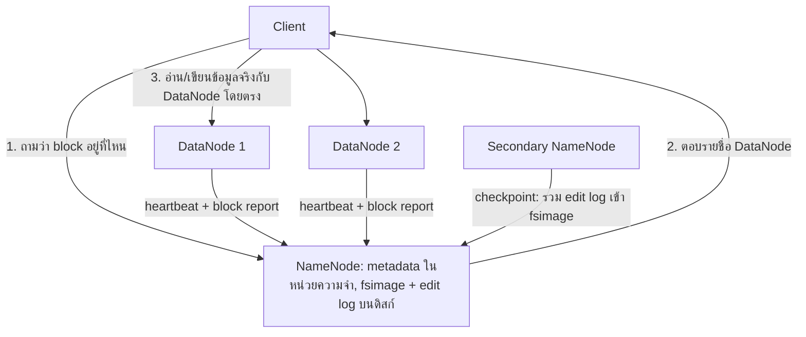

**client** คือโปรแกรมหรือผู้ใช้ที่ต้องการอ่านหรือเขียนไฟล์ client ถาม NameNode เพียงว่าข้อมูลอยู่ที่ไหน แล้วรับส่งข้อมูลจริงกับ DataNode โดยตรง NameNode จึงรับภาระแค่คำถามเล็กๆ และไม่เป็นคอขวดของความเร็ว

**NameNode** (master) เก็บ **metadata** คือข้อมูลที่อธิบายข้อมูล ได้แก่ โครงสร้างโฟลเดอร์ (directory tree) ชื่อไฟล์ สิทธิ์ จำนวนสำเนา และตำแหน่งของทุก block ใน cluster metadata ทั้งหมดถูกโหลดไว้ในหน่วยความจำเพื่อให้ค้นได้เร็ว ไม่มี NameNode ก็ประกอบ block ที่กระจายอยู่หลายเครื่องกลับเป็นไฟล์ไม่ได้ ใน cluster ที่มี NameNode ตัวเดียว ถ้า NameNode ล้มทั้งระบบไฟล์หยุดใช้งาน แม้ข้อมูลทั้งหมดยังอยู่ครบบน DataNode

หน่วยความจำหายเมื่อปิดเครื่อง NameNode จึงบันทึก metadata ลงดิสก์ด้วยสองไฟล์ **fsimage** คือภาพรวม (snapshot) ของ metadata ทั้งระบบไฟล์ ณ ตอนที่ NameNode เริ่มทำงาน **edit log** คือรายการการเปลี่ยนแปลงทุกครั้งหลังจากนั้นตามลำดับ เช่น สร้างไฟล์ ลบไฟล์ เปลี่ยนจำนวนสำเนา fsimage มีขนาดใหญ่ การเขียนใหม่ทั้งไฟล์ทุกครั้งที่มีการเปลี่ยนแปลงจะช้ามาก ส่วนการต่อท้าย edit log ทีละรายการทำได้เร็ว metadata ปัจจุบันจึงได้จาก fsimage บวกการเปลี่ยนแปลงทั้งหมดใน edit log การนำ edit log มารวมเข้า fsimage เป็นรอบๆ เรียกว่า **checkpoint**

**Secondary NameNode** (master) ทำ checkpoint แทน NameNode เป็นระยะ ถ้าไม่มีใครทำ edit log จะยาวขึ้นเรื่อยๆ และการเริ่ม NameNode ใหม่แต่ละครั้งต้องไล่ทำตามรายการเปลี่ยนแปลงหลายล้านรายการ Secondary NameNode อ่าน edit log ของ NameNode นำการเปลี่ยนแปลงไปใส่ในสำเนา fsimage ของตัวเอง ส่ง fsimage ใหม่กลับไปให้ NameNode แล้วล้าง edit log Secondary NameNode ทำหน้าที่ checkpoint อย่างเดียว ไม่ได้รับคำขอจาก client และไม่ได้ขึ้นมาทำงานแทน NameNode

**DataNode** (worker) เก็บและดูแล block บนดิสก์ในเครื่องตัวเอง ให้บริการอ่านเขียนแก่ client และสร้าง ลบ หรือทำสำเนา block ตามคำสั่งของ NameNode DataNode ส่ง **heartbeat** (สัญญาณสั้นๆ ที่ส่งเป็นระยะ บอกว่ายังทำงานอยู่) และ **block report** (รายการ block ทั้งหมดที่เก็บ) ไปให้ NameNode เมื่อ heartbeat ของเครื่องใดขาดหายนาน NameNode ตัดสินว่าเครื่องนั้นตาย หยุดส่งงานไปเครื่องนั้น และสั่งให้เครื่องที่ยังมีสำเนาทำสำเนาเพิ่ม จนทุก block กลับมามีสำเนาครบ

การป้องกันข้อมูลใน HDFS มีสองวิธี **Replication** ทำสำเนาแต่ละ block ไว้ 3 ชุดบนคนละเครื่อง ข้อมูล 6 หน่วยจึงใช้พื้นที่ 18 หน่วย พื้นที่ส่วนเกิน 200% ทนการเสียหายพร้อมกันได้ 2 จาก 3 สำเนา **Erasure coding** ซึ่งเพิ่มเข้ามาใน Hadoop 3 รวม block ข้อมูลเป็นกลุ่ม แล้วคำนวณ **parity block** (block ที่คำนวณจากข้อมูลในกลุ่ม ใช้คำนวณย้อนกลับหา block ที่หายไป) เก็บไว้ด้วย policy ค่าเริ่มต้นคือ RS-6-3 (ข้อมูล 6 ส่วน parity 3 ส่วน) ข้อมูล 6 หน่วยใช้พื้นที่ 6 + 3 = 9 หน่วย พื้นที่ส่วนเกิน 50% ทนการเสียหายพร้อมกันได้ 3 จาก 9 ส่วน แลกกับการใช้ CPU และเครือข่ายเพิ่มตอนเขียนและตอนกู้ข้อมูล ([HDFS Erasure Coding](https://hadoop.apache.org/docs/r3.4.0/hadoop-project-dist/hadoop-hdfs/HDFSErasureCoding.html)) ใน Hadoop 3 ค่าเริ่มต้นยังเป็น replication 3 สำเนา และผู้ดูแลระบบเปิดใช้ erasure coding เป็นรายโฟลเดอร์

ผู้ใช้ติดต่อกับ HDFS ได้สามทาง คือ Command Line Interface (CLI) ด้วยคำสั่ง `hadoop fs`, HTTP interface ผ่าน web browser และ API ที่เขียนด้วยภาษา Java ตัวอย่าง CLI ต่อไปนี้ใช้ผู้ใช้ `cloudera` ซึ่ง home directory ใน HDFS คือ `/user/cloudera`

```bash
hadoop fs -put x.txt /user/cloudera/y.txt
hadoop fs -get /user/cloudera/y.txt x.txt
hadoop fs -mkdir -p /user/cloudera/corpora
hadoop fs -ls /user/cloudera
hadoop fs -mv /user/cloudera/x.txt /user/cloudera/rawdata
hadoop fs -cp /user/cloudera/x.txt y.txt
hadoop fs -rm /user/cloudera/x.txt
hadoop fs -chmod 664 /user/cloudera/x.txt
```

`-put` อัปโหลดไฟล์ `x.txt` จากเครื่องเราขึ้น HDFS ในชื่อ `y.txt` (path แรกอยู่บนเครื่องเรา path ที่สองอยู่ใน HDFS) `-get` ทำกลับทิศ คือดาวน์โหลดจาก HDFS ลงเครื่องเรา คำสั่งที่เหลือทำงานภายใน HDFS ทั้งหมด `-mkdir -p` สร้างโฟลเดอร์พร้อมโฟลเดอร์ชั้นบนที่ยังไม่มี `-ls` แสดงรายการไฟล์ในโฟลเดอร์ `-mv` ย้ายหรือเปลี่ยนชื่อไฟล์ (ถ้า `rawdata` เป็นโฟลเดอร์ที่มีอยู่ ไฟล์จะย้ายเข้าไป ถ้ายังไม่มี ไฟล์จะเปลี่ยนชื่อเป็น `rawdata`) `-cp` คัดลอกไฟล์ ปลายทาง `y.txt` ไม่ได้ขึ้นต้นด้วย `/` จึงนับจาก home directory ได้เป็น `/user/cloudera/y.txt` และ `-rm` ลบไฟล์

`-chmod 664` ตั้งสิทธิ์ของไฟล์เป็น `-rw-rw-r--` สิทธิ์มีสามชนิด อ่าน (read) = 4, เขียน (write) = 2, รัน (execute) = 1 แต่ละหลักคือผลรวมของสิทธิ์ที่ให้ หลักแรกเป็นของเจ้าของไฟล์ 6 = 4 + 2 คืออ่านและเขียน (`rw-`) หลักที่สองเป็นของกลุ่ม 6 คืออ่านและเขียน (`rw-`) หลักที่สามเป็นของผู้ใช้อื่น 4 คืออ่านอย่างเดียว (`r--`) ขีดตัวแรกหมายถึงเป็นไฟล์ธรรมดา

### 3.4 YARN

ใน Hadoop 1 MapReduce ทำทั้งการจัดสรรทรัพยากรของ cluster และการควบคุมทุก job ด้วย daemon ตัวเดียว cluster จึงรันได้เฉพาะงาน MapReduce YARN แยกสองหน้าที่นี้ไว้ใน daemon คนละตัว cluster เดียวจึงรันงานได้หลายแบบ ทั้ง MapReduce, Spark และอื่นๆ ([Apache Hadoop YARN](https://hadoop.apache.org/docs/current/hadoop-yarn/hadoop-yarn-site/YARN.html)) หน่วยการจัดสรรทรัพยากรของ YARN คือ **container** หนึ่ง container คือสิทธิ์ใช้ CPU และหน่วยความจำจำนวนหนึ่งบนเครื่องหนึ่ง เช่น 1 แกน CPU กับ 2 GB งานจริงทุกชิ้นรันอยู่ใน container

**ResourceManager** (master) มีหนึ่งตัวต่อ cluster จัดสรรและติดตามทรัพยากรที่ว่างของทั้ง cluster (หน่วยความจำ แกน CPU) ให้แอปพลิเคชัน และจัดตารางว่า job ไหนได้รันเมื่อไร

**ApplicationMaster** (master) มีหนึ่งตัวต่อหนึ่งแอปพลิเคชัน เช่น MapReduce job หนึ่ง job ถูกสร้างขึ้นพร้อมแอปและหายไปเมื่อแอปจบ ทำหน้าที่ประสานงานแอปของตัวเองตั้งแต่ต้นจนจบ คือขอ container จาก ResourceManager สั่ง NodeManager ให้รันงานใน container เหล่านั้น ติดตามความคืบหน้า และสั่งรันใหม่เมื่องานชิ้นใดล้ม

**NodeManager** (worker) มีหนึ่งตัวต่อ worker node รันและดูแล container บนเครื่องของตัวเอง และรายงานสุขภาพของเครื่องและสถานะงานกลับไปยัง ResourceManager

ลำดับเหตุการณ์เมื่อส่ง MapReduce job หนึ่ง job เรียงจากบนลงล่างตามเวลา

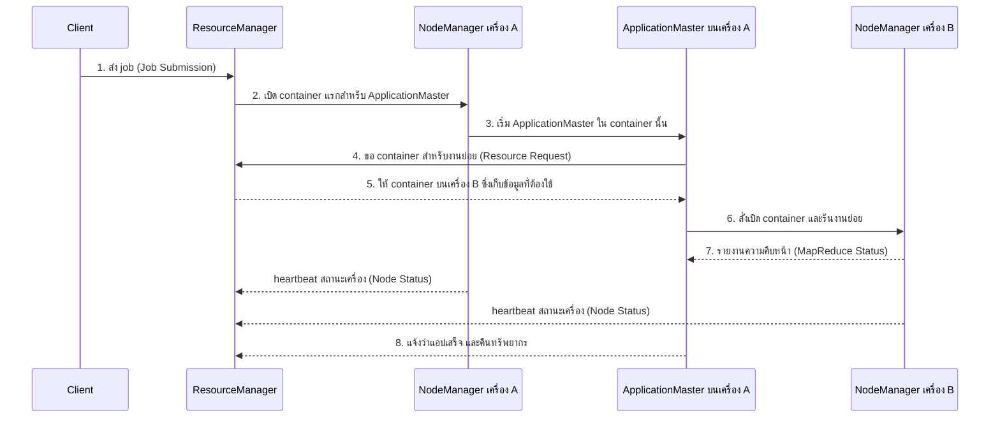

เมื่องานใน container ล้ม ApplicationMaster ขอ container ใหม่แล้วรันงานนั้นซ้ำ เมื่อ heartbeat ของ NodeManager ขาด ResourceManager หยุดจัดสรรงานไปเครื่องนั้น และ ApplicationMaster รันงานที่อยู่บนเครื่องนั้นใหม่บนเครื่องอื่น เมื่อ ApplicationMaster เองล้ม ResourceManager เริ่ม ApplicationMaster ตัวใหม่ใน container ใหม่

daemon ระดับ master สำคัญต่อทั้ง cluster จึงควรรันบนเครื่องของตัวเอง ไม่แย่งทรัพยากรกับงานอื่นจนเป็นคอขวด สำหรับ cluster ขนาดเล็ก master node สองเครื่องก็เพียงพอ

### 3.5 Hadoop Ecosystem

Hadoop เติบโตเป็นกลุ่มเครื่องมือที่รันบน HDFS และ YARN แต่ละตัวทำหน้าที่ในระยะต่างๆ ของ Big Data Pipeline

ระยะนำข้อมูลเข้ามี Sqoop ย้ายข้อมูลระหว่างฐานข้อมูลแบบตารางกับ HDFS ทั้งเข้าและออก, Flume รวบรวม log และข้อมูลที่ไหลเข้ามาต่อเนื่องส่งเข้า HDFS และ Kafka ระบบคิวข้อความที่รับข้อความจากผู้ส่งจำนวนมากแล้วให้ผู้รับหลายรายดึงไปใช้

ระยะจัดการข้อมูลมี HBase ฐานข้อมูล NoSQL บน HDFS ที่ค้นและแก้ข้อมูลรายแถวด้วย key ได้เร็ว และ Hive ซึ่งเป็น data warehouse บน Hadoop ให้ query ข้อมูลใน HDFS ด้วยภาษาคล้าย SQL

ระยะวิเคราะห์มี Pig (ภาษาสคริปต์ที่ระบบแปลงเป็นงาน MapReduce), Spark MLlib และ Mahout (machine learning) และ Spark GraphX (วิเคราะห์กราฟ)

ระยะจัดการ workflow มี Oozie (Part 5)

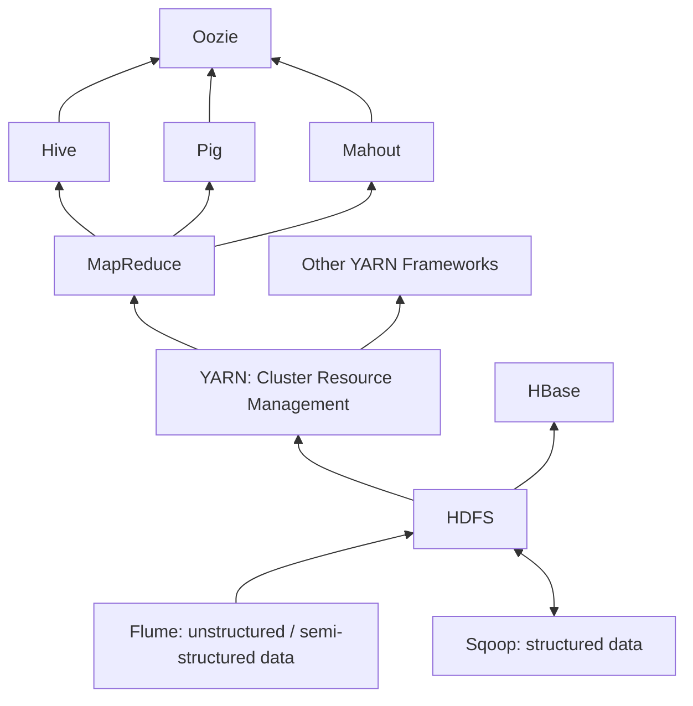

แผนภาพเรียงจากล่างขึ้นบน ข้อมูลเข้าทาง Flume และ Sqoop ไปเก็บใน HDFS YARN จัดสรรทรัพยากรให้ MapReduce และ framework อื่น เครื่องมือระดับสูงอย่าง Hive, Pig, Mahout แปลงคำสั่งของผู้ใช้เป็นงาน MapReduce และ Oozie อยู่บนสุดเพื่อร้อยงานเป็นลำดับ HBase ใช้ HDFS เป็นที่เก็บโดยตรง ปัจจุบัน Sqoop (ปี 2021) และ Oozie (ปี 2025) ยุติการพัฒนาแล้ว ([Apache Attic](https://attic.apache.org/projects/sqoop.html)) แต่ยังพบได้ในระบบ Hadoop เดิมขององค์กร

---

## Part 4 MapReduce

### 4.1 แนวคิด

HDFS ทำให้ข้อมูลกระจายอยู่หลายเครื่องแล้ว คำถามต่อไปคือ ถ้าต้องการนับว่าแต่ละคำปรากฏกี่ครั้งในเอกสารทั้งหมด จะให้ 100 เครื่องช่วยกันนับได้อย่างไร โดยผู้เขียนโปรแกรมไม่ต้องเขียนเองทั้งเรื่องส่งข้อมูลข้ามเครือข่ายและการรับมือเมื่อเครื่องพัง **MapReduce** คือ framework การคำนวณแบบกระจายที่ทนต่อความล้มเหลว ผู้ใช้เขียนงานในรูปแบบตายตัวเพียงสองฟังก์ชัน คือ map และ reduce แล้ว framework จัดการส่วนที่เหลือ

MapReduce ใช้รูปแบบ **functional programming** คือเขียนงานเป็นฟังก์ชันที่รับข้อมูลเข้าแล้วคืนผลออก task อิสระหลายตัวรันฟังก์ชันเดียวกันกับข้อมูลชิ้นที่อยู่ในเครื่องของตัวเอง ข้อมูลส่งต่อระหว่างฟังก์ชันด้วยการนำผลของฟังก์ชันหนึ่งไปเป็นข้อมูลเข้าของอีกฟังก์ชัน และฟังก์ชันไม่เก็บสถานะ (stateless) ผลลัพธ์ขึ้นกับข้อมูลเข้าอย่างเดียว รันซ้ำกี่ครั้งด้วยข้อมูลเดิมก็ได้ผลเดิม ระบบจึงรัน task ที่ล้มซ้ำได้อย่างปลอดภัย

ข้อมูลทุกขั้นของ MapReduce อยู่ในรูป **คู่ key/value** เช่น ('cat', 1) คือ key เป็นคำว่า cat และ value เป็น 1 ระบบใช้ key ตัดสินว่าข้อมูลไหนต้องมารวมกัน

**map** รับข้อมูลเข้าเป็นชุดของคู่ key/value ทำงานกับทีละคู่ และส่งออกคู่ key/value ระหว่างทาง (intermediate) ตั้งแต่ศูนย์คู่ขึ้นไป **reduce** รับ key หนึ่งตัวพร้อมรายการ value ทั้งหมดของ key นั้น แล้วประมวลผลขั้นสุดท้าย ซึ่งมักเป็นการรวมหรือสรุปค่า เช่น หาผลรวม แล้วส่งออกคู่ key/value สุดท้าย

ระหว่าง map กับ reduce framework ทำ **shuffle and sort** โดยมี **partitioner** ตัดสินว่า key แต่ละตัวไป reduce ตัวไหน ส่งข้อมูลข้ามเครือข่ายไปยังเครื่องของ reduce ตัวนั้น แล้วเรียงตาม key และรวม value ของ key เดียวกันเป็นรายการ ระบบรับประกันว่าทุกคู่ที่มี key เดียวกันไปถึง reduce ตัวเดียวกันเสมอ reduce จึงคำนวณผลของ key นั้นได้ครบด้วยตัวเอง

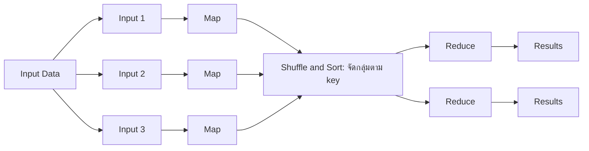

framework อ่านไฟล์จาก HDFS แล้วตัดเป็น input split (ปกติหนึ่ง split ต่อหนึ่ง block) map หลายตัวทำงานพร้อมกัน ผลของ map อาจผ่าน combiner (หัวข้อ 4.5) ก่อนเข้า shuffle and sort จากนั้น reduce หลายตัวทำงานพร้อมกัน และ framework เขียนผลลง HDFS เป็นหนึ่งไฟล์ต่อ reduce หนึ่งตัว ชื่อ `part-00000`, `part-00001` ไปเรื่อยๆ ผู้ใช้เขียนเองเฉพาะ map, combiner และ reduce

### 4.2 ตัวอย่างนับคำ (Word Count)

pseudo code (โค้ดที่เขียนให้อ่านง่าย เน้นตรรกะ ยังรันไม่ได้จริง)

```text
def map(dockey, line):
    for word in line.split():
        emit(word, 1)

def reduce(word, values):
    count = sum(value for value in values)
    emit(word, count)
```

`emit` ส่งคู่ key/value ออกไปยังขั้นถัดไปของ MapReduce map ทำหน้าที่เดียวคือประกาศว่า "เจอคำนี้หนึ่งครั้ง" ทุกครั้งที่เจอ การนับจริงเกิดที่ reduce ซึ่งได้รับเลข 1 ทั้งหมดของคำนั้นจากทุก map มารวมกัน map แต่ละตัวจึงทำงานได้โดยไม่ต้องรู้ว่าตัวอื่นเจออะไร

เมื่ออ่านไฟล์ข้อความ map ได้รับทีละบรรทัด value คือข้อความในบรรทัด ส่วน key คือรหัสระบุตำแหน่งของบรรทัด ซึ่ง map ของการนับคำไม่ได้ใช้ map แต่ละตัวอาจทำงานกับเอกสารทั้งฉบับ หรือกับชิ้นหนึ่งของเอกสารที่ใหญ่มาก ผลของ map มี key เป็นคำและ value เป็นจำนวนเต็ม

ข้อมูลเข้ามีสอง block คือ (27183, "The fast cat wears no hat.") และ (31416, "The cat in the hat ran fast.") ตัวอย่างนี้ให้จุด `.` เป็น token (หน่วยที่ตัดออกมา) ของตัวเอง และนับ "The" กับ "the" เป็นคนละคำ

Map ตัวที่ 1 ส่งออก ('The',1), ('fast',1), ('cat',1), ('wears',1), ('no',1), ('hat',1), ('.',1) และ Map ตัวที่ 2 ส่งออก ('The',1), ('cat',1), ('in',1), ('the',1), ('hat',1), ('ran',1), ('fast',1), ('.',1) จากนั้น shuffle and sort รวมผลจาก map ทุกตัวแล้วเรียงตาม key

```text
('.',     [1, 1])
('The',   [1, 1])
('cat',   [1, 1])
('fast',  [1, 1])
('hat',   [1, 1])
('in',    [1])
('no',    [1])
('ran',   [1])
('the',   [1])
('wears', [1])
```

ผลนี้ถูกแบ่งเป็นชุด แต่ละชุดส่งไป reduce หนึ่งตัว reduce รวมเลข 1 ของแต่ละ key ได้ ('.', 2), ('The', 2), ('cat', 2), ('fast', 2), ('hat', 2), ('in', 1), ('no', 1), ('ran', 1), ('the', 1), ('wears', 1) ผลรวมของทุก key เท่ากับ 15 ตรงกับจำนวน token ของสองประโยค (7 + 8)

### 4.3 Hadoop Streaming: เขียน MapReduce ด้วย Python

MapReduce ดั้งเดิมเขียนด้วยภาษา Java แล้วรวมเป็นไฟล์ JAR (Java Archive) เมื่อส่ง job Hadoop ส่งไฟล์ JAR ไปยังทุกเครื่องที่ต้องรัน map หรือ reduce **Hadoop Streaming** ทำให้ใช้คำสั่ง shell, R หรือ Python เป็น map และ reduce ได้ โดยสื่อสารผ่าน **stdin** (ช่องที่โปรแกรมอ่านข้อมูลเข้า) และ **stdout** (ช่องที่โปรแกรมเขียนผลออก) ซึ่งทุกโปรแกรมบน Linux มีอยู่แล้ว ([Hadoop Streaming](https://hadoop.apache.org/docs/r2.8.5/hadoop-streaming/HadoopStreaming.html))

เมื่อ streaming รัน job map task แต่ละตัวเปิดสคริปต์ที่ผู้ใช้ระบุขึ้นมาเป็นโปรแกรมแยก แปลงข้อมูลเข้าเป็นบรรทัดข้อความแล้วส่งเข้า stdin ของสคริปต์ พร้อมกับเก็บทุกบรรทัดที่สคริปต์เขียนออกทาง stdout แต่ละบรรทัดถูกแปลงเป็นคู่ key/value โดยข้อความก่อน tab ตัวแรกคือ key ส่วนที่เหลือคือ value สคริปต์จึงต้องเขียนผลเป็น `key<TAB>value` หนึ่งคู่ต่อบรรทัด หลัง shuffle and sort แล้ว reduce task เปิดสคริปต์ reducer และส่งคู่ key/value ที่เรียงตาม key แล้วเข้า stdin ในรูปแบบเดียวกัน reducer รวมค่าแล้วเขียนผลออกทาง stdout

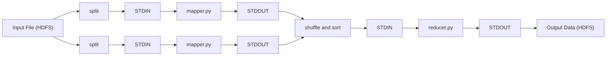

```python
#!/usr/bin/env python3
import sys

if __name__ == '__main__':
    for line in sys.stdin:
        for word in line.split():
            sys.stdout.write('{}\t1\n'.format(word))
```

mapper.py อ่าน stdin ทีละบรรทัด ตัดบรรทัดเป็นคำด้วย `split()` แล้วเขียนหนึ่งบรรทัดต่อคำในรูป `คำ<TAB>1` (`\t` คือ tab และ `\n` คือขึ้นบรรทัดใหม่) บรรทัดแรก `#!/usr/bin/env python3` บอกระบบว่าให้รันไฟล์นี้ด้วย python3 ซึ่งจำเป็นเพราะ Hadoop เรียกไฟล์เป็นโปรแกรมโดยตรง

reducer ของ streaming ได้รับข้อมูลเป็นบรรทัดทีละบรรทัด และ key เดียวกันซ้ำหลายบรรทัด เช่น

```text
cat	1
cat	1
fast	1
```

reducer จึงต้องจำ key ที่กำลังรวมอยู่เอง เมื่อพบบรรทัดที่ key เปลี่ยน แปลว่ากลุ่มเดิมจบแล้ว ส่งผลของกลุ่มนั้นออกได้ วิธีนี้ใช้ได้เพราะข้อมูลเข้า reducer เรียงตาม key แล้ว key เดียวกันจึงอยู่ติดกันเสมอ

```python
#!/usr/bin/env python3
import sys

if __name__ == '__main__':
    curkey = None
    total = 0
    for line in sys.stdin:
        key, val = line.rstrip('\n').split('\t', 1)
        val = int(val)
        if key == curkey:
            total += val
        else:
            if curkey is not None:
                sys.stdout.write('{}\t{}\n'.format(curkey, total))
            curkey = key
            total = val
    if curkey is not None:
        sys.stdout.write('{}\t{}\n'.format(curkey, total))
```

`curkey` เก็บ key ที่กำลังรวมอยู่ (เริ่มต้นเป็น `None` คือยังไม่มี) และ `total` เก็บยอดสะสม แต่ละบรรทัดถูกตัดตัวขึ้นบรรทัดใหม่ท้ายออก แล้วแยกที่ tab ตัวแรกเป็น `key` กับ `val` และแปลง `val` เป็นตัวเลขด้วย `int()` เพราะทุกอย่างที่อ่านจาก stdin เป็นข้อความ ถ้า key เท่ากับ `curkey` ก็บวกสะสม ถ้าไม่เท่า แปลว่ากลุ่มก่อนหน้าจบ จึงเขียนผลของกลุ่มนั้นออก (ถ้ามี) แล้วเริ่มกลุ่มใหม่ด้วย key และค่าปัจจุบัน สองบรรทัดสุดท้ายนอก loop เขียนผลของกลุ่มสุดท้าย เพราะหลังอ่านครบทุกบรรทัด กลุ่มสุดท้ายยังค้างอยู่ใน `curkey` และ `total` โดยไม่มี key ใหม่มากระตุ้นให้เขียน ถ้าขาดบรรทัดนี้ คำสุดท้ายจะหายจากผลลัพธ์

ทดสอบในเครื่องโดยไม่ต้องมี cluster ได้ด้วยคำสั่ง `sort` ของ Linux ซึ่งทำหน้าที่แทน shuffle and sort และ `|` ส่ง stdout ของคำสั่งซ้ายไปเป็น stdin ของคำสั่งขวา

```bash
printf 'The fast cat wears no hat.\nThe cat in the hat ran fast.\n' > input.txt
cat input.txt | python3 mapper.py | LC_ALL=C sort | python3 reducer.py
```

ผลจากการรันจริง

```text
The	2
cat	2
fast	1
fast.	1
hat	1
hat.	1
in	1
no	1
ran	1
the	1
wears	1
```

`split()` ตัดคำด้วยช่องว่างอย่างเดียว เครื่องหมายวรรคตอนจึงติดไปกับคำ "fast." และ "hat." จึงเป็นคนละ key กับ "fast" และ "hat"

คำสั่งส่ง job ขึ้น cluster

```bash
hadoop jar $HADOOP_HOME/share/hadoop/tools/lib/hadoop-streaming-*.jar \
    -files mapper.py,reducer.py,combiner.py \
    -input input.data \
    -output output.data \
    -mapper mapper.py \
    -combiner combiner.py \
    -reducer reducer.py
```

`hadoop jar` รันตัว Hadoop Streaming ซึ่งอยู่ในไฟล์ JAR ที่ระบุ `-files` ส่งไฟล์สคริปต์ไปให้ทุกเครื่องที่รันงาน (Hadoop รุ่นเก่าใช้ `-file` ทีละไฟล์) `-input` คือ path ของข้อมูลเข้าใน HDFS `-output` คือโฟลเดอร์ผลลัพธ์ใน HDFS ซึ่งต้องยังไม่มีอยู่ ระบบตั้งกติกานี้เพื่อไม่ให้เขียนทับผลเดิม `-mapper`, `-combiner` และ `-reducer` บอกสคริปต์ที่ใช้ในแต่ละขั้น ผลลัพธ์อยู่ใน `output.data/part-00000` ดูได้ด้วย `hadoop fs -cat output.data/part-00000`

### 4.4 ตัวอย่างเพื่อนร่วมกัน (Shared Friendship)

โจทย์นี้วิเคราะห์เครือข่ายสังคมเพื่อแนะนำคนที่ผู้ใช้อาจรู้จัก ขั้นพื้นฐานคือหารายชื่อเพื่อนร่วมกันของผู้ใช้ทุกคู่ที่เป็นเพื่อนกัน ข้อมูลเข้ามี key เป็นชื่อผู้ใช้และ value เป็นรายชื่อเพื่อนของผู้ใช้นั้น

เพื่อนร่วมกันของ A กับ B คือคนที่อยู่ทั้งในรายชื่อเพื่อนของ A และของ B (**intersection** ของสองชุด) reduce ตัวหนึ่งจะคำนวณ intersection ได้ ก็ต่อเมื่อได้รับรายชื่อเพื่อนของทั้ง A และ B map จึงส่งรายชื่อเพื่อนทั้งชุดออกไปโดยใช้คู่ชื่อเป็น key รายชื่อของสองคนในคู่เดียวกันจึงไปพบกันที่ reduce ตัวเดียวกัน

```text
def map(person, friends):
    for friend in friends:
        pair = sorted([person, friend])
        emit(pair, friends)

def reduce(pair, friends_lists):
    shared = set(friends_lists[0])
    shared = shared.intersection(friends_lists[1])
    emit(pair, shared)
```

Allen สร้างคู่ (Allen, Betty) ส่วน Betty สร้างคู่ (Betty, Allen) การเรียงชื่อในคู่ด้วย `sorted` ทำให้ทั้งสองฝั่งได้ key เดียวกันคือ (Allen, Betty) หลักที่ได้จากตัวอย่างนี้คือ ออกแบบ key ให้ข้อมูลที่ต้องคำนวณด้วยกันได้ key เดียวกัน

ข้อมูลเข้าห้าบรรทัด หนึ่งบรรทัดต่อ map หนึ่งตัว

```text
Allen: (Betty, Chris, David)
Betty: (Allen, Chris, David, Ellen)
Chris: (Allen, Betty, David, Ellen)
David: (Allen, Betty, Chris, Ellen)
Ellen: (Betty, Chris, David)
```

map แต่ละตัวส่งออกหนึ่งคู่ต่อเพื่อนหนึ่งคน value เป็นรายชื่อเพื่อนทั้งหมดของเจ้าของ map ของ Allen ส่งออก (Allen, Betty), (Allen, Chris), (Allen, David) ทุกคู่มี value (Betty, Chris, David) map ของ Betty ส่งออก (Allen, Betty), (Betty, Chris), (Betty, David), (Betty, Ellen) ทุกคู่มี value (Allen, Chris, David, Ellen) รวมทุก map ได้ 3 + 4 + 4 + 4 + 3 = 18 คู่

ความเป็นเพื่อนในข้อมูลนี้บันทึกไว้ทั้งสองทาง หลัง shuffle and sort ทุก key จึงได้รายชื่อสองชุดพอดี ได้ 18 / 2 = 9 key เช่น (Allen, Betty) ได้ [(Betty, Chris, David), (Allen, Chris, David, Ellen)] reduce หา intersection ของสองชุด ได้ผลลัพธ์

```text
(Allen, Betty) : Chris, David
(Allen, Chris) : Betty, David
(Allen, David) : Betty, Chris
(Betty, Chris) : Allen, David, Ellen
(Betty, David) : Allen, Chris, Ellen
(Betty, Ellen) : Chris, David
(Chris, David) : Allen, Betty, Ellen
(Chris, Ellen) : Betty, David
(David, Ellen) : Betty, Chris
```

บรรทัดแรก เพื่อนของ Allen = {Betty, Chris, David} เพื่อนของ Betty = {Allen, Chris, David, Ellen} คนที่อยู่ทั้งสองชุดคือ {Chris, David} ผลลัพธ์มีเฉพาะคู่ที่เป็นเพื่อนกันอยู่แล้ว เพราะ map สร้าง key จากเจ้าของกับเพื่อนในรายชื่อเท่านั้น

### 4.5 Combiner

map อาจผลิตข้อมูลระหว่างทางจำนวนมากที่ต้องส่งข้ามเครือข่ายไป shuffle, sort แล้วจึง reduce การสื่อสารจึงล่าช้า และ reduce อาจได้ข้อมูลมากเกินกว่าหน่วยความจำจะรับ เช่น ถ้าคำว่า "the" ปรากฏ 50,000 ครั้งใน block หนึ่ง map ตัวนั้นส่ง ('the', 1) ออกไป 50,000 บรรทัด **Combiner** รวมผลย่อยบนเครื่องเดียวกับ map (mapper-local reduction) ก่อนส่งไป shuffle and sort 50,000 บรรทัดจึงเหลือบรรทัดเดียว ('the', 50000)

ตัวอย่างหาผลรวมตามรหัสสนามบิน Map ตัวที่ 1 ส่งออก (IAD, 14.4), (SFO, 3.9), (JFK, 3.9), (IAD, 12.2), (JFK, 5.8) และ Map ตัวที่ 2 ส่งออก (SFO, 4.7), (IAD, 2.3), (SFO, 4.4), (IAD, 1.2) ถ้าไม่มี combiner ต้องส่ง 9 คู่ข้ามเครือข่าย แล้ว reduce รวมได้ IAD = 14.4 + 12.2 + 2.3 + 1.2 = 30.1, JFK = 3.9 + 5.8 = 9.7, SFO = 3.9 + 4.7 + 4.4 = 13.0

ถ้ามี combiner map แต่ละตัวรวมผลของตัวเองก่อน Map ตัวที่ 1 เหลือ (IAD, 26.6), (SFO, 3.9), (JFK, 9.7) และ Map ตัวที่ 2 เหลือ (SFO, 9.1), (IAD, 3.5) ส่งข้ามเครือข่ายเพียง 5 คู่ reduce รวมได้ IAD = 26.6 + 3.5 = 30.1, JFK = 9.7, SFO = 3.9 + 9.1 = 13.0 เท่ากับกรณีไม่มี combiner ทุก key

combiner ใช้ได้เมื่อการรวมทีละส่วนแล้วรวมผลย่อยอีกทีได้ผลเท่ากับรวมทั้งหมดในครั้งเดียว ซึ่งต้องมีสองคุณสมบัติ **commutative** คือสลับลำดับได้ (a + b = b + a) และ **associative** คือจัดกลุ่มได้ ((a + b) + c = a + (b + c)) ผลรวม การนับ ค่ามากสุด และค่าน้อยสุด มีทั้งสองคุณสมบัติ Hadoop อาจเรียก combiner ศูนย์ครั้ง หนึ่งครั้ง หรือหลายครั้ง ผลลัพธ์สุดท้ายจึงต้องถูกต้องในทุกกรณี ([Hadoop MapReduce Tutorial](https://hadoop.apache.org/docs/r2.8.5/hadoop-mapreduce-client/hadoop-mapreduce-client-core/MapReduceTutorial.html)) ใน word count ใช้ reducer ตัวเดิมเป็น combiner ได้ทันที

ค่าเฉลี่ยของค่าเฉลี่ยย่อยไม่เท่ากับค่าเฉลี่ยรวม เพราะ map แต่ละตัวมีจำนวนค่าไม่เท่ากัน วิธีใช้ combiner กับค่าเฉลี่ยคือให้ map ส่ง value เป็นคู่ (ผลรวม, จำนวน) combiner รวมผลรวมกับผลรวม จำนวนกับจำนวน แล้ว reduce หารครั้งเดียวตอนท้าย สำหรับ SFO Map ตัวที่ 1 ส่ง (3.9, 1) Map ตัวที่ 2 ส่ง (9.1, 2) reduce ได้ (3.9 + 9.1) / (1 + 2) = 13.0 / 3 = 4.33 เท่ากับค่าเฉลี่ยของ 3.9, 4.7, 4.4 โดยตรง

### 4.6 Partitioner

**Partitioner** ควบคุมว่า key แต่ละตัวพร้อม value ของมันถูกส่งไป reduce ตัวไหน โดยแบ่งเซตของ key ทั้งหมด (keyspace) ออกเป็นส่วนๆ เท่ากับจำนวน reduce ค่าเริ่มต้นคือ **HashPartitioner** ซึ่งใช้ hash function (ฟังก์ชันที่แปลงข้อมูลเป็นตัวเลข ข้อมูลเดิมได้ตัวเลขเดิมเสมอ) แล้วหารด้วยจำนวน reduce เอาเศษ

$$
\mathrm{partition}(k) = \mathrm{hash}(k) \;\mathrm{mod}\; R
$$

โดย $k$ คือ key และ $R$ คือจำนวน reduce ผลคือเลข 0 ถึง $R-1$ ซึ่งเป็นหมายเลขของ reduce เช่น มี reduce 3 ตัว key 'cat' ได้ hash = 10 หารด้วย 3 เหลือเศษ 1 จึงไป reduce ตัวที่ 1 key 'hat' ได้ hash = 12 เศษ 0 ไป reduce ตัวที่ 0 key เดียวกันได้ hash เดียวกันเสมอ จึงไป reduce ตัวเดิมเสมอ และเพราะ hash กระจายค่าสม่ำเสมอ reduce แต่ละตัวจึงได้จำนวน key ใกล้เคียงกัน

HashPartitioner แบ่งจำนวน key ให้เท่ากัน แต่จำนวน value ต่อ key ขึ้นกับข้อมูล ถ้า key บางตัวมี value มหาศาล (key imbalance หรือ data skew) reduce ที่ได้ key นั้นทำงานหนักกว่าตัวอื่นมาก และ job ทั้งหมดต้องรอ reduce ตัวนี้ตัวเดียว เช่น นับรายการเบิกยาตามสาขา โรงพยาบาลใหญ่หนึ่งแห่งมีรายการเท่ากับสาขาเล็กทุกแห่งรวมกัน ทางแก้คือเขียน **custom partitioner** ที่แบ่ง keyspace ตามลักษณะของข้อมูล เช่น ส่ง key ที่รู้ว่าใหญ่ไป reduce เฉพาะ หรือแบ่ง key ใหญ่เป็นหลาย key ย่อย (สาขา_A#1, สาขา_A#2) แล้วรวมผลอีกรอบภายหลัง

---

## Part 5 Job Chaining และ Workflow: Oozie และ Airflow

### 5.1 Job Chaining

งานจริงมักต้องใช้ MapReduce หลาย job ต่อกัน เช่น หา 10 คำที่พบบ่อยที่สุด job แรกนับคำ job ที่สองเรียงตามจำนวนแล้วเลือก 10 อันดับแรก อัลกอริทึมที่ซับซ้อนจึงถูกแตกเป็นงาน MapReduce เล็กๆ หลายงานแล้วต่อกัน (chain) เป็น **workflow** โดยผลลัพธ์ของ job หนึ่งเป็นข้อมูลเข้าของ job ถัดไป workflow อาจต่อกันเป็นเส้นตรง (linear chain) หรือเป็น **DAG (directed acyclic graph)** คือแผนภาพที่ลูกศรมีทิศทางและไม่มีเส้นทางวนกลับมาที่เดิม งานแยกสายและมาบรรจบกันได้ และงานที่ไม่ต้องรอกันรันพร้อมกันได้

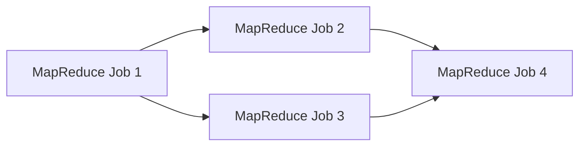

Job 2 และ Job 3 ใช้ผลของ Job 1 และไม่ต้องรอกัน จึงรันพร้อมกันได้ Job 4 รอจนทั้งสองเสร็จ

### 5.2 Apache Oozie

**Apache Oozie** คือระบบตั้งเวลาและควบคุมการรันงาน Hadoop ใน cluster ใช้รวมงานหลายงานให้รันตามลำดับ หรือรันพร้อมกันด้วยโครงสร้าง **fork-join** (fork แยกออกเป็นหลายสายที่รันพร้อมกัน join รอให้ทุกสายเสร็จแล้วรวมเป็นสายเดียว) รองรับงาน Hive, Pig, Sqoop, MapReduce และงานทั่วไปอย่างโปรแกรม Java และ shell script ([Apache Oozie](https://oozie.apache.org/))

node (กล่องหนึ่งกล่องใน workflow) ของ Oozie มีสองชนิด **control flow node** กำหนดเส้นทางการไหลของงาน ได้แก่ start, end, kill (หยุด workflow เมื่อเกิดข้อผิดพลาด), fork, join และ decision (เลือกเส้นทางตามเงื่อนไข) **action node** คือกล่องที่ทำงานจริง เช่น MapReduce job, Pig job, คำสั่ง shell ผู้ใช้สร้าง workflow ด้วย GUI editor ของ Oozie ซึ่งส่งออกเป็นไฟล์ XML แล้วส่งไฟล์ให้ Oozie engine รัน


workflow นี้เริ่มด้วย Hive job แล้ว fork เป็น Shell job กับ Pig job ที่รันพร้อมกัน join รอให้ทั้งสองเสร็จ แล้ว decision เลือกว่าจะรัน Shell job หรือ Hive job ต่อตามเงื่อนไข เช่น ผลตรวจคุณภาพข้อมูลผ่านหรือไม่

### 5.3 Apache Airflow

**Apache Airflow** คือแพลตฟอร์มโอเพนซอร์สสำหรับเขียน ตั้งเวลา และติดตาม workflow แบบ batch workflow ของ Airflow เขียนเป็นโค้ด Python ทั้งหมด เชื่อมต่อกับเทคโนโลยีได้แทบทุกชนิด มีหน้าเว็บสำหรับดูภาพ workflow สั่งรัน และหาสาเหตุเมื่องานล้ม และติดตั้งได้ตั้งแต่โปรแกรมเดียวบน laptop ไปจนถึงระบบหลายเครื่องที่รับงานปริมาณมาก

workflow หนึ่งใน Airflow คือ **DAG** ซึ่งรวมทุกอย่างที่ต้องใช้ในการรัน ได้แก่ schedule (รันเมื่อไร), tasks (หน่วยงานย่อยที่ถูกนำไปรันบน worker), task dependencies (ลำดับและเงื่อนไขของ task), callbacks (สิ่งที่ทำเมื่อ workflow จบ เช่น ส่งอีเมลแจ้งผล) และพารามิเตอร์อื่นๆ เช่น จำนวนครั้งที่ลองใหม่เมื่อล้ม

```python
from datetime import datetime

from airflow.sdk import DAG, task
from airflow.providers.standard.operators.bash import BashOperator

# A Dag represents a workflow, a collection of tasks
with DAG(dag_id='demo', start_date=datetime(2022, 1, 1), schedule='0 0 * * *') as dag:
    # Tasks are represented as operators
    hello = BashOperator(task_id='hello', bash_command='echo hello')

    @task()
    def airflow():
        print('airflow')

    # Set dependencies between tasks
    hello >> airflow()
```

โค้ดนี้เขียนตามรูปแบบของ Airflow 3 ([Airflow Task SDK examples](https://airflow.apache.org/docs/task-sdk/stable/examples.html)) `with DAG(...) as dag:` สร้าง DAG ชื่อ `demo` ที่เริ่มนับรอบจากวันที่ 1 มกราคม 2022 และรันทุกวันเวลาเที่ยงคืน task ทุกตัวที่สร้างในบล็อก `with` เป็นสมาชิกของ DAG นี้ `BashOperator(...)` สร้าง task จาก **operator** คือแม่แบบ task สำเร็จรูป BashOperator ใช้รันคำสั่ง shell ในที่นี้คือ `echo hello` ทุก task ต้องมี `task_id` ไม่ซ้ำกันภายใน DAG `@task()` ที่วางเหนือฟังก์ชันเรียกว่า **decorator** มันแปลงฟังก์ชัน Python ธรรมดาเป็น task การเขียน `airflow()` ใน DAG จึงเป็นการสร้าง task ส่วน `hello >> airflow()` กำหนดว่า `hello` ต้องเสร็จก่อน task `airflow` จึงเริ่ม ถ้าต้องการให้หลาย task รันพร้อมกันหลัง task หนึ่ง ให้ใส่ไว้ในวงเล็บเหลี่ยม เช่น `t1 >> [t2, t3]` คือ t2 และ t3 เริ่มพร้อมกันได้หลัง t1 เสร็จ

`schedule='0 0 * * *'` เป็น **cron expression** รูปแบบมาตรฐานของตารางเวลา มีห้าช่องอ่านจากซ้ายไปขวา คือ นาที (0 ถึง 59), ชั่วโมง (0 ถึง 23), วันที่ของเดือน (1 ถึง 31), เดือน (1 ถึง 12) และวันในสัปดาห์ (0 ถึง 6 โดย 0 คือวันอาทิตย์) `*` แปลว่าทุกค่าของช่องนั้น `0 0 * * *` จึงเป็นนาทีที่ 0 ชั่วโมงที่ 0 ทุกวันที่ ทุกเดือน ทุกวันในสัปดาห์ คือเที่ยงคืนทุกวัน อีกตัวอย่าง `30 6 * * 1-5` คือ 06:30 วันจันทร์ถึงศุกร์

Oozie และ Airflow จัดการ workflow ในรูป DAG เหมือนกัน Oozie เขียน workflow ด้วย XML และเน้นงานใน Hadoop ecosystem ส่วน Airflow เขียนด้วย Python ใช้กับงานได้ทุกระบบ

---

## สรุปท้ายบท

- ข้อมูลแบ่งตามตำแหน่งของโครงสร้าง: structured (schema กำหนดล่วงหน้า), semi-structured (โครงสร้างฝังในตัว เช่น JSON), unstructured (ต้องสกัดเอง)
- 5Vs: Volume (มาก), Variety (หลากหลาย), Velocity (เร็ว), Veracity (น่าเชื่อถือ), Value (คุณค่า)
- การวิเคราะห์สี่ระดับ: Descriptive (what happened), Diagnostic (why), Predictive (what will happen), Prescriptive (how to make it happen)
- Data product ใช้ข้อมูลสร้างคุณค่าและสร้างข้อมูลใหม่ป้อนกลับให้ตัวเองดีขึ้น
- Big Data Pipeline: Ingestion, Staging, Computation, Workflow Management ทำงานอัตโนมัติและวนกลับไปปรับโมเดล
- Lambda: batch layer (ข้อมูลดิบ immutable, ถูกต้อง, ช้า) + speed layer (ข้อมูลล่าสุด, เร็ว) + serving layer (รวมผล) แลกกับการดูแลตรรกะสองชุด
- Data lake ใช้ ELT และ schema-on-read; data warehouse ใช้ ETL และ schema-on-write; lake แปลงต่อเป็น warehouse หรือ data mart
- ความต้องการของระบบกระจาย: fault tolerance, recoverability, consistency, scalability
- HDFS: block 128 MB, 3 สำเนา, WORM, เหมาะกับไฟล์ใหญ่จำนวนไม่มาก; client ถามตำแหน่งจาก NameNode แล้วรับส่งข้อมูลกับ DataNode โดยตรง
- NameNode เก็บ metadata ในหน่วยความจำ บันทึกด้วย fsimage + edit log; Secondary NameNode ทำ checkpoint อย่างเดียว; DataNode เก็บ block และส่ง heartbeat
- Erasure coding RS(6,3) ใน Hadoop 3: พื้นที่ส่วนเกิน 50% เทียบกับ 200% ของ replication 3 สำเนา
- YARN: ResourceManager (หนึ่งตัวต่อ cluster จัดสรรทรัพยากร), ApplicationMaster (หนึ่งตัวต่อแอป), NodeManager (รัน container บนแต่ละเครื่อง)
- MapReduce: map, shuffle and sort, reduce; key เดียวกันไป reduce ตัวเดียวกัน; ฟังก์ชัน stateless และ task อิสระจึงรันซ้ำได้ผลเดิม
- Streaming: สคริปต์อ่าน stdin เขียน stdout เป็น `key<TAB>value`; reducer ต้องเขียนผลของกลุ่มสุดท้ายหลัง loop
- Combiner ลดข้อมูลข้ามเครือข่าย ใช้กับการรวมที่ commutative และ associative; ค่าเฉลี่ยต้องส่งคู่ (ผลรวม, จำนวน)
- Partitioner: hash(key) mod R แบ่งจำนวน key เท่ากัน; data skew แก้ด้วย custom partitioner
- Oozie: workflow แบบ XML มี control flow node และ action node; Airflow: DAG เขียนด้วย Python ตั้งเวลาด้วย cron และกำหนดลำดับด้วย `>>`

---

## โจทย์ฝึก

**ข้อ 1** ไฟล์ 1 GB (1,024 MB) เข้า HDFS ที่ block 128 MB และ 3 สำเนา ได้กี่ block ใช้พื้นที่เท่าไร และถ้า DataNode หนึ่งเครื่องดับนาน เกิดอะไรขึ้น

แนวตอบ: 1,024 / 128 = 8 block ใช้พื้นที่ 1,024 x 3 = 3,072 MB เมื่อ heartbeat ขาดนาน NameNode ตัดสินว่าเครื่องตาย หยุดส่งงานไปเครื่องนั้น และสั่งทำสำเนา block ที่สำเนาเหลือไม่ครบจากเครื่องอื่น ข้อมูลยังอยู่ครบเพราะทุก block เหลืออย่างน้อย 2 สำเนา

**ข้อ 2** ยอดขาย (สาขา, จำนวนเงิน) อยู่ใน 2 block: Block 1 = (A,100), (B,50), (A,30), (C,20) และ Block 2 = (B,70), (A,10), (C,40), (C,15) จงไล่ shuffle and sort และ reduce หาผลรวม และบอกว่า combiner ลดข้อมูลที่ส่งจากกี่คู่เหลือกี่คู่

แนวตอบ: หลัง shuffle and sort ได้ A: [100, 30, 10], B: [50, 70], C: [20, 40, 15] หลัง reduce ได้ (A,140), (B,120), (C,75) ไม่มี combiner ส่ง 8 คู่ มี combiner Map 1 ส่ง (A,130), (B,50), (C,20) และ Map 2 ส่ง (B,70), (A,10), (C,55) รวม 6 คู่ ผลสุดท้ายเท่าเดิม

**ข้อ 3** ทำไม MapReduce รัน task ที่ล้มซ้ำบนเครื่องอื่นได้โดยผลลัพธ์ยังถูกต้อง

แนวตอบ: ฟังก์ชัน map และ reduce ไม่เก็บสถานะ ผลขึ้นกับข้อมูลเข้าอย่างเดียว และ task แต่ละตัวทำงานอิสระโดยไม่คุยกับ task อื่น การรัน task เดิมด้วยข้อมูลชุดเดิมจึงได้ผลเท่าเดิมเสมอ (ตอบความต้องการ Consistency และ Fault tolerance)

**แบบฝึกเช็กตัวเอง**

1. เซนเซอร์ส่งค่าทุก 5 วินาที ปัญหาหลักคือ V ใด
2. "ทำไมยอดสั่งซื้อเดือนนี้สูงผิดปกติ" เป็นการวิเคราะห์ระดับใด
3. daemon ใดเก็บ metadata ของ HDFS
4. fsimage กับ edit log ต่างกันอย่างไร
5. daemon ของ YARN ตัวใดมีหนึ่งตัวต่อแอป
6. `chmod 640` ได้สิทธิ์แบบใด
7. cron `15 2 * * 0` หมายถึงอะไร
8. `t1 >> [t2, t3] >> t4` รันลำดับอย่างไร

เฉลย: (1) Velocity (2) Diagnostic (3) NameNode (4) fsimage คือภาพรวม metadata ณ จุดเวลาหนึ่ง edit log คือรายการเปลี่ยนแปลงหลังจากนั้น (5) ApplicationMaster (6) `-rw-r-----` (7) 02:15 ทุกวันอาทิตย์ (8) t1 ก่อน แล้ว t2 กับ t3 พร้อมกัน แล้วจึง t4

---

## References

- TechTarget. *Cost implications of the 5 V's of big data*. https://searchcloudcomputing.techtarget.com/tip/Cost-implications-of-the-5-Vs-of-big-data
- StreamSets. *Lambda architecture*. https://streamsets.com/?p=16819
- Wikipedia. *Data lake*. https://en.wikipedia.org/wiki/Data_lake
- BigDATAwire. *Happy Birthday, Hadoop* (2016). https://www.bigdatawire.com/2016/01/28/happy-birthday-hadoop-celebrating-10-years-of-improbable-growth/
- Apache Hadoop. *HDFS Architecture*. https://hadoop.apache.org/docs/r2.8.5/hadoop-project-dist/hadoop-hdfs/HdfsDesign.html
- Apache Hadoop. *HDFS Erasure Coding*. https://hadoop.apache.org/docs/r3.4.0/hadoop-project-dist/hadoop-hdfs/HDFSErasureCoding.html
- Apache Hadoop. *Apache Hadoop YARN*. https://hadoop.apache.org/docs/current/hadoop-yarn/hadoop-yarn-site/YARN.html
- Apache Hadoop. *Hadoop Streaming*. https://hadoop.apache.org/docs/r2.8.5/hadoop-streaming/HadoopStreaming.html
- Apache Hadoop. *MapReduce Tutorial*. https://hadoop.apache.org/docs/r2.8.5/hadoop-mapreduce-client/hadoop-mapreduce-client-core/MapReduceTutorial.html
- Apache Attic. *Sqoop*. https://attic.apache.org/projects/sqoop.html
- Apache Oozie. https://oozie.apache.org/
- Apache Airflow. *Task SDK Examples*. https://airflow.apache.org/docs/task-sdk/stable/examples.html
