# Big Data, Hadoop และ MapReduce

แก่นของบทนี้คือ เมื่อข้อมูลใหญ่และเร็วเกินกว่าคอมพิวเตอร์เครื่องเดียวจะรับไหว เราต้องแบ่งทั้งข้อมูลและงานคำนวณออกไปให้คอมพิวเตอร์หลายเครื่องทำพร้อมกัน และออกแบบระบบให้ทำงานต่อได้แม้บางเครื่องพังกลางทาง Hadoop คือระบบแรกที่ทำเรื่องนี้ได้จริงในวงกว้าง และแนวคิดของมันยังอยู่ในเครื่องมือรุ่นใหม่แทบทุกตัว

**โครงของบท**

- Part 1 ข้อมูล Big Data และการวิเคราะห์: ข้อมูลมีกี่แบบ อะไรทำให้ข้อมูลเป็น Big Data และเราวิเคราะห์ข้อมูลเพื่ออะไร
- Part 2 สถาปัตยกรรมข้อมูล: Lambda Architecture และ Data Lake
- Part 3 Hadoop: ระบบเก็บไฟล์ HDFS และระบบจัดสรรทรัพยากร YARN
- Part 4 MapReduce: วิธีเขียนงานคำนวณให้หลายเครื่องช่วยกันทำ
- Part 5 การต่องานหลายงานเป็นลำดับ: Oozie และ Airflow
- ท้ายบท: cheat sheet, โจทย์ฝึกพร้อมแนวตอบ, หัวข้อที่น่าจะออกสอบ

Part 3 และ 4 คือแกนกลางของบท ระหว่างอ่านให้ไล่ตัวอย่างที่มีตัวเลขตามไปทีละขั้น ศัพท์ใหม่ทุกคำจะอธิบายไว้ตรงจุดที่ปรากฏครั้งแรก

---

## ทำไมต้องเรียนเรื่องนี้

ลองนึกถึงงานที่คุ้นเคย: ดึงข้อมูลการสั่งซื้อจาก SQL Server แล้วสรุปยอดใน Power BI ถ้าข้อมูลมีหลักล้านแถว คอมพิวเตอร์เครื่องเดียวทำได้สบาย แต่ถ้าเป็นบันทึกการใช้งาน (log) ของแอปทั้งประเทศวันละหลายเทราไบต์ เครื่องเดียวจะติดปัญหาสามอย่างพร้อมกัน

1. **ดิสก์ไม่พอเก็บ**
2. **อ่านไม่ทัน** สมมติดิสก์อ่านได้ 200 MB ต่อวินาที ไฟล์ 10 TB ต้องใช้เวลาอ่านราว 14 ชั่วโมงก่อนจะเริ่มคำนวณได้
3. **ถ้าเครื่องพังกลางทาง งานที่ทำมาทั้งหมดหายไป**

ทางออกคือนำคอมพิวเตอร์ 100 เครื่องมาต่อเครือข่ายกัน กระจายข้อมูลไปเก็บทุกเครื่อง แล้วให้แต่ละเครื่องอ่านส่วนของตัวเองพร้อมกัน เวลาอ่านจะลดลงราวร้อยเท่า ในวิชานี้ คอมพิวเตอร์แต่ละเครื่องเรียกว่า **node** และกลุ่มของ node ที่ต่อเครือข่ายกันและทำงานร่วมกันเป็นระบบเดียวเรียกว่า **cluster**

แต่เมื่อมี 100 เครื่อง โอกาสที่จะมีเครื่องใดเครื่องหนึ่งพังในแต่ละวันก็สูงขึ้นมาก เนื้อหาทั้งบทคือคำตอบว่าจะกระจายงานแบบนี้อย่างไรให้ผลลัพธ์ยังถูกต้องและข้อมูลไม่หาย

---

## Part 1 ข้อมูล Big Data และการวิเคราะห์

### 1.1 ข้อมูลสามประเภท

ก่อนจะพูดถึงระบบ ต้องรู้ก่อนว่าข้อมูลที่ระบบต้องรับมีหน้าตาแบบไหน เพราะรูปร่างของข้อมูลกำหนดว่าจะเก็บและประมวลผลอย่างไร เกณฑ์ที่ใช้แบ่งคือ **schema** ซึ่งหมายถึงคำอธิบายโครงสร้างของข้อมูล ว่ามีช่องอะไรบ้าง แต่ละช่องเก็บข้อมูลชนิดใด เช่น ตาราง PO มีคอลัมน์ เลขที่ PO (ข้อความ), วันที่ (วันที่), ยอดเงิน (ตัวเลข)

**Structured data (ข้อมูลมีโครงสร้าง)** คือข้อมูลที่กำหนด schema ไว้ก่อนเก็บ ทุกแถวมีคอลัมน์เหมือนกัน และรู้ชนิดข้อมูลของแต่ละคอลัมน์ล่วงหน้า เช่น ตารางใน relational database (ฐานข้อมูลที่เก็บข้อมูลเป็นตารางที่เชื่อมกันด้วย key อย่าง SQL Server) หรือข้อมูลแบบ record ที่ทุกรายการมีฟิลด์ชุดเดียวกัน ข้อดีคือ query (เขียนคำสั่งดึงข้อมูลออกมา) ด้วย SQL ได้ทันทีและตรวจคุณภาพได้ง่าย ข้อจำกัดคือข้อมูลที่รูปร่างต่างจาก schema จะเก็บได้ก็ต่อเมื่อแก้ schema ก่อน

**Unstructured data (ข้อมูลไม่มีโครงสร้าง)** คือข้อมูลที่ไม่มีโครงสร้างแถว-คอลัมน์ให้ query ได้ตรงๆ เช่น ข้อความอิสระ log file รูปภาพ เสียง วิดีโอ การจะได้ข้อมูลที่นำไปใช้ได้ต้องสกัดออกมาก่อน เช่น ตัดคำจากข้อความ หรือแยกลักษณะเด่นจากภาพ ข้อมูลแบบกราฟ คือข้อมูลที่เป็นจุดเชื่อมโยงกันด้วยเส้น เช่น เครือข่ายเพื่อนใน social media หรือลิงก์ระหว่างหน้าเว็บ วิชานี้จัดไว้ในกลุ่มนี้ด้วย เพราะต้องใช้อัลกอริทึมเฉพาะในการวิเคราะห์

**Semi-structured data (ข้อมูลกึ่งมีโครงสร้าง)** อยู่ตรงกลาง ข้อมูลมีป้ายกำกับบอกโครงสร้างฝังอยู่ในตัวเอง (เรียกว่า self-describing) และแต่ละ record มีฟิลด์ไม่เท่ากันก็ได้ เช่น HTML, XML, JSON ตัวอย่าง JSON ด้านล่าง ข้อความในเครื่องหมายคำพูดหน้าเครื่องหมาย `:` คือป้ายกำกับ (key) และสิ่งที่ตามหลังคือค่า ค่าหนึ่งค่าเป็นได้ทั้งข้อความ ตัวเลข ค่าความจริง ค่าว่าง (`null`) กลุ่มข้อมูลซ้อนใน `{ }` หรือรายการใน `[ ]` ที่มีชนิดปนกัน

```json
{
  "string": "Hi",
  "number": 2.5,
  "boolean": true,
  "null": null,
  "object": { "name": "Kyle", "age": 24 },
  "array": ["Hello", 5, false, null, { "key": "value", "number": 6 }],
  "arrayOfObjects": [
    { "name": "Jerry", "age": 28 },
    { "name": "Sally", "age": 26 }
  ]
}
```

สิ่งที่แยกสามประเภทออกจากกันคือ **ตำแหน่งของโครงสร้าง** structured data เก็บโครงสร้างไว้ใน schema ที่กำหนดล่วงหน้าแยกจากตัวข้อมูล จึงอ่านด้วย SQL ได้ตรงๆ semi-structured data ฝังโครงสร้างไว้ในตัวข้อมูลเองและยืดหยุ่นได้ การอ่านจึงต้องใช้โปรแกรมแยกโครงสร้าง (parser) ออกมาก่อน แล้วค่อย query ส่วน unstructured data ไม่มีโครงสร้างให้อ่าน ต้องใช้เทคนิคประมวลผลภาษา ภาพ หรือกราฟ สกัดสิ่งที่ต้องการออกมาเอง ประเด็นเรื่องตำแหน่งของโครงสร้างนี้จะกลับมาอีกครั้งในเรื่อง Data Lake ใน Part 2

**สรุปหัวข้อ:** ข้อมูลแบ่งตามตำแหน่งของโครงสร้าง คือกำหนดไว้ล่วงหน้า (structured) ฝังในตัว (semi-structured) หรือต้องสกัดเอง (unstructured) Big Data ส่วนใหญ่เป็นสองแบบหลัง ระบบสำหรับ Big Data จึงต้องรับข้อมูลได้หลายรูปแบบ

### 1.2 ลักษณะของ Big Data: 5Vs

Big Data นิยามด้วยลักษณะที่ทำให้เครื่องมือแบบเดิมเริ่มรับไม่ไหว ไม่ได้นิยามด้วยขนาดตายตัว เดิมใช้สามลักษณะ (3Vs: Volume, Variety, Velocity) ต่อมาเพิ่มอีกสองเป็น 5Vs ([TechTarget](https://searchcloudcomputing.techtarget.com/tip/Cost-implications-of-the-5-Vs-of-big-data))

**Volume (ปริมาณ)** คือข้อมูลมีปริมาณมหาศาลและมาจากหลายแหล่ง จนเก็บในเครื่องเดียวไม่พอ และการอ่านทั้งหมดใช้เวลานาน ตัวอย่างคือประวัติการเบิกจ่ายยาทุกสาขาย้อนหลังหลายปีในระดับรายรายการ

**Variety (ความหลากหลาย)** คือข้อมูลมาจากหลายแหล่งและหลายชนิด ทั้งที่มีและไม่มีโครงสร้าง schema เดียวจึงรับไม่ได้ทั้งหมด ระบบต้องรวมข้อมูลต่างรูปแบบเข้าด้วยกัน ตัวอย่างคือตาราง PO จาก ERP ไฟล์ PDF ใบแจ้งหนี้ ภาพสแกน และ JSON จากระบบของผู้ขาย ที่ต้องนำมาใช้ร่วมกัน

**Velocity (ความเร็ว)** คือข้อมูลไหลเข้ามาเร็วและต่อเนื่อง จนต้องประมวลผลแบบ real-time คือได้ผลภายในไม่กี่วินาทีหลังข้อมูลเกิด การประมวลผลรอบละคืนจึงไม่ทันใช้ ตัวอย่างคือสัญญาณจากเซนเซอร์ตู้เย็นเก็บวัคซีนที่ส่งเข้ามาทุกไม่กี่วินาที

**Veracity (ความน่าเชื่อถือ)** คือระดับที่เชื่อถือข้อมูลได้ ครอบคลุมอคติ (bias) สัญญาณรบกวน (noise) ค่าผิดปกติ และคุณภาพข้อมูลโดยรวม ถ้าข้อมูลสกปรก ผลวิเคราะห์ก็ใช้ไม่ได้ ตัวอย่างคือยาตัวเดียวกันมีหลายรหัส หรือแต่ละสาขาบันทึกหน่วยนับไม่ตรงกัน

**Value (คุณค่า)** คือความสามารถเปลี่ยนข้อมูลให้เป็นคุณค่าทางธุรกิจ ข้อมูลที่เก็บไว้มากแต่ไม่ได้ใช้เป็นเพียงต้นทุน ตัวอย่างคือการใช้ข้อมูลการใช้ยาจริงพยากรณ์จุดสั่งซื้อ เพื่อลดของขาดและของหมดอายุ

สามตัวแรกเป็นเรื่อง **ทางเทคนิค** (ขนาด รูปแบบ ความเร็ว) และเป็นเหตุผลโดยตรงที่ต้องใช้ระบบหลายเครื่อง Veracity เป็นเรื่อง **ความถูกต้อง** และ Value เป็น **เป้าหมาย** ของการลงทุนทั้งหมด เวลาจับคู่สถานการณ์กับ V ให้ถามว่าปัญหาในโจทย์ "เกิดจากอะไร" ถ้าเกิดจากความเร็วที่ข้อมูลเข้ามา คำตอบคือ Velocity แม้ข้อมูลจะเยอะด้วยก็ตาม

**สรุปหัวข้อ:** 5Vs = Volume (มาก), Variety (หลากหลาย), Velocity (เร็ว), Veracity (น่าเชื่อถือแค่ไหน), Value (ได้ประโยชน์จริงไหม)

### 1.3 ระดับของการวิเคราะห์ข้อมูล

แผนภาพของ Gartner จัดการวิเคราะห์ข้อมูลเป็นสี่ระดับ เรียงจากทำง่ายไปทำยาก และคุณค่าที่ได้สูงขึ้นตามลำดับ แต่ละระดับตอบคำถามต่างกัน ลองไล่ตามด้วยเรื่องถุงมือทางการแพทย์เรื่องเดียวกันทั้งสี่ระดับ

**Descriptive analytics** ตอบคำถาม What happened? (เกิดอะไรขึ้น) เป็นการมองย้อนหลัง (hindsight) เช่น เดือนที่แล้วสาขาใดใช้ถุงมือมากที่สุด รายงานและ dashboard ส่วนใหญ่อยู่ในระดับนี้

**Diagnostic analytics** ตอบคำถาม Why did it happen? (ทำไมจึงเกิด) เป็นการเข้าใจสาเหตุ (insight) เช่น ยอดใช้ถุงมือเพิ่มขึ้นเพราะมีการผ่าตัดมากขึ้น หรือเพราะเปลี่ยนไปใช้ยี่ห้อใหม่ที่ขาดง่าย

**Predictive analytics** ตอบคำถาม What will happen? (จะเกิดอะไรขึ้น) เป็นการมองไปข้างหน้า (foresight) เช่น พยากรณ์ความต้องการถุงมือในไตรมาสหน้า

**Prescriptive analytics** ตอบคำถาม How can we make it happen? (ควรทำอย่างไร) เป็นการหาทางเลือกที่ดีที่สุด (optimization) เช่น แนะนำปริมาณและเวลาสั่งซื้อถุงมือที่ทำให้ต้นทุนรวมต่ำที่สุด

แผนภาพจึงไล่จาก **Information** (ข้อมูลบอกข้อเท็จจริง) ไปสู่ **Optimization** (ข้อมูลช่วยตัดสินใจ) ระดับที่สูงกว่าต้องอาศัยระดับที่ต่ำกว่าเสมอ การพยากรณ์ต้องเริ่มจากการรู้ว่าที่ผ่านมาเกิดอะไรขึ้น

**สรุปหัวข้อ:** Descriptive (อะไร), Diagnostic (ทำไม), Predictive (จะเกิดอะไร), Prescriptive (ควรทำอะไร) ยากขึ้นและมีคุณค่ามากขึ้นตามลำดับ

### 1.4 Data Product

**Data product** คือแอปพลิเคชันหรือเครื่องมือที่ใช้ข้อมูลช่วยให้ธุรกิจตัดสินใจและทำงานได้ดีขึ้น และระหว่างที่ถูกใช้งานก็ **สร้างข้อมูลใหม่ป้อนกลับเข้ามา** ซึ่งทำให้ตัวมันดีขึ้นได้อีก วงจรนี้เรียกว่า feedback loop (วงจรป้อนกลับ) ลักษณะของ data product จึงมีสามข้อ คือ เรียนรู้จากข้อมูล ปรับตัวเองได้ (self-adapting) และนำไปใช้ได้กว้าง (broadly applicable)

ตัวอย่างและวงจรป้อนกลับของแต่ละตัว

- **ระบบแนะนำสินค้าของ Amazon** ดูสินค้าที่ลูกค้าคนหนึ่งซื้อ แล้วแนะนำสินค้าที่ลูกค้าคนอื่นซึ่งมีพฤติกรรมการซื้อคล้ายกันเคยซื้อ การคลิกหรือไม่คลิกคำแนะนำกลายเป็นข้อมูลรอบใหม่ที่ทำให้คำแนะนำครั้งถัดไปแม่นขึ้น
- **Facebook** ใช้อัลกอริทึมบนกราฟเครือข่ายสังคมเพื่ออนุมานกลุ่มชุมชนจากเพื่อนร่วมกัน (mutual friends) ซึ่งคือที่มาของฟีเจอร์ "คนที่คุณอาจรู้จัก" ตัวอย่าง MapReduce ใน Part 4 จะคำนวณเพื่อนร่วมกันนี้จริงๆ
- **ข้อมูลเซนเซอร์จากรถยนต์ไร้คนขับ** ถูกนำกลับมาปรับปรุงระบบขับขี่ ยิ่งรถวิ่งมาก ข้อมูลยิ่งมาก ระบบยิ่งดี

ในงานจริง dashboard ใน Power BI ที่แสดงยอดสต็อกคือรายงาน เพราะอ่านแล้วจบ ส่วนระบบที่คำนวณจุดสั่งซื้อจากข้อมูลการใช้จริง แล้วนำผลการสั่งซื้อจริงป้อนกลับมาปรับการคำนวณ คือ data product

**สรุปหัวข้อ:** Data product = แอปที่ใช้ข้อมูลสร้างคุณค่า และสร้างข้อมูลใหม่ป้อนกลับให้ตัวเองดีขึ้น

### 1.5 Data Science

**Data science** คือศาสตร์ที่รวมหลายสาขาเพื่อสร้าง data product ที่มีประสิทธิภาพ (efficient: ใช้ทรัพยากรคุ้ม) และมีประสิทธิผล (effective: ได้ผลตามเป้าหมาย) สาขาที่ประกอบกันได้แก่

1. **Machine Learning** สร้างโมเดล คือสูตรหรือโปรแกรมที่เรียนรู้รูปแบบจากข้อมูลแล้วใช้ทำนายหรือจัดกลุ่มข้อมูลใหม่
2. **Software Engineering** ทำให้โมเดลกลายเป็นระบบที่นำขึ้นใช้งานจริงและดูแลต่อได้
3. **Statistics** ให้ทฤษฎีในการอนุมาน วัดความไม่แน่นอน และออกแบบการทดลอง
4. **Database Management** เก็บ จัดการ และเรียกข้อมูลอย่างมีประสิทธิภาพ
5. **Distributed Computing** การคำนวณแบบกระจาย คือแบ่งงานคำนวณไปให้หลายเครื่องทำพร้อมกัน ซึ่งเป็นหัวใจของวิชานี้

### 1.6 จาก Data Science Pipeline สู่ Big Data Pipeline

**Pipeline** คือลำดับขั้นตอนที่ข้อมูลไหลผ่านทีละขั้น ผลของขั้นหนึ่งเป็นข้อมูลเข้าของขั้นถัดไป

**Data Science Pipeline** เป็นลำดับขั้นสำหรับสร้าง data product แบบดั้งเดิม มีห้าขั้นต่อกันเป็นเส้นตรง คนเป็นผู้ลงมือในแต่ละขั้น โดยใช้ภาษาสคริปต์อย่าง Python หรือ R ช่วย

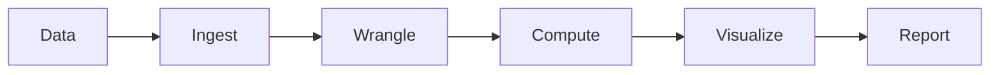

วิธีอ่านแผนภาพ: นำข้อมูลเข้า (Ingest) ทำความสะอาดและจัดรูปข้อมูล (Wrangle) คำนวณหรือสร้างโมเดล (Compute) แสดงผลเป็นกราฟ (Visualize) แล้วออกเป็นรายงาน (Report) ลูกศรไปทางเดียวจากซ้ายไปขวา

แบบนี้เหมาะกับข้อมูลขนาดที่คนจัดการทัน เมื่อข้อมูลใหญ่ขึ้น เร็วขึ้น และหลากหลายขึ้น (ซึ่งก็คือ Volume, Velocity, Variety) ทุกขั้นที่ต้องรอคนลงมือกลายเป็นคอขวด เช่น ข้อมูลเข้ามาทุกนาทีแต่คนทำรายงานได้วันละครั้ง ระบบจึงต้องมีเครื่องมือที่หา insight (ข้อค้นพบที่นำไปใช้ตัดสินใจได้) หรือรูปแบบในข้อมูลได้เองโดยไม่ต้องให้คนลงมือทุกรอบ

**Big Data Pipeline (Big Data Workflow)** ปรับ pipeline เดิมให้ทำงานอัตโนมัติและ **วนซ้ำ (iterative)** มีสี่ระยะหลัก

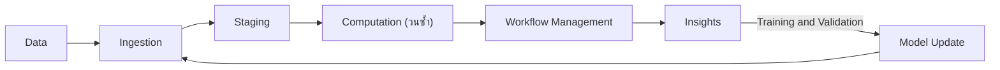

วิธีอ่าน: เส้นหลักวิ่งจากซ้ายไปขวาเหมือนเดิม และมีเส้นวนกลับจาก Insights ผ่านการฝึกโมเดล (training) และทดสอบโมเดล (validation) ไปปรับปรุงโมเดล แล้วป้อนกลับเข้าระยะ Ingestion วงจรนี้คือ feedback loop ที่ทำให้ระบบเป็น data product

ไล่ทั้งสี่ระยะด้วยตัวอย่างระบบพยากรณ์จุดสั่งซื้อในงานจัดซื้อ

**Ingestion (นำข้อมูลเข้า)** คือการหาแหล่งข้อมูลและนำข้อมูลเข้าระบบ ระยะนี้ยังรับข้อมูลป้อนกลับจากผู้ใช้ที่ใช้ผลของโมเดลแล้ว เพื่อนำมาปรับโมเดลด้วย ในตัวอย่างนี้คือการดึงรายการเบิกจ่ายจาก ERP ทุกชั่วโมง พร้อมบันทึกว่าผู้ซื้อทำตามจุดสั่งซื้อที่ระบบแนะนำหรือไม่

**Staging (เตรียมข้อมูล)** คือการแปลงข้อมูลให้พร้อมใช้ แล้วเก็บไว้ให้พร้อมประมวลผล การแปลงรวมถึงการปรับรูปแบบให้เป็นมาตรฐานเดียวกัน (standardization, normalization) เช่น หน่วยนับเดียวกัน รูปแบบวันที่เดียวกัน ในตัวอย่างนี้คือการแปลงหน่วยกล่อง แพ็ก และชิ้น ให้เป็นหน่วยฐานเดียวกันทุกรายการ

**Computation (คำนวณ)** คือการคำนวณหรือรัน machine learning เพื่อให้ได้ insight หรือโมเดล และมักวนหลายรอบ ในตัวอย่างนี้คือการฝึกโมเดลพยากรณ์ความต้องการรายสินค้า

**Workflow Management (จัดการลำดับงาน)** คือการทำให้ทุกระยะข้างต้นรันได้เองในระบบงานจริง (production) ผ่านงานสามอย่าง abstraction คือซ่อนรายละเอียดทางเทคนิคไว้หลังขั้นตอนที่เรียกใช้ง่าย orchestration คือกำหนดลำดับและเงื่อนไขว่าขั้นไหนรันก่อนหลัง และ automation คือให้รันเองตามตารางเวลาโดยไม่ต้องมีคนสั่ง ในตัวอย่างนี้คือการตั้งให้ขั้นดึงข้อมูล แปลง และพยากรณ์ รันต่อกันเองทุกคืน

เครื่องมือเฉพาะของแต่ละระยะในโลกของ Hadoop จะพบใน Part 3 (การนำเข้าและการเก็บ) Part 4 (การคำนวณ) และ Part 5 (การจัดการ workflow)

**สรุปหัวข้อ:** Data Science Pipeline เป็นเส้นตรงห้าขั้นที่คนลงมือ Big Data Pipeline เป็นวงวนสี่ระยะ (Ingestion, Staging, Computation, Workflow Management) ที่ทำงานอัตโนมัติและป้อนผลกลับไปปรับโมเดล

---
## Part 2 สถาปัตยกรรมข้อมูล: Lambda Architecture และ Data Lake

### 2.1 Lambda Architecture

**สองวิธีประมวลผลที่ต้องรู้ก่อน**

- **Batch processing** คือการสะสมข้อมูลไว้ก่อน แล้วประมวลผลทั้งก้อนในรอบเดียว เช่น รันทุกเที่ยงคืน ข้อดีคือเห็นข้อมูลครบจึงได้ผลถูกต้อง ข้อเสียคือต้องรอถึงรอบถัดไปจึงเห็นผล
- **Stream processing** คือการประมวลผลข้อมูลทีละรายการทันทีที่เข้ามา ได้ผลแทบจะทันที แต่ในแต่ละขณะเห็นเฉพาะข้อมูลที่เพิ่งเข้ามา

เวลาตั้งแต่ข้อมูลเกิดจนได้ผลลัพธ์เรียกว่า **latency** batch มี latency สูง (หลายนาทีถึงหลายชั่วโมง) stream มี latency ต่ำ (ระดับวินาที)

**ปัญหาที่ทำให้ต้องมี Lambda Architecture**  
ผู้บริหารต้องการทั้งรายงานย้อนหลังทั้งปีที่ถูกต้อง และตัวเลข "ยอดเบิกยาวันนี้ถึงตอนนี้" ที่สดใหม่ ระบบ batch ที่รันทุกเที่ยงคืนตอบคำถามที่สองได้ช้าเกินไป ส่วนระบบ stream เหมาะกับข้อมูลล่าสุดมากกว่าการคำนวณย้อนหลังทั้งปี

**นิยาม**  
Lambda Architecture คือสถาปัตยกรรมการประมวลผลข้อมูลที่ **รัน batch processing และ stream processing ควบคู่กัน** บนข้อมูลชุดเดียวกัน แล้วรวมผลทั้งสองตอนผู้ใช้เรียกดู จึงรองรับข้อมูลปริมาณมหาศาลไปพร้อมกับการติดตามแบบ real-time และมักใช้เป็นพื้นฐานของสถาปัตยกรรม big data แนวคิดนี้เผยแพร่โดย Nathan Marz ซึ่งพัฒนาขึ้นระหว่างทำระบบวิเคราะห์ข้อมูลที่ BackType และ Twitter และเขียนไว้ในหนังสือ *Big Data* ร่วมกับ James Warren ([Manning](https://www.manning.com/books/big-data)) ชื่อ Lambda มาจากรูปแผนภาพที่ข้อมูลแยกเป็นสองทางแล้วมาบรรจบกัน คล้ายอักษรกรีก λ ([MotherDuck glossary](https://motherduck.com/glossary/lambda-architecture/))

**ภาพในหัว:** ข้อมูลทุกชิ้นที่เข้ามาถูก **คัดลอกไปสองทางพร้อมกัน** ทางหนึ่งเก็บสะสมไว้แล้วคำนวณใหม่ทั้งก้อนเป็นรอบๆ อีกทางคำนวณเพิ่มทีละนิดทันทีที่ข้อมูลมาถึง แล้วชั้นที่ให้บริการผู้ใช้นำผลสองทางมารวมกัน

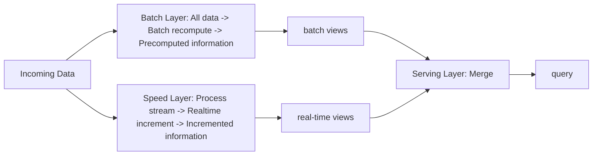

วิธีอ่าน: ลูกศรจาก Incoming Data แยกเป็นสองเส้น เส้นบนผ่าน batch layer เส้นล่างผ่าน speed layer ผลของแต่ละเส้นถูกเก็บเป็น **view** คือตารางผลลัพธ์ที่คำนวณไว้แล้วพร้อมให้อ่าน แล้วทั้งสองเส้นไปรวมกัน (merge) ที่ serving layer ก่อนตอบคำถามของผู้ใช้ (query)

**ส่วนประกอบสามชั้น**

**Batch layer** มีไว้ให้ผลที่ครบและถูกต้อง ชั้นนี้ถือ **master raw dataset** คือข้อมูลดิบทั้งหมด ทั้งข้อมูลในอดีตและข้อมูลล่าสุด เก็บแบบ **immutable** คือเพิ่มข้อมูลใหม่ได้อย่างเดียว ข้อมูลที่บันทึกแล้วคงไว้ตามเดิมตลอด จากข้อมูลดิบนี้ batch layer คำนวณ batch view ไว้ล่วงหน้า (precomputed) เป็นรอบๆ เช่น ยอดรวมและตัวชี้วัดทางธุรกิจ บทบาทของมันเทียบได้กับ data warehouse (ฐานข้อมูลกลางสำหรับการวิเคราะห์ อธิบายในหัวข้อ 2.2) ในงาน BI แบบเดิม ถ้าชั้นนี้มีปัญหา ผลของข้อมูลล่าสุดยังได้จาก speed layer และเมื่อแก้ปัญหาแล้วก็คำนวณ batch view ใหม่ทั้งหมดจากข้อมูลดิบได้ เพราะข้อมูลดิบยังอยู่ครบ

**Speed layer** มีไว้ปิดช่องว่างของข้อมูลที่เกิดขึ้นหลังรอบ batch ล่าสุด ชั้นนี้ถือเฉพาะข้อมูลช่วงล่าสุด และประมวลผล stream ทีละส่วน (incremental) เพื่อให้ real-time view ที่มี latency ต่ำ ถ้าชั้นนี้มีปัญหา ผู้ใช้จะดูข้อมูลล่าสุดไม่ได้ชั่วคราว ส่วนตัวข้อมูลยังอยู่ครบใน batch layer และรอบ batch ถัดไปจะครอบคลุมช่วงเวลานั้น

**Serving layer** เป็นจุดเดียวที่ผู้ใช้ติดต่อ ชั้นนี้ถือทั้ง batch view และ real-time view แล้วรวมผลจากสองชั้นเพื่อตอบ query จึงทำหน้าที่เป็นชั้น dashboard และรายงาน ที่รองรับทั้งรายงานรอบ batch และรายงาน real-time ถ้าชั้นนี้มีปัญหา ผู้ใช้เรียกดูอะไรไม่ได้เลย แม้สองชั้นแรกยังทำงานอยู่

**Worked example: ยอดเบิกยาสะสมวันนี้**

1. Batch layer รันทุกคืนเวลา 02:00 คำนวณยอดเบิกสะสมทั้งหมดถึงสิ้นวันก่อนหน้า ได้ batch view = 1,250,000 หน่วย
2. ตั้งแต่เที่ยงคืนถึง 14:00 วันนี้ มีรายการเบิกเข้ามารวม 3,400 หน่วย speed layer รับทีละรายการแล้วบวกสะสมไว้ใน real-time view = 3,400 หน่วย
3. ผู้ใช้เปิด dashboard เวลา 14:00 serving layer ตอบ 1,250,000 + 3,400 = 1,253,400 หน่วย
4. คืนถัดไป batch layer คำนวณใหม่จากข้อมูลดิบทั้งหมด ซึ่งรวมรายการของวันนี้แล้ว real-time view ของวันนี้จึงทิ้งได้
5. ถ้าระหว่างวัน speed layer นับตกไปบางรายการ ตัวเลขจะถูกต้องเองเมื่อ batch รอบถัดไปเสร็จ เพราะ batch คำนวณจากข้อมูลดิบที่ครบ

ข้อ 5 คือเหตุผลที่กล่าวว่า batch layer ให้ความถูกต้อง ส่วน speed layer ให้ความสดใหม่

**เครื่องมือในแต่ละชั้น (ระบบ Hadoop ยุคคลาสสิก)**  
แผนภาพสถาปัตยกรรมแบบเต็มวางชั้นต่างๆ ตามลำดับการไหลของข้อมูล จากระบบต้นทางไปถึงผู้ใช้ ลองไล่ตามทางเดินของข้อมูลหนึ่งรายการ โดยเน้นจำ **หน้าที่ของแต่ละชั้น** ชื่อเครื่องมือเป็นเพียงตัวอย่าง เครื่องมือหลักของ Hadoop อธิบายละเอียดใน Part 3 ถึง 5

ข้อมูลเริ่มต้นที่ **Source Systems** คือระบบต้นทาง เช่น ฐานข้อมูลของแอปพลิเคชัน log รูปภาพ และไฟล์ ชั้นถัดมาคือ **Data Acquisition Layer** ทำหน้าที่ดึงข้อมูลออกจากต้นทาง เช่น Sqoop ดึงตารางจากฐานข้อมูล และ Flume เก็บ log

ข้อมูลที่ดึงมาไปพักไว้ที่ **Messaging Layer** ซึ่งเป็นคิวกลาง ต้นทางส่งข้อมูลเข้าคิวได้ตลอดเวลา และปลายทางมาดึงไปตามจังหวะของตัวเอง เครื่องมือที่ใช้กันมากคือ Kafka ซึ่งเป็นระบบคิวข้อความที่กระจายอยู่หลายเครื่อง จากนั้น **Data Ingestion Layer** นำข้อมูลจากคิวเข้าสู่ระบบประมวลผล เช่น Flume, Kafka Consumer (โปรแกรมที่อ่านข้อความออกจาก Kafka) หรือ Spark-Kafka Connector (ตัวเชื่อมให้ Spark ซึ่งเป็นระบบประมวลผลข้อมูลแบบกระจาย อ่านข้อมูลจาก Kafka)

ถึงตรงนี้ข้อมูลแยกสองทางตามหลักของ Lambda ทางแรกเข้า **Batch Layer** ซึ่งประมวลผลข้อมูลทั้งหมดเป็นรอบ ด้วยเครื่องมืออย่าง HDFS, MapReduce, Pig, Hive และ Impala (เครื่องมือ query ด้วย SQL บน Hadoop ที่เน้นความเร็ว) โดยมี Oozie คุมลำดับงาน ทางที่สองเข้า **Speed Layer** ซึ่งประมวลผล stream ด้วยเครื่องมืออย่าง Flume, Spark Streaming หรือ Flink (สองตัวหลังเป็นระบบประมวลผล stream)

ผลของทั้งสองทางไปรวมกันที่ **Serving Layer** เพื่อส่งให้ผู้ใช้ เช่น ผ่านบริการเว็บที่เขียนด้วย Spring Boot (framework ภาษา Java) ตาราง Hive และ Impala ที่ผู้ใช้ query ได้ หรือส่งออกตารางด้วย Pig หรือ Sqoop ไปยังระบบอื่น ตลอดทางทั้งหมดมี **Data Storage Layer** รองรับอยู่ข้างล่าง ทำหน้าที่เก็บข้อมูลถาวร เช่น HDFS, HBase และ Elasticsearch (ระบบค้นหาและทำดัชนีข้อความ)

**เมื่อไรควรใช้ และสิ่งที่ต้องแลก**  
Lambda เหมาะเมื่อต้องการทั้งผลย้อนหลังที่ถูกต้องและผลปัจจุบันที่เร็ว สิ่งที่ต้องแลกคือ **ทีมต้องเขียนและดูแลตรรกะเดียวกันสองชุด** ชุดหนึ่งสำหรับ batch อีกชุดสำหรับ stream และต้องให้ผลตรงกันเสมอ เมื่อกฎธุรกิจเปลี่ยนต้องแก้ทั้งสองที่ ([StreamSets](https://streamsets.com/?p=16819))

**สรุปหัวข้อ:** Lambda = batch layer (เก็บข้อมูลดิบทั้งหมดแบบ immutable ให้ผลถูกต้องครบแต่ช้า) + speed layer (ข้อมูลล่าสุด เร็ว) + serving layer (รวมผลแล้วตอบผู้ใช้) สิ่งที่ต้องแลกคือดูแลโค้ดสองชุด

### 2.2 Data Lake

**ปัญหาที่ทำให้ต้องมี**  
**Data warehouse** คือฐานข้อมูลกลางสำหรับการวิเคราะห์ ที่รวมข้อมูลจากหลายระบบมาจัดเป็นตารางตาม schema ที่ออกแบบไว้ การสร้าง warehouse จึงต้องตกลงกันก่อนว่าจะใช้ข้อมูลทำอะไร แล้วแปลงข้อมูลให้เข้า schema ก่อนโหลด ข้อมูลที่ยังไม่รู้ว่าจะใช้ทำอะไร หรือรูปแบบไม่เข้ากับตาราง (ภาพ ไฟล์ PDF log ดิบ) จึงไม่ถูกเก็บ เมื่อมีคำถามใหม่ในอนาคตที่ต้องใช้ข้อมูลเหล่านั้น ก็ไม่มีให้ใช้แล้ว

**นิยาม**  
**Data lake** คือที่เก็บข้อมูลกลางแห่งเดียว ที่เก็บข้อมูล **ในรูปแบบดั้งเดิมตามที่มาจากต้นทาง (natural format)** รองรับข้อมูลหลาย schema และหลายโครงสร้างอยู่ด้วยกัน มักเก็บเป็นไฟล์หรือ object blob (ก้อนข้อมูลที่เก็บทั้งก้อนพร้อมชื่อระบุ เช่น ไฟล์ใน cloud storage) แนวคิดคือมีที่เก็บกลางแห่งเดียวสำหรับข้อมูลทั้งองค์กร ตั้งแต่ข้อมูลดิบที่เป็นสำเนาตรงจากระบบต้นทาง ไปจนถึงข้อมูลที่แปลงแล้วสำหรับงานต่างๆ ได้แก่ การทำรายงาน visualization การวิเคราะห์ และ machine learning ([Wikipedia: Data lake](https://en.wikipedia.org/wiki/Data_lake))

ข้อมูลใน data lake ครอบคลุมทุกแบบ จึงเป็นที่เก็บกลางที่รับข้อมูลได้ทุกรูปแบบ

- **Structured:** ตารางจาก relational database
- **Semi-structured:** CSV, log, XML, JSON
- **Unstructured:** อีเมล เอกสาร PDF
- **Binary:** ข้อมูลที่เก็บเป็นไบต์ดิบ เช่น รูปภาพ เสียง วิดีโอ

data lake ที่ใช้งานได้จริงต้องมี **metadata** (ข้อมูลที่อธิบายข้อมูล เช่น มาจากระบบไหน ใครดูแล อัปเดตเมื่อไร) และ **governance** (กฎและผู้รับผิดชอบเรื่องคุณภาพ สิทธิ์ และการใช้ข้อมูล) เพื่อให้คนในองค์กรหาข้อมูลเจอและเชื่อถือได้

**ETL และ ELT**  
ทั้งสองคำมาจากสามขั้น Extract (ดึงข้อมูลออกจากต้นทาง), Transform (แปลงข้อมูล) และ Load (โหลดเข้าที่เก็บปลายทาง) ต่างกันที่ลำดับ

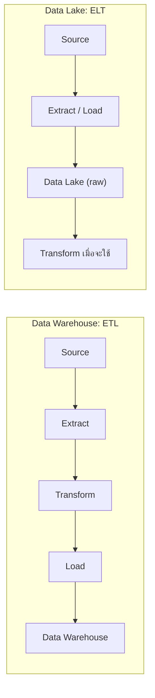

วิธีอ่าน: กล่องบน แปลงข้อมูลก่อนเข้าคลัง (Transform อยู่ก่อน Load) กล่องล่าง โหลดข้อมูลดิบเข้า lake ทันที แล้วแปลงตอนจะดึงไปใช้

**Data warehouse ใช้ ETL** ข้อมูลถูกแปลงตอนเข้า ก่อนโหลดลงคลัง วิธีนี้เรียกว่า **schema-on-write** คือกำหนด schema ไว้ก่อน แล้วเขียนข้อมูลให้ตรงกับ schema คลังจึงเก็บเฉพาะข้อมูลที่แปลงแล้วและรู้ว่าจะใช้ทำอะไร ผลที่ได้คือ query เร็วและคุณภาพข้อมูลสม่ำเสมอ เหมาะกับรายงาน BI ที่นิยามตัวชี้วัดไว้ชัดแล้ว สิ่งที่ต้องมีคือต้องรู้ความต้องการล่วงหน้าตั้งแต่ตอนออกแบบ

**Data lake ใช้ ELT** ข้อมูลถูกโหลดเข้า lake ตามสภาพที่มา แล้วแปลงตอนดึงออกไปใช้ วิธีนี้เรียกว่า **schema-on-read** คือเก็บข้อมูลตามที่มา แล้วค่อยตีความโครงสร้างตอนอ่าน lake จึงเก็บทุกอย่างรวมถึงข้อมูลดิบ ผลที่ได้คือความยืดหยุ่น เก็บข้อมูลไว้ได้ก่อนรู้ว่าจะใช้ทำอะไร และย้อนกลับไปคำนวณใหม่จากข้อมูลดิบได้เสมอ สิ่งที่ต้องมีคือ metadata และ governance และผู้ใช้ต้องแปลงข้อมูลเองก่อนนำไปใช้

**Data Lake Pattern: ใช้คู่กับ Data Warehouse**  
ในองค์กรจริง data lake กับ data warehouse ทำงานต่อกันตามรูปแบบนี้

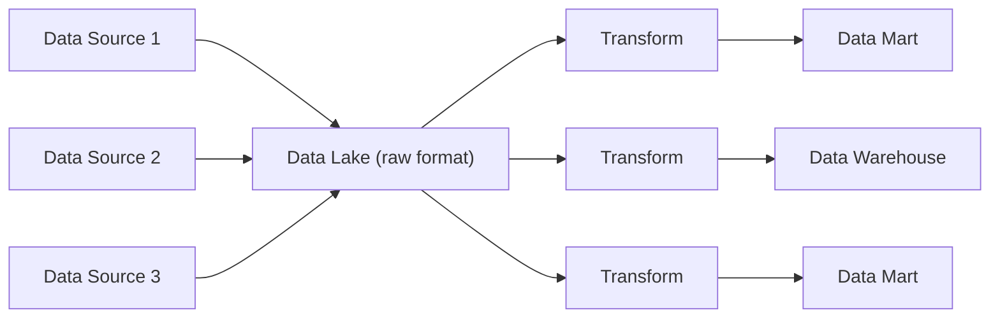

วิธีอ่าน: ข้อมูลจากหลายแหล่งไหลเข้า data lake ในรูปดิบก่อน จากนั้นมีกระบวนการแปลงหลายสาย แยกตามความต้องการของผู้ใช้แต่ละกลุ่ม ผลของแต่ละสายคือ data warehouse หรือ **data mart** (warehouse ขนาดเล็กเฉพาะหน่วยงานหรือเรื่องใดเรื่องหนึ่ง เช่น data mart ของฝ่ายจัดซื้อ) ซึ่งพร้อมให้เครื่องมือวิเคราะห์ใช้ ([Dragon1](https://www.dragon1.com/terms/data-lake-definition))

ในทางเทคนิค data lake สร้างบนที่เก็บข้อมูลแบบกระจายหลายเครื่อง เช่น HDFS (ระบบไฟล์ของ Hadoop ใน Part 3), Amazon S3 หรือ Azure Data Lake Storage จากนั้นดึงข้อมูลออกไปแปลงเพื่อสร้าง warehouse หรือ data mart เช่น ด้วย Hive หรือ HBase ให้เครื่องมือวิเคราะห์ใช้งาน ช่วงจาก lake ไปสู่ warehouse นี้เองเป็นการ extract, transform แล้ว load อีกทอดหนึ่ง จึงเรียกช่วงนี้ว่า ETL ได้ ส่วนคำว่า ELT ใช้กับภาพรวมของการนำข้อมูลจากต้นทางเข้า lake

**สรุปหัวข้อ:** Data lake เก็บข้อมูลทุกรูปแบบในรูปดิบไว้ที่เดียว (ELT, schema-on-read) แล้วแปลงไปเป็น warehouse หรือ data mart ตามความต้องการ ส่วน data warehouse แปลงข้อมูลก่อนโหลด (ETL, schema-on-write) สองแบบนี้มักใช้ต่อกัน

---
## Part 3 Hadoop: HDFS และ YARN

### 3.1 Hadoop คืออะไร และมาจากไหน

**Hadoop** คือ framework โอเพนซอร์สของมูลนิธิ Apache สำหรับเก็บและประมวลผลข้อมูลขนาดใหญ่บน cluster (framework คือชุดซอฟต์แวร์สำเร็จรูปที่วางโครงไว้ให้ ผู้ใช้เขียนเฉพาะส่วนที่เป็นงานของตัวเองใส่เข้าไป ส่วนโอเพนซอร์สคือเปิดเผยซอร์สโค้ดให้ทุกคนใช้และแก้ได้) Hadoop ออกแบบมาให้รันบน **commodity hardware** คือเครื่องเซิร์ฟเวอร์ราคาธรรมดาที่หาซื้อได้ทั่วไป เครื่องแบบนี้ราคาถูกแต่พังบ่อยกว่าเครื่องระดับสูง ระบบจึงถูกออกแบบโดยถือว่าเครื่องพังเป็นเรื่องปกติ

หลักการทำงานคือ กระจายงานคำนวณที่ต้องใช้ข้อมูลมหาศาลไปให้เครื่องจำนวนมาก แต่ละเครื่องทำงานกับข้อมูลชิ้นที่อยู่ในเครื่องของตัวเองพร้อมกัน งานทั้งหมดจึงเสร็จเร็วขึ้น การทำแบบนี้ต้องอาศัยสามอย่าง คือ อัลกอริทึมที่แบ่งงานเป็นชิ้นได้ (distributed algorithm), เครื่องจำนวนมากใน cluster และระบบเครือข่ายที่เชื่อมเครื่องเหล่านั้น บางตำราเปรียบ Hadoop ว่าเป็น "ระบบปฏิบัติการสำหรับ Big Data" เพราะมันจัดการทรัพยากร (ดิสก์ หน่วยความจำ CPU) ของทั้ง cluster ให้โปรแกรมอื่นมาใช้ เหมือนที่ Windows จัดการทรัพยากรของเครื่องเดียว

**ที่มา:** Google ตีพิมพ์บทความวิจัยสองชิ้นที่อธิบายระบบภายในของตัวเอง คือ The Google File System (2003) และ MapReduce: Simplified Data Processing on Large Clusters (2004) Doug Cutting และ Mike Cafarella นำแนวคิดจากบทความทั้งสองมาเขียนเป็นโอเพนซอร์สในโครงการ search engine ชื่อ Apache Nutch ในปี 2006 ส่วนระบบไฟล์และ MapReduce ถูกแยกออกมาเป็นโครงการใหม่ชื่อ Hadoop โดยมี Yahoo เป็นผู้สนับสนุนหลักทั้งการพัฒนาและการใช้งานจริง ชื่อ Hadoop มาจากตุ๊กตาช้างของลูกชาย Doug Cutting ([Mastering Hadoop 3, Packt](https://www.packtpub.com/en-cl/product/mastering-hadoop-3-9781788620444); [BigDATAwire](https://www.bigdatawire.com/2016/01/28/happy-birthday-hadoop-celebrating-10-years-of-improbable-growth/))

### 3.2 ความต้องการของระบบกระจาย และแนวคิดที่ Hadoop ใช้ตอบ

**ระบบกระจาย (distributed system)** คือระบบที่ข้อมูลหรืองานกระจายอยู่หลายเครื่อง แต่ผู้ใช้เห็นเป็นระบบเดียว Hadoop ออกแบบมาเพื่อตอบความต้องการสี่ข้อของระบบแบบนี้

**Fault tolerance (ทนต่อความล้มเหลว)** คือเมื่อส่วนประกอบหนึ่งล้ม ระบบทั้งหมดยังทำงานต่อได้ โดยลดระดับลงอย่างนุ่มนวล (graceful degradation) ไปสู่สถานะที่ช้าลงแต่ยังใช้ได้ และเมื่อส่วนที่ล้มกลับมาทำงานได้ ก็กลับเข้าระบบได้อีกครั้ง

**Recoverability (กู้คืนได้)** คือเมื่อเกิดความล้มเหลว ข้อมูลยังอยู่ครบ

**Consistency (ผลลัพธ์คงเส้นคงวา)** คือแม้งานย่อยชิ้นหนึ่งล้มระหว่างทาง ผลลัพธ์สุดท้ายยังถูกต้องเหมือนตอนที่ไม่มีอะไรล้มเลย

**Scalability (ขยายได้)** คือเมื่อเพิ่มภาระ (ข้อมูลมากขึ้น คำนวณมากขึ้น) ระบบแค่ช้าลงทีละน้อยและยังทำงานได้ และเมื่อเพิ่มทรัพยากร ประสิทธิภาพก็เพิ่มตามสัดส่วน

Scalability มีสองด้านที่ต้องจำให้ครบ ด้านภาระ: งานเพิ่ม ระบบช้าลงอย่างค่อยเป็นค่อยไป ด้านทรัพยากร: เพิ่มเครื่องเป็น 2 เท่า ควรได้ความเร็วเพิ่มราว 2 เท่า การขยายด้วยการเพิ่มจำนวนเครื่องแบบนี้เรียกว่า **horizontal scaling**

เพื่อให้ได้สี่ข้อนี้ Hadoop ใช้แนวคิดแปดข้อ ก่อนอ่านต้องรู้จักศัพท์สามคำนี้

- **Block** คือชิ้นส่วนขนาดคงที่ที่ไฟล์ถูกตัดแบ่ง เช่น ไฟล์ 300 MB ตัดเป็นชิ้นละ 128 MB
- **Job** คืองานคำนวณทั้งก้อนที่ผู้ใช้ส่งเข้าระบบ เช่น "นับจำนวนการเบิกยาแต่ละรายการทั้งปี"
- **Task** คือชิ้นย่อยของ job ที่เครื่องหนึ่งรับไปทำ ปกติหนึ่ง task ทำงานกับข้อมูลหนึ่ง block

แนวคิดแปดข้อแบ่งได้เป็นสามกลุ่มตามสิ่งที่มันจัดการ

**กลุ่มแรก: วิธีเก็บข้อมูล**

1. **ข้อมูลถูกกระจายไปเก็บหลายเครื่องทันทีที่เพิ่มเข้า cluster** ข้อมูลทุกชิ้นจึงมีสำเนาอยู่หลายเครื่องตั้งแต่วินาทีแรก เครื่องใดพังข้อมูลก็ยังอยู่ ข้อนี้ตอบ Recoverability และ Fault tolerance
2. **ข้อมูลเก็บเป็น block ขนาดคงที่** ปกติ 128 MB และแต่ละ block ได้รับการป้องกันด้วยการทำสำเนา หรือด้วย erasure coding (วิธีประหยัดพื้นที่ที่อธิบายในหัวข้อ 3.4) block เป็นหน่วยเดียวกันที่ใช้ทั้งกระจาย ทำสำเนา และแบ่งงาน ข้อนี้ตอบ Recoverability และ Scalability

**กลุ่มที่สอง: วิธีแบ่งงาน**

3. **job ถูกแบ่งเป็น task ให้แต่ละเครื่องทำกับ block หนึ่ง** จำนวน task จึงเพิ่มตามจำนวน block และทุก task ทำพร้อมกันได้ ข้อนี้ตอบ Scalability
4. **โปรแกรมควบคุมกลาง (master) แจกงานให้เครื่องที่ทำงานจริง (worker) หลายเครื่องทำพร้อมกัน** แต่ละเครื่องทำส่วนของตัวเอง การแบ่งงานรวมอยู่ที่จุดเดียว ส่วนการลงมือทำกระจายไปทุกเครื่อง ข้อนี้ตอบ Scalability
5. **เครื่องเลือกประมวลผลข้อมูลที่เก็บอยู่ในเครื่องตัวเอง** เรียกว่า **data locality** เพราะการส่งโปรแกรมขนาดเล็กไปหาข้อมูลประหยัดกว่าการย้ายข้อมูลขนาดใหญ่ข้ามเครือข่าย ข้อนี้ตอบ Scalability
6. **ผู้ใช้เขียน job ในระดับสูง** ระบบจัดการเรื่องเครือข่ายและการสื่อสารระหว่างเครื่องให้ ผู้ใช้จึงเขียนเฉพาะตรรกะของงาน ข้อนี้ทำให้ใช้งานง่าย

**กลุ่มที่สาม: วิธีรับมือความล้มเหลว**

7. **ลดการรับส่งข้อมูลระหว่างเครื่อง และให้แต่ละ task ทำงานอิสระ** ระหว่างประมวลผล task ไม่ต้องคุยกับ task อื่น ระบบจึงรัน task ใดใหม่ได้ทุกเมื่อโดยไม่กระทบ task อื่น และไม่เกิด **deadlock** (สถานการณ์ที่ task สองตัวรอกันและกันจนไม่มีใครทำต่อได้) ข้อนี้ตอบ Scalability และ Consistency
8. **job ทนความล้มเหลวได้ด้วยการรัน task ซ้ำ (task redundancy)** task ที่ล้มหรือช้าผิดปกติจะถูกรันใหม่บนเครื่องอื่น ข้อนี้ตอบ Fault tolerance และ Consistency

ข้อ 7 คือกุญแจของ MapReduce ใน Part 4: เพราะ task อิสระต่อกัน เมื่อ task หนึ่งล้ม ระบบรัน task นั้นใหม่บนเครื่องอื่นด้วยข้อมูลชุดเดิม ได้ผลเท่าเดิม ผลลัพธ์รวมจึงยังถูกต้อง

**สรุปหัวข้อ:** Hadoop ทำให้ระบบหลายเครื่องทนทานและขยายได้ ด้วยการแบ่งข้อมูลเป็น block ที่มีสำเนา ส่งการคำนวณไปหาข้อมูล และแบ่งงานเป็น task อิสระที่รันซ้ำได้

### 3.3 สถาปัตยกรรม Hadoop: สองส่วนหลัก

Hadoop ประกอบด้วยส่วนหลักสองส่วนที่ทำงานคู่กัน

1. **HDFS (Hadoop Distributed File System)** ระบบไฟล์กระจาย ดูแลข้อมูลที่เก็บบนดิสก์และการเข้าถึงข้อมูลทั่วทั้ง cluster (ส่วน **storage**)
2. **YARN (Yet Another Resource Negotiator)** ผู้จัดการทรัพยากรของ cluster แบ่ง CPU และหน่วยความจำบนเครื่องต่างๆ ให้โปรแกรมที่ขอใช้ (ส่วน **compute**)

ทั้งสองส่วนทำงานประสานกันเพื่อลดการรับส่งข้อมูลบนเครือข่าย HDFS รู้ว่าแต่ละ block อยู่เครื่องไหน และ YARN ใช้ข้อมูลนั้นวาง task ไว้บนเครื่องที่มี block ที่ task ต้องใช้ กลไกร่วมอีกสองข้อคือ

- **การทำสำเนา block** ไว้หลายเครื่อง ให้ระบบทนความล้มเหลวและกู้คืนได้ โดยข้อมูลทุกสำเนาตรงกัน
- **Speculative execution** เมื่อ task ใดคืบหน้าช้าผิดปกติ (เช่น เครื่องนั้นดิสก์เริ่มเสื่อม) ระบบเปิด task ซ้ำไปรันบนเครื่องอื่นพร้อมกัน สำเนาไหนเสร็จก่อนใช้ผลของสำเนานั้น และยกเลิกสำเนาที่เหลือ กลไกนี้กันไม่ให้เครื่องช้าเครื่องเดียวถ่วงทั้ง job

ทั้ง HDFS และ YARN ทำงานผ่าน **daemon** หลายตัว daemon คือโปรแกรมที่รันค้างอยู่เบื้องหลังตลอดเวลา คอยรับคำขอและส่งผลตอบกลับทางเครือข่าย คล้าย web server ที่รอรับคำขอหน้าเว็บ

**บทบาทของ node:** **บทบาทของเครื่องกำหนดด้วยชนิดของ daemon ที่รันอยู่บนเครื่องนั้น** มีสองบทบาท

- **Master node** รัน daemon ที่ประสานงานและเก็บข้อมูลภาพรวม และมักเป็นจุดที่ผู้ใช้เข้าถึง cluster
- **Worker node** รัน daemon ที่รับงานจาก master มาทำ เช่น เก็บและส่งข้อมูล หรือรันโปรแกรม

ฝั่ง HDFS มี daemon ระดับ master สองตัวคือ NameNode และ Secondary NameNode และมี daemon ระดับ worker คือ DataNode ฝั่ง YARN มี daemon ระดับ master คือ ResourceManager และ ApplicationMaster (หนึ่งตัวต่อโปรแกรมที่รัน) และมี daemon ระดับ worker คือ NodeManager

ในการติดตั้งทั่วไป worker node หนึ่งเครื่องรันทั้ง DataNode และ NodeManager คู่กัน task ที่ YARN วางบนเครื่องนั้นจึงอ่าน block จาก DataNode บนเครื่องเดียวกันได้โดยตรง นี่คือ data locality ในทางปฏิบัติ หน้าที่ของ daemon แต่ละตัวอธิบายในหัวข้อ 3.4 และ 3.5

### 3.4 HDFS

#### แนวคิดหลักของ HDFS

HDFS ให้ที่เก็บข้อมูลแบบมีสำเนาสำหรับ big data โดยกระจายข้อมูลไปทั่ว cluster มันเป็น **ชั้นซอฟต์แวร์ที่ทำงานอยู่บนระบบไฟล์ปกติของแต่ละเครื่อง** (เช่น ระบบไฟล์ ext4 ของ Linux) แต่ละ DataNode เก็บ block เป็นไฟล์ธรรมดาในดิสก์ของตัวเอง ส่วนการรู้ว่า block ไหนเป็นของไฟล์ใด เป็นหน้าที่ของ NameNode ([HDFS Architecture](https://hadoop.apache.org/docs/r2.8.5/hadoop-project-dist/hadoop-hdfs/HdfsDesign.html))

คุณสมบัติที่ต้องจำ

- **ทำงานดีที่สุดกับไฟล์ขนาดใหญ่จำนวนไม่มาก** (ไฟล์ระดับ GB ถึง TB) เหตุผลคือ NameNode เก็บรายละเอียดของทุกไฟล์และทุก block ไว้ในหน่วยความจำ ระบบที่มีไฟล์เล็กจำนวนมหาศาลจะใช้หน่วยความจำของ NameNode จนเต็มก่อนดิสก์ของ cluster จะเต็ม
- **ใช้รูปแบบ WORM (Write Once, Read Many)** คือเขียนครั้งเดียวแล้วอ่านหลายครั้ง ไฟล์ที่เขียนเสร็จและปิดแล้วจะคงเนื้อหาเดิม แก้ข้อมูลกลางไฟล์ไม่ได้ (no random writes) ทำได้เพียงต่อท้ายไฟล์ (append) หรือตัดท้ายไฟล์ (truncate) ([HDFS Architecture: Simple Coherency Model](https://hadoop.apache.org/docs/r2.8.5/hadoop-project-dist/hadoop-hdfs/HdfsDesign.html#Simple_Coherency_Model)) HDFS จึงเหมาะกับงานอ่านข้อมูลก้อนใหญ่ต่อเนื่องเพื่อวิเคราะห์ ส่วนงานที่ต้องแก้ไขรายเรคคอร์ดตลอดเวลา เช่น ระบบบันทึกการขาย เหมาะกับฐานข้อมูลอย่าง SQL Server
- **ไฟล์ถูกตัดเป็น block** ขนาดปกติ 128 MB ใน Hadoop 2 ขึ้นไป (Hadoop 1 ใช้ 64 MB) ทุก block ในไฟล์มีขนาดเท่ากัน ยกเว้น block สุดท้ายซึ่งมีขนาดเท่าข้อมูลที่เหลือ ขนาด block และจำนวนสำเนากำหนดเป็นรายไฟล์ได้
- **Block คือหน่วยของการเก็บ การกระจาย และการแบ่งงาน** บางตำราอธิบายว่า block size คือปริมาณข้อมูลน้อยที่สุดที่ระบบอ่านหรือเขียนเป็นหน่วย ส่วนพื้นที่ดิสก์ที่ใช้จริงเท่ากับขนาดข้อมูลจริง ไฟล์ขนาด 1 MB ใช้ดิสก์ราว 1 MB ต่อสำเนา

ทำไม block ต้องใหญ่ขนาดนี้ (ดิสก์ทั่วไปใช้ block ระดับ KB) HDFS ออกแบบมาเพื่ออ่านข้อมูลยาวต่อเนื่อง โดยเน้น **throughput** (ปริมาณข้อมูลที่อ่านได้ต่อวินาที) มากกว่า latency ทุกครั้งที่อ่าน block ใหม่ หัวอ่านดิสก์ต้องเสียเวลาไปหาตำแหน่งเริ่มต้น (seek) block ใหญ่ทำให้เวลาที่เสียไปกับการหาตำแหน่งน้อยมากเมื่อเทียบกับเวลาอ่านจริง และทำให้จำนวน block ที่ NameNode ต้องจำมีน้อยลง

#### Worked example: ไฟล์ 300 MB เข้า HDFS

ก่อนเริ่ม ต้องรู้จักศัพท์หนึ่งคำ **Replication factor** คือจำนวนสำเนาของแต่ละ block ค่าเริ่มต้นคือ 3

สมมติเราอัปโหลดไฟล์ `sales.csv` ขนาด 300 MB เข้า cluster ที่ block size 128 MB และ replication factor 3

1. **แบ่ง block:** 300 / 128 = 2 เศษ 44 จึงได้ 3 block คือ B1 = 128 MB, B2 = 128 MB, B3 = 44 MB
2. **ทำสำเนา:** แต่ละ block มี 3 สำเนา รวม 9 สำเนา พื้นที่ดิสก์ที่ใช้จริง = 300 x 3 = 900 MB
3. **วางสำเนา:** NameNode เลือกให้สำเนาทั้งสามของแต่ละ block อยู่บนคนละเครื่อง ถ้าเครื่องหนึ่งพัง block นั้นยังมีสำเนาอยู่บนเครื่องอื่น
4. **ผลต่อการประมวลผล:** เมื่อรัน MapReduce บนไฟล์นี้ ระบบตัดข้อมูลเข้าเป็นชิ้นสำหรับ task แต่ละตัว เรียกว่า input split ซึ่งปกติเท่ากับหนึ่ง block จึงได้ map task ราว 3 ตัว แต่ละตัววางบนเครื่องใดก็ได้ที่มีสำเนาของ block นั้น

ตรวจสอบ: ถ้า DataNode เครื่องหนึ่งพัง block ที่อยู่บนเครื่องนั้นยังเหลือสำเนาอีก 2 ชุด ข้อมูลยังอยู่ครบ สำหรับ block ใดๆ ระบบรับมือกับเครื่องที่เก็บสำเนาพังพร้อมกันได้สูงสุด 2 เครื่อง

#### ส่วนประกอบของ HDFS

คำว่า **metadata** หมายถึงข้อมูลที่อธิบายข้อมูล ใน HDFS คือ ชื่อไฟล์ โฟลเดอร์ สิทธิ์ ขนาด จำนวนสำเนา และตำแหน่งของแต่ละ block

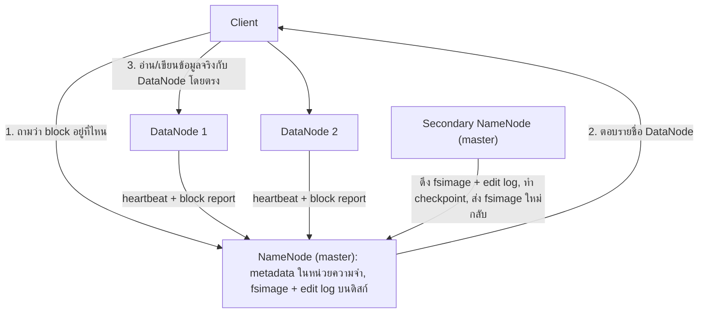

วิธีอ่าน: **client** คือโปรแกรมหรือผู้ใช้ที่ต้องการอ่านหรือเขียนไฟล์ client ถาม NameNode เพียงว่าข้อมูลอยู่ที่ไหน (ลูกศร 1 และ 2) แล้วไปรับส่งข้อมูลจริงกับ DataNode โดยตรง (ลูกศร 3) ข้อมูลจริงจึงไหลระหว่าง client กับ DataNode เท่านั้น NameNode รับภาระแค่คำถามเล็กๆ และไม่เป็นคอขวดของความเร็ว ลูกศรจาก DataNode และ Secondary NameNode อธิบายต่อด้านล่าง

**1) NameNode (master)**

- *ทำไมต้องมี:* ข้อมูลที่กระจายอยู่ 100 เครื่องจะประกอบกลับเป็นไฟล์ได้ ก็ต่อเมื่อมีผู้รู้ว่าไฟล์ไหนประกอบด้วย block อะไร และแต่ละ block อยู่เครื่องไหน
- *ถือข้อมูลอะไร:* โครงสร้างโฟลเดอร์ของระบบไฟล์ (directory tree) metadata ของทุกไฟล์ และตำแหน่งของทุก block ใน cluster ทั้งหมดถูกโหลดไว้ใน **หน่วยความจำ** เพื่อให้ค้นหาได้เร็ว
- *ทำอะไร:* ก่อนอ่านหรือเขียนไฟล์ client ต้องถาม NameNode ว่าไฟล์อยู่บน DataNode ใด NameNode ยังเป็นผู้ตัดสินใจเรื่องการทำสำเนาทั้งหมด
- *บันทึกถาวรอย่างไร:* หน่วยความจำหายเมื่อปิดเครื่อง NameNode จึงบันทึก metadata ลงดิสก์ด้วยไฟล์สองชนิด
  - **fsimage** ภาพรวม (snapshot) ของ metadata ทั้งระบบไฟล์ ณ จุดเวลาหนึ่ง ใช้เป็นจุดตั้งต้นตอน NameNode เริ่มทำงาน
  - **edit log** บันทึกการเปลี่ยนแปลงทุกครั้งที่เกิดหลังจากนั้นตามลำดับ เช่น สร้างไฟล์ ลบไฟล์ เปลี่ยนจำนวนสำเนา

  เหตุที่ใช้สองไฟล์: fsimage มีขนาดใหญ่ การเขียน fsimage ใหม่ทุกครั้งที่มีการเปลี่ยนแปลงจะช้ามาก การต่อท้าย edit log ทีละรายการทำได้เร็ว แล้วค่อยนำมารวมเข้า fsimage เป็นรอบๆ การรวมนี้เรียกว่า **checkpoint** เปรียบได้กับยอดยกมาต้นเดือน (fsimage) กับสมุดรายการเคลื่อนไหว (edit log) ยอดปัจจุบันได้จากยอดยกมาบวกรายการเคลื่อนไหวทั้งหมด
- *ถ้าล้ม:* ใน cluster ที่มี NameNode ตัวเดียว ทั้งระบบไฟล์หยุดใช้งาน เพราะไม่มีใครบอกได้ว่า block อยู่ที่ไหน แม้ข้อมูลทั้งหมดยังอยู่ครบบน DataNode จุดที่ล้มแล้วทำให้ทั้งระบบหยุดแบบนี้เรียกว่า **single point of failure** ระบบจริงจึงมักมี NameNode สำรองที่พร้อมขึ้นมาทำงานแทน เรียกว่าโหมด High Availability

**2) Secondary NameNode (master)**

- *ทำไมต้องมี:* ถ้าปล่อยให้ edit log ยาวขึ้นเรื่อยๆ ทุกครั้งที่ NameNode เริ่มทำงานใหม่ ต้องไล่ทำตามรายการเปลี่ยนแปลงหลายล้านรายการ ซึ่งใช้เวลานานมาก
- *ทำอะไร:* ทำ checkpoint แทน NameNode เป็นระยะ ขั้นตอนคือ อ่าน edit log ของ NameNode แล้วนำการเปลี่ยนแปลงไปใส่ในสำเนา fsimage ของตัวเอง ได้ fsimage ใหม่ที่ทันสมัย ส่ง fsimage ใหม่กลับไปให้ NameNode แล้วล้าง edit log ให้เริ่มใหม่
- *บทบาทเมื่อ NameNode ล้ม:* Secondary NameNode มีหน้าที่ checkpoint อย่างเดียว ไม่ได้รับคำขอจาก client ตัวที่ขึ้นมาทำงานแทน NameNode ได้คือ Standby NameNode ในโหมด HA สิ่งที่ Secondary NameNode ช่วยได้เมื่อ NameNode ล้มคือ มันมี fsimage ล่าสุดที่ใช้ตั้งต้นกู้ระบบได้

**3) DataNode (worker)**

- *ทำอะไร:* เก็บและดูแล block บนดิสก์ในเครื่องตัวเอง ให้บริการอ่านและเขียนแก่ client และสร้าง ลบ หรือทำสำเนา block ตามคำสั่งของ NameNode
- *รายงานสถานะ:* ส่ง **heartbeat** (สัญญาณสั้นๆ ที่ส่งเป็นระยะ บอกว่ายังทำงานอยู่) และ **block report** (รายการ block ทั้งหมดที่ตัวเองเก็บ) ไปให้ NameNode
- *ถ้าล้ม:* NameNode สังเกตได้จาก heartbeat ที่ขาดไป โดยค่าเริ่มต้นรอนานกว่า 10 นาทีก่อนตัดสินว่าเครื่องนั้นตาย (รอนานเพื่อไม่ให้สั่งทำสำเนาใหม่ทุกครั้งที่เครื่องสะดุดชั่วครู่) จากนั้นหยุดส่งงานไปเครื่องนั้น และสั่งให้เครื่องที่ยังมีสำเนาทำสำเนาเพิ่ม จนทุก block กลับมามีสำเนาครบตามจำนวน ([HDFS Architecture: Re-Replication](https://hadoop.apache.org/docs/r2.8.5/hadoop-project-dist/hadoop-hdfs/HdfsDesign.html#Data_Disk_Failure_Heartbeats_and_Re-Replication))

#### การป้องกันข้อมูล: Replication และ Erasure Coding

**Replication (ทำสำเนา)** คือวิธีมาตรฐานของ HDFS ทุกรุ่น แต่ละ block ถูกทำสำเนาไว้หลายเครื่อง ค่าเริ่มต้น 3 สำเนา ต้นทุนคือพื้นที่ ข้อมูล 1 ส่วนใช้ดิสก์ 3 ส่วน พื้นที่ส่วนเกินจึงเท่ากับ 200%

**Erasure coding (EC)** เป็นทางเลือกที่เพิ่มเข้ามาใน Hadoop 3 เพื่อประหยัดพื้นที่ ระบบรวม block ข้อมูลเป็นกลุ่ม แล้วคำนวณ **parity block** (block ตรวจสอบที่คำนวณจากข้อมูลในกลุ่ม) จำนวนไม่มากเก็บไว้ด้วย เมื่อ block ใดในกลุ่มหายไป ระบบคำนวณย้อนกลับจาก block ที่เหลือได้ หลักการเดียวกับ RAID ในชุดฮาร์ดดิสก์

ตัวอย่าง policy ค่าเริ่มต้นของ EC คือ **RS-6-3** (ใช้วิธีคำนวณชื่อ Reed-Solomon กับข้อมูล 6 ส่วน และสร้าง parity 3 ส่วน)

เทียบสองวิธีด้วยข้อมูลจริง 6 หน่วย

- **Replication 3 สำเนา** เก็บข้อมูล 6 หน่วยครบสามชุด ใช้พื้นที่ 18 หน่วย พื้นที่ส่วนเกินคือ 12 หน่วย หรือ 200% ของข้อมูลจริง ทนการเสียหายพร้อมกันได้ 2 จาก 3 สำเนา ต้นทุนหลักคือพื้นที่ดิสก์ วิธีนี้เหมาะกับข้อมูลที่ใช้บ่อย (hot data) เพราะอ่านจากสำเนาใดก็ได้ทันที
- **Erasure coding RS(6,3)** เก็บข้อมูล 6 หน่วยเพียงชุดเดียว บวก parity อีก 3 หน่วย ใช้พื้นที่ 9 หน่วย พื้นที่ส่วนเกินคือ 3 หน่วย หรือ 50% ของข้อมูลจริง ทนการเสียหายพร้อมกันได้ 3 จาก 9 ส่วน ต้นทุนหลักคือ CPU และเครือข่าย ทั้งตอนเขียน (ต้องคำนวณ parity) และตอนกู้ข้อมูล (ต้องคำนวณย้อนกลับ) และต้องมี DataNode อย่างน้อย 9 เครื่อง วิธีนี้เหมาะกับข้อมูลที่นานๆ ใช้ที (cold data)

ตัวเลขข้างต้นอ้างอิงจาก [HDFS Erasure Coding (Hadoop 3.4.0)](https://hadoop.apache.org/docs/r3.4.0/hadoop-project-dist/hadoop-hdfs/HDFSErasureCoding.html)

ใน Hadoop 3 ไฟล์ใช้ replication 3 สำเนาเป็นค่าเริ่มต้นเหมือน Hadoop 2 ผู้ดูแลระบบเปิดใช้ erasure coding เป็นรายโฟลเดอร์ สำหรับข้อมูลที่ต้องการประหยัดพื้นที่ ความต่างระหว่างสองรุ่นในเรื่องนี้จึงสรุปได้ว่า Hadoop 3 เพิ่มทางเลือก erasure coding

#### การใช้งาน HDFS

ติดต่อกับ HDFS ได้สามทาง

1. **Command Line Interface (CLI)** พิมพ์คำสั่งใน terminal ด้วย `hadoop fs` (หรือ `hdfs dfs` ซึ่งทำงานเหมือนกัน)
2. **HTTP interface** เปิดดูไฟล์ผ่าน web browser หรือให้โปรแกรมอื่นส่งคำขอผ่านเว็บมาที่ WebHDFS
3. **API** (Application Programming Interface ชุดคำสั่งที่ระบบเปิดให้โปรแกรมอื่นเรียกใช้) เขียนโปรแกรมภาษา Java เรียกใช้ HDFS ผ่าน FileSystem Java API

**คำสั่ง CLI ที่ต้องรู้**  
ตัวอย่างใช้ผู้ใช้ชื่อ `cloudera` ซึ่งเป็นผู้ใช้ของเครื่องฝึก Cloudera QuickStart โฟลเดอร์ประจำตัวของผู้ใช้ใน HDFS (home directory) คือ `/user/cloudera` ระบบไฟล์ของ HDFS เรียงเป็นต้นไม้แบบเดียวกับ Linux เริ่มจากรากคือ `/`

```bash
hadoop fs -put x.txt /user/cloudera/y.txt
hadoop fs -get /user/cloudera/y.txt x.txt
hadoop fs -mkdir -p /user/cloudera/corpora
hadoop fs -ls /user/cloudera
hadoop fs -mv /user/cloudera/x.txt /user/cloudera/rawdata
hadoop fs -cp /user/cloudera/x.txt y.txt
hadoop fs -rm /user/cloudera/x.txt
hadoop fs -chmod 664 /user/cloudera/x.txt
```

คำสั่งเหล่านี้แบ่งได้เป็นสองกลุ่ม

**กลุ่มที่ย้ายไฟล์ระหว่างเครื่องเรากับ HDFS** มีสองคำสั่งที่ทำงานกลับทิศกัน

- `-put x.txt /user/cloudera/y.txt` อัปโหลดไฟล์ `x.txt` จากดิสก์เครื่องเราขึ้น HDFS ในชื่อ `y.txt` จำง่ายๆ ว่า path แรกอยู่บนเครื่องเรา path ที่สองอยู่ใน HDFS
- `-get /user/cloudera/y.txt x.txt` ทำกลับทิศกัน คือดาวน์โหลดไฟล์จาก HDFS มาเก็บในเครื่องเราเป็น `x.txt` path แรกอยู่ใน HDFS path ที่สองอยู่บนเครื่องเรา

**กลุ่มที่จัดการไฟล์ภายใน HDFS** ทุก path ในกลุ่มนี้อยู่ใน HDFS ทั้งหมด

- `-mkdir -p /user/cloudera/corpora` สร้างโฟลเดอร์ ตัวเลือก `-p` ให้สร้างโฟลเดอร์ชั้นบนที่ยังไม่มีให้ด้วย และให้คำสั่งทำงานต่อได้ถ้าโฟลเดอร์มีอยู่แล้ว
- `-ls /user/cloudera` แสดงรายการไฟล์ในโฟลเดอร์ คอลัมน์ที่สองของผลลัพธ์คือจำนวนสำเนาของไฟล์ (โฟลเดอร์แสดงเป็น `-`)
- `-mv /user/cloudera/x.txt /user/cloudera/rawdata` ย้ายหรือเปลี่ยนชื่อไฟล์ ถ้า `rawdata` เป็นโฟลเดอร์ที่มีอยู่แล้ว ไฟล์จะย้ายเข้าไปอยู่ในนั้น ถ้ายังไม่มี ไฟล์จะเปลี่ยนชื่อเป็น `rawdata` คำสั่งนี้แก้แค่ metadata บน NameNode จึงเสร็จเร็ว
- `-cp /user/cloudera/x.txt y.txt` คัดลอกไฟล์ ปลายทาง `y.txt` ไม่ได้ขึ้นต้นด้วย `/` จึงเป็น relative path ซึ่งนับจาก home directory ใน HDFS ไฟล์ที่ได้จึงอยู่ที่ `/user/cloudera/y.txt` การคัดลอกต้องอ่านและเขียนข้อมูลจริงทั้งไฟล์ จึงใช้เวลานานกว่า `-mv` มาก
- `-rm /user/cloudera/x.txt` ลบไฟล์ ถ้าระบบเปิดถังขยะ (trash) ไว้ ไฟล์จะย้ายไปโฟลเดอร์ `.Trash` ก่อนและยังกู้คืนได้ ถ้าต้องการลบถาวรทันทีให้เพิ่ม `-skipTrash`
- `-chmod 664 /user/cloudera/x.txt` ตั้งสิทธิ์ของไฟล์ เลข 664 ให้สิทธิ์ `-rw-rw-r--` ซึ่งอ่านความหมายได้ดังนี้

**อ่าน chmod 664 ทีละหลัก** สิทธิ์มีสามชนิด แต่ละชนิดมีค่าเป็นตัวเลข: อ่าน (read) = 4, เขียน (write) = 2, รัน (execute) = 1 แต่ละหลักคือผลรวมของสิทธิ์ที่ให้

- หลักแรก = เจ้าของไฟล์ (owner) = 6 = 4 + 2 = อ่านและเขียน: `rw-`
- หลักที่สอง = กลุ่มของเจ้าของ (group) = 6 = อ่านและเขียน: `rw-`
- หลักที่สาม = ผู้ใช้อื่นทั้งหมด (others) = 4 = อ่านอย่างเดียว: `r--`

นำมาต่อกันหลังขีดตัวแรก (ขีดตัวแรกหมายถึงเป็นไฟล์ธรรมดา) ได้ `-rw-rw-r--`

ข้อควรระวังตอนใช้งาน: เครื่องหมายหน้าตัวเลือกต้องเป็นขีดสั้น `-` เมื่อคัดลอกคำสั่งจากเอกสาร Word หรือ PowerPoint ขีดมักถูกแปลงเป็นขีดยาวโดยอัตโนมัติ ให้พิมพ์ขีดใหม่เองทุกครั้ง และถ้าไฟล์ปลายทางของ `-put` มีอยู่แล้ว ต้องใส่ `-f` (`-put -f`) เพื่อเขียนทับ

**สรุปหัวข้อ:** HDFS ตัดไฟล์เป็น block ใหญ่ ทำสำเนาไว้หลายเครื่อง NameNode เก็บ metadata ทั้งหมดในหน่วยความจำและบันทึกถาวรด้วย fsimage กับ edit log DataNode เก็บข้อมูลจริงและส่ง heartbeat Secondary NameNode ทำ checkpoint ข้อมูลจริงไหลระหว่าง client กับ DataNode โดยตรง

### 3.5 YARN

**ปัญหาที่ทำให้ต้องมี**  
ใน Hadoop 1 ตัว MapReduce ทำสองหน้าที่พร้อมกัน คือจัดสรรทรัพยากรของทั้ง cluster และควบคุมการรันทุก job โดยใช้ daemon ตัวเดียวชื่อ JobTracker ผลคือ cluster รันได้เฉพาะงาน MapReduce และ JobTracker กลายเป็นคอขวดเมื่อ cluster ใหญ่ขึ้น YARN แยกสองหน้าที่ออกไปไว้ใน daemon คนละตัว คือ **การจัดสรรทรัพยากร** กับ **การควบคุมงานของแต่ละโปรแกรม** ผลคือ cluster เดียวรันงานได้หลายแบบ ทั้ง MapReduce, Spark และอื่นๆ ([Apache Hadoop YARN](https://hadoop.apache.org/docs/current/hadoop-yarn/hadoop-yarn-site/YARN.html))

**Container** คือหน่วยการจัดสรรทรัพยากรของ YARN หนึ่ง container คือสิทธิ์ใช้ CPU และหน่วยความจำจำนวนหนึ่งบนเครื่องหนึ่ง เช่น 1 แกน CPU และ 2 GB งานจริงทุกชิ้นรันอยู่ใน container

**ภาพในหัว:** เปรียบ cluster เป็นอาคารสำนักงานที่มีห้องประชุมให้จอง ResourceManager คือฝ่ายจองห้องกลางที่รู้ว่าห้องไหนว่าง ApplicationMaster คือหัวหน้าโครงการที่มาขอจองห้องให้ทีมของตัวเอง NodeManager คือผู้ดูแลประจำแต่ละชั้นที่เปิดห้องให้ใช้จริงและรายงานสถานะ container คือห้องที่ได้รับการจอง ข้อจำกัดของอุปมานี้คือ ApplicationMaster ถูกสร้างขึ้นพร้อมโปรแกรมและหายไปเมื่อโปรแกรมจบ และตัวมันเองก็นั่งทำงานอยู่ใน container หนึ่งด้วย

**ส่วนประกอบ** ในหัวข้อนี้ "แอป" หมายถึงโปรแกรมหนึ่งตัวที่ส่งเข้ามารันบน cluster เช่น MapReduce job หนึ่ง job

**ResourceManager** เป็น daemon ระดับ master มีหนึ่งตัวต่อ cluster มันจัดสรรและติดตามทรัพยากรที่ว่างของทั้ง cluster (หน่วยความจำ แกน CPU) ให้แอปต่างๆ และจัดตารางว่า job ไหนได้รันเมื่อไร ภายใน ResourceManager แบ่งเป็นสองส่วน ส่วนแรกคือ Scheduler ซึ่งตัดสินว่าแอปไหนได้ทรัพยากรเท่าไร ส่วนที่สองคือ ApplicationsManager ซึ่งรับ job ที่ส่งเข้ามา และเปิด container แรกให้ ApplicationMaster ของ job นั้น

**ApplicationMaster** เป็น master ประจำแอป มีหนึ่งตัวต่อหนึ่งแอป มันประสานงานแอปที่ตัวเองดูแลตั้งแต่ต้นจนจบ คือขอ container จาก ResourceManager สั่ง NodeManager ให้รันงานใน container เหล่านั้น ติดตามความคืบหน้า และสั่งรันใหม่เมื่องานชิ้นใดล้ม

**NodeManager** เป็น daemon ระดับ worker มีหนึ่งตัวต่อ worker node มันรันและดูแล container บนเครื่องของตัวเอง วัดว่าแต่ละ container ใช้ทรัพยากรไปเท่าไร และรายงานสุขภาพของเครื่องกับสถานะงานกลับไปยัง ResourceManager

**กลไกทีละขั้น: ส่ง MapReduce job หนึ่ง job**

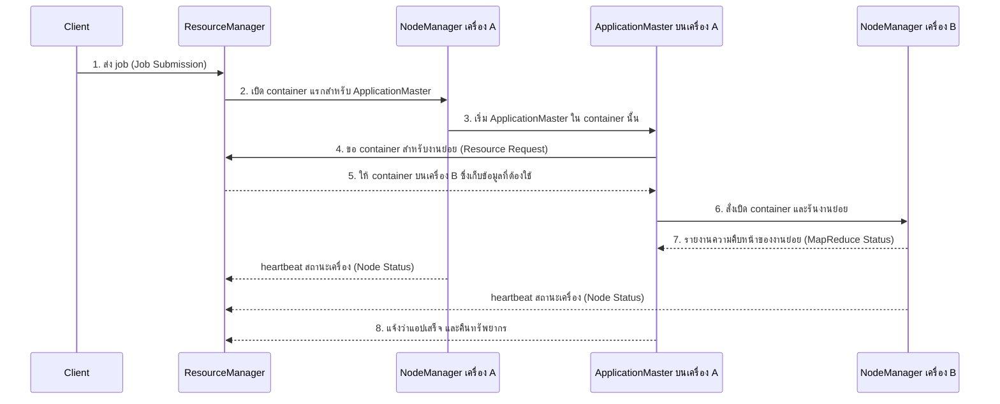

วิธีอ่าน: แต่ละเส้นตั้งคือ daemon หนึ่งตัว ลูกศรเรียงตามเวลาจากบนลงล่าง ลูกศรมีสี่ชนิด ได้แก่ การส่ง job (Job Submission: client ไปหา ResourceManager) การขอทรัพยากร (Resource Request: ApplicationMaster ไปหา ResourceManager) การรายงานสถานะเครื่อง (Node Status: NodeManager ไปหา ResourceManager) และการรายงานความคืบหน้าของงาน (MapReduce Status: งานใน container ไปหา ApplicationMaster ของแอปตัวเอง) ใน cluster จริงมักมีหลายแอปรันพร้อมกัน แต่ละแอปมี ApplicationMaster ของตัวเอง และ container ของแอปหนึ่งกระจายอยู่หลายเครื่องได้

**ความล้มเหลวและการกู้คืน**

- งานใน container ล้ม: ApplicationMaster ขอ container ใหม่แล้วรันงานนั้นซ้ำ ทำได้เพราะงานแต่ละชิ้นอิสระต่อกัน
- NodeManager เงียบไป (heartbeat ขาด): ResourceManager หยุดจัดสรรงานไปเครื่องนั้น และ ApplicationMaster รันงานที่อยู่บนเครื่องนั้นใหม่บนเครื่องอื่น
- ApplicationMaster ล้ม: ResourceManager (ส่วน ApplicationsManager) เริ่ม ApplicationMaster ตัวใหม่ใน container ใหม่

**การวาง master:** daemon ระดับ master สำคัญต่อทั้ง cluster ควรรันบนเครื่องของตัวเอง เพื่อไม่ต้องแย่งทรัพยากรกับงานอื่นจนกลายเป็นคอขวด สำหรับ cluster ขนาดเล็ก master node สองเครื่องก็เพียงพอ เช่น เครื่องหนึ่งรัน NameNode อีกเครื่องรัน ResourceManager กับ Secondary NameNode

**สรุปหัวข้อ:** YARN แยกการจัดสรรทรัพยากร (ResourceManager) ออกจากการควบคุมแต่ละแอป (ApplicationMaster หนึ่งตัวต่อแอป) โดยมี NodeManager รัน container บนแต่ละเครื่อง cluster เดียวจึงรันงานได้หลายแบบ

### 3.6 Hadoop Ecosystem

เมื่อเวลาผ่านไป Hadoop เติบโตเป็น **ระบบนิเวศของเครื่องมือ (ecosystem)** ที่รันบน HDFS และ YARN แต่ละตัวทำหน้าที่เป็นระยะต่างๆ ของ Big Data Pipeline ใน Part 1 เรียงตามระยะได้ดังนี้

**ระยะ Ingestion (นำข้อมูลเข้า)** มีสามเครื่องมือ Sqoop ย้ายข้อมูลจำนวนมากระหว่างฐานข้อมูลแบบตารางกับ HDFS ได้ทั้งนำเข้าและส่งออก Flume รวบรวม log และข้อมูลที่ไหลเข้ามาต่อเนื่องแล้วส่งเข้า HDFS ส่วน Kafka เป็นระบบคิวข้อความที่กระจายอยู่หลายเครื่อง รับข้อความจากผู้ส่งจำนวนมาก แล้วให้ผู้รับหลายรายดึงไปใช้

**ระยะ Data management (จัดการข้อมูลที่เก็บแล้ว)** มีสองเครื่องมือ HBase เป็นฐานข้อมูลแบบ NoSQL (ฐานข้อมูลที่เก็บข้อมูลในรูปแบบอื่นนอกจากตารางเชิงสัมพันธ์) ที่ทำงานบน HDFS ค้นหาและแก้ไขข้อมูลรายแถวด้วย key ได้เร็ว ส่วน Hive เป็น data warehouse บน Hadoop ให้ query ข้อมูลใน HDFS ด้วยภาษาคล้าย SQL ชื่อ HiveQL

**ระยะ Analysis (วิเคราะห์)** Pig เป็นภาษาสคริปต์ชื่อ Pig Latin สำหรับเขียนขั้นตอนแปลงข้อมูล แล้วระบบแปลงสคริปต์เป็นงาน MapReduce ให้ ส่วน Spark MLlib และ Mahout เป็นไลบรารี machine learning และ Spark GraphX เป็นไลบรารีวิเคราะห์ข้อมูลกราฟ

**ระยะ Workflow (จัดการลำดับงาน)** Oozie จัดลำดับและตั้งเวลารันงาน Hadoop (รายละเอียดใน Part 5)

แผนภาพ Hadoop 2.0 วางเครื่องมือเหล่านี้เป็นชั้น อ่านจากล่างขึ้นบน

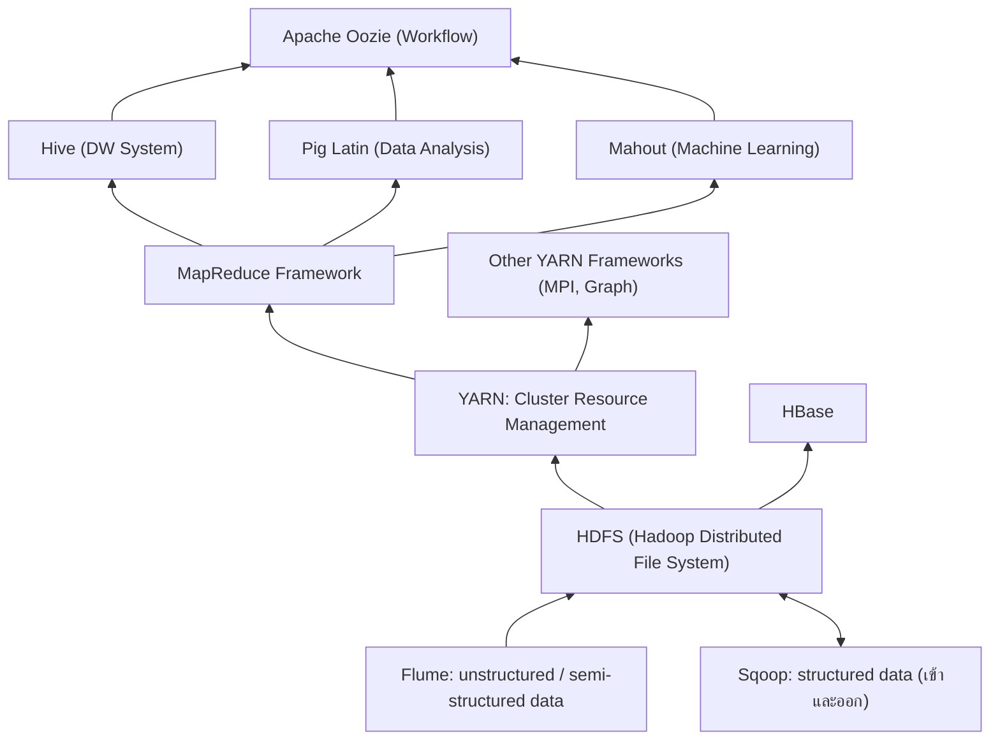

วิธีอ่าน: ด้านล่างสุดคือทางเข้าข้อมูล Flume รับข้อมูลไม่มีโครงสร้างและกึ่งมีโครงสร้าง Sqoop รับส่งข้อมูลแบบตาราง HDFS อยู่ถัดขึ้นมาเป็นที่เก็บข้อมูล YARN อยู่บน HDFS ในฐานะผู้จัดสรรทรัพยากร โปรแกรมประมวลผล (MapReduce และ framework อื่น) รันบน YARN เครื่องมือระดับสูงอย่าง Hive, Pig, Mahout แปลงคำสั่งของผู้ใช้เป็นงานของ MapReduce และ Oozie อยู่บนสุดเพื่อร้อยงานทั้งหมดเป็นลำดับ HBase อยู่ด้านข้างเพราะใช้ HDFS เป็นที่เก็บโดยตรง

สถานะปัจจุบันของเครื่องมือบางตัว: Apache Sqoop ยุติการพัฒนาและย้ายเข้า Apache Attic (แหล่งเก็บโครงการที่ปลดระวางของมูลนิธิ Apache) ในปี 2021 ([Apache Attic: Sqoop](https://attic.apache.org/projects/sqoop.html)) และ Apache Oozie ย้ายเข้า Attic ในปี 2025 ([Apache Attic: Oozie](https://attic.apache.org/projects/oozie.html)) แนวคิดของทั้งสองตัวยังเป็นพื้นฐานที่ดีและพบได้ในระบบ Hadoop เดิมขององค์กร งานใหม่มักใช้เครื่องมือรุ่นใหม่ เช่น Airflow สำหรับจัดการ workflow

**สรุปหัวข้อ:** Hadoop ecosystem วางเครื่องมือตามระยะของ pipeline ได้แก่ นำเข้า (Sqoop, Flume, Kafka) จัดการข้อมูล (HBase, Hive) วิเคราะห์ (Pig, MLlib, Mahout) และจัดการ workflow (Oozie) ทั้งหมดอยู่บน HDFS และ YARN

---
## Part 4 MapReduce

### 4.1 แนวคิด

**ปัญหาที่ทำให้ต้องมี**  
HDFS ทำให้ข้อมูลกระจายอยู่หลายเครื่องแล้ว คำถามต่อไปคือ ถ้าต้องการ "นับว่าแต่ละคำปรากฏกี่ครั้งในเอกสารทั้งหมด" เราจะให้ 100 เครื่องช่วยกันนับได้อย่างไร โดยผู้เขียนโปรแกรมไม่ต้องเขียนเองทั้งเรื่องการส่งข้อมูลข้ามเครือข่าย การรอกันระหว่างเครื่อง และการรับมือเมื่อเครื่องพังกลางทาง MapReduce แก้ด้วยการให้ผู้ใช้เขียนงานในรูปแบบตายตัวเพียงสองฟังก์ชัน แล้ว framework จัดการส่วนที่เหลือทั้งหมด

**คู่ key/value** คือหน่วยข้อมูลพื้นฐานของ MapReduce ข้อมูลหนึ่งคู่ประกอบด้วยตัวระบุ (key) กับค่า (value) เขียนเป็น ('cat', 1) ก็หมายถึง key คือคำว่า cat และ value คือ 1 ทุกขั้นของ MapReduce รับและส่งข้อมูลเป็นคู่แบบนี้ และระบบใช้ key ตัดสินว่าข้อมูลไหนต้องมารวมกัน

**นิยาม**  
MapReduce คือ framework การคำนวณที่เรียบง่ายแต่ทรงพลัง ออกแบบมาเพื่อการคำนวณแบบกระจายหลายเครื่องที่ทนต่อความล้มเหลว ใช้รูปแบบ **functional programming** คือเขียนงานเป็นฟังก์ชันที่รับข้อมูลเข้าแล้วคืนผลลัพธ์ออก โดยฟังก์ชันไม่แตะต้องตัวแปรภายนอก รูปแบบนี้มีคุณสมบัติสามข้อที่ทำให้กระจายงานได้

1. **task อิสระหลายตัวรันฟังก์ชันเดียวกัน** แต่ละตัวทำกับข้อมูลชิ้นที่อยู่ในเครื่องของตัวเอง
2. **ข้อมูลส่งต่อระหว่างฟังก์ชันด้วยการนำผลของฟังก์ชันหนึ่งไปเป็นข้อมูลเข้าของอีกฟังก์ชัน** ฟังก์ชันไม่ใช้ตัวแปรร่วมกัน
3. **ฟังก์ชันไม่เก็บสถานะ (stateless)** คือผลลัพธ์ขึ้นกับข้อมูลเข้าอย่างเดียว รันซ้ำกี่ครั้งด้วยข้อมูลเข้าเดิมก็ได้ผลเดิม ระบบจึงรัน task ที่ล้มซ้ำได้อย่างปลอดภัย

**สองฟังก์ชันที่ผู้ใช้เขียน**

- **map** รับข้อมูลเข้าเป็นชุดของคู่ key/value ทำงานกับ **ทีละคู่** และส่งออกคู่ key/value ระหว่างทาง (intermediate) จำนวนตั้งแต่ศูนย์คู่ขึ้นไป การส่งออกศูนย์คู่ทำให้ map ใช้คัดข้อมูลที่ไม่ต้องการทิ้งได้ด้วย
- **reduce** รับ key หนึ่งตัว พร้อม **รายการของ value ทั้งหมด** ที่มี key นั้น แล้วประมวลผลขั้นสุดท้าย ซึ่งมักเป็นการรวมหรือสรุปค่า (aggregate) เช่น หาผลรวม แล้วส่งออกคู่ key/value สุดท้าย

**ส่วนที่ framework ทำให้: Shuffle and Sort**  
ระหว่าง map กับ reduce ระบบนำผลจาก map ทุกตัวมาจัดการสามขั้น

1. **Partition** ตัดสินว่า key แต่ละตัวจะไป reduce ตัวไหน งานนี้เป็นของส่วนที่เรียกว่า **partitioner** (หัวข้อ 4.6)
2. **Shuffle** ส่งข้อมูลข้ามเครือข่ายไปยังเครื่องของ reduce ที่ได้รับ key นั้น
3. **Sort** เรียงข้อมูลตาม key และรวม value ของ key เดียวกันเข้าเป็นรายการ

สิ่งที่ระบบรับประกันคือ **ทุกคู่ที่มี key เดียวกันจะไปถึง reduce ตัวเดียวกันเสมอ** reduce จึงคำนวณผลของ key นั้นได้ครบด้วยตัวเอง ([Cloudera MapReduce tutorial](https://docs.cloudera.com/documentation/other/tutorial/CDH5/topics/ht_interfaces.html))

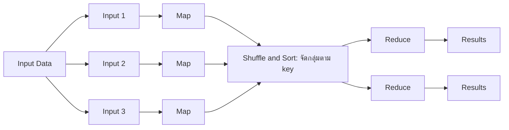

วิธีอ่าน: ข้อมูลเข้าถูกตัดเป็นหลายชิ้น แต่ละชิ้นไปที่ map หนึ่งตัวซึ่งทำงานพร้อมกัน ผลของ map ทุกตัวถูกสลับและจัดกลุ่มตาม key ตรงกลาง แล้วแต่ละกลุ่มไปยัง reduce ตัวใดตัวหนึ่ง map แต่ละตัวส่งข้อมูลไปให้ reduce ได้ทุกตัว ขึ้นกับว่าผลของมันมี key ใดบ้าง

**ลำดับขั้นทั้งหมดของ job หนึ่ง** มีเจ็ดขั้น ขั้นที่ผู้ใช้เขียนเองมีแค่ map, combiner และ reduce ที่เหลือ framework ทำให้

1. **Input** framework อ่านไฟล์จาก HDFS แล้วตัดเป็นชิ้นข้อมูลเข้า (input split) ปกติหนึ่ง split ต่อหนึ่ง block แต่ละ split ถูกอ่านออกมาเป็นคู่ key/value
2. **Map** ฟังก์ชันที่ผู้ใช้เขียน รันพร้อมกันหลายตัว แต่ละตัวรับคู่ key/value ทีละคู่ แล้วส่งออกคู่ key/value ระหว่างทาง
3. **Combiner** (เลือกใช้หรือไม่ใช้ก็ได้) ฟังก์ชันที่ผู้ใช้เขียน รันบนเครื่องเดียวกับ map เพื่อรวมผลของ map ตัวนั้นให้เล็กลงก่อนส่งต่อ (หัวข้อ 4.5)
4. **Partition** partitioner ดู key แต่ละตัว แล้วกำหนดหมายเลข reduce ที่ key นั้นจะไป
5. **Shuffle and Sort** framework ส่งผลของ map ทุกตัวข้ามเครือข่ายไปยัง reduce ที่ถูกกำหนด แล้วเรียงตาม key reduce แต่ละตัวจึงได้รายการ key ที่เรียงแล้ว พร้อมรายการ value ของแต่ละ key
6. **Reduce** ฟังก์ชันที่ผู้ใช้เขียน รันพร้อมกันหลายตัว แต่ละตัวรับ key หนึ่งตัวกับรายการ value แล้วส่งออกคู่ key/value สุดท้าย
7. **Output** framework เขียนผลของ reduce ลง HDFS เป็นหนึ่งไฟล์ต่อ reduce หนึ่งตัว ชื่อ `part-00000`, `part-00001` ไปเรื่อยๆ

**สรุปหัวข้อ:** ผู้ใช้เขียนแค่ map (แปลงข้อมูลทีละคู่) และ reduce (รวมค่าตาม key) ส่วนการกระจายงาน การจัดกลุ่มตาม key และการรันซ้ำเมื่อล้มเป็นงานของ framework ฟังก์ชันไม่เก็บสถานะจึงรันซ้ำได้ผลเดิม

### 4.2 ตัวอย่างที่ 1: นับคำ (Word Count)

**Pseudo code** (โค้ดจำลองที่เขียนให้อ่านง่าย เน้นตรรกะ ยังไม่ใช่โค้ดที่รันได้จริง)

```text
def map(dockey, line):
    for word in line.split():
        emit(word, 1)

def reduce(word, values):
    count = sum(value for value in values)
    emit(word, count)
```

`emit` คือคำสั่งส่งคู่ key/value ออกไปยังขั้นถัดไปของ MapReduce เรียกได้หลายครั้งในฟังก์ชันเดียว `line.split()` ตัดบรรทัดเป็นคำตามช่องว่าง

**ทำไมจึงได้ผลถูก:** map มีหน้าที่เดียวคือประกาศว่า "เจอคำนี้หนึ่งครั้ง" ทุกครั้งที่เจอ การนับจริงเกิดที่ reduce ซึ่งได้รับเลข 1 ทั้งหมดของคำนั้นจากทุก map มารวมกัน map แต่ละตัวจึงทำงานได้โดยไม่ต้องรู้ว่าตัวอื่นเจออะไร

**Key ที่ map ได้รับ:** เมื่ออ่านไฟล์ข้อความ Hadoop ส่งให้ map ทีละบรรทัด value คือข้อความในบรรทัดนั้น ส่วน key คือตำแหน่งที่บรรทัดนั้นเริ่มต้นในไฟล์ นับเป็นจำนวนไบต์จากต้นไฟล์ (byte offset) key นี้บอกแค่ตำแหน่ง map ของการนับคำจึงไม่ได้ใช้มัน ในตัวอย่างนี้ใช้ตัวเลขสมมติ 27183 และ 31416 เป็น key map แต่ละตัวอาจทำงานกับเอกสารทั้งฉบับ หรือถ้าเอกสารใหญ่มาก ก็ทำกับชิ้นหนึ่งของเอกสาร ผลของ map มี key เป็นคำ และ value เป็นจำนวนเต็ม

**Worked trace: สองประโยค สอง map**

ข้อมูลเข้า

- Block 1: (27183, "The fast cat wears no hat.")
- Block 2: (31416, "The cat in the hat ran fast.")

ข้อสมมติของตัวอย่างนี้: ตัดประโยคเป็นหน่วยย่อยเรียกว่า **token** โดยให้จุด `.` เป็น token ของตัวเอง และนับตัวพิมพ์ใหญ่กับเล็กเป็นคนละคำ ("The" กับ "the" เป็นคนละ key)

ขั้นที่ 1 Map

- Map ตัวที่ 1 ส่งออก: ('The',1), ('fast',1), ('cat',1), ('wears',1), ('no',1), ('hat',1), ('.',1)
- Map ตัวที่ 2 ส่งออก: ('The',1), ('cat',1), ('in',1), ('the',1), ('hat',1), ('ran',1), ('fast',1), ('.',1)

ขั้นที่ 2 Shuffle and Sort ระบบรวมผลจาก map ทุกตัว แล้วเรียงตาม key แต่ละบรรทัดคือ key หนึ่งตัวกับรายการ value ทั้งหมดของมัน

```text
('.',     [1, 1])
('The',   [1, 1])
('cat',   [1, 1])
('fast',  [1, 1])
('hat',   [1, 1])
('in',    [1])
('no',    [1])
('ran',   [1])
('the',   [1])
('wears', [1])
```

ผลนี้ถูกแบ่งเป็นชุด และแต่ละชุดส่งไปให้ reduce หนึ่งตัว

ขั้นที่ 3 Reduce (รวมเลข 1 ทั้งหมดของแต่ละ key)

('.', 2), ('The', 2), ('cat', 2), ('fast', 2), ('hat', 2), ('in', 1), ('no', 1), ('ran', 1), ('the', 1), ('wears', 1)

ตรวจสอบ: ประโยคแรกมี 7 token ประโยคที่สองมี 8 token รวม 15 ผลรวมของจำนวนทุก key = 2+2+2+2+2+1+1+1+1+1 = 15 ตรงกัน

**ฝึกไล่เองอีกหนึ่งชุด:** ข้อมูลเข้าสามบรรทัด "A B R", "C C R", "A C B" แต่ละบรรทัดไปที่ map คนละตัว ได้ (A,1)(B,1)(R,1), (C,1)(C,1)(R,1), (A,1)(C,1)(B,1) หลัง shuffle and sort จัดกลุ่มเป็น A:[1,1], B:[1,1], C:[1,1,1], R:[1,1] และ reduce ได้ (A,2), (B,2), (C,3), (R,2) ถ้าไล่ตามได้ครบ แปลว่าเข้าใจกลไกแล้ว

### 4.3 Hadoop Streaming: เขียน MapReduce ด้วย Python

**ที่มา:** MapReduce ดั้งเดิมเขียนด้วยภาษา Java แล้วรวมเป็นไฟล์ JAR (Java Archive ไฟล์บีบอัดที่รวมโปรแกรม Java ไว้ในไฟล์เดียว) เมื่อส่ง job Hadoop จะส่งไฟล์ JAR ไปยังทุกเครื่องที่ต้องรัน map หรือ reduce

**Hadoop Streaming** คือเครื่องมือที่มากับ Hadoop ทำให้ใช้โปรแกรมหรือสคริปต์ภาษาใดก็ได้ (คำสั่ง shell, R, Python) เป็น map และ reduce โดยสื่อสารกันผ่าน **standard stream** ซึ่งเป็นช่องรับส่งข้อมูลมาตรฐานที่ทุกโปรแกรมบน Linux มีอยู่แล้วสามช่อง

- **stdin (standard input):** ช่องที่โปรแกรมอ่านข้อมูลเข้า ปกติคือสิ่งที่พิมพ์จากคีย์บอร์ด
- **stdout (standard output):** ช่องที่โปรแกรมเขียนผลลัพธ์ออก ปกติคือหน้าจอ
- **stderr (standard error):** ช่องสำหรับข้อความแจ้งข้อผิดพลาด แยกจากผลลัพธ์

Streaming นำข้อมูลมาป้อนเข้า stdin ของสคริปต์ และเก็บสิ่งที่สคริปต์เขียนออกทาง stdout สคริปต์จึงเขียนแบบ "อ่านจาก stdin แล้ว print ผลออก" ได้เลย

**กลไกทีละขั้น** ([Hadoop Streaming](https://hadoop.apache.org/docs/r2.8.5/hadoop-streaming/HadoopStreaming.html))

1. map task แต่ละตัวเปิดสคริปต์ที่ผู้ใช้ระบุขึ้นมาเป็นโปรแกรมแยก (process) ของตัวเอง
2. map task แปลงข้อมูลเข้าเป็นบรรทัดข้อความ แล้วส่งต่อ (pipe) เข้า stdin ของสคริปต์ พร้อมกันนั้นก็เก็บทุกบรรทัดที่สคริปต์เขียนออกทาง stdout
3. แต่ละบรรทัดจาก stdout ถูกแปลงเป็นคู่ key/value ตามกติกา **ข้อความก่อน tab ตัวแรกคือ key ส่วนที่เหลือคือ value** สคริปต์จึงต้องเขียนผลเป็น `key<TAB>value` หนึ่งคู่ต่อบรรทัด
4. หลัง shuffle and sort แล้ว reduce task เปิดสคริปต์ reducer ขึ้นมา และส่งคู่ key/value **ที่เรียงตาม key แล้ว** เข้า stdin ในรูปบรรทัด `key<TAB>value`
5. reducer รวมค่าแล้วเขียนผลออกทาง stdout ในรูปแบบเดียวกัน

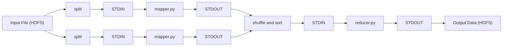

**ข้อมูลที่ reducer ของ streaming ได้รับ:** reducer ได้รับ **บรรทัดทีละบรรทัด** และ key เดียวกันซ้ำหลายบรรทัด เช่น

```text
cat	1
cat	1
fast	1
```

reducer จึงต้องจำ key ที่กำลังรวมอยู่เอง เมื่อพบบรรทัดที่ key เปลี่ยน แปลว่ากลุ่มเดิมจบแล้ว ส่งผลของกลุ่มนั้นออกได้ วิธีนี้ใช้ได้เพราะระบบรับประกันว่า **ข้อมูลเข้า reducer เรียงตาม key แล้ว** key เดียวกันจึงอยู่ติดกันเสมอ

**mapper.py**

```python
#!/usr/bin/env python3
import sys

if __name__ == '__main__':
    for line in sys.stdin:
        for word in line.split():
            sys.stdout.write('{}\t1\n'.format(word))
```

อธิบายทีละบรรทัด

- `#!/usr/bin/env python3` เรียกว่า shebang เป็นบรรทัดแรกที่บอกระบบปฏิบัติการว่าให้รันไฟล์นี้ด้วย python3 จำเป็นเมื่อ Hadoop เรียกไฟล์เป็นโปรแกรมโดยตรง และไฟล์ต้องมีสิทธิ์รัน (`chmod +x mapper.py`)
- `import sys` นำโมดูล `sys` เข้ามาเพื่อใช้ `sys.stdin` และ `sys.stdout`
- `if __name__ == '__main__':` ให้โค้ดข้างในทำงานเมื่อไฟล์ถูกรันเป็นโปรแกรมหลัก ชื่อ `__name__` มีขีดล่างสองตัวทั้งหน้าและหลัง และ `==` คือการเปรียบเทียบว่าเท่ากันหรือไม่
- `for line in sys.stdin:` อ่านข้อมูลเข้าทีละบรรทัด จึงใช้หน่วยความจำน้อยแม้ไฟล์ใหญ่
- `line.split()` ตัดบรรทัดเป็นคำตามช่องว่างทุกชนิด รวมถึงตัวขึ้นบรรทัดใหม่ท้ายบรรทัด
- `sys.stdout.write('{}\t1\n'.format(word))` เขียนหนึ่งบรรทัด ประกอบด้วย คำ, tab (`\t`), เลข 1 และตัวขึ้นบรรทัดใหม่ (`\n`) `'{}\t1\n'.format(word)` คือการนำ `word` ไปแทนที่ `{}` ในข้อความ ได้ข้อความหนึ่งก้อนส่งให้ `write`

**reducer.py**

```python
#!/usr/bin/env python3
import sys

if __name__ == '__main__':
    curkey = None
    total = 0
    for line in sys.stdin:
        key, val = line.rstrip('\n').split('\t', 1)
        val = int(val)
        if key == curkey:
            total += val
        else:
            if curkey is not None:
                sys.stdout.write('{}\t{}\n'.format(curkey, total))
            curkey = key
            total = val
    if curkey is not None:
        sys.stdout.write('{}\t{}\n'.format(curkey, total))
```

อธิบายทีละบรรทัด

- `curkey = None` key ที่กำลังรวมอยู่ ตอนเริ่มยังไม่มี (`None` คือค่าว่างของ Python เขียนด้วย N ตัวใหญ่)
- `total = 0` ยอดสะสมของ key ปัจจุบัน
- `line.rstrip('\n').split('\t', 1)` ตัดตัวขึ้นบรรทัดใหม่ท้ายบรรทัดออก แล้วแยกที่ tab ตัวแรกครั้งเดียว ได้สองส่วนเก็บใน `key` และ `val`
- `val = int(val)` ทุกอย่างที่อ่านจาก stdin เป็นข้อความ จึงต้องแปลงเป็นตัวเลขก่อนนำไปบวก
- `if key == curkey: total += val` ถ้ายังเป็น key เดิม บวกสะสม
- `else:` key เปลี่ยน แปลว่ากลุ่มก่อนหน้าจบแล้ว ถ้ามีกลุ่มก่อนหน้าอยู่ (`curkey is not None`) ให้เขียนผลของกลุ่มนั้นออก จากนั้นเริ่มกลุ่มใหม่ด้วย key และค่าปัจจุบัน
- สองบรรทัดสุดท้ายนอก loop **เขียนผลของกลุ่มสุดท้าย** หลังอ่านครบทุกบรรทัด กลุ่มสุดท้ายยังค้างอยู่ใน `curkey` และ `total` เพราะไม่มี key ใหม่มากระตุ้นให้เขียน บรรทัดนี้จึงจำเป็นเสมอ เงื่อนไข `curkey is not None` ทำให้โค้ดทำงานได้แม้ข้อมูลเข้าว่างเปล่า

**ทดสอบในเครื่องโดยไม่ต้องมี cluster:** คำสั่ง `sort` ของ Linux ทำหน้าที่แทน shuffle and sort ได้ เพราะทำให้ key เดียวกันมาเรียงติดกัน เครื่องหมาย `|` (pipe) ส่ง stdout ของคำสั่งซ้ายไปเป็น stdin ของคำสั่งขวา

```bash
printf 'The fast cat wears no hat.\nThe cat in the hat ran fast.\n' > input.txt
cat input.txt | python3 mapper.py | LC_ALL=C sort | python3 reducer.py
```

ผลจากการรันจริง

```text
The	2
cat	2
fast	1
fast.	1
hat	1
hat.	1
in	1
no	1
ran	1
the	1
wears	1
```

`split()` ตัดคำด้วยช่องว่างอย่างเดียว เครื่องหมายวรรคตอนจึงติดไปกับคำ ได้ "fast." และ "hat." เป็นคนละ key กับ "fast" และ "hat" และตัวพิมพ์ใหญ่-เล็กต่างกันก็เป็นคนละ key ในงานจริงจึงมักแปลงคำให้เป็นตัวพิมพ์เล็กและตัดเครื่องหมายวรรคตอนใน mapper ก่อน

**ส่ง job ขึ้น cluster**

```bash
hadoop jar $HADOOP_HOME/share/hadoop/tools/lib/hadoop-streaming-*.jar \
    -files mapper.py,reducer.py,combiner.py \
    -input input.data \
    -output output.data \
    -mapper mapper.py \
    -combiner combiner.py \
    -reducer reducer.py
```

อ่านคำสั่งนี้ทีละส่วน

- `hadoop jar $HADOOP_HOME/share/hadoop/tools/lib/hadoop-streaming-*.jar` สั่งให้ Hadoop รันโปรแกรม Java ในไฟล์ JAR ที่ระบุ ซึ่งในที่นี้คือตัว Hadoop Streaming ไฟล์นี้อยู่ในโฟลเดอร์ `share/hadoop/tools/lib/` ของ Hadoop และมีชื่อ `hadoop-streaming-<เลขรุ่น>.jar` ส่วน `$HADOOP_HOME` คือตัวแปรที่เก็บตำแหน่งที่ติดตั้ง Hadoop
- `-files mapper.py,reducer.py,combiner.py` ส่งไฟล์สคริปต์ไปให้ทุกเครื่องที่รันงาน คั่นชื่อไฟล์ด้วยจุลภาค ตัวเลือกนี้ต้องวางก่อนตัวเลือกอื่นของ streaming (Hadoop รุ่นเก่าใช้ `-file` ใส่ทีละไฟล์)
- `-input input.data` บอก path ใน HDFS ของข้อมูลเข้า เป็นไฟล์หรือโฟลเดอร์ก็ได้
- `-output output.data` บอกโฟลเดอร์ใน HDFS สำหรับเก็บผลลัพธ์ ต้องเป็นชื่อที่ยังไม่มีอยู่ ระบบตั้งกติกานี้เพื่อป้องกันการเขียนทับผลลัพธ์เดิม
- `-mapper mapper.py` และ `-reducer reducer.py` บอกคำสั่งที่ใช้เป็น map และ reduce
- `-combiner combiner.py` บอกคำสั่งที่ใช้เป็น combiner (หัวข้อ 4.5)

เมื่อ job เสร็จ ผลลัพธ์อยู่ใน `output.data/part-00000` (หนึ่งไฟล์ต่อ reduce หนึ่งตัว) และมีไฟล์ `_SUCCESS` บอกว่า job จบสมบูรณ์ ดูเนื้อหาได้ด้วย `hadoop fs -cat output.data/part-00000`

### 4.4 ตัวอย่างที่ 2: เพื่อนร่วมกัน (Shared Friendship)

**โจทย์:** วิเคราะห์เครือข่ายสังคมเพื่อหาคนที่ผู้ใช้อาจรู้จัก ขั้นพื้นฐานคือหา **รายชื่อเพื่อนร่วมกันของผู้ใช้ทุกคู่ที่เป็นเพื่อนกัน**

- ข้อมูลเข้า: key = ชื่อผู้ใช้, value = รายชื่อเพื่อนของผู้ใช้นั้น
- ผลลัพธ์: สำหรับผู้ใช้แต่ละคู่ รายชื่อเพื่อนที่ทั้งสองคนมีร่วมกัน

**ไอเดียหลัก:** เพื่อนร่วมกันของ A กับ B คือคนที่อยู่ทั้งในรายชื่อเพื่อนของ A และในรายชื่อเพื่อนของ B (เรียกว่า **intersection** ของสองชุด) reduce ตัวหนึ่งจะคำนวณ intersection ได้ ก็ต่อเมื่อได้รับรายชื่อเพื่อนของทั้ง A และ B เราจึงออกแบบให้ map ส่งรายชื่อเพื่อนทั้งชุดออกไป โดยใช้ "คู่ชื่อ" เป็น key เพื่อให้รายชื่อของสองคนในคู่เดียวกันไปพบกันที่ reduce ตัวเดียวกัน

```text
def map(person, friends):
    for friend in friends:
        pair = sorted([person, friend])
        emit(pair, friends)

def reduce(pair, friends_lists):
    shared = set(friends_lists[0])
    shared = shared.intersection(friends_lists[1])
    emit(pair, shared)
```

**ทำไมต้องเรียงชื่อในคู่ (`sorted`):** Allen สร้างคู่ (Allen, Betty) และ Betty สร้างคู่ (Betty, Allen) การเรียงชื่อตามตัวอักษรทำให้ทั้งสองฝั่งได้ key เดียวกันคือ (Allen, Betty) รายชื่อของทั้งสองคนจึงไปถึง reduce ตัวเดียวกัน หลักการออกแบบที่ได้จากตัวอย่างนี้คือ **ออกแบบ key ให้ข้อมูลที่ต้องคำนวณด้วยกันได้ key เดียวกัน**

**Worked trace** (ผลทั้งหมดตรวจด้วยการจำลองในเครื่องแล้ว)

ข้อมูลเข้า หนึ่งบรรทัดต่อ map หนึ่งตัว

1. Allen: (Betty, Chris, David)
2. Betty: (Allen, Chris, David, Ellen)
3. Chris: (Allen, Betty, David, Ellen)
4. David: (Allen, Betty, Chris, Ellen)
5. Ellen: (Betty, Chris, David)

ขั้น Map: map แต่ละตัวส่งออกหนึ่งคู่ต่อเพื่อนหนึ่งคน และทุกคู่มี value เป็นรายชื่อเพื่อนทั้งหมดของเจ้าของ เช่น map ตัวที่ 1 ส่งออก

- (Allen, Betty) : (Betty, Chris, David)
- (Allen, Chris) : (Betty, Chris, David)
- (Allen, David) : (Betty, Chris, David)

map ตัวที่ 2 ส่งออก (Allen, Betty), (Betty, Chris), (Betty, David), (Betty, Ellen) ทุกคู่มี value เป็น (Allen, Chris, David, Ellen) map ตัวที่ 3 ถึง 5 ทำแบบเดียวกัน รวมทั้งหมด 3 + 4 + 4 + 4 + 3 = 18 คู่

ขั้น Shuffle and Sort: คู่ที่มี key เดียวกันมารวมกัน ความเป็นเพื่อนในข้อมูลนี้เป็นสองทาง (A อยู่ในรายชื่อของ B และ B อยู่ในรายชื่อของ A) **ทุก key จึงได้รายชื่อสองชุดพอดี** ได้ 18 / 2 = 9 key เช่น

- (Allen, Betty) : [(Betty, Chris, David), (Allen, Chris, David, Ellen)]
- (Allen, Chris) : [(Betty, Chris, David), (Allen, Betty, David, Ellen)]
- (Allen, David) : [(Betty, Chris, David), (Allen, Betty, Chris, Ellen)]

ขั้น Reduce: หา intersection ของสองชุด ได้ผลลัพธ์สุดท้าย แต่ละบรรทัดคือคู่เพื่อน และหลังเครื่องหมาย `:` คือเพื่อนร่วมกันของคู่นั้น

```text
(Allen, Betty) : Chris, David
(Allen, Chris) : Betty, David
(Allen, David) : Betty, Chris
(Betty, Chris) : Allen, David, Ellen
(Betty, David) : Allen, Chris, Ellen
(Betty, Ellen) : Chris, David
(Chris, David) : Allen, Betty, Ellen
(Chris, Ellen) : Betty, David
(David, Ellen) : Betty, Chris
```

ตรวจสอบหนึ่งบรรทัดด้วยมือ: เพื่อนของ Allen = {Betty, Chris, David} เพื่อนของ Betty = {Allen, Chris, David, Ellen} คนที่อยู่ทั้งสองชุดคือ {Chris, David} ตรงกับบรรทัดแรก

ผลลัพธ์มีเฉพาะคู่ที่เป็นเพื่อนกันอยู่แล้ว เพราะ map สร้าง key จากเจ้าของกับเพื่อนในรายชื่อเท่านั้น การหาคู่ที่ยังไม่เป็นเพื่อนแต่มีเพื่อนร่วมกัน เช่น Allen กับ Ellen ต้องออกแบบ map อีกแบบ (โจทย์ฝึกข้อ 5)

reduce นี้อ่านรายชื่อสองชุดด้วย `friends_lists[0]` และ `friends_lists[1]` จึงต้องการข้อมูลที่ความเป็นเพื่อนบันทึกไว้ครบทั้งสองทาง ถ้าข้อมูลจริงอาจบันทึกไว้ทางเดียว การเขียนที่รองรับทุกกรณีคือวนทำ intersection กับทุกรายการที่ได้รับ และข้าม key ที่ได้รับรายการน้อยกว่าสองชุด

### 4.5 Combiner

**ปัญหา:** map อาจผลิตข้อมูลระหว่างทางจำนวนมากที่ต้องส่งข้ามเครือข่ายไป shuffle, sort แล้วจึง reduce ผลคือการสื่อสารล่าช้า และ reduce อาจได้ข้อมูลมากเกินกว่าหน่วยความจำจะรับ ใน word count ถ้าคำว่า "the" ปรากฏ 50,000 ครั้งใน block หนึ่ง map ตัวนั้นส่ง ('the', 1) ออกไป 50,000 บรรทัด

**นิยาม:** Combiner คือการรวมผลย่อยบนเครื่องเดียวกับ map (mapper-local reduction) ก่อนส่งข้อมูลไป shuffle and sort จึงลดปริมาณข้อมูลที่ต้องส่งข้ามเครือข่าย ในตัวอย่างข้างบน combiner เปลี่ยน 50,000 บรรทัดเป็นบรรทัดเดียว ('the', 50000)

**Worked example: ผลรวมตามรหัสสนามบิน**

ผลของ map

- Map ตัวที่ 1: (IAD, 14.4), (SFO, 3.9), (JFK, 3.9), (IAD, 12.2), (JFK, 5.8)
- Map ตัวที่ 2: (SFO, 4.7), (IAD, 2.3), (SFO, 4.4), (IAD, 1.2)

**กรณีไม่มี combiner:** ส่ง 9 คู่ข้ามเครือข่าย reduce รวมได้

- IAD = 14.4 + 12.2 + 2.3 + 1.2 = **30.1**
- JFK = 3.9 + 5.8 = **9.7**
- SFO = 3.9 + 4.7 + 4.4 = **13.0**

**กรณีมี combiner:** map แต่ละตัวรวมผลของตัวเองก่อนส่ง

- Map ตัวที่ 1 หลัง combine: (IAD, 14.4 + 12.2 = 26.6), (SFO, 3.9), (JFK, 3.9 + 5.8 = 9.7)
- Map ตัวที่ 2 หลัง combine: (SFO, 4.7 + 4.4 = 9.1), (IAD, 2.3 + 1.2 = 3.5)

ส่งข้ามเครือข่ายเพียง 5 คู่ (ลดจาก 9) reduce รวม IAD = 26.6 + 3.5 = 30.1, JFK = 9.7, SFO = 3.9 + 9.1 = 13.0 **ได้ผลเท่ากับกรณีไม่มี combiner ทุก key** การเทียบสองกรณีแบบนี้คือวิธีตรวจว่า combiner ทำงานถูกต้อง

**เงื่อนไขการใช้ combiner:** การรวมต้องทำทีละส่วนแล้วรวมผลย่อยอีกทีได้ผลเท่ากับรวมทั้งหมดในครั้งเดียว คุณสมบัติที่ทำให้เป็นแบบนี้มีสองข้อ

- **Commutative (สลับลำดับได้):** a + b = b + a ลำดับที่ข้อมูลมาถึงไม่มีผล
- **Associative (จัดกลุ่มได้):** (a + b) + c = a + (b + c) จะรวมกลุ่มย่อยก่อนแบบไหนก็ได้ผลเดียวกัน

การรวมที่มีสองคุณสมบัตินี้ ได้แก่ ผลรวม (sum) การนับ (count) ค่ามากสุด (max) ค่าน้อยสุด (min) และ Hadoop เรียก combiner ได้ศูนย์ครั้ง หนึ่งครั้ง หรือหลายครั้ง ผลลัพธ์สุดท้ายจึงต้องถูกต้องในทุกกรณี ([Hadoop MapReduce Tutorial](https://hadoop.apache.org/docs/r2.8.5/hadoop-mapreduce-client/hadoop-mapreduce-client-core/MapReduceTutorial.html)) ใน word count ใช้ reducer ตัวเดิมเป็น combiner ได้ทันที เพราะการบวกมีทั้งสองคุณสมบัติ และ combiner รับและส่งข้อมูลรูปแบบเดียวกับ reducer คือ `คำ<TAB>จำนวน`

**ค่าเฉลี่ยใช้ combiner ด้วยวิธีส่งคู่ (ผลรวม, จำนวน):** ค่าเฉลี่ยคำนวณจากผลรวมหารด้วยจำนวน ให้ map ส่ง value เป็นคู่ (ผลรวม, จำนวน) combiner รวมผลรวมกับผลรวม จำนวนกับจำนวน แล้ว reduce หารเพียงครั้งเดียวตอนท้าย ตัวอย่าง SFO:

- Map ตัวที่ 1 หลัง combine: (SFO, (3.9, 1))
- Map ตัวที่ 2 หลัง combine: (SFO, (4.7 + 4.4, 2)) = (SFO, (9.1, 2))
- Reduce: (3.9 + 9.1) / (1 + 2) = 13.0 / 3 = 4.33 ซึ่งเท่ากับค่าเฉลี่ยของ 3.9, 4.7, 4.4 โดยตรง

เหตุที่ต้องพกจำนวนไปด้วย: map แต่ละตัวมีจำนวนค่าไม่เท่ากัน (ตัวที่ 1 มี SFO หนึ่งค่า ตัวที่ 2 มีสองค่า) ค่าเฉลี่ยรวมต้องให้น้ำหนักตามจำนวนค่าที่แต่ละตัวมี

### 4.6 Partitioner

**นิยาม:** Partitioner ควบคุมว่า key แต่ละตัวพร้อม value ของมันจะถูกส่งไป reduce ตัวไหน โดยแบ่งเซตของ key ที่เป็นไปได้ทั้งหมด (keyspace) ออกเป็นส่วนๆ เท่ากับจำนวน reduce

**HashPartitioner (ค่าเริ่มต้น):** ใช้ **hash function** คือฟังก์ชันที่แปลงข้อมูลใดๆ เป็นตัวเลข โดยข้อมูลเดิมได้ตัวเลขเดิมเสมอ และข้อมูลต่างกันมักได้ตัวเลขกระจายกันไป แล้วนำตัวเลขนั้นหารด้วยจำนวน reduce เอาเศษ

$$
\mathrm{partition}(k) = \mathrm{hash}(k) \;\mathrm{mod}\; R
$$

โดย $k$ คือ key, $R$ คือจำนวน reduce และ mod คือเศษจากการหาร ผลลัพธ์คือเลข 0 ถึง $R-1$ ซึ่งเป็นหมายเลขของ reduce (ในโค้ดจริงของ Hadoop มีการทำให้ค่า hash เป็นบวกก่อนหาร)

ตัวอย่าง: มี reduce 3 ตัว ($R = 3$) และสมมติค่า hash ดังนี้

- key 'cat' ได้ hash = 10 หารด้วย 3 เหลือเศษ 1 จึงไป reduce ตัวที่ 1
- key 'hat' ได้ hash = 12 หารด้วย 3 ลงตัว เศษ 0 จึงไป reduce ตัวที่ 0
- key 'ran' ได้ hash = 17 หารด้วย 3 เหลือเศษ 2 จึงไป reduce ตัวที่ 2

key เดียวกันได้ hash เดียวกันเสมอ จึงไป reduce ตัวเดิมเสมอ และเพราะ hash กระจายค่าค่อนข้างสม่ำเสมอ reduce แต่ละตัวจึงได้ **จำนวน key** ใกล้เคียงกัน

**ปัญหา key imbalance (data skew):** HashPartitioner แบ่ง **จำนวน key** ให้ใกล้เคียงกัน ส่วน **จำนวน value** ต่อ key ขึ้นกับข้อมูล ถ้า key บางตัวมี value มหาศาลในขณะที่ key อื่นมีน้อย reduce ที่ได้ key ใหญ่จะทำงานหนักกว่าตัวอื่นมาก และ job ทั้งหมดต้องรอ reduce ตัวนี้ตัวเดียว ตัวอย่าง: นับรายการเบิกยาตามสาขา โรงพยาบาลใหญ่หนึ่งแห่งมีรายการเท่ากับสาขาเล็กทุกแห่งรวมกัน reduce ที่ได้สาขานั้นคือคอขวด

**Custom partitioner:** ผู้ใช้เขียน partitioner เองได้ เพื่อแบ่ง keyspace ตามลักษณะเฉพาะของข้อมูล (domain-specific) เช่น ส่ง key ที่รู้ว่าใหญ่ไปยัง reduce เฉพาะ หรือแบ่ง key ใหญ่เป็นหลาย key ย่อย (เช่น สาขา_A#1, สาขา_A#2) แล้วรวมผลอีกรอบภายหลัง ใน Hadoop Streaming เลือก partitioner ได้ด้วยตัวเลือก `-partitioner` เช่น KeyFieldBasedPartitioner ซึ่งแบ่งตามบางส่วนของ key ([Hadoop Streaming: Partitioner Class](https://hadoop.apache.org/docs/r2.8.5/hadoop-streaming/HadoopStreaming.html#Hadoop_Partitioner_Class))

**สรุปหัวข้อ (combiner และ partitioner):** combiner รวมผลย่อยบนเครื่องของ map เพื่อลดข้อมูลที่ส่งข้ามเครือข่าย ใช้กับการรวมที่ commutative และ associative ส่วน partitioner เลือก reduce ให้แต่ละ key ค่าเริ่มต้นคือ hash(key) mod R ซึ่งแบ่งจำนวน key ใกล้เคียงกัน เมื่อข้อมูลกระจุกตัวที่บาง key ให้ใช้ custom partitioner

---
## Part 5 Job Chaining และ Workflow: Oozie และ Airflow

### 5.1 Job Chaining

**ปัญหา:** งานจริงมักต้องใช้ MapReduce หลาย job ต่อกัน เช่น ถ้าต้องการ "10 คำที่พบบ่อยที่สุด" job แรกนับคำ job ที่สองเรียงตามจำนวนแล้วเลือก 10 อันดับแรก อัลกอริทึมที่ซับซ้อนจึงถูกแตกเป็นงาน MapReduce เล็กๆ หลายงาน แล้วนำมาต่อกัน (chain) เป็น **workflow** คือลำดับงานที่ให้ผลสุดท้าย โดยโฟลเดอร์ผลลัพธ์ของ job หนึ่งเป็นข้อมูลเข้าของ job ถัดไป

workflow มีได้สองรูปแบบ

- **Linear chain:** ต่อกันเป็นเส้นตรง job A แล้ว job B แล้ว job C
- **DAG (directed acyclic graph):** แผนภาพที่ลูกศรมีทิศทาง (directed) และไม่มีเส้นทางวนกลับมาที่เดิม (acyclic) งานแยกสายและมาบรรจบกันได้ งานที่ไม่ต้องรอกันรันพร้อมกันได้ และเพราะไม่มีวงวน ทุก workflow จึงมีจุดเริ่มต้นและจุดจบที่ชัดเจน

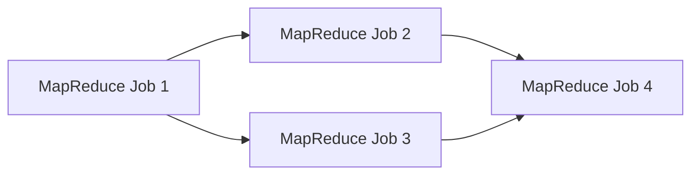

วิธีอ่าน: ลูกศรจาก A ไป B หมายถึง B ต้องรอ A เสร็จก่อน Job 2 และ Job 3 ใช้ผลของ Job 1 และไม่ต้องรอกัน จึงรันพร้อมกันได้ Job 4 รอจนทั้งสองเสร็จ

### 5.2 Apache Oozie

**Apache Oozie** คือระบบตั้งเวลาและควบคุมการรัน (scheduler) สำหรับงาน Hadoop ใน cluster ใช้รวมงานซับซ้อนหลายงานให้รันตามลำดับ หรือรันพร้อมกันด้วยโครงสร้าง **fork-join** (fork แยกออกเป็นหลายสายที่รันพร้อมกัน join รอให้ทุกสายเสร็จแล้วรวมกลับเป็นสายเดียว) รองรับงานหลายชนิดของ Hadoop เช่น Hive, Pig, Sqoop, MapReduce และงานทั่วไป เช่น โปรแกรม Java และ shell script ([Apache Oozie](https://oozie.apache.org/))

**Node ใน workflow ของ Oozie มีสองชนิด** (node ในที่นี้คือกล่องหนึ่งกล่องในแผนภาพ workflow)

**Control flow node** กำหนดเส้นทางการไหลของงาน มีหกแบบ start คือจุดเริ่ม end คือจุดจบ kill หยุด workflow เมื่อเกิดข้อผิดพลาด fork แยกออกเป็นหลายสาย join รวมหลายสายกลับเป็นสายเดียว และ decision เลือกเส้นทางตามเงื่อนไข

**Action node** คือกล่องที่ลงมือทำงานจริง เช่น MapReduce job, Pig job, Hive job หรือคำสั่ง shell

Workflow ของ Oozie เขียนเป็นไฟล์ **XML** (ภาษาที่ใช้แท็กกำกับโครงสร้าง แบบเดียวกับ HTML) Oozie มีหน้าจอแบบลากวาง (GUI editor) ให้สร้าง workflow แล้วส่งออกเป็นไฟล์ XML จากนั้นส่งไฟล์ให้ Oozie engine รัน

**ตัวอย่าง workflow**

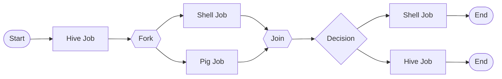

วิธีอ่าน: เริ่มด้วย Hive job หนึ่งงาน จากนั้น fork แยกเป็น Shell job กับ Pig job ที่รันพร้อมกัน join รอให้ทั้งสองเสร็จ แล้ว decision เลือกว่าจะรัน Shell job หรือ Hive job ต่อตามเงื่อนไข (เช่น ผลตรวจคุณภาพข้อมูลผ่านหรือไม่) แล้วจบ

สถานะโครงการ: Apache Oozie ยุติการพัฒนาและย้ายเข้า Apache Attic ในปี 2025 ([Apache Attic: Oozie](https://attic.apache.org/projects/oozie.html)) ยังพบได้ในระบบ Hadoop เดิมขององค์กร ส่วน workflow ใหม่นิยมสร้างด้วย Airflow

### 5.3 Apache Airflow

**Apache Airflow** คือแพลตฟอร์มโอเพนซอร์สสำหรับเขียน ตั้งเวลา และติดตาม workflow แบบ batch จุดเด่นคือ

- **Workflow เขียนเป็นโค้ด Python ทั้งหมด** จึงใช้ตัวแปร loop ฟังก์ชัน และระบบเก็บประวัติการแก้ไขโค้ดอย่าง Git กับ workflow ได้เหมือนโค้ดทั่วไป
- ขยายความสามารถได้ และเชื่อมต่อกับเทคโนโลยีได้แทบทุกชนิด ทั้งในและนอก Hadoop
- มีหน้าเว็บสำหรับดูภาพ workflow สั่งรัน และหาสาเหตุเมื่องานล้ม
- ติดตั้งได้หลายขนาด ตั้งแต่โปรแกรมเดียวบน laptop ไปจนถึงระบบหลายเครื่องที่รับงานปริมาณมาก

**DAG ใน Airflow** คือวัตถุที่รวมทุกอย่างที่ต้องใช้ในการรัน workflow หนึ่ง คุณสมบัติหลักได้แก่

1. **Schedule:** workflow รันเมื่อไร
2. **Tasks:** หน่วยงานย่อยแต่ละชิ้น ซึ่งถูกนำไปรันบน **worker** (เครื่องหรือโปรแกรมที่ทำงานจริงตามคำสั่งของ Airflow)
3. **Task dependencies:** ลำดับและเงื่อนไขว่า task ใดรันก่อนหลัง
4. **Callbacks:** สิ่งที่ทำเมื่อ workflow จบ เช่น ส่งอีเมลแจ้งผล
5. **Additional parameters:** รายละเอียดอื่นๆ เช่น จำนวนครั้งที่ลองใหม่เมื่อล้ม

**โค้ดตัวอย่าง (Airflow 3)**

```python
from datetime import datetime

from airflow.sdk import DAG, task
from airflow.providers.standard.operators.bash import BashOperator

# A Dag represents a workflow, a collection of tasks
with DAG(dag_id='demo', start_date=datetime(2022, 1, 1), schedule='0 0 * * *') as dag:
    # Tasks are represented as operators
    hello = BashOperator(task_id='hello', bash_command='echo hello')

    @task()
    def airflow():
        print('airflow')

    # Set dependencies between tasks
    hello >> airflow()
```

อธิบายทีละส่วน

- `from airflow.sdk import DAG, task` และ `from airflow.providers.standard.operators.bash import BashOperator` คือการนำเครื่องมือของ Airflow เข้ามาใช้ เขียนตามรูปแบบของ **Airflow 3** ([Airflow Task SDK examples](https://airflow.apache.org/docs/task-sdk/stable/examples.html))
- `with DAG(...) as dag:` สร้าง DAG ชื่อ `demo` ทุก task ที่สร้างภายในบล็อก `with` (บรรทัดที่ย่อหน้าเข้าไป) เป็นสมาชิกของ DAG นี้โดยอัตโนมัติ
- `start_date=datetime(2022, 1, 1)` วันที่เริ่มนับรอบการรัน
- `schedule='0 0 * * *'` ตารางเวลาในรูป cron expression หมายถึงรันทุกวันเวลา 00:00 (วิธีอ่านอยู่ด้านล่าง)
- `BashOperator(task_id='hello', bash_command='echo hello')` สร้าง task จาก **operator** คือแม่แบบของ task สำเร็จรูป BashOperator เป็นแม่แบบสำหรับรันคำสั่ง shell ในที่นี้สั่ง `echo hello` (พิมพ์คำว่า hello) ทุก task ต้องมี `task_id` ที่ไม่ซ้ำกันภายใน DAG
- `@task()` ที่วางเหนือฟังก์ชันเรียกว่า **decorator** มันแปลงฟังก์ชัน Python ธรรมดาให้กลายเป็น task ของ Airflow การเขียน `airflow()` ใน DAG จึงเป็นการสร้าง task ตัวโค้ดในฟังก์ชันจะรันบน worker เมื่อถึงรอบ
- `hello >> airflow()` ตั้งลำดับ: `hello` ต้องเสร็จก่อน task `airflow` จึงเริ่ม

**สรุปความหมายของโค้ด:** DAG ชื่อ "demo" รันทุกวันโดยเริ่มนับจาก 1 มกราคม 2022 มีสอง task คือ task ที่ใช้ BashOperator รันคำสั่ง shell และ task ที่สร้างจากฟังก์ชัน Python ด้วย decorator `@task` เครื่องหมาย `>>` กำหนดลำดับ ถ้าต้องการให้หลาย task รันพร้อมกันหลัง task หนึ่ง ให้ใส่ไว้ในวงเล็บเหลี่ยม เช่น `t1 >> [t2, t3]` หมายถึง t2 และ t3 เริ่มพร้อมกันได้หลัง t1 เสร็จ

**อ่าน cron expression:** cron เป็นรูปแบบมาตรฐานสำหรับเขียนตารางเวลา มีห้าช่องคั่นด้วยช่องว่าง อ่านจากซ้ายไปขวาตามลำดับนี้

1. นาที (minute) ค่า 0 ถึง 59
2. ชั่วโมง (hour) ค่า 0 ถึง 23
3. วันที่ของเดือน (day of month) ค่า 1 ถึง 31
4. เดือน (month) ค่า 1 ถึง 12
5. วันในสัปดาห์ (day of week) ค่า 0 ถึง 6 โดย 0 คือวันอาทิตย์

เครื่องหมาย `*` ในช่องใดแปลว่า "ทุกค่า" ของช่องนั้น เมื่ออ่าน `0 0 * * *` ทีละช่องจึงได้ว่า นาทีที่ 0, ชั่วโมงที่ 0, ทุกวันที่, ทุกเดือน, ทุกวันในสัปดาห์ รวมความคือเที่ยงคืนทุกวัน ตัวอย่างอื่น `30 6 * * 1-5` คือ 06:30 วันจันทร์ถึงศุกร์ และ `0 */4 * * *` คือทุก 4 ชั่วโมงตรง (`*/4` แปลว่าทุกค่าที่หาร 4 ลงตัว)

**Oozie กับ Airflow:** ทั้งสองจัดการ workflow ในรูป DAG เหมือนกัน ต่างกันที่วิธีเขียนและขอบเขต Oozie เขียน workflow ด้วย XML (มี GUI editor ช่วย) และเน้นงานใน Hadoop ecosystem โครงสร้างของมันประกอบด้วย control flow node กับ action node ปัจจุบันโครงการอยู่ใน Apache Attic ตั้งแต่ปี 2025 ส่วน Airflow เขียน workflow ด้วยโค้ด Python ใช้กับงานได้ทุกชนิดทุกระบบ กำหนดลำดับของ task ด้วย `>>` และยังพัฒนาต่อเนื่อง (รุ่นปัจจุบันคือ Airflow 3)

**สรุปหัวข้อ:** งานใหญ่ถูกแตกเป็นหลาย job แล้วต่อกันเป็น workflow แบบ DAG Oozie เขียน workflow ด้วย XML มี control flow node (start, end, kill, fork, join, decision) และ action node ส่วน Airflow เขียน DAG ด้วย Python ตั้งเวลาด้วย cron และกำหนดลำดับด้วย `>>`

---

## สรุปท้ายบท

- ข้อมูลมีสามประเภทตามตำแหน่งของโครงสร้าง: structured, semi-structured, unstructured
- 5Vs: Volume (มาก), Variety (หลากหลาย), Velocity (เร็ว), Veracity (น่าเชื่อถือ), Value (คุณค่า)
- การวิเคราะห์สี่ระดับ: Descriptive (what), Diagnostic (why), Predictive (what will), Prescriptive (how to make it happen)
- Big Data Pipeline: Ingestion, Staging, Computation, Workflow Management และวนกลับไปปรับโมเดล
- Lambda: batch layer (ข้อมูลดิบ immutable, ถูกต้อง, ช้า) + speed layer (ข้อมูลล่าสุด, เร็ว) + serving layer (รวมผล)
- Data lake ใช้ ELT และ schema-on-read; data warehouse ใช้ ETL และ schema-on-write
- HDFS: block 128 MB, 3 สำเนา, WORM, เหมาะกับไฟล์ใหญ่; NameNode (metadata, fsimage + edit log), Secondary NameNode (checkpoint), DataNode (เก็บ block, heartbeat)
- Erasure coding RS(6,3) ใน Hadoop 3: พื้นที่ส่วนเกิน 50% เทียบกับ 200% ของ replication 3 สำเนา
- YARN: ResourceManager (จัดสรรทรัพยากร), ApplicationMaster (หนึ่งตัวต่อแอป), NodeManager (รัน container)
- MapReduce: map, shuffle and sort, reduce; key เดียวกันไป reduce ตัวเดียวกัน; task อิสระจึงรันซ้ำได้
- Combiner ลดข้อมูลข้ามเครือข่าย ใช้กับการรวมที่ commutative และ associative
- Partitioner: hash(key) mod R; data skew แก้ด้วย custom partitioner
- Oozie: workflow แบบ XML มี control flow node และ action node; Airflow: DAG เขียนด้วย Python, cron, `>>`

---

## โจทย์ฝึก

**ข้อ 1** ไฟล์ 1 GB (1,024 MB) เข้า HDFS ที่ block 128 MB และ 3 สำเนา ได้กี่ block ใช้พื้นที่เท่าไร และถ้า DataNode หนึ่งเครื่องดับนาน เกิดอะไรขึ้น

แนวตอบ: 1,024 / 128 = 8 block ใช้พื้นที่ 1,024 x 3 = 3,072 MB เมื่อ heartbeat ขาดนาน NameNode ตัดสินว่าเครื่องตาย หยุดส่งงานไปเครื่องนั้น และสั่งทำสำเนา block ที่สำเนาเหลือไม่ครบจากเครื่องอื่น ข้อมูลยังอยู่ครบเพราะทุก block เหลืออย่างน้อย 2 สำเนา

**ข้อ 2** ยอดขาย (สาขา, จำนวนเงิน) อยู่ใน 2 block: Block 1 = (A,100), (B,50), (A,30), (C,20) และ Block 2 = (B,70), (A,10), (C,40), (C,15) จงไล่ shuffle and sort และ reduce หาผลรวม และบอกว่า combiner ลดข้อมูลที่ส่งจากกี่คู่เหลือกี่คู่

แนวตอบ: หลัง shuffle and sort ได้ A: [100, 30, 10], B: [50, 70], C: [20, 40, 15] หลัง reduce ได้ (A,140), (B,120), (C,75) ไม่มี combiner ส่ง 8 คู่ มี combiner Map 1 ส่ง (A,130), (B,50), (C,20) และ Map 2 ส่ง (B,70), (A,10), (C,55) รวม 6 คู่ ผลสุดท้ายเท่าเดิม

**ข้อ 3** ทำไม MapReduce รัน task ที่ล้มซ้ำบนเครื่องอื่นได้โดยผลลัพธ์ยังถูกต้อง

แนวตอบ: ฟังก์ชัน map และ reduce ไม่เก็บสถานะ ผลขึ้นกับข้อมูลเข้าอย่างเดียว และ task แต่ละตัวทำงานอิสระโดยไม่คุยกับ task อื่น การรัน task เดิมด้วยข้อมูลชุดเดิมจึงได้ผลเท่าเดิมเสมอ (ตอบความต้องการ Consistency และ Fault tolerance)

**แบบฝึกเช็กตัวเอง**

1. เซนเซอร์ส่งค่าทุก 5 วินาที ปัญหาหลักคือ V ใด
2. "ทำไมยอดสั่งซื้อเดือนนี้สูงผิดปกติ" เป็นการวิเคราะห์ระดับใด
3. daemon ใดเก็บ metadata ของ HDFS
4. fsimage กับ edit log ต่างกันอย่างไร
5. daemon ของ YARN ตัวใดมีหนึ่งตัวต่อแอป
6. `chmod 640` ได้สิทธิ์แบบใด
7. cron `15 2 * * 0` หมายถึงอะไร
8. `t1 >> [t2, t3] >> t4` รันลำดับอย่างไร

เฉลย: (1) Velocity (2) Diagnostic (3) NameNode (4) fsimage คือภาพรวม metadata ณ จุดเวลาหนึ่ง edit log คือรายการเปลี่ยนแปลงหลังจากนั้น (5) ApplicationMaster (6) `-rw-r-----` (7) 02:15 ทุกวันอาทิตย์ (8) t1 ก่อน แล้ว t2 กับ t3 พร้อมกัน แล้วจึง t4

---

## References

- Apache Hadoop. *HDFS Architecture*. https://hadoop.apache.org/docs/r2.8.5/hadoop-project-dist/hadoop-hdfs/HdfsDesign.html
- Apache Hadoop. *HDFS Erasure Coding*. https://hadoop.apache.org/docs/r3.4.0/hadoop-project-dist/hadoop-hdfs/HDFSErasureCoding.html
- Apache Hadoop. *Apache Hadoop YARN*. https://hadoop.apache.org/docs/current/hadoop-yarn/hadoop-yarn-site/YARN.html
- Apache Hadoop. *Hadoop Streaming*. https://hadoop.apache.org/docs/r2.8.5/hadoop-streaming/HadoopStreaming.html
- Apache Airflow. *Task SDK Examples*. https://airflow.apache.org/docs/task-sdk/stable/examples.html
- MotherDuck. *Lambda architecture*. https://motherduck.com/glossary/lambda-architecture/
- Wikipedia. *Data lake*. https://en.wikipedia.org/wiki/Data_lake
- BigDATAwire. *Happy Birthday, Hadoop* (2016). https://www.bigdatawire.com/2016/01/28/happy-birthday-hadoop-celebrating-10-years-of-improbable-growth/
