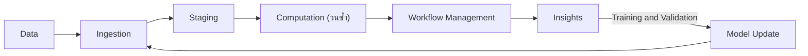
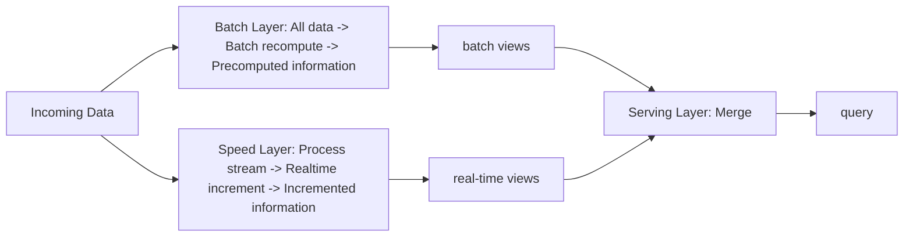
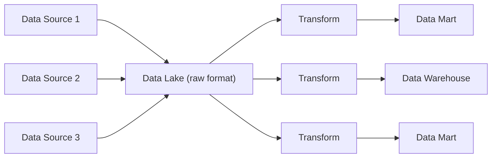
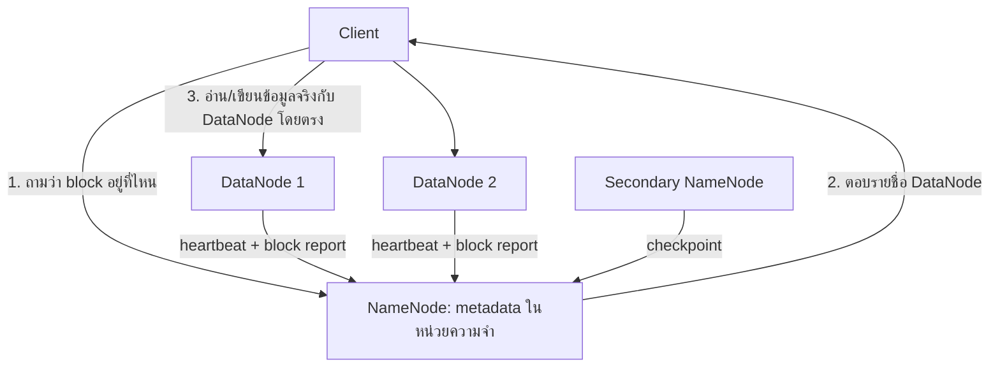
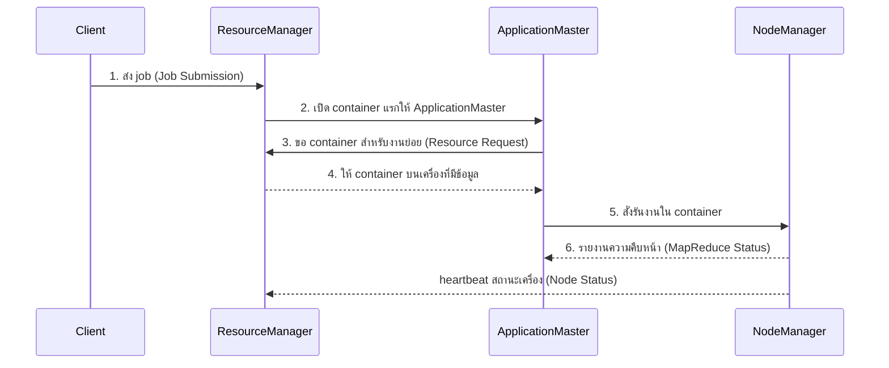
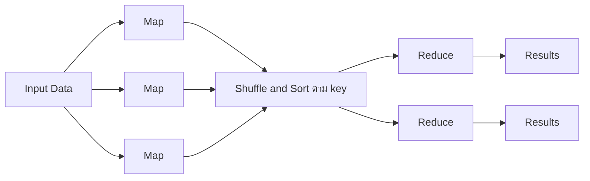

# Big Data, Hadoop และ MapReduce

แก่นของบทนี้คือ เมื่อข้อมูลใหญ่และเร็วเกินกว่าคอมพิวเตอร์เครื่องเดียวจะรับไหว เราแบ่งทั้งข้อมูลและงานคำนวณไปให้คอมพิวเตอร์หลายเครื่องทำพร้อมกัน และออกแบบระบบให้ทำงานต่อได้แม้บางเครื่องพัง Hadoop คือระบบที่ทำเรื่องนี้ โดยมี HDFS เก็บข้อมูล YARN จัดสรรทรัพยากร และ MapReduce เป็นวิธีเขียนงานคำนวณ

คอมพิวเตอร์แต่ละเครื่องในระบบเรียกว่า **node** และกลุ่มของ node ที่ต่อเครือข่ายกันและทำงานเป็นระบบเดียวเรียกว่า **cluster**

---

## Part 1 Big Data และการวิเคราะห์

### 1.1 ข้อมูลสามประเภท

เกณฑ์ที่ใช้แบ่งคือ **schema** ซึ่งหมายถึงคำอธิบายโครงสร้างของข้อมูล ว่ามีช่องอะไรบ้าง และแต่ละช่องเก็บข้อมูลชนิดใด

**Structured data** คือข้อมูลที่กำหนด schema ไว้ก่อนเก็บ ทุกแถวมีคอลัมน์เหมือนกัน เช่น ตารางใน relational database หรือข้อมูลแบบ record จึงดึงข้อมูลด้วย SQL ได้ทันที

**Unstructured data** คือข้อมูลที่ไม่มีโครงสร้างแถว-คอลัมน์ ต้องสกัดสิ่งที่ต้องการออกมาเอง เช่น ข้อความ log ภาพ เสียง วิดีโอ และข้อมูลแบบกราฟ (จุดที่เชื่อมกันด้วยเส้น เช่น เครือข่ายเพื่อนใน social media หรือลิงก์ระหว่างหน้าเว็บ)

**Semi-structured data** คือข้อมูลที่ฝังป้ายกำกับบอกโครงสร้างไว้ในตัวเอง และแต่ละ record มีฟิลด์ไม่เท่ากันก็ได้ เช่น HTML, XML, JSON ใน JSON ข้อความหน้าเครื่องหมาย `:` คือป้ายกำกับ (key) และสิ่งที่ตามหลังคือค่า เช่น `{ "name": "Kyle", "age": 24 }`

จำง่ายๆ ว่าสามประเภทต่างกันที่ **ตำแหน่งของโครงสร้าง** คือกำหนดไว้ล่วงหน้า (structured) ฝังอยู่ในตัวข้อมูล (semi-structured) หรือไม่มีเลย (unstructured)

### 1.2 ลักษณะของ Big Data: 5Vs

**Volume** คือข้อมูลปริมาณมหาศาล เก็บในเครื่องเดียวไม่พอ เช่น ประวัติการเบิกยาทุกสาขาย้อนหลังหลายปี

**Variety** คือข้อมูลหลายแหล่งหลายชนิด ทั้งมีและไม่มีโครงสร้าง เช่น ตาราง PO จาก ERP รวมกับ PDF ใบแจ้งหนี้และ JSON จากผู้ขาย

**Velocity** คือข้อมูลไหลเข้ามาเร็วและต่อเนื่อง จนต้องประมวลผลแบบ real-time (ได้ผลภายในไม่กี่วินาที) เช่น เซนเซอร์อุณหภูมิตู้วัคซีนที่ส่งค่าทุกไม่กี่วินาที

**Veracity** คือความน่าเชื่อถือของข้อมูล ได้แก่ อคติ (bias) สัญญาณรบกวน (noise) ค่าผิดปกติ และคุณภาพข้อมูล เช่น ยาตัวเดียวกันมีหลายรหัส

**Value** คือความสามารถเปลี่ยนข้อมูลให้เป็นคุณค่าทางธุรกิจ เช่น ใช้ข้อมูลการใช้ยาจริงพยากรณ์จุดสั่งซื้อ

เวลาจับคู่สถานการณ์กับ V ให้ถามว่าปัญหาในโจทย์เกิดจากอะไร ถ้าเกิดจากความเร็วที่ข้อมูลเข้ามา คำตอบคือ Velocity แม้ข้อมูลจะเยอะด้วยก็ตาม

### 1.3 ระดับของการวิเคราะห์ (Gartner)

Gartner จัดการวิเคราะห์เป็นสี่ระดับ ยิ่งระดับสูง ยิ่งทำยาก และคุณค่ายิ่งมาก ไล่ด้วยเรื่องถุงมือทางการแพทย์

- **Descriptive** ตอบ What happened? มองย้อนหลัง (hindsight) เช่น เดือนที่แล้วสาขาใดใช้ถุงมือมากที่สุด
- **Diagnostic** ตอบ Why did it happen? หาสาเหตุ (insight) เช่น ยอดเพิ่มเพราะมีการผ่าตัดมากขึ้น
- **Predictive** ตอบ What will happen? มองไปข้างหน้า (foresight) เช่น พยากรณ์ความต้องการไตรมาสหน้า
- **Prescriptive** ตอบ How can we make it happen? หาทางเลือกที่ดีที่สุด (optimization) เช่น แนะนำปริมาณและเวลาสั่งซื้อที่ต้นทุนต่ำที่สุด

### 1.4 Data Product และ Data Science

**Data product** คือแอปพลิเคชันที่ใช้ข้อมูลช่วยให้ธุรกิจตัดสินใจได้ดีขึ้น และระหว่างใช้งานก็สร้างข้อมูลใหม่ป้อนกลับให้ตัวเองดีขึ้นอีก (feedback loop) ลักษณะสำคัญคือ เรียนรู้จากข้อมูล ปรับตัวเองได้ และใช้ได้กว้าง ตัวอย่างได้แก่ ระบบแนะนำสินค้าของ Amazon ที่แนะนำจากพฤติกรรมการซื้อของลูกค้าที่คล้ายกัน, Facebook ที่ใช้กราฟเครือข่ายหาชุมชนจากเพื่อนร่วมกัน และรถไร้คนขับที่ใช้ข้อมูลเซนเซอร์ปรับปรุงระบบขับขี่

**Data science** คือศาสตร์ที่รวมห้าสาขาเพื่อสร้าง data product ได้แก่ Machine Learning, Software Engineering, Statistics, Database Management และ Distributed Computing (การแบ่งงานคำนวณไปให้หลายเครื่องทำพร้อมกัน)

### 1.5 จาก Data Science Pipeline สู่ Big Data Pipeline

**Pipeline** คือลำดับขั้นที่ข้อมูลไหลผ่าน ผลของขั้นหนึ่งเป็นข้อมูลเข้าของขั้นถัดไป

**Data Science Pipeline** มีห้าขั้นเป็นเส้นตรง: Data, Ingest (นำเข้า), Wrangle (ทำความสะอาด), Compute (คำนวณ), Visualize (แสดงผล), Report คนเป็นผู้ลงมือในแต่ละขั้นโดยใช้ภาษาสคริปต์ช่วย จึงไม่ทันเมื่อข้อมูลใหญ่ขึ้น เร็วขึ้น และหลากหลายขึ้น ระบบต้องหารูปแบบในข้อมูลได้เองโดยไม่ต้องรอคน

**Big Data Pipeline** ปรับให้ทำงานอัตโนมัติและวนซ้ำ มีสี่ระยะ



- **Ingestion** หาแหล่งข้อมูลและนำเข้า รวมถึงรับข้อมูลป้อนกลับจากผู้ใช้เพื่อนำมาปรับโมเดล
- **Staging** แปลงข้อมูลให้พร้อมใช้ (normalization, standardization เช่น ทำหน่วยนับให้เป็นมาตรฐานเดียวกัน) แล้วเก็บไว้ให้พร้อมประมวลผล
- **Computation** รัน machine learning หรือการวิเคราะห์เพื่อให้ได้ insight หรือโมเดล มักวนหลายรอบ
- **Workflow Management** ทำให้ทุกระยะรันได้เองในระบบงานจริง ผ่าน abstraction (ซ่อนรายละเอียดเทคนิค) orchestration (กำหนดลำดับงาน) และ automation (รันเองตามตารางเวลา)

เส้นวนกลับจาก Insights ผ่านการ train และ validate ไปปรับโมเดล คือสิ่งที่ทำให้ระบบเป็น data product

---

## Part 2 Lambda Architecture และ Data Lake

### 2.1 Lambda Architecture

**Batch processing** คือสะสมข้อมูลไว้แล้วประมวลผลทั้งก้อนเป็นรอบ เช่น ทุกเที่ยงคืน ได้ผลครบและถูกต้องแต่ต้องรอ **Stream processing** คือประมวลผลทีละรายการทันทีที่ข้อมูลเข้ามา ได้ผลเร็วแต่เห็นเฉพาะข้อมูลล่าสุด เวลาตั้งแต่ข้อมูลเกิดจนได้ผลเรียกว่า **latency**

**Lambda Architecture** คือสถาปัตยกรรมที่รัน batch และ stream **ควบคู่กันบนข้อมูลชุดเดียวกัน** แล้วรวมผลตอนผู้ใช้เรียกดู จึงรับข้อมูลปริมาณมหาศาลได้พร้อมกับติดตามแบบ real-time และมักเป็นพื้นฐานของสถาปัตยกรรม big data ([MotherDuck glossary](https://motherduck.com/glossary/lambda-architecture/))



ข้อมูลทุกชิ้นถูกคัดลอกไปสองทาง ผลของแต่ละทางเก็บเป็น **view** (ตารางผลลัพธ์ที่คำนวณไว้พร้อมอ่าน) แล้วไปรวมกันที่ serving layer

**Batch layer** เก็บ **master raw dataset** คือข้อมูลดิบทั้งหมดทั้งอดีตและล่าสุด แบบ **immutable** (เพิ่มได้อย่างเดียว ของเดิมคงไว้) และคำนวณ batch view ไว้ล่วงหน้า เช่น ยอดรวมและตัวชี้วัดธุรกิจ เทียบได้กับชั้น data warehouse ในงาน BI

**Speed layer** ประมวลผลเฉพาะข้อมูลที่เกิดหลังรอบ batch ล่าสุด แบบ stream ให้ real-time view ที่ latency ต่ำ

**Serving layer** รวม batch view กับ real-time view เพื่อตอบผู้ใช้ เป็นชั้น dashboard และรายงานที่รองรับทั้งแบบรอบ batch และแบบ real-time

**ตัวอย่าง:** batch รันตี 2 ได้ยอดเบิกสะสมถึงเมื่อวาน 1,250,000 หน่วย วันนี้ถึงบ่ายสองมีเบิกเพิ่ม 3,400 หน่วยซึ่ง speed layer นับไว้ serving layer ตอบ 1,250,000 + 3,400 = 1,253,400 คืนถัดไป batch คำนวณใหม่จากข้อมูลดิบทั้งหมด real-time view ของวันนี้จึงทิ้งได้ และถ้า speed layer นับตกไปบางรายการ ตัวเลขจะถูกต้องเองหลัง batch รอบถัดไป

สิ่งที่ต้องแลกคือ ทีมต้องดูแลตรรกะเดียวกันสองชุด (batch และ stream) ให้ได้ผลตรงกันเสมอ

**ชั้นของระบบเต็มรูปแบบ (ไล่ตามทางเดินของข้อมูล):** Source Systems (ฐานข้อมูล log ภาพ ไฟล์) ไปที่ Data Acquisition Layer ที่ดึงข้อมูลออกมา (Sqoop, Flume) ไปพักใน Messaging Layer ซึ่งเป็นคิวกลาง (Kafka) แล้ว Data Ingestion Layer นำเข้าสู่การประมวลผล จากนั้นแยกเป็น Batch Layer (HDFS, MapReduce, Hive, Pig, Impala, Oozie) และ Speed Layer (Spark Streaming, Flink) แล้วรวมที่ Serving Layer (บริการเว็บ ตาราง Hive/Impala) โดยมี Data Storage Layer (HDFS, HBase, Elasticsearch) เก็บข้อมูลถาวรอยู่ข้างล่าง

### 2.2 Data Lake

**Data warehouse** คือฐานข้อมูลกลางสำหรับการวิเคราะห์ ที่แปลงข้อมูลให้เข้า schema ก่อนโหลด ข้อมูลที่ยังไม่รู้ว่าจะใช้ หรือรูปแบบไม่เข้ากับตาราง จึงไม่ถูกเก็บ

**Data lake** คือที่เก็บกลางแห่งเดียวที่เก็บข้อมูล **ในรูปแบบดั้งเดิมตามที่มาจากต้นทาง** ทุกรูปแบบ ทั้ง structured (ตาราง), semi-structured (CSV, log, XML, JSON), unstructured (อีเมล เอกสาร PDF) และ binary (ภาพ เสียง วิดีโอ) มักเก็บเป็นไฟล์หรือ object blob ตั้งแต่ข้อมูลดิบไปจนถึงข้อมูลที่แปลงแล้ว สำหรับงานรายงาน visualization การวิเคราะห์ และ machine learning ([Wikipedia: Data lake](https://en.wikipedia.org/wiki/Data_lake))

**ETL และ ELT** มาจาก Extract (ดึง), Transform (แปลง), Load (โหลด) ต่างกันที่ลำดับ

- **Data warehouse ใช้ ETL** แปลงก่อนโหลด เรียกว่า **schema-on-write** (กำหนด schema ก่อนแล้วเขียนข้อมูลให้ตรง) ได้ query เร็วและคุณภาพสม่ำเสมอ แต่ต้องรู้ความต้องการล่วงหน้า
- **Data lake ใช้ ELT** โหลดข้อมูลดิบก่อนแล้วแปลงตอนจะใช้ เรียกว่า **schema-on-read** (ตีความโครงสร้างตอนอ่าน) ยืดหยุ่น เก็บก่อนรู้ว่าจะใช้อะไร และย้อนกลับไปคำนวณใหม่ได้

**Data Lake Pattern:** สองแบบนี้ใช้ต่อกัน



ข้อมูลจากหลายแหล่งเข้า lake ในรูปดิบ แล้วถูกแปลงหลายสายตามความต้องการ ไปเป็น data warehouse หรือ **data mart** (warehouse ขนาดเล็กเฉพาะหน่วยงาน) data lake สร้างบนที่เก็บแบบกระจาย เช่น HDFS, Amazon S3, Azure Data Lake และใช้เครื่องมืออย่าง Hive หรือ HBase สร้าง warehouse หรือ data mart ช่วงจาก lake ไป warehouse นี้เป็น ETL อีกทอดหนึ่ง

---
## Part 3 Hadoop: HDFS และ YARN

### 3.1 Hadoop คืออะไร

**Hadoop** คือ framework โอเพนซอร์สของ Apache สำหรับเก็บและประมวลผลข้อมูลขนาดใหญ่บน cluster ของเครื่องราคาธรรมดา (commodity hardware) ซึ่งพังได้บ่อย ระบบจึงออกแบบโดยถือว่าเครื่องพังเป็นเรื่องปกติ หลักการคือกระจายงานคำนวณไปให้หลายเครื่อง แต่ละเครื่องทำงานกับข้อมูลชิ้นของตัวเองพร้อมกัน งานทั้งหมดจึงเสร็จเร็วขึ้น การทำแบบนี้ต้องมีอัลกอริทึมที่แบ่งงานได้ เครื่องจำนวนมาก และเครือข่ายที่เชื่อมกัน บางตำราเรียก Hadoop ว่า "ระบบปฏิบัติการสำหรับ Big Data"

Hadoop เขียนโดย Doug Cutting และ Mike Cafarella โดยนำแนวคิดจากบทความวิจัยของ Google สองชิ้น คือ Google File System (2003) และ MapReduce (2004) มาสร้างเป็นโอเพนซอร์ส และมี Yahoo เป็นผู้สนับสนุนหลัก ([BigDATAwire](https://www.bigdatawire.com/2016/01/28/happy-birthday-hadoop-celebrating-10-years-of-improbable-growth/))

**Hadoop ecosystem:** Hadoop เติบโตเป็นชุดเครื่องมือที่รันบน cluster เดียวกัน แต่ละตัวทำหน้าที่เป็นระยะหนึ่งของ pipeline

- นำเข้าข้อมูล: **Sqoop** (ย้ายตารางระหว่างฐานข้อมูลกับ HDFS), **Flume** (เก็บ log), **Kafka** (คิวข้อความ)
- จัดการข้อมูล: **HBase** (ฐานข้อมูล NoSQL ค้นและแก้รายแถวด้วย key ได้เร็ว), **Hive** (data warehouse ที่ query ด้วยภาษาคล้าย SQL)
- วิเคราะห์: **Pig** (ภาษาสคริปต์แปลงข้อมูล), **Spark MLlib, Mahout** (machine learning), **Spark GraphX** (กราฟ)
- จัดลำดับงาน: **Oozie** (Part 5)

### 3.2 ความต้องการของระบบกระจาย และแนวคิดที่ Hadoop ใช้

Hadoop ออกแบบมาเพื่อตอบความต้องการสี่ข้อ

- **Fault tolerance** ส่วนประกอบหนึ่งล้ม ระบบยังทำงานต่อ โดยลดระดับอย่างนุ่มนวล (ช้าลงแต่ยังใช้ได้) และส่วนที่ล้มกลับเข้าระบบได้เมื่อหาย
- **Recoverability** เมื่อเกิดความล้มเหลว ข้อมูลยังอยู่ครบ
- **Consistency** งานย่อยชิ้นหนึ่งล้ม ผลลัพธ์สุดท้ายยังถูกต้อง
- **Scalability** เพิ่มภาระแล้วระบบแค่ช้าลงทีละน้อย และเพิ่มทรัพยากรแล้วประสิทธิภาพเพิ่มตามสัดส่วน

ศัพท์ที่ต้องรู้ก่อน: **block** คือชิ้นส่วนขนาดคงที่ที่ไฟล์ถูกตัดแบ่ง, **job** คืองานคำนวณทั้งก้อนที่ผู้ใช้ส่งเข้าระบบ, **task** คือชิ้นย่อยของ job ที่เครื่องหนึ่งรับไปทำ

แนวคิดแปดข้อที่ Hadoop ใช้ตอบความต้องการข้างต้น

1. ข้อมูลถูกกระจายไปเก็บหลายเครื่องทันทีที่เพิ่มเข้า cluster
2. เครื่องเลือกประมวลผลข้อมูลที่อยู่ในเครื่องตัวเอง (**data locality**) เพราะส่งโปรแกรมไปหาข้อมูลถูกกว่าย้ายข้อมูลข้ามเครือข่าย
3. ข้อมูลเก็บเป็น block ขนาดคงที่ (ปกติ 128 MB) Hadoop 2 ป้องกันด้วยการทำสำเนาแต่ละ block หลายชุด Hadoop 3 เพิ่มทางเลือก erasure coding (หัวข้อ 3.4)
4. job ถูกแบ่งเป็น task แต่ละ task ทำงานกับ block หนึ่ง
5. ผู้ใช้เขียน job ในระดับสูง ระบบจัดการเครือข่ายและการสื่อสารให้
6. ลดการรับส่งข้อมูลระหว่างเครื่อง แต่ละ task ทำงานอิสระ ไม่ต้องคุยกับ task อื่นระหว่างทาง จึงไม่เกิด **deadlock** (task สองตัวรอกันและกันไม่จบ)
7. job ทนความล้มเหลวด้วยการรัน task ซ้ำ (task redundancy)
8. master แจกงานให้ worker หลายเครื่องทำพร้อมกัน แต่ละเครื่องทำส่วนของตัวเอง

ข้อ 6 กับ 7 ทำงานคู่กัน: เพราะ task อิสระต่อกัน เมื่อ task หนึ่งล้ม ระบบรันมันใหม่บนเครื่องอื่นด้วยข้อมูลชุดเดิมได้ผลเท่าเดิม ผลลัพธ์รวมจึงยังถูกต้อง

### 3.3 สถาปัตยกรรม: HDFS + YARN

Hadoop มีสองส่วนหลัก **HDFS** ดูแลการเก็บข้อมูลบนดิสก์และการเข้าถึงทั่ว cluster (storage) และ **YARN** จัดสรรทรัพยากร CPU และหน่วยความจำบนเครื่องต่างๆ ให้โปรแกรมที่ขอใช้ (compute) ทั้งสองทำงานคู่กันเพื่อให้การคำนวณเกิดบนเครื่องที่มีข้อมูล

ทั้งสองทำงานผ่าน **daemon** คือโปรแกรมที่รันค้างอยู่เบื้องหลัง คอยรับคำขอทางเครือข่าย คล้าย web server บทบาทของเครื่องกำหนดด้วย daemon ที่รันอยู่ **master node** รัน daemon ที่ประสานงานและเป็นจุดที่ผู้ใช้เข้าถึง **worker node** รัน daemon ที่รับงานมาทำ

- HDFS: master คือ NameNode และ Secondary NameNode, worker คือ DataNode
- YARN: master คือ ResourceManager และ ApplicationMaster (หนึ่งตัวต่อแอป), worker คือ NodeManager

กลไกร่วมอีกข้อคือ **speculative execution** เมื่อ task ใดช้าผิดปกติ ระบบเปิด task ซ้ำบนเครื่องอื่น ใช้ผลของตัวที่เสร็จก่อนแล้วยกเลิกตัวที่เหลือ

### 3.4 HDFS

**คุณสมบัติหลัก**

HDFS เป็นชั้นซอฟต์แวร์ที่ทำงานบนระบบไฟล์ปกติของแต่ละเครื่อง เก็บข้อมูลแบบมีสำเนาทั่ว cluster และทำงานดีที่สุดกับ **ไฟล์ใหญ่จำนวนไม่มาก** เพราะ NameNode เก็บรายละเอียดของทุกไฟล์ไว้ในหน่วยความจำ ไฟล์เล็กจำนวนมหาศาลจะทำให้หน่วยความจำนี้เต็ม

HDFS ใช้รูปแบบ **WORM (Write Once, Read Many)** เขียนครั้งเดียวอ่านหลายครั้ง แก้ข้อมูลกลางไฟล์ไม่ได้ (no random writes) จึงเหมาะกับงานอ่านข้อมูลก้อนใหญ่เพื่อวิเคราะห์ ส่วนงานที่ต้องอัปเดตรายเรคคอร์ดแบบ real-time เหมาะกับฐานข้อมูล

ไฟล์ถูกตัดเป็น block ขนาด 128 MB (Hadoop 1 ใช้ 64 MB) block สุดท้ายมีขนาดเท่าข้อมูลที่เหลือ แต่ละ block ทำสำเนาไว้ 3 ชุดเป็นค่าเริ่มต้น (**replication factor** = 3) block ขนาดใหญ่ทำให้อ่านข้อมูลยาวต่อเนื่องได้เร็ว และลดจำนวน block ที่ NameNode ต้องจำ

**ตัวอย่าง: ไฟล์ 300 MB**

1. 300 / 128 = 2 เศษ 44 ได้ 3 block: 128, 128 และ 44 MB
2. แต่ละ block มี 3 สำเนา ใช้พื้นที่ดิสก์รวม 300 x 3 = 900 MB
3. สำเนาของแต่ละ block อยู่คนละเครื่อง ถ้าเครื่องหนึ่งพัง ยังเหลืออีก 2 สำเนา
4. เมื่อรัน MapReduce จะได้ map task ราว 3 ตัว หนึ่งตัวต่อหนึ่ง block

**ส่วนประกอบ**



**Client** (โปรแกรมหรือผู้ใช้) ถาม NameNode เพียงว่า block อยู่ที่ไหน แล้วไปรับส่งข้อมูลจริงกับ DataNode โดยตรง ข้อมูลจริงจึงไม่ไหลผ่าน NameNode

**NameNode (master)** เก็บ **metadata** (ข้อมูลที่อธิบายไฟล์) ได้แก่ โครงสร้างโฟลเดอร์ รายละเอียดไฟล์ และตำแหน่งของทุก block ไว้ในหน่วยความจำ client ต้องถาม NameNode ก่อนเข้าถึงไฟล์ทุกครั้ง NameNode บันทึก metadata ลงดิสก์ด้วยสองไฟล์

- **fsimage** ภาพรวมของ metadata ทั้งระบบ ณ ตอนที่ NameNode เริ่มทำงาน
- **edit log** รายการการเปลี่ยนแปลงทุกครั้งหลังจากนั้นตามลำดับ

เปรียบได้กับยอดยกมา (fsimage) กับสมุดรายการเคลื่อนไหว (edit log) การรวมรายการเคลื่อนไหวเข้ากับยอดยกมาเรียกว่า **checkpoint** ถ้า NameNode ล้ม ทั้งระบบไฟล์หยุดใช้งาน เพราะไม่มีใครรู้ว่า block อยู่ที่ไหน แม้ข้อมูลยังอยู่ครบบน DataNode

**Secondary NameNode (master)** ทำ checkpoint ให้ NameNode เป็นระยะ คืออ่าน edit log ของ NameNode นำการเปลี่ยนแปลงไปใส่ในสำเนา fsimage ของตัวเอง ส่ง fsimage ใหม่กลับไปให้ NameNode แล้วล้าง edit log วิธีนี้ทำให้ edit log ไม่ยาวเกินไปจน NameNode เริ่มทำงานใหม่ช้า หน้าที่ของ Secondary NameNode คือ checkpoint อย่างเดียว ตัวที่รับงานแทน NameNode ได้คือ Standby NameNode ในโหมด High Availability

**DataNode (worker)** เก็บและดูแล block บนดิสก์ของตัวเอง ส่ง **heartbeat** (สัญญาณบอกว่ายังทำงาน) และ **block report** (รายการ block ที่เก็บ) ให้ NameNode เมื่อ heartbeat ขาดไปนาน NameNode ตัดสินว่าเครื่องนั้นตาย แล้วสั่งทำสำเนา block ที่หายไปจากเครื่องอื่นจนครบจำนวน ([HDFS Architecture](https://hadoop.apache.org/docs/r2.8.5/hadoop-project-dist/hadoop-hdfs/HdfsDesign.html))

**Replication และ Erasure Coding**

**Replication 3 สำเนา** (ค่าเริ่มต้นของทุกรุ่น) ข้อมูล 6 หน่วยใช้พื้นที่ 18 หน่วย พื้นที่ส่วนเกิน 200% ทนการเสียพร้อมกันได้ 2 สำเนา

**Erasure coding RS(6,3)** (ทางเลือกที่เพิ่มใน Hadoop 3) เก็บข้อมูล 6 ส่วนชุดเดียว บวก **parity** 3 ส่วน (ส่วนตรวจสอบที่คำนวณจากข้อมูล ใช้คำนวณย้อนกลับเมื่อข้อมูลบางส่วนหาย) ใช้พื้นที่ 9 หน่วย พื้นที่ส่วนเกิน 50% ทนการเสียพร้อมกันได้ 3 ส่วน แลกกับการใช้ CPU และเครือข่ายมากขึ้นตอนเขียนและตอนกู้ข้อมูล จึงเหมาะกับข้อมูลที่นานๆ ใช้ที ([HDFS Erasure Coding](https://hadoop.apache.org/docs/r3.4.0/hadoop-project-dist/hadoop-hdfs/HDFSErasureCoding.html))

**การใช้งาน HDFS** ทำได้สามทาง คือ CLI (พิมพ์คำสั่ง), HTTP (ผ่าน web browser) และ API (เขียนโปรแกรม Java)

```bash
hadoop fs -put x.txt /user/cloudera/y.txt
hadoop fs -get /user/cloudera/y.txt x.txt
hadoop fs -mkdir -p /user/cloudera/corpora
hadoop fs -ls /user/cloudera
hadoop fs -mv /user/cloudera/x.txt /user/cloudera/rawdata
hadoop fs -cp /user/cloudera/x.txt y.txt
hadoop fs -rm /user/cloudera/x.txt
hadoop fs -chmod 664 /user/cloudera/x.txt
```

`-put` อัปโหลดจากเครื่องเราขึ้น HDFS (path แรกอยู่ในเครื่องเรา) และ `-get` ดาวน์โหลดจาก HDFS ลงเครื่องเรา (path แรกอยู่ใน HDFS) คำสั่งที่เหลือทำงานภายใน HDFS: `-mkdir -p` สร้างโฟลเดอร์รวมถึงโฟลเดอร์ชั้นบนที่ยังไม่มี, `-ls` แสดงรายการไฟล์, `-mv` ย้ายหรือเปลี่ยนชื่อ, `-cp` คัดลอก (path ที่ไม่ขึ้นต้นด้วย `/` เช่น `y.txt` นับจาก home directory คือ `/user/cloudera/y.txt`), `-rm` ลบ

`chmod 664` ตั้งสิทธิ์โดยแต่ละหลักเป็นผลรวมของ อ่าน = 4, เขียน = 2, รัน = 1 หลักแรกคือเจ้าของ (6 = อ่าน+เขียน = `rw-`) หลักสองคือกลุ่ม (6 = `rw-`) หลักสามคือผู้ใช้อื่น (4 = อ่านอย่างเดียว = `r--`) รวมเป็น `-rw-rw-r--`

### 3.5 YARN

YARN แยกหน้าที่ **จัดสรรทรัพยากร** ออกจาก **ควบคุมงานของแต่ละโปรแกรม** ไว้ใน daemon คนละตัว ทำให้ cluster เดียวรันงานได้หลายแบบ ทั้ง MapReduce และ Spark ([Apache Hadoop YARN](https://hadoop.apache.org/docs/current/hadoop-yarn/hadoop-yarn-site/YARN.html)) หน่วยการจัดสรรทรัพยากรเรียกว่า **container** คือสิทธิ์ใช้ CPU และหน่วยความจำจำนวนหนึ่งบนเครื่องหนึ่ง งานจริงทุกชิ้นรันอยู่ใน container ในหัวข้อนี้ "แอป" หมายถึงโปรแกรมหนึ่งตัวที่ส่งเข้ามารัน เช่น MapReduce job หนึ่ง job

**ResourceManager (master หนึ่งตัวต่อ cluster)** จัดสรรและติดตามทรัพยากรของทั้ง cluster (หน่วยความจำ แกน CPU) ให้แอปต่างๆ และจัดตารางว่า job ไหนได้รันเมื่อไร

**ApplicationMaster (master หนึ่งตัวต่อแอป)** ประสานงานแอปที่ตัวเองดูแล ขอ container จาก ResourceManager สั่งให้รันงาน ติดตามความคืบหน้า และสั่งรันใหม่เมื่องานล้ม

**NodeManager (worker หนึ่งตัวต่อเครื่อง)** รันและดูแล container บนเครื่องของตัวเอง และรายงานสุขภาพเครื่องกับสถานะงานไปยัง ResourceManager



daemon ระดับ master ควรรันบนเครื่องของตัวเองเพื่อไม่แย่งทรัพยากรจนเป็นคอขวด สำหรับ cluster เล็ก master node สองเครื่องก็เพียงพอ

---

## Part 4 MapReduce

### 4.1 แนวคิด

MapReduce คือ framework การคำนวณแบบกระจายที่ทนต่อความล้มเหลว ผู้ใช้เขียนแค่สองฟังก์ชัน คือ map กับ reduce แล้ว framework จัดการการกระจายงาน การรับส่งข้อมูล และการรันซ้ำเมื่อล้ม

ข้อมูลทุกขั้นอยู่ในรูป **คู่ key/value** เช่น ('cat', 1) คือ key = cat และ value = 1 ระบบใช้ key ตัดสินว่าข้อมูลไหนต้องมารวมกัน

MapReduce ใช้รูปแบบ **functional programming** คือ task อิสระหลายตัวรันฟังก์ชันเดียวกันบนข้อมูลชิ้นที่อยู่ในเครื่องของตัวเอง ข้อมูลส่งต่อด้วยการนำผลของฟังก์ชันหนึ่งไปเป็นข้อมูลเข้าของอีกฟังก์ชัน และฟังก์ชันไม่เก็บสถานะ (stateless) ผลขึ้นกับข้อมูลเข้าอย่างเดียว จึงรันซ้ำได้ผลเดิม

- **map** รับคู่ key/value ทีละคู่ ส่งออกคู่ key/value ระหว่างทางตั้งแต่ศูนย์คู่ขึ้นไป
- **reduce** รับ key หนึ่งตัวพร้อมรายการ value ทั้งหมดของ key นั้น แล้วรวมค่า (เช่น หาผลรวม) ส่งออกคู่ key/value สุดท้าย

ระหว่าง map กับ reduce ระบบทำ **shuffle and sort** คือส่งผลของ map ทุกตัวข้ามเครือข่ายไปยัง reduce ที่กำหนด แล้วเรียงตาม key โดยรับประกันว่า **key เดียวกันไปถึง reduce ตัวเดียวกันเสมอ** การเลือกว่า key ไหนไป reduce ตัวไหนเป็นหน้าที่ของ **partitioner** (หัวข้อ 4.6)



ลำดับขั้นของ job: Input (อ่านไฟล์ ตัดเป็นชิ้นละ block) แล้ว Map แล้ว Combiner (เลือกใช้ได้) แล้ว Partition แล้ว Shuffle and Sort แล้ว Reduce แล้ว Output (หนึ่งไฟล์ต่อ reduce หนึ่งตัว)

### 4.2 ตัวอย่างที่ 1: นับคำ (Word Count)

```text
def map(dockey, line):
    for word in line.split():
        emit(word, 1)

def reduce(word, values):
    count = sum(value for value in values)
    emit(word, count)
```

`emit` คือการส่งคู่ key/value ไปยังขั้นถัดไป map แค่ประกาศ "เจอคำนี้หนึ่งครั้ง" การนับเกิดที่ reduce key ที่ map ได้รับ (`dockey`) คือตำแหน่งของบรรทัดในไฟล์ ซึ่งการนับคำไม่ได้ใช้

**ไล่ทีละขั้น** (แยกจุดเป็นคำของตัวเอง และนับ "The" กับ "the" เป็นคนละคำ)

- Block 1: (27183, "The fast cat wears no hat.") map ได้ ('The',1) ('fast',1) ('cat',1) ('wears',1) ('no',1) ('hat',1) ('.',1)
- Block 2: (31416, "The cat in the hat ran fast.") map ได้ ('The',1) ('cat',1) ('in',1) ('the',1) ('hat',1) ('ran',1) ('fast',1) ('.',1)

หลัง shuffle and sort

```text
('.',     [1, 1])
('The',   [1, 1])
('cat',   [1, 1])
('fast',  [1, 1])
('hat',   [1, 1])
('in',    [1])
('no',    [1])
('ran',   [1])
('the',   [1])
('wears', [1])
```

หลัง reduce: ('.',2) ('The',2) ('cat',2) ('fast',2) ('hat',2) ('in',1) ('no',1) ('ran',1) ('the',1) ('wears',1) ตรวจ: รวมทุก count = 15 เท่ากับจำนวนคำในสองประโยค (7 + 8)

### 4.3 Hadoop Streaming

Hadoop Streaming ให้เขียน map และ reduce ด้วยภาษาใดก็ได้ (Python, R, shell) แทน Java โดยสื่อสารผ่าน **stdin** (ช่องรับข้อมูลเข้าของโปรแกรม) และ **stdout** (ช่องเขียนผลออก) map task เปิดสคริปต์เป็น process แยก ส่งข้อมูลเข้า stdin ทีละบรรทัด แล้วเก็บผลจาก stdout โดยข้อความก่อน tab ตัวแรกคือ key ส่วนที่เหลือคือ value reduce task ได้รับข้อมูลที่ **เรียงตาม key แล้ว** เป็นบรรทัด `key<TAB>value` ทีละบรรทัด

**mapper.py**

```python
#!/usr/bin/env python3
import sys

if __name__ == '__main__':
    for line in sys.stdin:
        for word in line.split():
            sys.stdout.write('{}\t1\n'.format(word))
```

อ่านทีละบรรทัดจาก stdin ตัดเป็นคำ แล้วเขียน `คำ<TAB>1` ออกทาง stdout ทีละคำ

**reducer.py**

```python
#!/usr/bin/env python3
import sys

if __name__ == '__main__':
    curkey = None
    total = 0
    for line in sys.stdin:
        key, val = line.rstrip('\n').split('\t', 1)
        val = int(val)
        if key == curkey:
            total += val
        else:
            if curkey is not None:
                sys.stdout.write('{}\t{}\n'.format(curkey, total))
            curkey = key
            total = val
    if curkey is not None:
        sys.stdout.write('{}\t{}\n'.format(curkey, total))
```

reducer ได้บรรทัดที่ key ซ้ำกันติดกัน เช่น `cat 1`, `cat 1`, `fast 1` จึงจำ key ที่กำลังรวม (`curkey`) และยอดสะสม (`total`) ไว้เอง ถ้า key เท่าเดิมให้บวกสะสม ถ้า key เปลี่ยนแปลว่ากลุ่มเดิมจบ ให้เขียนผลของกลุ่มเดิมแล้วเริ่มกลุ่มใหม่ สองบรรทัดสุดท้ายหลัง loop เขียนผลของกลุ่มสุดท้าย ซึ่งยังค้างอยู่เพราะไม่มี key ใหม่มาเปลี่ยน

ทดสอบในเครื่องได้โดยใช้ `sort` แทน shuffle and sort: `cat input.txt | python3 mapper.py | sort | python3 reducer.py`

**ส่ง job ขึ้น cluster**

```bash
hadoop jar $HADOOP_HOME/share/hadoop/tools/lib/hadoop-streaming-*.jar \
    -files mapper.py,reducer.py,combiner.py \
    -input input.data \
    -output output.data \
    -mapper mapper.py \
    -combiner combiner.py \
    -reducer reducer.py
```

`-files` ส่งสคริปต์ไปทุกเครื่อง, `-input` คือข้อมูลเข้าใน HDFS, `-output` คือโฟลเดอร์ผลลัพธ์ใน HDFS ซึ่งต้องยังไม่มีอยู่ และ `-mapper`, `-combiner`, `-reducer` คือสคริปต์ของแต่ละขั้น

### 4.4 ตัวอย่างที่ 2: เพื่อนร่วมกัน (Shared Friendship)

โจทย์: หาเพื่อนร่วมกันของผู้ใช้ทุกคู่ที่เป็นเพื่อนกัน (พื้นฐานของ "คนที่คุณอาจรู้จัก") ข้อมูลเข้าคือ key = ชื่อผู้ใช้ และ value = รายชื่อเพื่อน

เพื่อนร่วมกันของ A กับ B คือคนที่อยู่ในรายชื่อเพื่อนของทั้งสองคน (**intersection**) reduce จึงต้องได้รับรายชื่อเพื่อนของทั้ง A และ B map จึงใช้ "คู่ชื่อ" เป็น key

```text
def map(person, friends):
    for friend in friends:
        pair = sorted([person, friend])
        emit(pair, friends)

def reduce(pair, friends_lists):
    shared = set(friends_lists[0])
    shared = shared.intersection(friends_lists[1])
    emit(pair, shared)
```

ชื่อในคู่ต้องเรียง (`sorted`) เพราะ Allen สร้าง (Allen, Betty) และ Betty สร้าง (Betty, Allen) การเรียงทำให้ทั้งสองได้ key เดียวกันคือ (Allen, Betty) รายชื่อของทั้งสองจึงไปถึง reduce ตัวเดียวกัน

**ไล่ทีละขั้น**

ข้อมูลเข้า: Allen (Betty, Chris, David), Betty (Allen, Chris, David, Ellen), Chris (Allen, Betty, David, Ellen), David (Allen, Betty, Chris, Ellen), Ellen (Betty, Chris, David)

map ของ Allen ส่งออก (Allen, Betty), (Allen, Chris), (Allen, David) ทุกคู่มี value = (Betty, Chris, David) map ของคนอื่นทำแบบเดียวกัน หลัง shuffle and sort ทุก key ได้รายชื่อสองชุด เช่น (Allen, Betty) : [(Betty, Chris, David), (Allen, Chris, David, Ellen)] reduce หา intersection ได้

```text
(Allen, Betty) : Chris, David
(Allen, Chris) : Betty, David
(Allen, David) : Betty, Chris
(Betty, Chris) : Allen, David, Ellen
(Betty, David) : Allen, Chris, Ellen
(Betty, Ellen) : Chris, David
(Chris, David) : Allen, Betty, Ellen
(Chris, Ellen) : Betty, David
(David, Ellen) : Betty, Chris
```

### 4.5 Combiner

map อาจผลิตข้อมูลจำนวนมากที่ต้องส่งข้ามเครือข่าย ทำให้ช้าและ reduce รับไม่ไหว **Combiner** คือการรวมผลย่อยบนเครื่องของ map ก่อนส่งไป shuffle and sort จึงลดปริมาณข้อมูลที่ส่ง

**ตัวอย่าง: ผลรวมตามสนามบิน**

- Map 1: (IAD, 14.4), (SFO, 3.9), (JFK, 3.9), (IAD, 12.2), (JFK, 5.8)
- Map 2: (SFO, 4.7), (IAD, 2.3), (SFO, 4.4), (IAD, 1.2)

ไม่มี combiner ส่ง 9 คู่ ผลรวม IAD = 14.4 + 12.2 + 2.3 + 1.2 = **30.1**, JFK = 3.9 + 5.8 = **9.7**, SFO = 3.9 + 4.7 + 4.4 = **13.0**

มี combiner Map 1 ส่ง (IAD, 26.6), (SFO, 3.9), (JFK, 9.7) และ Map 2 ส่ง (SFO, 9.1), (IAD, 3.5) รวม 5 คู่ ผลสุดท้าย IAD = 26.6 + 3.5 = 30.1, JFK = 9.7, SFO = 3.9 + 9.1 = 13.0 เท่ากันทุก key

combiner ใช้ได้กับการรวมที่ **commutative** (สลับลำดับได้: a + b = b + a) และ **associative** (จัดกลุ่มได้: (a + b) + c = a + (b + c)) เช่น sum, count, max, min สำหรับค่าเฉลี่ย ให้ส่ง value เป็นคู่ (ผลรวม, จำนวน) แล้วหารครั้งเดียวที่ reduce เช่น SFO: (3.9, 1) กับ (9.1, 2) รวมเป็น 13.0 / 3 = 4.33

### 4.6 Partitioner

**Partitioner** กำหนดว่า key แต่ละตัวไป reduce ตัวไหน ค่าเริ่มต้นคือ **HashPartitioner** ซึ่งแปลง key เป็นตัวเลขด้วย hash function (ข้อมูลเดิมได้ตัวเลขเดิมเสมอ) แล้วหารด้วยจำนวน reduce เอาเศษ

$$
\mathrm{partition}(k) = \mathrm{hash}(k) \;\mathrm{mod}\; R
$$

เช่น มี reduce 3 ตัว key 'cat' ได้ hash 10 เศษ 1 จึงไป reduce ตัวที่ 1 วิธีนี้ทำให้ reduce แต่ละตัวได้ **จำนวน key** ใกล้เคียงกัน

ปัญหาเกิดเมื่อ **key imbalance (data skew)** คือ key บางตัวมี value มากกว่า key อื่นมาก reduce ที่ได้ key นั้นทำงานหนัก และทั้ง job ต้องรอมัน **custom partitioner** แก้ได้โดยแบ่ง key ตามลักษณะเฉพาะของข้อมูลแทนการใช้ hash อย่างเดียว

---

## Part 5 Job Chaining และ Workflow

### 5.1 Job Chaining และ Oozie

งานซับซ้อนแตกเป็นงาน MapReduce เล็กๆ หลายงาน แล้วต่อกันเป็น **workflow** ได้สองแบบ คือต่อเป็นเส้นตรง (linear chain) หรือเป็น **DAG (directed acyclic graph)** คือแผนภาพลำดับงานที่ลูกศรมีทิศทาง แยกสายและมาบรรจบได้ แต่ไม่มีเส้นทางวนกลับ งานที่ไม่ต้องรอกันรันพร้อมกันได้

**Apache Oozie** คือระบบตั้งเวลาและควบคุมการรันงาน Hadoop รันงานตามลำดับ หรือพร้อมกันด้วย **fork-join** (fork แยกเป็นหลายสาย join รอทุกสายแล้วรวม) รองรับ Hive, Pig, Sqoop, MapReduce, Java และ shell script

node ใน workflow ของ Oozie มีสองชนิด **control flow node** กำหนดเส้นทาง ได้แก่ start, end, kill (หยุดเมื่อผิดพลาด), fork, join, decision (เลือกเส้นทางตามเงื่อนไข) และ **action node** ทำงานจริง เช่น MapReduce job, Pig job, shell command workflow เขียนเป็นไฟล์ XML (สร้างผ่าน GUI editor ได้) แล้วส่งให้ Oozie engine รัน


### 5.2 Apache Airflow

**Airflow** คือแพลตฟอร์มโอเพนซอร์สสำหรับเขียน ตั้งเวลา และติดตาม workflow แบบ batch เขียน workflow ด้วย Python ทั้งหมด เชื่อมกับเทคโนโลยีได้แทบทุกชนิด มีหน้าเว็บสำหรับดูและสั่งรัน และติดตั้งได้ตั้งแต่ laptop ถึงระบบหลายเครื่อง

workflow ใน Airflow เรียกว่า **DAG** ประกอบด้วย schedule (รันเมื่อไร), tasks (งานย่อยที่รันบน worker), task dependencies (ลำดับและเงื่อนไข), callbacks (สิ่งที่ทำเมื่อ workflow จบ) และพารามิเตอร์อื่น

```python
from datetime import datetime

from airflow.sdk import DAG, task
from airflow.providers.standard.operators.bash import BashOperator

with DAG(dag_id='demo', start_date=datetime(2022, 1, 1), schedule='0 0 * * *') as dag:
    hello = BashOperator(task_id='hello', bash_command='echo hello')

    @task()
    def airflow():
        print('airflow')

    hello >> airflow()
```

DAG ชื่อ demo รันทุกวันโดยเริ่มนับจาก 1 ม.ค. 2022 มีสอง task: `hello` สร้างจาก **operator** (แม่แบบ task สำเร็จรูป) ชื่อ BashOperator ที่รันคำสั่ง shell และ `airflow` สร้างจากฟังก์ชัน Python ด้วย decorator `@task` เครื่องหมาย `>>` กำหนดว่า `hello` ต้องเสร็จก่อน `airflow` ถ้าต้องการให้หลาย task รันพร้อมกันให้ใส่วงเล็บเหลี่ยม เช่น `t1 >> [t2, t3]` (โค้ดนี้เขียนตาม Airflow 3)

**cron expression** มีห้าช่อง อ่านจากซ้ายไปขวา: นาที (0-59), ชั่วโมง (0-23), วันที่ (1-31), เดือน (1-12), วันในสัปดาห์ (0-6, 0 = อาทิตย์) และ `*` แปลว่าทุกค่า `0 0 * * *` จึงแปลว่านาทีที่ 0 ชั่วโมงที่ 0 ทุกวัน คือเที่ยงคืนทุกวัน

---
## สรุปท้ายบท

- ข้อมูลมีสามประเภทตามตำแหน่งของโครงสร้าง: structured, semi-structured, unstructured
- 5Vs: Volume (มาก), Variety (หลากหลาย), Velocity (เร็ว), Veracity (น่าเชื่อถือ), Value (คุณค่า)
- การวิเคราะห์สี่ระดับ: Descriptive (what), Diagnostic (why), Predictive (what will), Prescriptive (how to make it happen)
- Big Data Pipeline: Ingestion, Staging, Computation, Workflow Management และวนกลับไปปรับโมเดล
- Lambda: batch layer (ข้อมูลดิบ immutable, ถูกต้อง, ช้า) + speed layer (ข้อมูลล่าสุด, เร็ว) + serving layer (รวมผล)
- Data lake ใช้ ELT และ schema-on-read; data warehouse ใช้ ETL และ schema-on-write
- HDFS: block 128 MB, 3 สำเนา, WORM, เหมาะกับไฟล์ใหญ่; NameNode (metadata, fsimage + edit log), Secondary NameNode (checkpoint), DataNode (เก็บ block, heartbeat)
- Erasure coding RS(6,3) ใน Hadoop 3: พื้นที่ส่วนเกิน 50% เทียบกับ 200% ของ replication 3 สำเนา
- YARN: ResourceManager (จัดสรรทรัพยากร), ApplicationMaster (หนึ่งตัวต่อแอป), NodeManager (รัน container)
- MapReduce: map, shuffle and sort, reduce; key เดียวกันไป reduce ตัวเดียวกัน; task อิสระจึงรันซ้ำได้
- Combiner ลดข้อมูลข้ามเครือข่าย ใช้กับการรวมที่ commutative และ associative
- Partitioner: hash(key) mod R; data skew แก้ด้วย custom partitioner
- Oozie: workflow แบบ XML มี control flow node และ action node; Airflow: DAG เขียนด้วย Python, cron, `>>`

---

## โจทย์ฝึก

**ข้อ 1** ไฟล์ 1 GB (1,024 MB) เข้า HDFS ที่ block 128 MB และ 3 สำเนา ได้กี่ block ใช้พื้นที่เท่าไร และถ้า DataNode หนึ่งเครื่องดับนาน เกิดอะไรขึ้น

แนวตอบ: 1,024 / 128 = 8 block ใช้พื้นที่ 1,024 x 3 = 3,072 MB เมื่อ heartbeat ขาดนาน NameNode ตัดสินว่าเครื่องตาย หยุดส่งงานไปเครื่องนั้น และสั่งทำสำเนา block ที่สำเนาเหลือไม่ครบจากเครื่องอื่น ข้อมูลยังอยู่ครบเพราะทุก block เหลืออย่างน้อย 2 สำเนา

**ข้อ 2** ยอดขาย (สาขา, จำนวนเงิน) อยู่ใน 2 block: Block 1 = (A,100), (B,50), (A,30), (C,20) และ Block 2 = (B,70), (A,10), (C,40), (C,15) จงไล่ shuffle and sort และ reduce หาผลรวม และบอกว่า combiner ลดข้อมูลที่ส่งจากกี่คู่เหลือกี่คู่

แนวตอบ: หลัง shuffle and sort ได้ A: [100, 30, 10], B: [50, 70], C: [20, 40, 15] หลัง reduce ได้ (A,140), (B,120), (C,75) ไม่มี combiner ส่ง 8 คู่ มี combiner Map 1 ส่ง (A,130), (B,50), (C,20) และ Map 2 ส่ง (B,70), (A,10), (C,55) รวม 6 คู่ ผลสุดท้ายเท่าเดิม

**ข้อ 3** ทำไม MapReduce รัน task ที่ล้มซ้ำบนเครื่องอื่นได้โดยผลลัพธ์ยังถูกต้อง

แนวตอบ: ฟังก์ชัน map และ reduce ไม่เก็บสถานะ ผลขึ้นกับข้อมูลเข้าอย่างเดียว และ task แต่ละตัวทำงานอิสระโดยไม่คุยกับ task อื่น การรัน task เดิมด้วยข้อมูลชุดเดิมจึงได้ผลเท่าเดิมเสมอ (ตอบความต้องการ Consistency และ Fault tolerance)

**แบบฝึกเช็กตัวเอง**

1. เซนเซอร์ส่งค่าทุก 5 วินาที ปัญหาหลักคือ V ใด
2. "ทำไมยอดสั่งซื้อเดือนนี้สูงผิดปกติ" เป็นการวิเคราะห์ระดับใด
3. daemon ใดเก็บ metadata ของ HDFS
4. fsimage กับ edit log ต่างกันอย่างไร
5. daemon ของ YARN ตัวใดมีหนึ่งตัวต่อแอป
6. `chmod 640` ได้สิทธิ์แบบใด
7. cron `15 2 * * 0` หมายถึงอะไร
8. `t1 >> [t2, t3] >> t4` รันลำดับอย่างไร

เฉลย: (1) Velocity (2) Diagnostic (3) NameNode (4) fsimage คือภาพรวม metadata ณ จุดเวลาหนึ่ง edit log คือรายการเปลี่ยนแปลงหลังจากนั้น (5) ApplicationMaster (6) `-rw-r-----` (7) 02:15 ทุกวันอาทิตย์ (8) t1 ก่อน แล้ว t2 กับ t3 พร้อมกัน แล้วจึง t4

---

## References

- Apache Hadoop. *HDFS Architecture*. https://hadoop.apache.org/docs/r2.8.5/hadoop-project-dist/hadoop-hdfs/HdfsDesign.html
- Apache Hadoop. *HDFS Erasure Coding*. https://hadoop.apache.org/docs/r3.4.0/hadoop-project-dist/hadoop-hdfs/HDFSErasureCoding.html
- Apache Hadoop. *Apache Hadoop YARN*. https://hadoop.apache.org/docs/current/hadoop-yarn/hadoop-yarn-site/YARN.html
- Apache Hadoop. *Hadoop Streaming*. https://hadoop.apache.org/docs/r2.8.5/hadoop-streaming/HadoopStreaming.html
- Apache Airflow. *Task SDK Examples*. https://airflow.apache.org/docs/task-sdk/stable/examples.html
- MotherDuck. *Lambda architecture*. https://motherduck.com/glossary/lambda-architecture/
- Wikipedia. *Data lake*. https://en.wikipedia.org/wiki/Data_lake
- BigDATAwire. *Happy Birthday, Hadoop* (2016). https://www.bigdatawire.com/2016/01/28/happy-birthday-hadoop-celebrating-10-years-of-improbable-growth/
