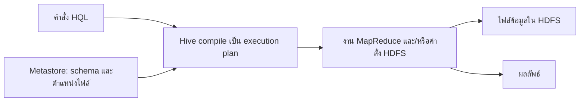
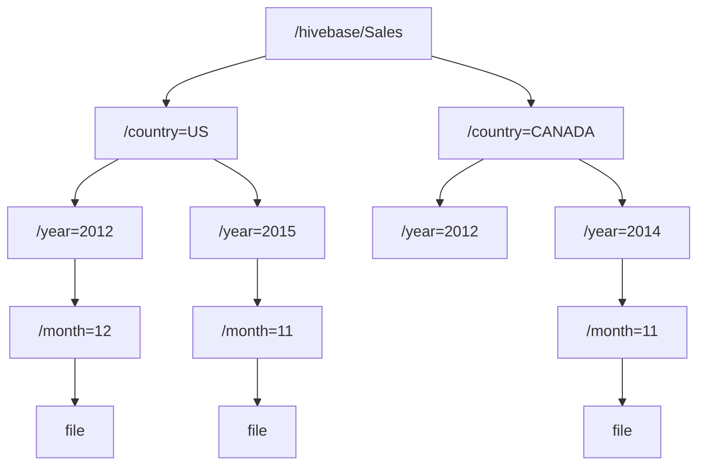

# Hive

งานวิเคราะห์ข้อมูลส่วนใหญ่เขียนด้วย SQL เช่น นับจำนวนใบสั่งซื้อต่อเดือน หรือรวมยอดเบิกยาต่อโรงพยาบาล แต่เมื่อข้อมูลใหญ่จนต้องเก็บบน Hadoop การตอบคำถามเดียวกันต้องเขียนโปรแกรม MapReduce ด้วย Java ทั้ง mapper, reducer และโค้ดตั้งค่างาน Hive ถูกสร้างขึ้นเพื่อปิดช่องว่างนี้ ให้นักวิเคราะห์เขียนคำสั่งแบบ SQL แล้ว Hive แปลงเป็นงานบน Hadoop ให้เอง

ศัพท์รากของบทนี้มาจากบท Hadoop **HDFS** (Hadoop Distributed File System) คือระบบไฟล์ที่ตัดไฟล์ใหญ่เป็น block แล้วกระจายเก็บบนหลายเครื่อง **cluster** คือกลุ่มเครื่องเหล่านั้นที่ทำงานร่วมกันเป็นระบบเดียว และ **MapReduce** คือรูปแบบการประมวลผลที่แบ่งงานเป็นขั้น map (อ่านข้อมูลแต่ละแถวแล้วส่งออกเป็นคู่ key กับ value) และขั้น reduce (รวม value ที่มี key เดียวกัน) โดยให้หลายเครื่องทำพร้อมกัน Hive ใช้ทั้งสองส่วน ข้อมูลอยู่ใน HDFS และการประมวลผลกลายเป็นงาน MapReduce

## 1. Hive และภาษา HQL

**Hive** คือ data warehousing framework ที่สร้างบน Hadoop **data warehouse** คือคลังข้อมูลที่รวบรวมข้อมูลปริมาณมากไว้สำหรับวิเคราะห์และทำรายงาน Hive ให้ส่วนติดต่อแบบ SQL ที่นักวิเคราะห์คุ้นเคย และทำให้เรากำหนด **schema** (นิยามว่าตารางมีคอลัมน์อะไร แต่ละคอลัมน์เป็นชนิดข้อมูลอะไร) ให้กับไฟล์ที่อยู่ใน HDFS ได้ ตัวไฟล์ยังเป็นไฟล์ธรรมดาเหมือนเดิม แต่เมื่อมี schema แล้ว Hive จึงอ่านมันเป็นแถวและคอลัมน์ได้

ภาษาที่ใช้สั่ง Hive ชื่อ **HQL** (Hive Query Language หรือ HiveQL) รองรับคำสั่ง SQL ที่ใช้บ่อยสามกลุ่ม **DDL** (Data Definition Language) ใช้สร้างโครงสร้าง เช่น CREATE DATABASE, CREATE SCHEMA, CREATE TABLE **DML** (Data Manipulation Language) ใช้เปลี่ยนข้อมูล เช่น INSERT, UPDATE, LOAD และกลุ่มดึงข้อมูลคือ SELECT ถ้าฟังก์ชันที่มีให้ไม่พอ Hive ยังรองรับ **UDF** (User-Defined Function คือฟังก์ชันที่ผู้ใช้เขียนเอง) ที่เขียนด้วย Java หรือภาษาอื่นที่ทำงานผ่าน **Hadoop Streaming** (กลไกที่ให้โปรแกรมภาษาใดก็ได้รับข้อมูลเข้าและส่งผลออกทางข้อความ)

เมื่อผู้ใช้ส่งคำสั่ง HQL Hive จะ compile คำสั่งนั้นเป็น **execution plan** คือแผนการทำงานที่ประกอบด้วยการทำงานกับ HDFS และ/หรืองาน MapReduce หลายงานต่อกัน ก่อนสร้างแผน Hive ต้องรู้ว่าตารางมีคอลัมน์อะไรและไฟล์อยู่ที่ไหน ข้อมูลส่วนนี้ได้มาจาก Metastore (อธิบายในหัวข้อ 3)



ตัวอย่างเช่น `select count(1) from apache_log;` ถูกแปลงเป็นงาน MapReduce หนึ่งงานที่อ่านทุกไฟล์ของตารางแล้วนับแถว ทุกงานบน cluster มีเวลาเริ่มต้นหลายวินาที Hive จึงเหมาะกับ **batch processing** คือการประมวลผลข้อมูลก้อนใหญ่ครั้งละมาก ๆ ที่ต้องการ **throughput** (ปริมาณข้อมูลที่ประมวลผลได้ต่อหน่วยเวลา) สูงและขยายตามขนาดข้อมูลได้ ส่วนงานที่ต้องตอบทีละแถวภายในเสี้ยววินาทีไม่เหมาะกับ Hive

## 2. การแก้ไขข้อมูลภายใต้ข้อจำกัดของ HDFS

HDFS ทำงานแบบ **WORM** (Write Once, Read Many) คือไฟล์ที่เขียนเสร็จแล้วอ่านได้หลายครั้ง แต่แก้ไขข้อมูลกลางไฟล์ไม่ได้ Hive รับข้อจำกัดนี้มาด้วย จึงทำ in-place update (แก้ค่าในตำแหน่งเดิมของไฟล์) ไม่ได้

ถึงอย่างนั้น Hive ก็รองรับ INSERT, UPDATE และ DELETE แบบ **ACID** ซึ่งย่อจาก Atomicity (ธุรกรรมสำเร็จครบทั้งหมดหรือไม่เกิดเลย), Consistency (ข้อมูลอยู่ในสภาพถูกต้องเสมอ), Isolation (ธุรกรรมที่ทำพร้อมกันไม่รบกวนกัน) และ Durability (สิ่งที่บันทึกแล้วไม่หาย) วิธีที่ Hive ทำได้ทั้งที่ไฟล์แก้ไม่ได้มีลำดับดังนี้ ([Hive Transactions](https://hive.apache.org/docs/latest/user/hive-transactions-acid))

1. ข้อมูลหลักของตารางหรือของ partition เก็บอยู่ในชุดไฟล์ที่เรียกว่า **base files**
2. ทุกธุรกรรมที่ insert, update หรือ delete จะเขียนการเปลี่ยนแปลงลงไฟล์เล็กชุดใหม่ที่เรียกว่า **delta files** โดยไม่แตะ base
3. ตอนอ่าน Hive อ่านทั้ง base และ delta แล้วรวมกัน โดยนำการแก้ไขและการลบใน delta มาใช้ทับ base
4. เมื่อ delta สะสมมาก การอ่านต้องรวมไฟล์จำนวนมากขึ้นจึงช้าลง Metastore server จึงรันงาน MapReduce เบื้องหลังเป็นระยะเพื่อรวม delta เข้ากับ base เป็นไฟล์ชุดใหม่ กระบวนการนี้เรียกว่า **compaction**

ทุกการแก้ไขจึงหมายถึงการสร้างไฟล์ใหม่และงานรวมไฟล์ในภายหลัง การ update หรือ delete บ่อย ๆ จึงไม่มีประสิทธิภาพ ตัวอย่างเช่น ถ้าระบบ update สถานะใบสั่งซื้อทีละใบตลอดวัน แต่ละ update จะสร้าง delta ชุดใหม่ งานแบบนี้ควรเก็บในฐานข้อมูลปฏิบัติการ แล้วนำข้อมูลเข้า Hive เป็นก้อนเพื่อวิเคราะห์

ตาราง Hive สร้าง **index** (โครงสร้างช่วยค้นที่บอกว่าค่าใดอยู่ตรงไหน) เพื่อเร่ง query ที่เข้าถึงตารางได้ ความสามารถนี้มีถึง Hive 2.x และถูกถอดออกตั้งแต่ Hive 3.0 โดยรุ่นใหม่ใช้รูปแบบไฟล์แบบคอลัมน์อย่าง ORC ที่ข้ามส่วนข้อมูลที่ไม่เกี่ยวข้องได้เองแทน ([Hive Indexes](https://hive.apache.org/development/designdocs/indexdev/))

## 3. Metastore

**Metastore** คือที่เก็บ **metadata** (ข้อมูลที่อธิบายข้อมูล) ของ Hive ได้แก่ รายชื่อ database และตาราง คอลัมน์และชนิดข้อมูลของแต่ละตาราง ตำแหน่งโฟลเดอร์ใน HDFS รายการ partition และการตั้งค่า bucket Hive เก็บ metadata ไว้ในฐานข้อมูลเชิงสัมพันธ์แยกต่างหาก ซึ่งมักเป็น MySQL server และไม่เก็บไว้ใน HDFS เพราะ metadata เป็นข้อมูลชิ้นเล็กที่ถูกอ่านและแก้บ่อย เช่น ทุกครั้งที่สร้างตาราง เพิ่มคอลัมน์ หรือเพิ่ม partition ฐานข้อมูลเชิงสัมพันธ์แก้ค่าเล็ก ๆ ได้ทันที ขณะที่ HDFS แก้ไฟล์ในที่เดิมไม่ได้

ข้อมูลจริงจึงอยู่ใน HDFS และคำอธิบายของข้อมูลอยู่ใน Metastore ถ้า Metastore ใช้งานไม่ได้ Hive จะไม่รู้ว่าตารางใดอยู่ที่ไหนและมีคอลัมน์อะไร query ทุกคำสั่งจึงทำงานไม่ได้ แม้ไฟล์ใน HDFS จะยังอยู่ครบ

## 4. Table, Partition และ Bucket

Hive จัดข้อมูลเป็นสามระดับ คือ Table, Partition และ Bucket metadata ของทั้งสามระดับอยู่ใน Metastore ส่วนตัวข้อมูลเป็นโฟลเดอร์และไฟล์ใน HDFS

**Table** ของ Hive มีความหมายเดียวกับตารางในฐานข้อมูลเชิงสัมพันธ์ ทุกตารางมีโฟลเดอร์ของตัวเองหนึ่งโฟลเดอร์ใน HDFS ข้อมูลของตารางถูก **serialize** (แปลงแถวข้อมูลเป็นรูปแบบที่เขียนลงไฟล์ได้) แล้วเก็บเป็นไฟล์อยู่ในโฟลเดอร์นั้น ตาราง Sales จึงมีโฟลเดอร์ เช่น `/hivebase/Sales` และทุกไฟล์ในโฟลเดอร์คือข้อมูลของ Sales

**Partition** คือการแบ่งตารางออกเป็นโฟลเดอร์ย่อยตามค่าของคอลัมน์ที่ระบุ ตารางที่ไม่มี partition ต้องอ่านทุกไฟล์ทุกครั้ง แม้คำถามต้องการข้อมูลเพียงเดือนเดียว partition แก้ปัญหานี้โดยวางข้อมูลแต่ละกลุ่มค่าไว้คนละโฟลเดอร์

```sql
CREATE TABLE sales (sale_id INT, amount FLOAT)
PARTITIONED BY (country STRING, year INT, month INT);
```

คอลัมน์ใน PARTITIONED BY กลายเป็นชื่อโฟลเดอร์ในรูป `ชื่อคอลัมน์=ค่า` ซ้อนกันตามลำดับที่ประกาศ ยอดขายของสหรัฐฯ เดือนธันวาคม 2012 จึงอยู่ที่ `Sales/country=US/year=2012/month=12` ค่า country, year และ month ไม่ถูกเขียนซ้ำในไฟล์ข้อมูล Hive อ่านค่าเหล่านี้จากชื่อโฟลเดอร์



เมื่อ query มีเงื่อนไข `WHERE country = 'US' AND year = 2012` Hive เปิดเฉพาะโฟลเดอร์ `country=US/year=2012` และข้ามโฟลเดอร์ของแคนาดาและของปีอื่นทั้งหมด ในงานจัดซื้อของโรงพยาบาล ตารางใบสั่งซื้อที่แบ่ง partition ตาม hospital และ year ทำให้รายงานของโรงพยาบาลเดียวในปีเดียวอ่านข้อมูลเพียงส่วนเล็ก ๆ ของทั้งเครือ

**Bucket** คือการแบ่งข้อมูลภายในตารางหรือภายใน partition ออกเป็นไฟล์จำนวนคงที่ โดยใช้คอลัมน์ที่ระบุใน CLUSTERED BY แต่ละ bucket เก็บเป็นหนึ่งไฟล์ในโฟลเดอร์ของ partition (หรือในโฟลเดอร์ของตาราง ถ้าตารางไม่มี partition) partition ใช้ได้ดีกับคอลัมน์ที่มีค่าไม่มาก เช่น ประเทศหรือเดือน แต่คอลัมน์อย่าง sale_id มีค่าต่างกันเป็นล้านค่า ถ้าใช้ partition จะได้โฟลเดอร์เป็นล้านโฟลเดอร์ bucket จึงใช้วิธีจัดค่าลงไฟล์จำนวนที่เรากำหนดไว้แทน

```sql
CREATE TABLE sales_bucketed (sale_id INT, amount FLOAT)
PARTITIONED BY (country STRING, year INT, month INT)
CLUSTERED BY (sale_id) SORTED BY (sale_id) INTO 4 BUCKETS;
```

CLUSTERED BY หาว่าแถวหนึ่งอยู่ bucket ใดด้วย **hash function** คือฟังก์ชันที่แปลงค่าเป็นตัวเลข โดยค่าเดิมได้ตัวเลขเดิมเสมอ แล้วนำตัวเลขนั้นหารด้วยจำนวน bucket เอาเศษเป็นหมายเลข bucket

$$
\mathrm{bucket} = \mathrm{hash}(v) \;\mathrm{mod}\; n
$$

โดย $v$ คือค่าในคอลัมน์ที่ใช้ bucket และ $n$ คือจำนวน bucket สำหรับคอลัมน์ INT ค่า hash คือตัวเลขนั้นเอง เมื่อ $n = 4$

```
sale_id = 13  ->  13 mod 4 = 1  ->  bucket 1
sale_id = 20  ->  20 mod 4 = 0  ->  bucket 0
sale_id = 27  ->  27 mod 4 = 3  ->  bucket 3
sale_id = 6   ->   6 mod 4 = 2  ->  bucket 2
```

เศษจากการหารด้วย 4 มีได้เพียง 0 ถึง 3 จึงมีไฟล์ bucket พอดีสี่ไฟล์ และเมื่อต้องการหา sale_id = 13 Hive คำนวณได้ทันทีว่าต้องเปิดเฉพาะ bucket 1 ส่วน **SORTED BY** สั่งให้เรียงข้อมูลภายในแต่ละ bucket ตามคอลัมน์ที่ระบุ เมื่อข้อมูลเรียงแล้ว การหาแถวที่ต้องการภายใน bucket ใช้ **binary search** ได้ คือเปิดแถวตรงกลาง ถ้าค่าที่หามากกว่าก็ทิ้งครึ่งแรก ถ้าน้อยกว่าก็ทิ้งครึ่งหลัง ทำซ้ำจนพบค่าที่ต้องการ ใน bucket ที่มีหนึ่งล้านแถวจึงเทียบค่าเพียงราว 20 ครั้ง เพราะ $2^{20}$ ประมาณหนึ่งล้าน การรู้ตำแหน่ง bucket ล่วงหน้าและการค้นในไฟล์ที่เรียงแล้วคือเหตุผลที่ bucket ทำให้ query บางประเภทเร็วขึ้น เช่น การค้นด้วยค่าของคอลัมน์ที่ใช้ bucket

## 5. Hive CLI

**Hive CLI** (Command Line Interface) คือโปรแกรมแบบพิมพ์คำสั่งสำหรับใช้งาน Hive ใช้ได้สองแบบ แบบแรกคือ interactive พิมพ์ `hive` ที่ shell แล้วจะได้ prompt `hive>` สำหรับพิมพ์คำสั่งทีละคำสั่ง ทุกคำสั่งจบด้วย `;` และออกด้วย `exit;`

```
# hive
hive> show databases;
hive> exit;
```

แบบที่สองคือสั่งจาก shell โดยตรงโดยไม่เข้า prompt ซึ่งใช้กับสคริปต์และงานตั้งเวลา `-e` รันคำสั่งเดียวที่เขียนไว้ในเครื่องหมายคำพูด `-f` รันทุกคำสั่งในไฟล์ `.hql` (ไฟล์ข้อความที่เก็บคำสั่ง HQL หลายคำสั่ง) ตามลำดับ และ `-h` แสดงวิธีใช้คำสั่ง hive

```
# hive -e 'show databases'
# hive -f exec.hql
# hive -h
```

## 6. คำสั่งจัดการ database และ table

คำสั่ง `create database log_data;` สร้าง database ใหม่โดยบันทึกนิยามไว้ใน Metastore ถ้ามี database ชื่อนี้อยู่แล้ว Hive จะแจ้ง error สคริปต์ที่ต้องรันซ้ำได้จึงใช้ `if not exists` ซึ่งสร้างเฉพาะเมื่อยังไม่มี

```sql
create database if not exists log_data;
```

หลังสร้าง database แล้ว ลำดับการใช้งานทั่วไปคือดูว่ามี database อะไร เลือก database ที่จะทำงาน ดูตารางในนั้น ดู schema ของตาราง และแก้หรือลบตาราง

```sql
show databases;
use log_data;
show tables;
describe test;
alter table test add columns (address string);
drop table test;
```

`describe test` แสดงชื่อคอลัมน์และชนิดข้อมูลของตาราง test และ `alter table ... add columns` เพิ่มคอลัมน์ address เข้าไปใน schema คำสั่งเหล่านี้ทำงานกับ metadata ใน Metastore ส่วน `drop table` อาจลบไฟล์ใน HDFS ด้วย ขึ้นกับชนิดของตารางซึ่งอธิบายในหัวข้อถัดไป

## 7. Managed table และ External table

**Managed table** คือชนิดตารางค่าเริ่มต้นของ Hive (บางแหล่งเรียก internal table) Hive เป็นผู้ดูแลข้อมูลเอง ข้อมูลที่โหลดเข้าตารางถูกย้ายไปไว้ใน **warehouse directory** ของ Hive ซึ่งเป็นโฟลเดอร์กลางใน HDFS สำหรับเก็บข้อมูลของตาราง managed ทั้งหมด เพราะ Hive เป็นเจ้าของข้อมูล เมื่อ drop managed table Hive จึงลบทั้ง metadata และไฟล์ข้อมูล

```sql
create table memo (lineno string, linetext string)
row format delimited fields terminated by '\t'
stored as textfile;
```

`row format delimited fields terminated by '\t'` บอกว่าในไฟล์ข้อมูลแต่ละคอลัมน์คั่นด้วยตัวอักษร tab และ `stored as textfile` บอกว่าเก็บเป็นไฟล์ข้อความ ตารางยังเก็บเป็น **ORC** (Optimized Row Columnar) ได้ด้วย `stored as orc` ORC เก็บข้อมูลเรียงตามคอลัมน์และบีบอัด query ที่ใช้ไม่กี่คอลัมน์จึงอ่านข้อมูลน้อยลงมาก

**External table** บอก Hive ให้อ้างถึงข้อมูลที่อยู่ในตำแหน่งเดิมนอก warehouse directory Hive ไม่ย้ายไฟล์และไม่ถือว่าเป็นเจ้าของไฟล์ เมื่อ drop external table Hive จึงลบเฉพาะ metadata ไฟล์ข้อมูลยังอยู่ครบ คำสั่งสร้างต่างจาก managed table สองจุด คือคำว่า `external` และ `location` ที่ชี้โฟลเดอร์ของข้อมูล

```sql
create external table memo (lineno string, linetext string)
row format delimited fields terminated by '\t'
stored as textfile
location '/user/cloudera/external_table';
```

ข้อมูลที่ระบบอื่นเขียนเข้ามาหรือใช้ร่วมกับเครื่องมืออื่น เช่น ไฟล์ส่งออกรายวันจากระบบจัดซื้อที่วางไว้ใน HDFS จึงมักสร้างเป็น external table เพื่อให้การ drop ตารางใน Hive ไม่ลบไฟล์ที่ระบบอื่นยังใช้อยู่

## 8. ชนิดข้อมูล

ชนิดข้อมูลพื้นฐาน (primitive data types) กลุ่มจำนวนเต็มมีสี่ขนาด **TINYINT** ขนาด 8 bit, **SMALLINT** 16 bit, **INT** 32 bit และ **BIGINT** 64 bit จำนวนเต็มแบบมีเครื่องหมายขนาด $n$ bit เก็บค่าได้ตั้งแต่ $-2^{n-1}$ ถึง $2^{n-1}-1$ TINYINT จึงเก็บได้ $-2^{7} = -128$ ถึง $2^{7}-1 = 127$ กลุ่มทศนิยมมี **FLOAT** ขนาด 32 bit (single precision) และ **DOUBLE** ขนาด 64 bit (double precision) ซึ่งเก็บเลขนัยสำคัญได้มากกว่า นอกจากนี้มี **BOOLEAN** เก็บ true หรือ false, **STRING** เก็บข้อความยาวได้ถึงประมาณ 2 GB และ **TIMESTAMP** เก็บวันเวลาละเอียดถึง nanosecond ในรูป `yyyy-mm-dd hh:mm:ss.fffffffff` (ทศนิยมของวินาที 9 หลัก)

ชนิดข้อมูลซับซ้อน (complex data types) ทำให้หนึ่งช่องเก็บได้หลายค่า **ARRAY** คือชุดค่าชนิดเดียวกันที่มีลำดับ เช่น `array<string>` ที่เก็บ `['Tie','Coat']` อ้างถึงด้วยตำแหน่งที่เริ่มจาก 0 คือ `col[0]` ได้ `'Tie'` **MAP** คือชุดคู่ key กับ value ที่ไม่มีลำดับ key ต้องเป็นชนิดพื้นฐาน เช่น `map<string,int>` ที่เก็บ `{'Tie': 2, 'Coat': 1}` อ้างถึงด้วย `col['Tie']` ได้ 2 **STRUCT** คือกลุ่มฟิลด์ที่มีชื่อ แต่ละฟิลด์เป็นชนิดใดก็ได้ เช่น `struct<name:string, age:int>` อ้างถึงด้วยจุด เช่น `col.name`

## 9. SerDe และ Regular Expression

**SerDe** ย่อจาก Serializer/Deserializer คือส่วนที่ Hive ใช้แปลงระหว่างไฟล์กับแถวของตาราง การ **deserialize** คือการอ่านข้อความในไฟล์แล้วแยกเป็นคอลัมน์ตอน query และการ serialize คือการแปลงแถวกลับเป็นข้อความตอนเขียนไฟล์ `row format delimited` ในหัวข้อ 7 ใช้ SerDe มาตรฐานที่แยกคอลัมน์ด้วยตัวคั่นตัวเดียว ซึ่งใช้ไม่ได้กับไฟล์ที่ตัวคั่นไม่สม่ำเสมอ เช่น **Apache access log** (ไฟล์บันทึกการเข้าเว็บของ web server Apache) ที่หนึ่งบรรทัดมีหน้าตาดังนี้

```
127.0.0.1 - frank [10/Oct/2000:13:55:36 -0700] "GET /apache_pb.gif HTTP/1.0" 200 2326 "http://www.example.com/start.html" "Mozilla/4.08"
```

ช่องในบรรทัดคั่นด้วยช่องว่าง แต่ช่องเวลาในวงเล็บเหลี่ยมและช่อง request ในเครื่องหมายคำพูดก็มีช่องว่างอยู่ข้างใน ถ้าแยกด้วยช่องว่างอย่างเดียว ช่องเวลาจะถูกตัดเป็นสองคอลัมน์และ request ถูกตัดเป็นสามคอลัมน์ Hive จึงมี **RegexSerDe** ซึ่งใช้ **regular expression** (regex คือรูปแบบข้อความที่บรรยายว่าข้อความที่ต้องการมีหน้าตาอย่างไร) จับคู่กับทั้งบรรทัด แล้วนำค่าในวงเล็บแต่ละคู่ของ regex ไปเป็นคอลัมน์ตามลำดับ ([Hive User Guide](https://hive.apache.org/docs/latest/userguide_27362066)) regex จึงใช้ระบุรูปแบบของไฟล์ที่ไม่ได้อยู่ในรูปแบบของ Hive เพื่อให้โหลดเนื้อหาเข้าตารางได้

ก่อนอ่าน regex ของ Apache log ต้องรู้สัญลักษณ์ regex ก่อน สัญลักษณ์ด้านล่างอธิบายตามความหมายว่า "ข้อความนี้มีส่วนที่ตรงกับรูปแบบหรือไม่" เว้นแต่รูปแบบมี `^` และ `$` บังคับจุดเริ่มและจุดจบ ทุกตัวอย่างตรวจผลด้วยการรันจริงใน Python

`^` และ `$` บอกจุดเริ่มและจุดจบของข้อความ `^The` ตรงกับข้อความที่ขึ้นต้นด้วย The ส่วน `of despair$` ตรงกับข้อความที่ลงท้ายด้วย of despair เมื่อใช้ทั้งสองตัว `^abc$` จะตรงกับข้อความที่มีเพียง abc เท่านั้น ซึ่งเท่ากับการเทียบว่าเท่ากันทุกตัวอักษร

`*`, `+` และ `?` บอกจำนวนครั้งที่ตัวอักษรหรือกลุ่มก่อนหน้าปรากฏ คือศูนย์ครั้งขึ้นไป หนึ่งครั้งขึ้นไป และศูนย์หรือหนึ่งครั้งตามลำดับ

```
ab*c   ตรงกับ ac, abc, abbc, abbbc
ab+c   ตรงกับ abc, abbc  (ac ไม่ตรง เพราะต้องมี b อย่างน้อยหนึ่งตัว)
ab?c   ตรงกับ ac, abc    (abbc ไม่ตรง เพราะ b มีได้ไม่เกินหนึ่งตัว)
```

รูปแบบ `a?b+$` หมายถึง a ที่มีหรือไม่มีก็ได้ ตามด้วย b หนึ่งตัวขึ้นไปที่ท้ายข้อความ เพราะไม่มี `^` กำหนดจุดเริ่ม ทุกข้อความที่ลงท้ายด้วย b ตรงกับรูปแบบนี้ เช่น ab, abb, b, bb รวมถึง aab ซึ่งรูปแบบเริ่มจับที่ a ตัวที่สอง เมื่อเติม `^` เป็น `^a?b+$` ทั้งข้อความต้องมี a ไม่เกินหนึ่งตัวนำหน้า b จึงตรงกับ ab, abb, b, bb และ aab กับ aabb ไม่ตรง

`{ }` กำหนดจำนวนครั้งเป็นตัวเลข `ab{2}` คือ a ตามด้วย b พอดีสองตัว (abb) และ `ab{3,5}` คือ a ตามด้วย b สามถึงห้าตัว (abbb, abbbb, abbbbb) ส่วน `( )` จัดกลุ่มให้สัญลักษณ์จำนวนครั้งใช้กับหลายตัวอักษรพร้อมกัน `a(bc)*` คือ a ตามด้วย bc กี่ชุดก็ได้ (a, abc, abcbc) ใน RegexSerDe วงเล็บแต่ละคู่ยังทำหน้าที่เป็นกลุ่มที่ค่าถูกนำไปเป็นคอลัมน์

`|` ทำหน้าที่ "หรือ" `hi|hello` ตรงกับข้อความที่มี hi หรือ hello `(b|cd)ef` ตรงกับ bef หรือ cdef และ `(a|b)*c` คือ a หรือ b เรียงกันกี่ตัวก็ได้ในลำดับใดก็ได้ แล้วตามด้วย c เช่น c, abc, aabbc, babac

`[ ]` กำหนดชุดตัวอักษรที่ยอมรับในหนึ่งตำแหน่ง `[ab]` คือ a หรือ b หนึ่งตัว ให้ผลเท่ากับ `a|b` `[a-d]` คือตัวพิมพ์เล็ก a ถึง d หนึ่งตัว เท่ากับ `[abcd]` `^[a-zA-Z]` คือข้อความที่ขึ้นต้นด้วยตัวอักษรภาษาอังกฤษ และ `[0-9]%` คือตัวเลขหนึ่งหลักตามด้วยเครื่องหมายเปอร์เซ็นต์ เมื่อ `^` อยู่เป็นตัวแรกในวงเล็บเหลี่ยม ความหมายเปลี่ยนเป็นตัวอักษรใดก็ได้ยกเว้นที่ระบุ `[^ ]` จึงหมายถึงตัวอักษรใดก็ได้ที่เป็นช่องว่างไม่ได้

`.` คือตัวอักษรใดก็ได้หนึ่งตัว `a.[0-9]` คือ a ตามด้วยตัวอักษรหนึ่งตัวแล้วตามด้วยตัวเลข เช่น ax7 และ `^.{3}$` คือข้อความที่ยาวพอดีสามตัวอักษร สุดท้าย `\` คือ escape character ใช้จับตัวอักษรที่มีความหมายพิเศษใน regex ตามตัวอักษรจริง `\[` คือวงเล็บเหลี่ยมเปิด `\.` คือจุด และ `\"` คือเครื่องหมายคำพูด

เมื่อรู้สัญลักษณ์ครบแล้ว ตาราง apache_log สร้างด้วย RegexSerDe ได้ดังนี้

```sql
create table apache_log (
  host     string,
  identity string,
  `user`   string,
  `time`   string,
  request  string,
  status   string,
  size     string,
  referer  string,
  agent    string
)
row format serde 'org.apache.hadoop.hive.serde2.RegexSerDe'
with serdeproperties (
  'input.regex' = '([^ ]*) ([^ ]*) ([^ ]*) (-|\\[[^\\]]*\\]) ([^ "]*|"[^"]*") (-|[0-9]*) (-|[0-9]*)(?: ([^ "]*|"[^"]*") ([^ "]*|"[^"]*"))?'
)
stored as textfile;
```

regex นี้มีกลุ่มจับค่า 9 กลุ่มสำหรับ 9 คอลัมน์ เรียงจากซ้ายไปขวา กลุ่มที่ 1 ถึง 3 คือ `[^ ]*` ข้อความที่ไม่มีช่องว่าง ได้ host, identity และ user กลุ่มที่ 4 คือ `-` หรือ `\[[^\]]*\]` วงเล็บเหลี่ยมเปิด ตามด้วยตัวอักษรที่เป็นวงเล็บปิดไม่ได้กี่ตัวก็ได้ แล้วปิดวงเล็บ จึงได้ช่องเวลาทั้งช่องรวมช่องว่างข้างใน กลุ่มที่ 5 คือ `"[^"]*"` ข้อความในเครื่องหมายคำพูดทั้งก้อน ได้ request กลุ่มที่ 6 และ 7 คือ `-` หรือตัวเลข ได้ status และ size ส่วนกลุ่มที่ 8 และ 9 (referer, agent) ถูกครอบด้วย `(?: ... )?` ซึ่งเป็นวงเล็บที่ไม่นับเป็นคอลัมน์และมีเครื่องหมาย `?` ตามหลัง log ที่ไม่มีสองช่องท้ายจึงยังตรงกับรูปแบบ จุดที่มักพลาดในการเขียนคือ backslash ในสตริงของ Hive ต้องเขียนสองตัว `\\` จึงจะเหลือ `\` หนึ่งตัวใน regex และชื่อคอลัมน์ `user` กับ `time` ต้องครอบด้วย backtick เพราะเป็นคำสงวนของ Hive

ผลจากการรันจริง (ทดสอบ regex เดียวกันกับบรรทัดตัวอย่างด้วย Python)

```
host     = 127.0.0.1
identity = -
user     = frank
time     = [10/Oct/2000:13:55:36 -0700]
request  = "GET /apache_pb.gif HTTP/1.0"
status   = 200
size     = 2326
referer  = "http://www.example.com/start.html"
agent    = "Mozilla/4.08"
```

RegexSerDe ต้องให้ regex ตรงกับทั้งบรรทัด บรรทัดที่ไม่ตรงจะได้ NULL ทุกคอลัมน์ ([AWS Athena: Regex SerDe](https://docs.aws.amazon.com/athena/latest/ug/regex-serde.md)) ตัวอย่างในเอกสาร Hive บางแห่งมี property `'output.format.string' = '%1$s %2$s ... %9$s'` เพิ่มมา property นี้ใช้กับ RegexSerDe รุ่น contrib (`org.apache.hadoop.hive.contrib.serde2.RegexSerDe`) ตอนเขียนแถวกลับเป็นข้อความ โดย `%1$s` หมายถึงค่าของกลุ่มที่ 1 ในรูปข้อความ

## 10. การโหลดข้อมูล

ฐานข้อมูลเชิงสัมพันธ์ทั่วไปตรวจข้อมูลตอนเขียน ถ้าค่าไม่ตรงชนิดคอลัมน์ การ insert จะ error ทันที Hive ทำงานต่างออกไป ตอนโหลดข้อมูลเข้าตาราง Hive ไม่ตรวจว่าข้อมูลสอดคล้องกับ schema และเพียงวางไฟล์ไว้ในโฟลเดอร์ของตาราง Hive ใช้ schema ตอน query อ่านไฟล์เท่านั้น วิธีนี้เรียกว่า **schema on read** ถ้าตอนอ่านพบว่าโครงสร้างไฟล์ไม่ตรงกับ schema Hive คืน NULL สำหรับฟิลด์ที่ขาดหายหรือชนิดข้อมูลไม่ตรง ตัวอย่างเช่น คอลัมน์ quantity ประกาศเป็น INT แต่ในไฟล์มีค่า `N/A` ช่องนั้นจะได้ NULL และ query ยังรันต่อได้ การโหลดจึงเร็วมากแม้ไฟล์ใหญ่ แต่ข้อมูลผิดรูปแบบจะไม่ถูกแจ้งตอนโหลด ผู้ใช้ต้องตรวจจำนวน NULL ในผลลัพธ์เอง

การโหลดข้อมูลของ Hive ทำเป็น batch ได้สองวิธี วิธีแรกคือ bulk load ด้วย LOAD DATA ซึ่งนำไฟล์ทั้งไฟล์เข้าตาราง

```sql
use log_data;
load data inpath '/user/cloudera/apache.log'
overwrite into table apache_log;
```

`inpath` ระบุไฟล์ที่อยู่ใน HDFS อยู่แล้ว Hive จะย้ายไฟล์นั้นเข้าโฟลเดอร์ของตาราง ไฟล์จึงหายไปจากตำแหน่งเดิม ถ้าไฟล์อยู่บนเครื่อง local ใช้ `load data local inpath` ซึ่งคัดลอกไฟล์ขึ้น HDFS คำว่า `overwrite` สั่งให้ลบข้อมูลเดิมของตารางก่อน ถ้าไม่ใส่ ไฟล์ใหม่จะถูกเพิ่มต่อจากของเดิม หลังโหลดแล้วตรวจจำนวนแถวด้วย `select count(1) from apache_log;` ซึ่ง Hive เริ่มงาน MapReduce หนึ่งงานเพื่อนับแถว (`count(1)` นับทุกแถว ให้ผลเท่ากับ `count(*)`)

วิธีที่สองคือนำผลของ query หนึ่งไปใส่ตาราง

```sql
insert overwrite table apache_log
select * from source;
```

`insert overwrite` แทนที่ข้อมูลเดิมทั้งหมดของตารางด้วยผลของ SELECT ส่วน `insert into` เพิ่มผลต่อจากข้อมูลเดิม

## 11. การวิเคราะห์ข้อมูลด้วย Hive

ปัญหานับจำนวนต่อกลุ่ม (group-count) ถ้าเขียนเป็น MapReduce ต้องเขียน mapper ที่ส่งคู่ (กลุ่ม, 1) reducer ที่รวมค่า 1 ของแต่ละกลุ่ม และฟังก์ชัน main ที่ตั้งค่างาน ใน Hive ปัญหาเดียวกันใช้ GROUP BY คำสั่งเดียว ตัวอย่างนี้นับจำนวนครั้งที่มีการเข้าเว็บในแต่ละเดือนจากตาราง apache_log

```sql
select month, count(1) as cnt
from (
  select split(`time`, '/')[1] as month
  from apache_log
) t
group by month
order by cnt desc;
```

query ชั้นในสร้างคอลัมน์ month จากค่า time `split` ตัดข้อความด้วยตัวคั่นที่ระบุได้เป็น array และ `[1]` เลือกสมาชิกตำแหน่งที่ 1 (นับจาก 0) กับค่า time ตัวอย่างจะได้ดังนี้

```
time                      =  [10/Oct/2000:13:55:36 -0700]
split(time, '/')          =  ['[10', 'Oct', '2000:13:55:36 -0700]']
split(time, '/')[1]       =  'Oct'
```

query ชั้นนอกนำ month ไปจัดกลุ่ม นับจำนวนแถวต่อกลุ่ม แล้วเรียงจากมากไปน้อย Hive บังคับให้ subquery ใน FROM มีชื่อเรียก (alias) ในที่นี้ใช้ `t` ถ้าไม่ใส่ คำสั่งจะ error การนับต่อ host เขียนได้โดยไม่ต้องมี subquery คือ `select host, count(1) as cnt from apache_log group by host order by cnt;` นอกจาก count Hive ยังมี **aggregate function** (ฟังก์ชันที่รวมหลายแถวเป็นค่าเดียว) สำหรับคอลัมน์ตัวเลข ได้แก่ sum, avg, min, max, variance, stddev และ covariance (covar_pop, covar_samp)

```sql
set hive.map.aggr = true;
```

การตั้งค่านี้สั่งให้ Hive รวมผลบางส่วนตั้งแต่ขั้น map ซึ่งเป็นหลักการเดียวกับ **combiner** ใน MapReduce แทนที่จะส่งทุกแถวไปรวมในขั้น reduce หลัง group by ถ้า mapper ตัวหนึ่งอ่านพบ host เดียวกัน 1,000 แถว เมื่อไม่ได้เปิดค่านี้ mapper ส่งคู่ (host, 1) ไป reducer 1,000 คู่ เมื่อเปิดค่านี้ mapper รวมเองแล้วส่ง (host, 1000) คู่เดียว ข้อมูลที่ต้องส่งข้ามเครือข่ายจึงลดลงมาก สิ่งที่ต้องแลกคือ mapper ต้องใช้หน่วยความจำมากขึ้นเพื่อเก็บผลรวมของทุกกลุ่มระหว่างทำงาน

Hive ยังสร้างตารางใหม่จากผลของ query ได้ด้วย **CREATE TABLE AS SELECT** (CTAS) ผลสรุปจึงถูกเก็บไว้ใช้วิเคราะห์ต่อหรือเก็บเป็นบันทึกได้โดยไม่ต้องรัน query เดิมซ้ำ ตัวอย่างนี้เก็บจำนวนการเข้าเว็บต่อเดือนเฉพาะ host ชื่อ remote

```sql
create table remote_hits_by_month as
select month, count(1) as cnt
from (
  select split(`time`, '/')[1] as month
  from apache_log
  where host = 'remote'
) t
group by month
order by cnt desc;
```

ตาราง remote_hits_by_month ที่ได้มีคอลัมน์ month และ cnt ตามผลของ SELECT (Hive รับทั้ง `=` และ `==` เป็นการเทียบความเท่ากัน)

## 12. Join

**Join** คือการนำแถวจากสองตารางมาต่อกันตามเงื่อนไข Hive รองรับ inner join, outer join และ semi join ตัวอย่างทั้งหัวข้อใช้สองตาราง ตาราง **sales** เก็บชื่อลูกค้า (cname) กับรหัสสินค้าที่ซื้อ (id) และตาราง **things** เก็บรหัสสินค้า (id) กับชื่อสินค้า (iname)

```
sales (cname, id)        things (id, iname)
Joe   2                  2  Tie
Hank  4                  4  Coat
Ali   0                  3  Hat
Eve   3                  1  Scarf
Hank  2
```

ในข้อมูลชุดนี้ Ali ซื้อสินค้ารหัส 0 ซึ่งไม่มีในตาราง things และ Scarf (รหัส 1) ไม่มีใครซื้อ สองแถวนี้ทำให้ join แต่ละแบบให้ผลต่างกัน ผลทุกแบบในหัวข้อนี้ตรวจด้วยการรันตรรกะเดียวกันจริงใน SQLite

**Inner join** คืนเฉพาะแถวที่จับคู่ได้ทั้งสองฝั่ง Ali ถูกตัดเพราะไม่มีรหัส 0 ใน things และ Scarf ถูกตัดเพราะไม่มีใครซื้อ จึงได้ 4 แถว

```sql
select sales.*, things.* from sales join things on (sales.id = things.id);
```

```
Joe   2  2  Tie
Hank  4  4  Coat
Eve   3  3  Hat
Hank  2  2  Tie
```

**Left outer join** คืนทุกแถวของตารางซ้าย แถวที่หาคู่ในตารางขวาไม่ได้จะมีคอลัมน์ฝั่งขวาเป็น NULL ผลจึงมี 5 แถวเท่ากับจำนวนแถวของ sales โดย Ali ปรากฏพร้อม NULL

```sql
select sales.*, things.* from sales left outer join things on (sales.id = things.id);
```

```
Joe   2  2     Tie
Hank  4  4     Coat
Ali   0  NULL  NULL
Eve   3  3     Hat
Hank  2  2     Tie
```

**Right outer join** คืนทุกแถวของตารางขวา แถวที่หาคู่ในตารางซ้ายไม่ได้จะมีคอลัมน์ฝั่งซ้ายเป็น NULL Tie ปรากฏสองครั้งเพราะลูกค้าสองคนซื้อ และ Scarf ปรากฏพร้อม NULL ได้ 5 แถว

```sql
select sales.*, things.* from sales right outer join things on (sales.id = things.id);
```

```
Joe   2     2  Tie
Hank  2     2  Tie
Hank  4     4  Coat
Eve   3     3  Hat
NULL  NULL  1  Scarf
```

**Full outer join** คืนทุกแถวจากทั้งสองฝั่ง ฝั่งที่หาคู่ไม่ได้เป็น NULL จึงได้ 4 แถวที่จับคู่ได้ บวก Ali บวก Scarf รวม 6 แถว ลำดับแถวในผลลัพธ์ของ Hive ไม่แน่นอน ถ้าต้องการลำดับต้องใส่ ORDER BY

```sql
select sales.*, things.* from sales full outer join things on (sales.id = things.id);
```

```
Ali   0     NULL  NULL
NULL  NULL  1     Scarf
Hank  2     2     Tie
Joe   2     2     Tie
Eve   3     3     Hat
Hank  4     4     Coat
```

**Left semi join** คืนแถวของตารางซ้ายที่มีคู่ในตารางขวาอย่างน้อยหนึ่งแถว ใช้ตอบคำถามแบบ "สินค้าตัวไหนเคยถูกซื้อ" ผลมีเฉพาะคอลัมน์ของตารางซ้าย ตารางขวาใช้ได้เฉพาะในเงื่อนไข ON และแต่ละแถวของตารางซ้ายปรากฏไม่เกินหนึ่งครั้ง Tie มีลูกค้าซื้อสองคนแต่ปรากฏครั้งเดียว ขณะที่ใน inner join Tie ปรากฏสองครั้ง

```sql
select * from things left semi join sales on (sales.id = things.id);
```

```
2  Tie
4  Coat
3  Hat
```

คำสั่งนี้ให้ผลเดียวกับ `select * from things where id in (select id from sales);`

**Anti join** คืนแถวของตารางซ้ายที่ไม่มีคู่ในตารางขวาเลย ใช้ตอบคำถามแบบ "สินค้าตัวไหนไม่เคยถูกซื้อ" หรือในงานจัดซื้อคือ "ใบสั่งซื้อใดอ้างรหัสสินค้าที่ไม่มีในข้อมูลหลักของสินค้า" ใน Hive เขียนได้ด้วย left outer join แล้วเก็บเฉพาะแถวที่คอลัมน์ฝั่งขวาเป็น NULL เพราะแถวที่หาคู่ไม่ได้คือแถวที่ฝั่งขวาถูกเติม NULL

```sql
select things.*
from things left outer join sales on (sales.id = things.id)
where sales.id is null;
```

ผลจากการรันจริงได้ `1 Scarf` ถ้าสลับให้ sales เป็นตารางซ้าย จะได้ `Ali 0` คือรายการขายที่หาสินค้าไม่พบ

## สรุปท้ายบท

- Hive คือ data warehousing framework บน Hadoop ให้ใช้ภาษาแบบ SQL (HQL) กับข้อมูลใน HDFS รองรับ DDL, DML, SELECT และ UDF ที่เขียนด้วย Java หรือภาษาที่ใช้ผ่าน Hadoop Streaming
- คำสั่ง HQL ถูก compile เป็น execution plan ที่ประกอบด้วยงาน MapReduce และ/หรือคำสั่ง HDFS เหมาะกับ batch processing ที่ต้องการ throughput สูง
- HDFS เป็น WORM Hive จึงทำ in-place update ไม่ได้ ACID insert/update/delete เขียนลง delta files และ compaction (งาน MapReduce เบื้องหลังที่ Metastore server สั่ง) รวม delta เข้า base files การแก้บ่อยจึงไม่มีประสิทธิภาพ
- ตาราง Hive ทำ index เพื่อเร่ง query ได้ (ถึงรุ่น 2.x ถูกถอดออกตั้งแต่ 3.0)
- Metastore เก็บ metadata ของ table, partition, bucket ในฐานข้อมูลเชิงสัมพันธ์ เช่น MySQL แยกจาก HDFS เพื่อให้อัปเดตและค้นได้เร็ว
- Table คือหนึ่งโฟลเดอร์ใน HDFS, Partition คือโฟลเดอร์ย่อยรูป `คอลัมน์=ค่า` ซ้อนตามลำดับใน PARTITIONED BY เช่น `Sales/country=US/year=2012/month=12`, Bucket คือไฟล์หนึ่งไฟล์ในโฟลเดอร์ partition
- CLUSTERED BY ใช้ hash mod จำนวน bucket เพื่อหาว่าแถวอยู่ bucket ใด SORTED BY เรียงข้อมูลใน bucket ให้ค้นด้วย binary search ได้
- Hive CLI: `hive` เข้า prompt, `exit;` ออก, `hive -e 'คำสั่ง'` รันคำสั่งเดียว, `hive -f ไฟล์.hql` รันไฟล์, `hive -h` ดูวิธีใช้
- `create database if not exists` ไม่ error เมื่อมี database อยู่แล้ว คำสั่งจัดการ: show databases, use, show tables, describe, alter table ... add columns, drop table
- Managed table: Hive ย้ายข้อมูลเข้า warehouse directory และ drop ลบทั้งข้อมูลและ metadata External table: ใช้ LOCATION ชี้ข้อมูลเดิม drop ลบเฉพาะ metadata
- Primitive: TINYINT 8 bit (-128 ถึง 127), SMALLINT 16, INT 32, BIGINT 64, FLOAT 32, DOUBLE 64, BOOLEAN, STRING (ถึง 2 GB), TIMESTAMP (nanosecond) Complex: ARRAY, MAP (key เป็น primitive), STRUCT
- SerDe แปลงระหว่างไฟล์กับแถว RegexSerDe นำกลุ่มในวงเล็บของ regex ไปเป็นคอลัมน์ บรรทัดที่ไม่ตรง regex ได้ NULL ทุกคอลัมน์
- Regex: `^` ต้น, `$` ท้าย, `*` ศูนย์ขึ้นไป, `+` หนึ่งขึ้นไป, `?` ศูนย์หรือหนึ่ง, `{n,m}` จำนวนครั้ง, `( )` กลุ่ม, `|` หรือ, `[ ]` ชุดตัวอักษร, `[^ ]` ยกเว้น, `.` ตัวใดก็ได้, `\` escape
- Schema on read: ตอนโหลดไม่ตรวจข้อมูล ตอนอ่านค่าที่ไม่ตรง schema ได้ NULL โหลดด้วย LOAD DATA (INPATH ย้ายไฟล์ใน HDFS, LOCAL INPATH คัดลอกไฟล์ local, OVERWRITE แทนที่ข้อมูลเดิม) หรือ INSERT OVERWRITE/INTO ... SELECT
- GROUP BY แทนการเขียน MapReduce group-count เอง, `hive.map.aggr = true` รวมผลบางส่วนในขั้น map แบบ combiner แลกกับหน่วยความจำ, CTAS เก็บผล query เป็นตารางใหม่
- Join: inner (คู่ที่ตรง), left/right outer (ทุกแถวฝั่งหนึ่ง เติม NULL), full outer (ทุกแถวทั้งสองฝั่ง), left semi (แถวซ้ายที่มีคู่ เฉพาะคอลัมน์ซ้าย ไม่ซ้ำ), anti (แถวซ้ายที่ไม่มีคู่)

## โจทย์ฝึก

**ข้อ 1** ตาราง orders สร้างด้วย `PARTITIONED BY (hospital STRING, year INT)` และ `CLUSTERED BY (order_id) INTO 8 BUCKETS` มีข้อมูล 3 โรงพยาบาล (BKK, PTY, HHN) และ 2 ปี (2025, 2026) ทุกคู่ จงหา (ก) จำนวนโฟลเดอร์ partition ระดับล่างสุด (ข) จำนวนไฟล์ bucket ทั้งหมด (ค) พาธและหมายเลข bucket ของ order_id = 45 ของ BKK ปี 2026

แนวตอบ: (ก) โฟลเดอร์ระดับล่างสุดคือทุกคู่ hospital กับ year คือ 3 x 2 = 6 โฟลเดอร์ (ข) แต่ละ partition มี 8 bucket จึงมี 6 x 8 = 48 ไฟล์ (ค) พาธคือ `orders/hospital=BKK/year=2026` และ 45 mod 8 = 5 เพราะ 8 x 5 = 40 เหลือเศษ 5 จึงอยู่ bucket 5

**ข้อ 2** นักวิเคราะห์สร้าง external table ชี้ไปที่ `/data/po_raw` แล้วสั่ง drop table จากนั้นสร้าง managed table ชื่อ po_clean แล้วสั่ง `load data inpath '/data/po_raw/po_2026.csv' into table po_clean` และสุดท้ายสั่ง drop po_clean จงไล่ว่าแต่ละขั้นเกิดอะไรกับไฟล์ po_2026.csv

แนวตอบ: drop external table ลบเฉพาะ metadata ไฟล์ยังอยู่ที่ `/data/po_raw` ขั้น load data inpath (ไม่มี local) ย้ายไฟล์จาก `/data/po_raw` เข้า warehouse directory ของ po_clean ไฟล์จึงหายจากตำแหน่งเดิม ขั้น drop po_clean ซึ่งเป็น managed table ลบทั้ง metadata และไฟล์ ไฟล์จึงหายจาก HDFS

**ข้อ 3** ใช้ตาราง sales และ things ในบทนี้ จงหาจำนวนแถวของ (ก) `things join sales` (ข) `things left semi join sales` (ค) `things left outer join sales` และอธิบายว่าทำไม (ก) กับ (ข) ได้จำนวนไม่เท่ากัน

แนวตอบ: (ก) inner join ได้ 4 แถว (Tie คู่กับ Joe และ Hank, Coat คู่กับ Hank, Hat คู่กับ Eve) (ข) semi join ได้ 3 แถว (Tie, Coat, Hat) (ค) ได้ 4 แถวที่จับคู่ได้ บวก Scarf ที่ไม่มีคู่ รวม 5 แถว (ก) กับ (ข) ต่างกันเพราะ semi join คืนแต่ละแถวของตารางซ้ายไม่เกินหนึ่งครั้ง Tie ที่มีสองคู่จึงนับครั้งเดียว

**แบบเช็กตัวเอง**

1. Hive เก็บ metadata ไว้ที่ใด และเพราะอะไรจึงไม่เก็บใน HDFS
2. เมื่อ UPDATE ตาราง ACID การเปลี่ยนแปลงถูกเก็บไว้ที่ไหน และถูกรวมกลับเข้าไฟล์หลักอย่างไร
3. ตาราง `PARTITIONED BY (country STRING, year INT, month INT)` แถวของแคนาดา พฤศจิกายน 2014 อยู่ในโฟลเดอร์ใด
4. ไฟล์มีค่า `N/A` ในคอลัมน์ที่ประกาศเป็น INT การ LOAD และการ SELECT จะเป็นอย่างไร
5. regex `^[0-9]{3}$` ตรงกับข้อความแบบใด
6. `[^ ]*` กับ `^ *` ต่างกันอย่างไร
7. `hive -f exec.hql` ทำอะไร
8. `set hive.map.aggr = true` ได้อะไรและเสียอะไร

**เฉลย**

1. เก็บใน Metastore ซึ่งเป็นฐานข้อมูลเชิงสัมพันธ์ เช่น MySQL เพราะ metadata เป็นข้อมูลชิ้นเล็กที่อ่านและแก้บ่อย ฐานข้อมูลเชิงสัมพันธ์แก้ได้ทันที ส่วน HDFS แก้ไฟล์ในที่เดิมไม่ได้
2. เก็บใน delta files ชุดใหม่ ตอนอ่าน Hive รวม base กับ delta และ compaction ที่ Metastore server สั่งรันเป็นงาน MapReduce เบื้องหลังรวม delta เข้า base เป็นระยะ
3. `Sales/country=CANADA/year=2014/month=11`
4. LOAD สำเร็จเพราะ Hive ไม่ตรวจข้อมูลตอนโหลด ตอน SELECT ช่องนั้นได้ NULL ตามหลัก schema on read
5. ข้อความที่เป็นตัวเลขพอดีสามหลักทั้งข้อความ เช่น 200 หรือ 404
6. `[^ ]*` คือตัวอักษรที่เป็นช่องว่างไม่ได้ต่อกันกี่ตัวก็ได้ (`^` ในวงเล็บเหลี่ยมคือยกเว้น) ส่วน `^ *` คือช่องว่างกี่ตัวก็ได้ที่ต้นข้อความ (`^` นอกวงเล็บคือจุดเริ่มข้อความ)
7. รันคำสั่ง HQL ทุกคำสั่งในไฟล์ exec.hql ตามลำดับโดยไม่เข้า prompt แบบ interactive
8. ได้การรวมผลบางส่วนในขั้น map แบบ combiner ทำให้ข้อมูลที่ส่งไป reducer น้อยลง เสียหน่วยความจำของ mapper มากขึ้น

## References

- Apache Hive, Hive Transactions (ACID): https://hive.apache.org/docs/latest/user/hive-transactions-acid
- Apache Hive, Indexes: https://hive.apache.org/development/designdocs/indexdev/
- Apache Hive, User Guide (Apache access log table with RegexSerDe): https://hive.apache.org/docs/latest/userguide_27362066
- AWS Athena, Regex SerDe: https://docs.aws.amazon.com/athena/latest/ug/regex-serde.md
