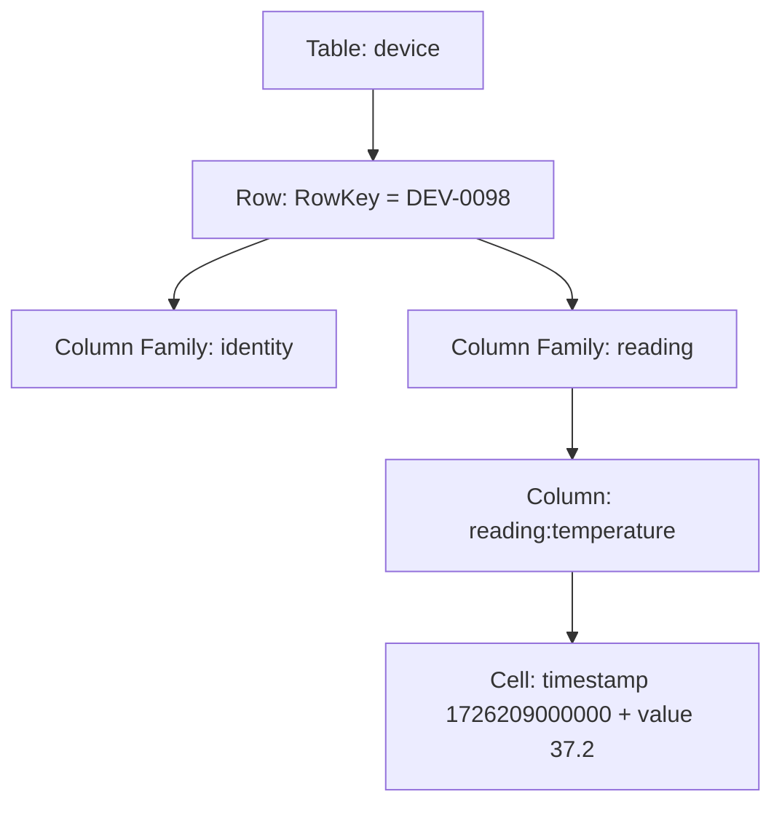
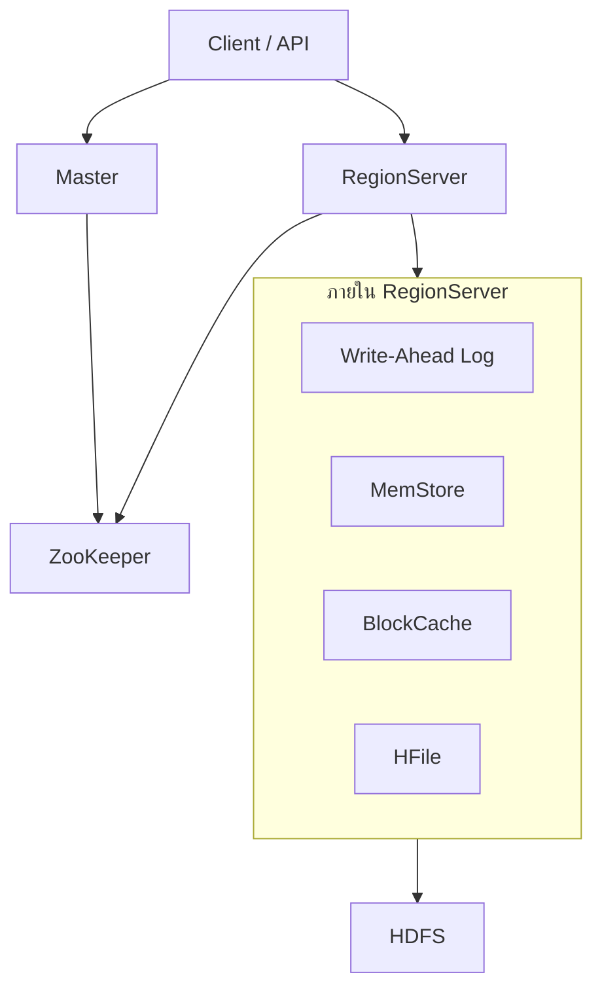
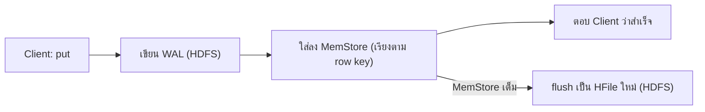

# 03 — Apache HBase

HBase คือฐานข้อมูลที่เก็บข้อมูลขนาดใหญ่ไว้บนคลัสเตอร์ของ Hadoop (คลัสเตอร์ คือกลุ่มคอมพิวเตอร์หลายเครื่องที่ทำงานร่วมกัน แต่ละเครื่องเรียกว่า node) และให้อ่านหรือเขียนข้อมูลทีละแถวได้ทันที ต่างจาก Hive ที่ต้องประมวลผลข้อมูลทั้งก้อนเป็นรอบๆ บทนี้อธิบายว่า HBase จัดเก็บข้อมูลอย่างไร ส่วนประกอบแต่ละตัวทำหน้าที่อะไร และการอ่านกับการเขียนวิ่งผ่านส่วนประกอบเหล่านั้นอย่างไร

ลองนึกถึงโรงพยาบาลที่เก็บเหตุการณ์จากอุปกรณ์ตรวจวัดมาหลายปีใน HDFS (HDFS คือระบบไฟล์ของ Hadoop ที่ตัดไฟล์เป็นชิ้นแล้วกระจายไปเก็บหลาย node) งานแรกคือรายงานจำนวนการแจ้งเตือนรายวันตลอดสามปี ซึ่งต้องอ่านข้อมูลมหาศาลแล้วรวมผล รอเป็นนาทีได้ งานที่สองคือหน้าจอพยาบาลที่เปิดสถานะล่าสุดของอุปกรณ์ `DEV-0098` ทันทีที่กด และบันทึกค่าใหม่ทุกไม่กี่วินาที งานแรกเหมาะกับ Hive งานที่สองต้องใช้ HBase

---

# ภาคที่ 1 ทฤษฎี

## 1. ทำไมต้องมี HBase

Hive คือเครื่องมือที่ให้เขียนคำสั่งแบบ SQL เพื่อวิเคราะห์ข้อมูลที่มีโครงสร้างใน HDFS โดยแปลงคำสั่งไปรันบน MapReduce (MapReduce คือโมเดลประมวลผลที่แบ่งงานไปทำพร้อมกันหลายเครื่อง) ซึ่งทำงานแบบ batch คือประมวลผลข้อมูลก้อนใหญ่ในรอบเดียวแล้วรอผลลัพธ์ทั้งชุด ส่วน HDFS มีคุณสมบัติ **WORM** (Write Once, Read Many) คือเขียนไฟล์ครั้งเดียวแล้วอ่านได้หลายครั้ง แก้ไขกลางไฟล์ไม่ได้ ผลคือ Hive ไม่ได้ออกแบบมาให้อ่านหรือเขียนข้อมูลชิ้นเดียวแบบสุ่มโดยตอบกลับทันที (random real-time access ที่มี latency ต่ำ latency คือเวลาที่รอจนได้คำตอบ) งาน "เปิดสถานะอุปกรณ์ `DEV-0098`" ถ้าให้ Hive ทำ ทุกคำขอต้องเริ่ม batch job ไปสแกนไฟล์ จึงช้าเกินไป

อีกเหตุผลคือโครงสร้างของระเบียนบางแบบหลากหลายมาก เช่น แต่ละแถวในตารางมีจำนวนคอลัมน์ไม่เท่ากัน ตารางแบบ RDBMS (ฐานข้อมูลเชิงสัมพันธ์ เช่น MySQL ที่ทุกแถวมีคอลัมน์ชุดเดียวกัน) รับมือได้ยาก HBase ถูกออกแบบมาตอบโจทย์ทั้งสองข้อนี้: อ่านและเขียนทีละแถวได้เร็ว และยอมให้แต่ละแถวมีคอลัมน์ต่างกัน

## 2. HBase ในกลุ่มฐานข้อมูล NoSQL

NoSQL เป็นคำกว้างๆ ที่หมายถึงฐานข้อมูลที่ไม่ใช้โมเดลเชิงสัมพันธ์ ครอบคลุมรูปแบบการเก็บข้อมูลหลายชนิด ได้แก่ graph database, document database, key/value store และ column-family database HBase อยู่ในกลุ่มสุดท้าย คือฐานข้อมูลแบบ column-family หรือ column-oriented ซึ่งจัดข้อมูลของแต่ละแถวเป็นกลุ่มของคอลัมน์ที่เกี่ยวข้องกัน

HBase สร้างตามแบบสถาปัตยกรรม BigTable ของ Google และให้คุณสมบัติสามข้อ ข้อแรกคืออ่านและเขียนระดับแถวแบบสุ่มได้ ข้อสองคือ strong consistency หมายความว่าเมื่อเขียนแถวสำเร็จแล้ว การอ่านครั้งถัดไปจะเห็นค่าใหม่เสมอ ข้อสามคือ schema ยืดหยุ่น คือไม่ต้องกำหนดรายชื่อคอลัมน์ล่วงหน้าทั้งหมด (รายละเอียดอยู่ในหัวข้อถัดไป)

## 3. โมเดลข้อมูล: table, row, column family และ cell

HBase จัดข้อมูลเป็น table ที่ประกอบด้วย row และแต่ละ row ถูกระบุด้วย **row key** ที่ไม่ซ้ำกันภายใน table row key ไม่มีชนิดข้อมูล HBase เก็บเป็น byte array (ลำดับของ byte) ดังนั้น row key จะเป็นข้อความ เลขฐานสองของจำนวนเต็ม หรือโครงสร้างข้อมูลที่แปลงเป็น byte แล้วก็ได้ แถวทั้งหมดของ table ถูกเรียงตาม row key โดยอัตโนมัติ และ row key ก็เป็น index ของ table ด้วย จึงหาแถวจาก row key ได้เร็ว

ข้อมูลภายในหนึ่ง row ถูกจัดเป็น **column family** (กลุ่มของคอลัมน์ที่เกี่ยวข้องกัน) ตัวอย่างตาราง Person ใช้รหัสบุคคลเป็น row key มี column family ชื่อ `personal-data` ที่มีคอลัมน์ `name` กับ `address` และ column family ชื่อ `Demographic` ที่มีคอลัมน์ `birthdate` กับ `gender` ชื่อคอลัมน์ในคำสั่งเขียนเป็น `family:column` เช่น `personal-data:name` ส่วนหลังเครื่องหมายทวิภาค (`:`) เรียกว่า column qualifier หรือชื่อคอลัมน์ในกลุ่มนั้น

Column family ต้องนิยามไว้ก่อนจึงจะเริ่มใส่ข้อมูลลงในแถวหรือคอลัมน์ใดๆ ของมันได้ ส่วนคอลัมน์ภายใน family เกิดขึ้นเองตอนเขียนข้อมูล และแต่ละแถวมีชุดคอลัมน์ต่างกันได้ ข้อนี้คือความหมายของ schema ยืดหยุ่น: สิ่งที่กำหนดล่วงหน้ามีแค่ชื่อ table กับ column family ส่วนคอลัมน์เพิ่มหรือลบได้ตลอดเวลา ถ้าต้องเพิ่ม family ภายหลังต้องใช้คำสั่ง `alter`

เมื่อแถว P002 ไม่มีที่อยู่ HBase จะไม่มี cell `personal-data:address` ของแถวนั้นอยู่เลย ตารางที่มีหลายคอลัมน์แต่แต่ละแถวใช้ไม่กี่คอลัมน์ (เรียกว่า sparse table) จึงไม่สิ้นเปลืองที่เก็บ และเมื่อต้องคำนวณรวมค่าตามคอลัมน์ (aggregation) บนข้อมูลชุดใหญ่ ก็ทำได้แม้ไม่ทุกแถวจะมีค่าในคอลัมน์นั้น

**Cell** คือจุดตัดของ row กับ column แต่ละ cell มี **timestamp** กำกับ เก็บเป็นจำนวนเต็มชนิด long ที่นับเป็นมิลลิวินาทีตั้งแต่ 1 มกราคม 1970 UTC เมื่อเขียนค่าใหม่ลงคอลัมน์เดิม HBase สร้าง cell ใหม่ที่ timestamp ใหม่ แล้วเรียงมิติเวลาจากใหม่ไปเก่า การอ่านจึงเจอค่าล่าสุดก่อนเสมอ เนื้อหาของ cell หนึ่งจึงอ้างถึงได้ด้วย `{ rowkey, column, timestamp }` และจำนวนค่าเก่าที่เก็บไว้ต่อคอลัมน์เรียกว่า **version** ค่าเริ่มต้นคือเก็บ 1 version (version 1 คือรุ่นล่าสุด) ปรับได้ที่ระดับ column family

ตัวอย่างหนึ่ง cell ของอุปกรณ์ในโรงพยาบาล:

```text
RowKey:        DEV-0098
Column:        reading:temperature
Timestamp:     1726209000000
Value:         37.2
```

ลำดับชั้นจากนอกเข้าใน:



## 4. HBase เทียบกับ RDBMS

HBase เก็บข้อมูลแบบ column-oriented ส่วน RDBMS ส่วนใหญ่เก็บแบบ row-oriented ฝั่ง HBase schema ยืดหยุ่น เพิ่มคอลัมน์ได้ทันที และจัดการตาราง sparse ได้ดี ฝั่ง RDBMS schema คงที่และไม่ได้ปรับให้เหมาะกับตาราง sparse

เรื่อง join ฝั่ง RDBMS ปรับให้ทำ join ได้ดี ส่วน HBase ไม่รองรับ join ในตัว และมี index เดียวคือ row key ผู้ใช้ HBase จึงต้องออกแบบ row key ให้ตรงกับคำถามที่จะถามบ่อยที่สุด การ join ทำผ่าน MapReduce ได้แต่ไม่ได้ถูกปรับให้เร็ว HBase ผสานกับ MapReduce ได้แน่นแฟ้น ขณะที่ RDBMS ไม่ได้ออกแบบมาเช่นนั้น

เรื่องการขยายระบบ HBase ขยายแนวนอนได้โดยเพิ่มเครื่อง (horizontal scalability) ส่วน RDBMS การแบ่งข้อมูล (shard) และขยายระบบทำได้ยาก ชนิดข้อมูลที่เหมาะกับ HBase คือข้อมูลกึ่งโครงสร้างและไม่มีโครงสร้าง ส่วน RDBMS เหมาะกับข้อมูลที่มีโครงสร้าง

## 5. สถาปัตยกรรม: ใครทำอะไรในระบบ

Table ขนาดใหญ่ถูกแบ่งเป็น **region** คือชุดของแถวที่อยู่ติดกันตามลำดับ row key และแต่ละ region ถูกดูแลโดย **RegionServer** ซึ่งเป็นโปรแกรมที่รับคำสั่งอ่านเขียนของ region ที่ตนถือ ข้อมูลของ region ถูกเก็บเป็นไฟล์ **HFile** บน HDFS ในรูปคู่ key/value ที่เรียงลำดับแล้ว RegionServer ทำงานบนเครื่องเดียวกับ HDFS data node (data node คือ node ที่เก็บชิ้นข้อมูลจริงของ HDFS) ทั้งระบบประกอบด้วย API สำหรับให้โปรแกรมเรียกใช้ Master, RegionServer หลายตัว และอาศัย HDFS กับ ZooKeeper



**Master** มีสองหน้าที่ หน้าที่แรกคือประสานงาน RegionServer ทั้งหมด ได้แก่ มอบหมาย region ให้ RegionServer ย้าย region ไปให้ตัวอื่นเมื่อต้องกู้คืนหรือต้องกระจายโหลดให้สมดุล (load balancing) และเฝ้าดูทุก RegionServer ในคลัสเตอร์ โดยรับการแจ้งเตือนจาก ZooKeeper หน้าที่ที่สองคือเป็นช่องทางสำหรับสร้าง ลบ และแก้ไข table

**ZooKeeper** คือบริการประสานงานแบบกระจายที่ HBase ใช้เก็บสถานะของเซิร์ฟเวอร์ในคลัสเตอร์ มันรู้ว่าเซิร์ฟเวอร์ใดยังทำงานอยู่และพร้อมใช้ และแจ้งเตือนเมื่อเซิร์ฟเวอร์ล้ม โดยเซิร์ฟเวอร์ส่ง heartbeat (ข้อความสั้นที่ส่งเป็นระยะเพื่อบอกว่ายังทำงานอยู่) ให้ ZooKeeper ถ้า heartbeat หยุดมา ZooKeeper ถือว่าเซิร์ฟเวอร์นั้นอาจล้ม

HBase มีตารางแค็ตตาล็อกชื่อ **META table** ที่เก็บตำแหน่งของทุก region พร้อม row key เริ่มต้นของแต่ละ region ZooKeeper เก็บว่า META table อยู่ที่ RegionServer ตัวใด เมื่อ client ต้องการหา region ของ row key หนึ่งๆ จึงทำตามลำดับนี้:

1. ถาม ZooKeeper ว่า RegionServer ตัวใดดูแล META table
2. ไปถาม META table ว่า row key นี้อยู่ใน region ใดและ RegionServer ใด
3. ติดต่อ RegionServer ตัวนั้นเพื่ออ่านหรือเขียนข้อมูล

ตัวอย่างเช่น client ต้องการอ่านแถว `org.hive.www` ZooKeeper บอกว่า META table อยู่ที่ RegionServer ตัวที่ 2 META table บอกว่า region ที่ครอบคลุม key นี้อยู่ที่ RegionServer ตัวที่ 5 แล้ว client จึงส่งคำสั่งอ่านไปยังตัวที่ 5 โดยตรง การอ่านเขียนวิ่งตรงระหว่าง client กับ RegionServer ไม่ผ่าน Master

RegionServer แต่ละตัวมีส่วนประกอบสี่ส่วน **Write-Ahead Log (WAL)** คือไฟล์บน HDFS ที่เก็บข้อมูลใหม่ที่ยังอยู่ใน MemStore และยังไม่ถูกบันทึกลงที่เก็บถาวร (HFile) เอาไว้กู้คืนเมื่อ RegionServer ล้ม โดยเล่นซ้ำ (replay) รายการเปลี่ยนแปลงเหล่านั้นเพื่อสร้างข้อมูลกลับมา **MemStore** คือแคชฝั่งเขียน เก็บข้อมูลใหม่ที่ยังไม่ถูกเขียนลงดิสก์ และเรียงข้อมูลให้เป็นลำดับก่อนเขียนลงดิสก์ มี MemStore หนึ่งตัวต่อหนึ่ง column family ต่อหนึ่ง region เมื่อ MemStore สะสมข้อมูลมากพอ ชุดข้อมูลที่เรียงแล้วทั้งก้อนจะถูกเขียนเป็น HFile ใหม่บน HDFS (การเขียนแบบนี้เรียกว่า flush) ดังนั้น column family หนึ่งจึงมี HFile หลายไฟล์ **HFile** เก็บแถวเป็นคู่ KeyValue ที่เรียงลำดับไว้บนดิสก์ **BlockCache** คือแคชฝั่งอ่าน เก็บข้อมูลที่ถูกอ่านบ่อยไว้ในหน่วยความจำ เมื่อเต็มจะไล่ข้อมูลที่ถูกใช้ล่าสุดนานที่สุดออกก่อน (Least Recently Used)

## 6. เส้นทางการเขียน

เมื่อ client ส่ง `put` ค่าอุณหภูมิ `37.2` ของ `DEV-0098` RegionServer ที่ถือ region นั้นเขียนรายการลง WAL บน HDFS ก่อน จากนั้นจึงใส่ค่าลง MemStore ของ column family `reading` ซึ่งเรียงตาม row key แล้วจึงตอบ client ว่าสำเร็จ ข้อมูลตอนนี้ยังไม่อยู่ใน HFile

ถ้า RegionServer ล้มตอนนี้ ข้อมูลใน MemStore หายไปจากหน่วยความจำ แต่ WAL อยู่บน HDFS ครบ จึงเล่นซ้ำรายการใน WAL เพื่อสร้างข้อมูลคืนได้ นี่คือเหตุผลที่ WAL ต้องถูกเขียนก่อนตอบ client ว่าสำเร็จ

เมื่อ MemStore สะสมข้อมูลมากพอ ข้อมูลทั้งชุดที่เรียงแล้วถูก flush เป็น HFile ใหม่ ข้อมูลส่วนนั้นจึงอยู่ในที่เก็บถาวรแล้ว ผู้ใช้สั่ง flush เองได้ด้วยคำสั่ง `flush 'ชื่อตาราง'`



## 7. เส้นทางการอ่านและ compaction

ทุกครั้งที่อ่าน HBase ค้นหา row key นั้นใน BlockCache และ MemStore ก่อน ถ้าไม่พบจึงค้นใน HFile ของ table ด้วย binary search (วิธีค้นที่แบ่งช่วงข้อมูลที่เรียงลำดับแล้วเป็นครึ่งๆ ทีละรอบ ใช้ได้เพราะ HFile เรียงตาม key)

ทุกครั้งที่ MemStore ถูก flush จะได้ HFile เพิ่มหนึ่งไฟล์ ยิ่งนานไฟล์ยิ่งมาก การค้นต้องตรวจหลายไฟล์และช้าลง HBase จึงมี **minor compaction** ที่ทำงานอัตโนมัติ รวม HFile ขนาดเล็กบางส่วนเป็นไฟล์เดียว เพื่อให้ binary search ครั้งต่อไปเร็วขึ้น ส่วน **major compaction** ต้องสั่งเอง ด้วยคำสั่ง `major_compact` เพื่อรวม HFile ทั้งหมดของ table เป็นไฟล์เดียว

## 8. ลำดับของ row key และ hotspot

HBase เก็บแถวเรียงตาม row key ตามลำดับ byte ทีละตำแหน่งจากซ้ายไปขวา เรียกว่า lexicographical order (ลำดับตามพจนานุกรม) ซึ่งต่างจากการเรียงตามค่าตัวเลข เมื่อเก็บเลข 1 ถึง 100 เป็นข้อความ ลำดับที่ได้คือ

```text
1, 10, 100, 11, 12, 13, ..., 18, 19, 2, 20, 21, 23, ..., 9, 90, 91, ..., 98, 99
```

เหตุที่ `10` มาก่อน `2` คือ byte แรกของ `10` คือ `1` ซึ่งน้อยกว่า byte แรกของ `2` การเรียงแบบนี้ทำให้ key ที่ขึ้นต้นเหมือนกันอยู่ติดกัน ตัวอย่างในบทนี้ใช้ domain ของเว็บไซต์ที่เขียนกลับด้านเป็น row key เช่น `org.hbase.www`, `org.hive.www` ทุกเว็บของ `org.hbase` จึงอยู่ติดกัน

การเก็บเรียงตาม key ทำให้ key ที่คล้ายกันถูกจัดไว้ใน region เดียวกัน ซึ่งทำให้ scan เป็นช่วง (range scan) เร็ว แต่ก็ทำให้ภาระอ่านเขียนไม่สม่ำเสมอ ถ้าบาง key ถูกเรียกบ่อยมาก region ที่ถือ key เหล่านั้นและ RegionServer ของมันจะทำงานหนักกว่าตัวอื่น เรียกจุดที่ถูกเรียกหนักเช่นนี้ว่า **hotspot** เช่น ถ้าคำขอส่วนใหญ่ไปที่เว็บในกลุ่ม `org.hbase.*` คำขอเหล่านั้นเข้า RegionServer ตัวเดียว ขณะที่ตัวอื่นว่าง

---

# ภาคที่ 2 สรุปและโจทย์ฝึก

## สรุปท้ายบท

- HBase เป็นฐานข้อมูล NoSQL แบบ column-family ตามแบบ BigTable ของ Google ให้อ่านเขียนระดับแถวแบบสุ่ม มี strong consistency และ schema ยืดหยุ่น
- Hive ทำงานแบบ batch บน HDFS ซึ่งเป็น WORM (เขียนครั้งเดียว อ่านหลายครั้ง) จึงไม่เหมาะกับการอ่านเขียนทีละแถวแบบ real-time ที่ latency ต่ำ ซึ่งเป็นงานของ HBase
- Table ประกอบด้วย row ที่ระบุด้วย row key ซึ่งเป็น byte array ไม่มีชนิดข้อมูล แถวเรียงตาม row key อัตโนมัติ และ row key เป็น index เดียวของ table
- ข้อมูลในแถวจัดเป็น column family ที่ต้องนิยามก่อนใช้ ส่วนคอลัมน์ภายใน family เพิ่มได้ตลอด และแถวหนึ่งมีคอลัมน์ต่างจากอีกแถวได้ cell ที่ไม่มีค่าจะไม่ถูกเก็บ
- Cell คือจุดตัดของ row กับ column มี timestamp เป็น long จำนวนมิลลิวินาทีตั้งแต่ 1 มกราคม 1970 UTC เรียงจากใหม่ไปเก่า ค่าเริ่มต้นเก็บ 1 version ต่อคอลัมน์ ปรับที่ระดับ column family
- HBase ไม่รองรับ join ในตัว และมี index เดียวคือ row key จึงต้องออกแบบ row key ตามคำถามที่จะถาม
- Table แบ่งเป็น region ที่ดูแลโดย RegionServer ข้อมูลของ region เก็บเป็น HFile บน HDFS
- Master มอบหมายและย้าย region เฝ้าดู RegionServer ตามการแจ้งเตือนจาก ZooKeeper และเป็นช่องทางสร้าง ลบ แก้ไข table
- ZooKeeper รู้ว่าเซิร์ฟเวอร์ใดยังทำงานอยู่จาก heartbeat และรู้ว่า META table อยู่ที่ใด client หา region โดยถาม ZooKeeper แล้วถาม META table แล้วติดต่อ RegionServer
- RegionServer มี WAL (บันทึกไว้กู้คืน), MemStore (แคชเขียน เรียงข้อมูล หนึ่งตัวต่อ family ต่อ region), BlockCache (แคชอ่าน ไล่ตัวที่ใช้ล่าสุดนานที่สุดออกเมื่อเต็ม) และ HFile (เก็บ KeyValue ที่เรียงแล้วบนดิสก์)
- เขียนข้อมูล: เขียน WAL ก่อน ใส่ MemStore แล้วตอบสำเร็จ เมื่อ MemStore เต็มจึง flush เป็น HFile ใหม่
- อ่านข้อมูล: ค้น BlockCache กับ MemStore ก่อน ถ้าไม่พบค้น HFile ด้วย binary search minor compaction รวม HFile เล็กอัตโนมัติ major compaction ต้องสั่งเองเพื่อรวมทุก HFile ของ table
- Row key เรียงตามลำดับ byte (lexicographical) เลข 1 ถึง 100 ที่เก็บเป็นข้อความจึงเรียงเป็น 1, 10, 100, 11, ..., 2, 20, ... การเรียงทำให้ range scan เร็ว แต่ key ที่ถูกเรียกบ่อยกลายเป็น hotspot

## โจทย์ฝึก

**โจทย์ 1** แอปบันทึกชีพจรเรียก `put` ค่า `72` ลง `DEV-0098` ที่ `reading:pulse` RegionServer ตอบสำเร็จ แล้วเครื่องดับก่อนที่ MemStore จะถูก flush ข้อมูลค่า 72 อยู่ที่ใดบ้างหลังเครื่องดับ และ HBase กู้คืนอย่างไร

แนวตอบ: ก่อนตอบสำเร็จ RegionServer เขียนรายการนี้ลง WAL บน HDFS แล้วจึงใส่ลง MemStore ซึ่งอยู่ในหน่วยความจำ เมื่อเครื่องดับ ข้อมูลใน MemStore หายไป แต่รายการใน WAL ยังอยู่บน HDFS HBase มอบหมาย region นั้นให้ RegionServer ตัวอื่น (ทำโดย Master ตามการแจ้งเตือนจาก ZooKeeper ที่ไม่ได้รับ heartbeat) แล้วเล่นซ้ำ (replay) รายการจาก WAL เพื่อสร้างค่า 72 คืนใน MemStore ค่าจึงไม่หาย

**โจทย์ 2** table เก็บ row key เป็นข้อความ `'2'`, `'10'`, `'1'`, `'21'`, `'100'` เมื่ออ่านทั้ง table ตามลำดับที่ HBase เก็บ จะได้ลำดับใด และเพราะเหตุใด

แนวตอบ: เรียงตาม byte ทีละตัวจากซ้ายไปขวา key ที่ขึ้นต้นด้วย `1` ทั้งสามตัวมาก่อน key ที่ขึ้นต้นด้วย `2` เพราะ byte แรก `1` น้อยกว่า `2` ภายในกลุ่มที่ขึ้นต้นด้วย `1` ตัวที่สั้นกว่ามาก่อนเมื่อ byte ที่มีเท่ากัน จึงได้ `1`, `10`, `100`, `2`, `21`

**โจทย์ 3** client ต้องการอ่านแถว `org.hive.www` เป็นครั้งแรก จงไล่ว่า client ติดต่อส่วนประกอบใดตามลำดับ แต่ละส่วนบอกอะไร และ client ได้ค่าจากที่ใด ถ้าค่าล่าสุดของแถวนั้นเพิ่งถูก `put` และ MemStore ยังไม่ถูก flush

แนวตอบ: client ถาม ZooKeeper ก่อน ซึ่งบอกว่า RegionServer ตัวใดดูแล META table จากนั้นถาม META table ที่ RegionServer ตัวนั้น ซึ่งเก็บตำแหน่งของทุก region พร้อม row key เริ่มต้นของแต่ละ region จึงบอกได้ว่า region ที่ครอบคลุม `org.hive.www` อยู่ที่ RegionServer ใด แล้ว client ส่งคำสั่งอ่านไปที่ RegionServer ตัวนั้นโดยตรง RegionServer ค้น BlockCache และ MemStore ก่อน ค่าที่เพิ่ง `put` และยังไม่ถูก flush อยู่ใน MemStore จึงพบที่นั่นและส่งคืนได้ทันทีโดยไม่ต้องค้น HFile

## แบบเช็กตัวเอง

1. เมื่อ `put` ค่าใหม่ลงคอลัมน์ที่มีค่าอยู่แล้ว ใน family ที่ใช้ค่าเริ่มต้นของ version จะเก็บกี่ version และ version ที่เก็บคือรุ่นใด
2. MemStore มีกี่ตัวต่อ column family ต่อ region และมันทำอะไรกับข้อมูลก่อนเขียนลงดิสก์
3. การอ่านค้นที่ใดก่อนและที่ใดทีหลัง
4. Minor compaction กับ major compaction ต่างกันอย่างไรในเรื่องการเริ่มทำงานและจำนวน HFile ที่รวม
5. Master ทำหน้าที่อะไรบ้าง และรู้ได้อย่างไรว่า RegionServer ตัวใดล้ม
6. WAL เก็บอะไรไว้ และใช้เมื่อใด
7. ทำไม key ที่คล้ายกันมักอยู่ region เดียวกัน และผลดีกับผลเสียคืออะไร

เฉลย:

1. เก็บ 1 version คือรุ่นล่าสุด ซึ่งเป็นค่าใหม่ที่เขียนเข้าไป
2. หนึ่งตัวต่อหนึ่ง column family ต่อหนึ่ง region และเรียงข้อมูลให้เป็นลำดับก่อนเขียนลงดิสก์
3. ค้น BlockCache และ MemStore ก่อน ถ้าไม่พบจึงค้น HFile ด้วย binary search
4. Minor compaction ทำอัตโนมัติและรวม HFile เล็กบางส่วนเป็นหนึ่งไฟล์ ส่วน major compaction ต้องสั่งเองและรวม HFile ทั้งหมดของ table เป็นหนึ่งไฟล์
5. Master มอบหมายและย้าย region ระหว่าง RegionServer เมื่อต้องกู้คืนหรือกระจายโหลด เฝ้าดู RegionServer ทุกตัว และเป็นช่องทางสร้าง ลบ แก้ไข table ส่วนการรู้ว่าตัวใดล้ม Master รับการแจ้งเตือนจาก ZooKeeper ซึ่งสังเกตได้จาก heartbeat ที่หยุดมา
6. WAL เก็บข้อมูลใหม่ที่ยังอยู่ใน MemStore และยังไม่ถูกบันทึกลง HFile ใช้เมื่อ RegionServer ล้ม โดยเล่นซ้ำรายการเพื่อสร้างข้อมูลคืน
7. เพราะ HBase เก็บแถวเรียงตาม row key และ region คือชุดของแถวที่อยู่ติดกัน ผลดีคือ range scan เร็ว ผลเสียคือภาระอ่านเขียนอาจไม่สม่ำเสมอ ถ้าบาง key ถูกเรียกบ่อยจะเกิด hotspot

## References

- [Apache HBase: Data Model](https://hbase.apache.org/docs/datamodel/)
- [Apache HBase: Architecture](https://hbase.apache.org/docs/architecture/)
- [Apache HBase: Shell](https://hbase.apache.org/docs/shell/)
