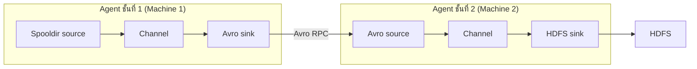
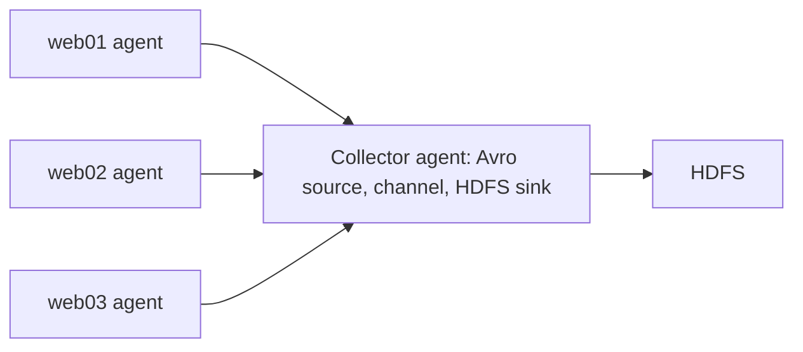
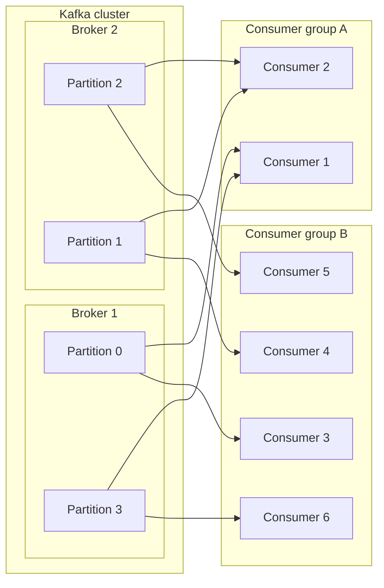

# Data Ingestion: Sqoop, Flume, Avro และ Kafka

ร้านค้าออนไลน์แห่งหนึ่งเก็บข้อมูลสองกลุ่มไว้คนละที่ กลุ่มแรกคือตาราง `orders` ในฐานข้อมูล MySQL ที่แต่ละแถวคือหนึ่งคำสั่งซื้อ กลุ่มที่สองคือไฟล์ log บนเว็บเซิร์ฟเวอร์ที่เขียนบรรทัดใหม่ทุกครั้งที่ลูกค้าทำอะไรกับสินค้า เช่น

```
{"sku": "T9921-5", "timestamp": 1453167527737, "cid": "51761", "action": "add_cart", "ip": "226.43.51.25"}
```

บรรทัดนี้อยู่ในรูป JSON (ข้อความที่เขียนข้อมูลเป็นคู่ชื่อฟิลด์กับค่า) บอกว่าลูกค้ารหัส 51761 ใส่สินค้า T9921-5 ลงตะกร้า ค่า timestamp 1453167527737 คือจำนวนมิลลิวินาทีนับจากวันที่ 1 มกราคม 1970 ซึ่งตรงกับ 2016-01-19 เวลา 01:38:47 UTC คำถามอย่าง "ลูกค้าคนไหนใส่ตะกร้าแล้วไม่ซื้อ" ต้องใช้ข้อมูลทั้งสองกลุ่มร่วมกัน เพราะลูกค้า 51761 ปรากฏทั้งใน log และในตาราง `orders` แต่เครื่องมือวิเคราะห์ของ Hadoop อ่านได้เฉพาะข้อมูลที่อยู่ในที่เก็บของ Hadoop ซึ่งมีสามแบบที่บทนี้ใช้ คือ HDFS (Hadoop Distributed File System ระบบไฟล์ที่ตัดไฟล์เป็นบล็อกแล้วเก็บกระจายหลายเครื่อง) Hive (เครื่องมือที่ให้เขียนคำสั่งแบบ SQL ค้นไฟล์ใน HDFS) และ HBase (ฐานข้อมูลที่เก็บข้อมูลเป็นแถวและเข้าถึงแถวด้วยค่า row key) ข้อมูลที่ยังอยู่ใน MySQL หรือในไฟล์ log บนเว็บเซิร์ฟเวอร์จึงต้องถูกย้ายเข้ามาก่อน

**Data ingestion** คือกระบวนการนำข้อมูลจากแหล่งภายนอกเข้ามาเก็บในที่เก็บสำหรับวิเคราะห์ข้อมูล และเป็นขั้นแรกของ data science pipeline ข้อมูลที่นำเข้ามีได้สามลักษณะ ลักษณะแรกคือข้อมูลมีโครงสร้าง (structured) เช่นแถวของตาราง `orders` ที่ทุกแถวมีคอลัมน์ชุดเดียวกัน ลักษณะที่สองคือข้อมูลกึ่งมีโครงสร้างหรือไม่มีโครงสร้าง (semi-structured และ unstructured) เช่นบรรทัด JSON ข้างบนที่มีชื่อฟิลด์กำกับแต่ไม่มีตารางกำหนดล่วงหน้า หรือข้อความรีวิวที่ลูกค้าพิมพ์เอง ลักษณะที่สามคือข้อมูลสตรีม (streaming data) ที่เกิดต่อเนื่องจากไฟล์ log หรือเหตุการณ์ภายนอก บทนี้ใช้ Sqoop สำหรับข้อมูลในตาราง และใช้ Flume หรือ Kafka สำหรับข้อมูลสตรีม โดยมี Avro เป็นรูปแบบข้อมูลที่ Flume ใช้ส่งต่อกันระหว่าง agent

---

## Sqoop: นำตารางจากฐานข้อมูลเข้า Hadoop

หากไม่มีเครื่องมือเฉพาะ การย้ายตาราง `orders` เข้า Hive ต้อง export เป็นไฟล์ CSV คัดลอกขึ้น HDFS แล้วเขียนคำสั่ง CREATE TABLE ใน Hive ให้ตรงกับชนิดข้อมูลของ MySQL ด้วยมือ และถ้าตารางมีหลายล้านแถว การดึงด้วยงานเดียวช้ามาก **Sqoop** (ชื่อมาจาก SQL-to-Hadoop) ถูกออกแบบมาถ่ายโอนข้อมูลระหว่างฐานข้อมูลเชิงสัมพันธ์ (RDBMS เช่น MySQL หรือ Oracle ที่เก็บข้อมูลเป็นตาราง) กับที่เก็บของ Hadoop ได้แก่ HDFS, Hive และ HBase ทั้งขาเข้า (import) และขาออก (export) โดยอ่านโครงสร้างตาราง (schema) จากฐานข้อมูลโดยตรง แล้วใช้ MapReduce ย้ายข้อมูลแบบขนาน[[1]](https://sqoop.apache.org/docs/1.4.6/SqoopUserGuide.html) Sqoop ออกแบบมาย้ายข้อมูลเป็นชุด การรับข้อมูลที่ไหลต่อเนื่องจากหลายแหล่งเป็นงานของ Flume และ Kafka ซึ่งอธิบายต่อไป

**MapReduce** คือโมเดลประมวลผลแบบขนานของ Hadoop ที่แบ่งงานเป็นงานย่อย map (อ่านและแปลงข้อมูลส่วนของตน) กับ reduce (รวมผลของ map) งานที่ Sqoop ส่งเป็นงานแบบ map-only คือมีเฉพาะ map task ไม่มีขั้น reduce เพราะการคัดลอกแถวจากฐานข้อมูลไปเก็บไม่ต้องรวมผลข้ามกัน เมื่อสั่ง import Sqoop ติดต่อฐานข้อมูลผ่าน JDBC (มาตรฐานที่โปรแกรม Java ใช้คุยกับฐานข้อมูล ระบุตำแหน่งฐานข้อมูลด้วย connect string เช่น `jdbc:mysql://localhost:3306/energydata` ซึ่งบอกชนิดฐานข้อมูล เครื่อง พอร์ต และชื่อฐานข้อมูล) เพื่อขอ metadata ของตาราง คือชื่อคอลัมน์และชนิดข้อมูล จากนั้นส่งงาน map-only ให้ map task หลายตัวดึงแถวคนละส่วนพร้อมกัน ผลคือชุดไฟล์ที่เก็บสำเนาของตาราง ซึ่งเป็นไฟล์ข้อความคั่นด้วยจุลภาค (comma) เป็นค่าเริ่มต้น หรือจะเป็นไฟล์ไบนารีแบบ Avro หรือ sequenceFile ก็ได้ ชื่อไฟล์เป็น `part-m-00000`, `part-m-00001` และต่อไป หนึ่งไฟล์ต่อหนึ่ง map task[[1]](https://sqoop.apache.org/docs/1.4.6/SqoopUserGuide.html)

การแบ่งงานให้ map task ใช้ตัวอย่างต่อไปนี้ ตาราง `orders_small` มี primary key (คอลัมน์ที่ค่าไม่ซ้ำกันในทุกแถว) ชื่อ id และมีข้อมูลสิบแถวนี้

```
id    cid    amount
0     51761  349.00
1     20390  1290.00
2     51761  99.00
3     75994  450.00
4     42538  120.00
5     20390  880.00
6     75994  60.00
7     42538  2100.00
8     51761  15.00
1000  20390  700.00
```

ผู้ใช้สั่งนำเข้าด้วย `-m 4` (ใช้ map task สี่ตัว) Sqoop เลือก primary key เป็นคอลัมน์แบ่งงาน (splitting column) เป็นค่าเริ่มต้น ถามฐานข้อมูลหาค่าต่ำสุดและสูงสุดของ id ได้ 0 และ 1000 แล้วแบ่งช่วงให้ task ละช่วง คู่มือของ Sqoop ยกกรณี min 0, max 1000 และสี่ task ไว้ตรงกับตัวอย่างนี้พอดี ว่าแต่ละ task รัน SQL รูปแบบ `SELECT * FROM sometable WHERE id >= lo AND id < hi` โดย (lo, hi) คือ (0, 250), (250, 500), (500, 750) และ (750, 1001)[[1]](https://sqoop.apache.org/docs/1.4.6/SqoopUserGuide.html) ค่า 1001 ที่ปลายช่วงสุดท้ายทำให้ id 1000 ถูกรวมด้วย เพราะเงื่อนไขปลายช่วงเป็น "น้อยกว่า" ผลที่ได้เป็นดังนี้

```
task 0: id >= 0   AND id < 250   ได้ id 0 ถึง 8 (9 แถว)   เขียนเป็น part-m-00000
task 1: id >= 250 AND id < 500   ไม่ได้แถวใด (0 แถว)      เขียนเป็น part-m-00001
task 2: id >= 500 AND id < 750   ไม่ได้แถวใด (0 แถว)      เขียนเป็น part-m-00002
task 3: id >= 750 AND id < 1001  ได้ id 1000 (1 แถว)       เขียนเป็น part-m-00003
```

ไฟล์ `part-m-00003` มีบรรทัดเดียวคือ `1000,20390,700.00` ตัวอย่างนี้ชี้ว่าการแบ่งช่วงค่าเท่ากันไม่ได้ทำให้แต่ละ task ได้แถวเท่ากัน เมื่อค่า id กระจุกตัวใกล้ 0 task แรกทำงานเกือบทั้งหมดและการใช้สี่ task ไม่ช่วยให้เร็วขึ้น ในกรณีแบบนี้ควรเลือกคอลัมน์ที่ค่ากระจายสม่ำเสมอกว่าด้วยตัวเลือก `--split-by`

ตารางที่ไม่มี primary key ทำให้ Sqoop ไม่มีคอลัมน์ให้หาค่าต่ำสุดและสูงสุด คู่มือระบุว่าการ import จะล้มเหลว เว้นแต่ระบุ `--split-by` หรือกำหนดจำนวน mapper เป็นหนึ่ง[[1]](https://sqoop.apache.org/docs/1.4.6/SqoopUserGuide.html) นี่คือเหตุผลที่คำสั่งตัวอย่างถัดไปใช้ `-m 1` กับตาราง `avgprice_by_state` ซึ่งสร้างโดยไม่มี primary key (ตารางเก็บราคาไฟฟ้าเฉลี่ยของแต่ละรัฐ แต่ละปี แต่ละภาคส่วน มีคอลัมน์ year, state, sector, residential, industrial, transportation, other, total) map task ตัวเดียวอ่านทั้งตาราง จึงได้ไฟล์เดียวคือ `part-m-00000`

### นำเข้า HDFS

```
sqoop import \
  --connect jdbc:mysql://localhost:3306/energydata \
  --username root --password cloudera \
  --table avgprice_by_state \
  --target-dir /user/cloudera/energydata \
  -m 1
```

`--connect` ระบุ connect string ของฐานข้อมูล `--username` และ `--password` เป็นบัญชีที่ใช้ต่อฐานข้อมูล `--table` ระบุตารางที่จะดึง `--target-dir` ระบุโฟลเดอร์ปลายทางใน HDFS ซึ่งต้องยังไม่มีอยู่ ถ้ามีอยู่แล้วงานจะล้มเหลว (ตัวเลือก `--delete-target-dir` ให้ Sqoop ลบโฟลเดอร์นั้นก่อน)[[1]](https://sqoop.apache.org/docs/1.4.6/SqoopUserGuide.html) และ `-m 1` ใช้ map task เดียว ถ้าไม่ระบุ `--target-dir` ผลลัพธ์ไปอยู่ในโฟลเดอร์ที่ตั้งชื่อตามตารางต้นทาง ตรวจผลด้วย `hadoop fs -cat /user/cloudera/energydata/part-m-00000` คาดว่าได้ข้อความหนึ่งแถวต่อบรรทัด แปดค่าคั่นด้วยจุลภาคตามลำดับคอลัมน์ เช่น `2013,AL,Total Electric Industry,11.87,6.15,0.00,9.47,9.58` (ค่าในบรรทัดนี้เป็นตัวเลขสมมติเพื่อแสดงรูปแบบ)

### นำเข้า Hive

```
sqoop import \
  --connect jdbc:mysql://localhost:3306/energydata \
  --username root --password cloudera \
  --table avgprice_by_state \
  --hive-table avgprice --hive-import \
  -m 1
```

ตัวเลือก `--hive-import` ทำให้ Sqoop นำข้อมูลเข้า HDFS ก่อน แล้วสร้างและรันสคริปต์ Hive ที่มีคำสั่ง CREATE TABLE โดยแปลงชนิดข้อมูลของ MySQL เป็นชนิดของ Hive ตามด้วย LOAD DATA เพื่อย้ายไฟล์เข้าที่เก็บของ Hive[[1]](https://sqoop.apache.org/docs/1.4.6/SqoopUserGuide.html) ผู้ใช้จึงไม่ต้องเขียน CREATE TABLE เอง และ `--hive-table avgprice` กำหนดชื่อตารางใน Hive ตรวจผลด้วยคำสั่ง `select * from avgprice;` ใน Hive ซึ่งคาดว่าได้แถวชุดเดียวกับตารางใน MySQL

### นำเข้า HBase

ตัวอย่างใช้ฐานข้อมูล `country_db` ที่มีตาราง `country_tbl` ซึ่งมี primary key คือ id และมีห้าแถว ได้แก่ (1, USA), (2, CANADA), (3, JAPAN), (4, ENGLAND) และ (5, THAILAND)

```
sqoop import \
  --connect jdbc:mysql://localhost:3306/country_db \
  --username root --password cloudera \
  --table country_tbl \
  --hbase-table country \
  --column-family country-cf \
  --hbase-row-key id \
  --hbase-create-table \
  -m 1
```

HBase เก็บข้อมูลเป็นแถว แต่ละแถวระบุด้วย row key และคอลัมน์ถูกจัดเป็นกลุ่มเรียกว่า column family Sqoop แปลงแต่ละแถวของตารางต้นทางเป็นการเขียนหนึ่งครั้งลงตาราง HBase `--hbase-table country` ระบุตารางปลายทาง `--hbase-row-key id` ระบุว่าค่าคอลัมน์ id เป็น row key และ `--column-family country-cf` ระบุ column family ที่เก็บคอลัมน์ที่เหลือ ถ้าไม่ระบุ row key Sqoop ใช้คอลัมน์แบ่งงาน ซึ่งคือ primary key เป็นค่าเริ่มต้น ตารางและ column family ปลายทางต้องมีอยู่ก่อน มิฉะนั้นงานล้มเหลว เว้นแต่ใส่ `--hbase-create-table` ให้ Sqoop สร้างให้[[1]](https://sqoop.apache.org/docs/1.4.6/SqoopUserGuide.html) โดยค่าเริ่มต้น Sqoop ไม่เก็บคอลัมน์ที่ใช้เป็น row key ซ้ำเป็นข้อมูลของแถว[[1]](https://sqoop.apache.org/docs/1.4.6/SqoopUserGuide.html) จึงคาดว่า `scan 'country'` ใน HBase shell ให้ผลดังนี้ (ผลจริงมี timestamp ของแต่ละเซลล์ด้วย)

```
row key 1   country-cf:country = USA
row key 2   country-cf:country = CANADA
row key 3   country-cf:country = JAPAN
row key 4   country-cf:country = ENGLAND
row key 5   country-cf:country = THAILAND
```

---
## Flume: นำข้อมูลเหตุการณ์เข้า Hadoop

สมมติร้านค้ามีเว็บเซิร์ฟเวอร์ web01, web02 และ web03 ที่ต่างเขียนไฟล์ log ใหม่ตลอดเวลา และต้องการให้ log ทั้งหมดไปอยู่ใน HDFS Sqoop ใช้ไม่ได้เพราะไม่มีตารางให้ดึง การสั่งคัดลอกไฟล์ด้วยมือต้องมีคนทำซ้ำทุกครั้งที่มีบรรทัดใหม่ และถ้า HDFS ล่มระหว่างคัดลอก ข้อมูลช่วงนั้นหายโดยไม่มีใครรู้ **Flume** ถูกออกแบบมาเก็บรวบรวมและนำข้อมูลปริมาณมากจากหลายสตรีมเข้า Hadoop โดยทั่วไปใช้กับ log ของเว็บเซิร์ฟเวอร์ และปรับให้ขนส่งเหตุการณ์จากแหล่งอื่นได้ เช่น ข้อมูลทราฟฟิกเครือข่าย ข้อมูลจากโซเชียลมีเดีย และข้อมูลเซ็นเซอร์ สถาปัตยกรรมแบบกระจายของ Flume ช่วยให้ทนต่อความล้มเหลว (fault tolerance) และขยายตัวได้ (scalability)[[2]](https://flume.apache.org/releases/content/1.9.0/FlumeUserGuide.html)

Flume เรียกเส้นทางที่ข้อมูลเดินจากต้นทางถึงปลายทางว่า **data flow** หน่วยข้อมูลที่เดินในเส้นทางนี้คือ **event** เช่นบรรทัด log หนึ่งบรรทัด ซึ่งประกอบด้วยเนื้อหาเป็นไบต์ (body) และแอตทริบิวต์แบบสตริงที่ไม่บังคับ (header)[[2]](https://flume.apache.org/releases/content/1.9.0/FlumeUserGuide.html) บรรทัด JSON ในตอนต้นของบทกลายเป็นหนึ่ง event ที่ body คือไบต์ของข้อความทั้งบรรทัด Flume ไม่ตีความเนื้อหาข้างใน มันขนส่ง body ตามที่เป็น event เดินจากจุดหนึ่งไปอีกจุดหนึ่งผ่านลำดับของ hop และจุดที่ event ผ่านอยู่ภายใน **agent** ซึ่งคือโปรเซส JVM (Java Virtual Machine โปรเซสที่รันโปรแกรม Java) หนึ่งตัว เครื่องหนึ่งเครื่องรัน agent ได้หลายตัว

agent หนึ่งตัวประกอบด้วยส่วนที่กำหนดค่าได้สามส่วน **Source** ทำหน้าที่ฟังและรับ event จากแหล่งข้อมูลภายนอกหนึ่งแหล่งหรือมากกว่า และถือสถานะว่าอ่านถึงตำแหน่งไหนแล้ว เช่น ไฟล์ไหนอ่านครบแล้ว เมื่อ source รับ event หนึ่งตัว มันเขียน event ลงใน **channel** ซึ่งทำหน้าที่เป็นคิวเก็บ event ไว้จนกว่าจะถูกส่งต่อ channel เก็บอย่างเดียว ไม่ส่ง event ไปไหนเอง ตัวที่ดึง event ออกมาคือ **sink** ซึ่งอ่านและเอา event ออกจาก channel แล้วส่งต่อไปยัง hop ถัดไป (agent อื่น) หรือปลายทางสุดท้าย (ที่เก็บข้อมูล เช่น HDFS) การมี channel คั่นกลางทำให้ source กับ sink ทำงานคนละความเร็วได้ เมื่อ sink ส่งไม่สำเร็จ event ยังอยู่ใน channel รอส่งใหม่ จึงไม่หายไปกับความล้มเหลวชั่วคราวของปลายทาง Flume ลบ event ออกจาก channel ก็ต่อเมื่อ event นั้นถูกเก็บลง channel ของ agent ถัดไป หรือเก็บลงปลายทางสุดท้ายเรียบร้อยแล้ว[[2]](https://flume.apache.org/releases/content/1.9.0/FlumeUserGuide.html) กฎการเชื่อมคือ source หนึ่งตัวระบุ channel ได้หลายตัว แต่ sink หนึ่งตัวระบุ channel ได้เพียงตัวเดียว

source มีหลายชนิดตามแหล่งข้อมูล **exec source** รันคำสั่ง Unix ที่ค้างทำงานอยู่แล้วอ่านผลลัพธ์ทีละบรรทัดเป็น event เช่น `tail -F /var/log/httpd/access_log` ซึ่งตาม access log ของ Apache เป็นสตรีมของบรรทัด คู่มือเตือนว่า exec source ไม่รับประกันการส่งมอบ เพราะโปรแกรมที่เขียน log ไม่มีทางรู้ว่า Flume รับบรรทัดนั้นไปแล้วหรือยัง จึงอาจเสียข้อมูลเมื่อ channel เต็ม[[2]](https://flume.apache.org/releases/content/1.9.0/FlumeUserGuide.html) **spooling directory source (spooldir)** เฝ้าโฟลเดอร์หนึ่งและอ่านไฟล์ใหม่ที่ถูกวางลงมา เมื่ออ่านไฟล์เข้า channel ครบ ค่าเริ่มต้นคือเปลี่ยนชื่อไฟล์โดยต่อท้าย `.COMPLETED` ไฟล์ที่วางลงโฟลเดอร์ต้องไม่ถูกแก้ไขอีก และชื่อไฟล์ต้องไม่ซ้ำ ถ้าฝ่าฝืน Flume บันทึกข้อผิดพลาดแล้วหยุดประมวลผล[[2]](https://flume.apache.org/releases/content/1.9.0/FlumeUserGuide.html) ตัวอย่างในบทนี้ใช้ spooldir ชนิดของ source ที่สามคือ **Avro source** ซึ่งรับ event จาก Avro sink ของ agent ก่อนหน้า (อธิบายในหัวข้อ Avro)

channel มีสองชนิดที่ใช้ในบทนี้ **memory channel** เก็บ event ในหน่วยความจำ เร็วกว่า แต่ถ้าโปรเซส agent ตาย event ที่ค้างอยู่หายหมด **file channel** เก็บ event บนดิสก์ จึงอยู่รอดเมื่อ agent ล้ม และ agent อ่านต่อได้เมื่อสตาร์ตใหม่ ตัวอย่างเช่น channel สะสม event ไว้ 800 ตัวขณะปลายทางล่ม แล้วโปรเซส agent ถูกฆ่า ถ้าเป็น memory channel ทั้ง 800 ตัวหาย ถ้าเป็น file channel ทั้ง 800 ตัวยังอยู่ในไฟล์บนดิสก์[[2]](https://flume.apache.org/releases/content/1.9.0/FlumeUserGuide.html) ตัวอย่างในบทนี้จึงใช้ file channel ทั้งสอง agent

### รูปแบบ data flow

flow อย่างง่ายคือ agent ตัวเดียวที่รับ event จากเว็บเซิร์ฟเวอร์ผ่าน source เก็บใน channel แล้ว sink เขียนลง HDFS flow แบบหลาย agent (multi-agent) ต่อ agent สองตัวเข้าด้วยกัน โดย sink ชนิด Avro ของ agent แรกส่ง event ผ่านเครือข่ายไปยัง Avro source ของ agent ที่สอง และ agent ที่สองเขียนลงปลายทาง การแยกเป็นสองชั้นช่วยควบคุมอัตราการเขียนลงที่เก็บข้อมูลได้ดีขึ้น เพราะ agent ชั้นแรกอยู่ใกล้แหล่งข้อมูลและมีจำนวนมาก ส่วนการเขียนลง HDFS ทำโดย agent ชั้นที่สองที่มีจำนวนน้อยกว่า[[2]](https://flume.apache.org/releases/content/1.9.0/FlumeUserGuide.html)



ถ้า agent ชั้นที่สองล่มชั่วคราว event ที่ agent ชั้นแรกส่งไม่สำเร็จยังอยู่ใน channel ของชั้นแรก (ถ้าเป็น file channel ก็อยู่บนดิสก์) และถูกส่งใหม่เมื่อชั้นที่สองกลับมา เพราะ event ถูกลบออกจาก channel ก็ต่อเมื่อ hop ถัดไปเก็บแล้วเท่านั้น

flow แบบ fan-in คือ agent ชั้นแรกหลายตัวส่งเข้า agent ชั้นที่สองตัวเดียวเพื่อรวม event (consolidation) ตัวอย่างเช่น web01, web02 และ web03 แต่ละเครื่องรัน agent ของตนเอง และ Avro sink ของทั้งสามชี้ไปที่ Avro source เดียวกันบน agent ชั้นที่สอง ซึ่งรวม event ทั้งหมดเข้า channel เดียวแล้วเขียนลง HDFS หากมีเว็บเซิร์ฟเวอร์ 300 เครื่อง การเขียนลง HDFS ยังทำโดย agent ชั้นที่สองไม่กี่ตัว[[2]](https://flume.apache.org/releases/content/1.9.0/FlumeUserGuide.html)



---

## Avro: รูปแบบข้อมูลและ RPC ที่ Flume ใช้

เมื่อ Avro sink ของ agent หนึ่งส่ง event ไปยัง Avro source ของอีก agent ข้ามเครือข่าย event ที่เป็นข้อมูลในหน่วยความจำต้องถูกแปลงเป็นไบต์ที่ฝั่งรับอ่านกลับได้ตรงกัน การแปลงแบบนี้เรียกว่า **serialization** **Avro** คือระบบ serialization ในระบบนิเวศ Hadoop ที่แปลงข้อมูล เช่น โครงสร้างข้อมูลหรือสถานะของ object ในหน่วยความจำ ให้เป็นรูปแบบไบนารีหรือข้อความที่ส่งผ่านเครือข่ายหรือเก็บลงที่เก็บถาวรได้ โดยเก็บเป็นไฟล์ที่อธิบายตัวเองได้เรียกว่า Avro data file[[3]](https://avro.apache.org/docs/1.11.1/specification/)

Avro เขียน schema ซึ่งบอกว่าข้อมูลมีฟิลด์อะไร ชนิดอะไร ตามลำดับใด ด้วย JSON ตัวอย่าง schema ของ impression ในตอนต้นบท

```json
{
  "type": "record",
  "name": "Impression",
  "fields": [
    {"name": "sku",       "type": "string"},
    {"name": "timestamp", "type": "long"},
    {"name": "cid",       "type": "string"},
    {"name": "action",    "type": "string"},
    {"name": "ip",        "type": "string"}
  ]
}
```

การเข้ารหัสแบบไบนารีของ Avro ไม่เก็บชื่อฟิลด์หรือชนิดข้อมูลไว้ในตัวข้อมูล ผู้อ่านจึงต้องมี schema ที่ผู้เขียนใช้ตอนเขียนจึงจะอ่านถูก ด้วยเหตุนี้ไฟล์ Avro เก็บ schema (เป็น JSON) ไว้ในส่วนหัวของไฟล์ตามด้วยข้อมูล[[3]](https://avro.apache.org/docs/1.11.1/specification/) เพื่อดูว่าไม่มีชื่อฟิลด์อยู่ในข้อมูลจริง ให้เข้ารหัส impression ตัวอย่างตามกฎสองข้อ ค่า long ถูกแปลงด้วย zig-zag (จำนวนเต็มบวก n กลายเป็น 2n) แล้วเขียนเป็นไบต์ความยาวแปรผัน ส่วนสตริงเขียนความยาวเป็นจำนวนไบต์ (เข้ารหัสแบบ long) ตามด้วยไบต์ UTF-8 และ record คือการนำการเข้ารหัสของแต่ละฟิลด์มาต่อกันตามลำดับที่ประกาศ[[3]](https://avro.apache.org/docs/1.11.1/specification/)

```
sku       "T9921-5"       ความยาว 7 เป็น 14 = 0e, ตามด้วยไบต์ของตัวอักษร   0e 54 39 39 32 31 2d 35
timestamp 1453167527737   zig-zag แล้วเขียนแบบความยาวแปรผัน 6 ไบต์         f2 9c c6 f8 ca 54
cid       "51761"         ความยาว 5 เป็น 10 = 0a                           0a 35 31 37 36 31
action    "add_cart"      ความยาว 8 เป็น 16 = 10                           10 61 64 64 5f 63 61 72 74
ip        "226.43.51.25"  ความยาว 12 เป็น 24 = 18                          18 32 32 36 2e 34 33 2e 35 31 2e 32 35
```

ผลรวมคือ 42 ไบต์ เทียบกับบรรทัด JSON ต้นบทที่ยาว 106 ตัวอักษร ผู้อ่านรู้ว่าไบต์ชุดแรกเป็นสตริงชื่อ sku และชุดที่สองเป็น long ชื่อ timestamp ได้เพราะมี schema อยู่ในมือ

Avro มีระบบ RPC (Remote Procedure Call การเรียกฟังก์ชันที่อยู่บนอีกเครื่องผ่านเครือข่าย) ในตัว ในบริบท Flume ฝั่งส่งซึ่งคือ Avro sink เป็น client และฝั่งรับซึ่งคือ Avro source เป็น server เมื่อเริ่มติดต่อกัน ทั้งสองฝั่งทำ handshake (ขั้นตอนทักทายก่อนส่งข้อมูล) เพื่อแลกเปลี่ยนคำอธิบายโปรโตคอลซึ่งรวม schema ของกันและกัน โดยแลกกันผ่านแฮช MD5 ของโปรโตคอล เมื่อทั้งสองฝั่งรู้จักโปรโตคอลของกันและกันแล้ว การเรียกต่อไปบนการเชื่อมต่อเดียวกันก็ไม่ต้องจับมืออีก[[3]](https://avro.apache.org/docs/1.11.1/specification/) Avro ปรากฏในบทนี้สองที่ คือ Avro sink กับ Avro source ที่ต่อ agent ของ Flume และไฟล์ Avro ที่เป็นหนึ่งในรูปแบบผลลัพธ์ของ Sqoop

---

## Flume: ตัวอย่างสองชั้นกับข้อมูล product impression

ตัวอย่างนี้ใช้ Flume รับข้อมูลสตรีมของปฏิสัมพันธ์ระหว่างผู้ใช้กับสินค้าในร้านค้าออนไลน์สมมติ ซึ่งบันทึกเป็น JSON หนึ่งบรรทัดต่อหนึ่งเหตุการณ์ในรูปแบบเดียวกับบรรทัดต้นบท ฟิลด์ `sku` คือรหัสสินค้า `timestamp` คือเวลาเป็นมิลลิวินาที `cid` คือรหัสลูกค้า `action` คือชนิดของปฏิสัมพันธ์ ซึ่งเป็นหนึ่งใน `view`, `click`, `add_cart`, `remove_cart` และ `purchase` และ `ip` คือที่อยู่ IP ของลูกค้า ไฟล์ log ที่จำลองขึ้นถูกเก็บเป็น `/tmp/impressions/impressions.log` และปลายทางคือโฟลเดอร์ `/user/cloudera/impressions` ใน HDFS ซึ่งต้องสร้างไว้และเปิดสิทธิ์เขียนก่อน โฟลเดอร์ `/tmp/flume` ที่ใช้เก็บข้อมูลของ file channel ต้องมีอยู่เช่นกัน

ใช้ agent สองตัวตามรูป agent ชั้นแรกชื่อ client (เรียกอีกอย่างว่า source agent) อ่านไฟล์ log แล้วส่งต่อ ส่วน agent ชั้นที่สองชื่อ collector รวบรวม event แล้วเขียนลง HDFS

การตั้งค่า Flume เขียนในไฟล์ข้อความแบบ Java properties ที่แต่ละบรรทัดมีรูปแบบ `ชื่อ-agent.ชนิดส่วนประกอบ.ชื่อส่วนประกอบ.คุณสมบัติ = ค่า` เช่นบรรทัด `client.sources.r1.type=spooldir` หมายถึง agent ชื่อ client มี source ชื่อ r1 ที่คุณสมบัติ type มีค่า spooldir ไฟล์เดียวกำหนดได้หลาย agent จึงต้องบอกตอนสตาร์ตด้วย `--name` ว่าจะรัน agent ชื่ออะไร และ **ค่า `--name` ต้องตรงกับคำนำหน้าชื่อ agent ในไฟล์** ถ้าไม่ตรง agent จะไม่พบการตั้งค่าของตนเอง[[2]](https://flume.apache.org/releases/content/1.9.0/FlumeUserGuide.html)

ไฟล์ตั้งค่าของ client เป็นดังนี้

```
# define spooling directory source:
client.sources=r1
client.sources.r1.channels=ch1
client.sources.r1.type=spooldir
client.sources.r1.spoolDir=/tmp/impressions

# define a file channel:
client.channels=ch1
client.channels.ch1.type=FILE

# define an Avro sink:
client.sinks=k1
client.sinks.k1.type=avro
client.sinks.k1.hostname=localhost
client.sinks.k1.port=4141
client.sinks.k1.channel=ch1
```

สามบรรทัดแรกประกาศว่า agent client มี source หนึ่งตัวชื่อ r1 ที่ใช้ channel ch1 ชนิด spooldir เฝ้าโฟลเดอร์ `/tmp/impressions` ถัดมาประกาศ channel ch1 เป็นชนิด FILE และสุดท้ายประกาศ sink k1 ชนิด avro ที่ส่ง event ไปยัง hostname `localhost` พอร์ต 4141 โดยอ่านจาก channel ch1 ให้สังเกตว่าฝั่ง source เขียนคุณสมบัติ `channels` (พหูพจน์) ส่วนฝั่ง sink เขียน `channel` (เอกพจน์) ตามกฎที่ source มีได้หลาย channel แต่ sink มีได้ channel เดียว ที่ตั้งเป็น localhost เพราะตัวอย่างนี้รันทั้งสอง agent บนเครื่องเดียวกัน ในงานจริงต้องเป็นชื่อเครื่องของ collector

ไฟล์ตั้งค่าของ collector เป็นดังนี้

```
# define an Avro source:
collector.sources=r1
collector.sources.r1.type=avro
collector.sources.r1.bind=0.0.0.0
collector.sources.r1.port=4141
collector.sources.r1.channels=ch1

# define a file channel using multiple disks for reliability
collector.channels=ch1
collector.channels.ch1.type=FILE
collector.channels.ch1.checkpointDir=/tmp/flume/checkpoint
collector.channels.ch1.dataDir=/tmp/flume/data

# define HDFS sinks to persist events as text
collector.sinks=k1
collector.sinks.k1.type=hdfs
collector.sinks.k1.channel=ch1

# HDFS sink configuration
collector.sinks.k1.hdfs.path=/user/cloudera/impressions
collector.sinks.k1.hdfs.filePrefix=impressions
collector.sinks.k1.hdfs.fileSuffix=.log
collector.sinks.k1.hdfs.fileType=DataStream
collector.sinks.k1.hdfs.writeFormat=text
collector.sinks.k1.hdfs.batchSize=1000
```

source ของ collector เป็นชนิด avro ฟังที่พอร์ต 4141 ซึ่งต้องตรงกับ `port` ของ Avro sink ใน client ค่า `bind=0.0.0.0` หมายถึงรับการเชื่อมต่อที่เข้ามาทางการ์ดเครือข่ายทุกใบของเครื่อง channel เป็น file channel ที่ต้องระบุสองโฟลเดอร์ คือ `checkpointDir` สำหรับจุดตรวจสอบสถานะของ channel และ `dataDir` สำหรับข้อมูล event ที่ค้างอยู่ ทั้งคู่อยู่ใต้ `/tmp/flume` ฝั่ง sink เป็นชนิด hdfs เขียนลง `hdfs.path` ชื่อไฟล์ประกอบด้วย `hdfs.filePrefix` ตามด้วยตัวนับที่ Flume ใส่ให้ และ `hdfs.fileSuffix` จึงคาดว่าได้ไฟล์ชื่อรูปแบบ `impressions.ตัวเลข.log` ค่า `fileType=DataStream` กับ `writeFormat=text` ทำให้เขียนเป็นไฟล์ข้อความธรรมดา เพราะค่าเริ่มต้นของ HDFS sink เป็น SequenceFile แบบไบนารีที่ `hadoop fs -cat` แล้วอ่านไม่ออก[[2]](https://flume.apache.org/releases/content/1.9.0/FlumeUserGuide.html) และ `batchSize=1000` คือจำนวน event ต่อชุดที่ sink เขียนลง HDFS

สั่งรัน agent ทั้งสองด้วยคำสั่ง

```
flume-ng agent --name collector --conf . --conf-file ./collector.conf &
flume-ng agent --name client --conf . --conf-file ./client.conf &
```

`flume-ng agent` สตาร์ต agent หนึ่งตัว `--name` ระบุชื่อ agent ตามที่กล่าวไว้ข้างบน `--conf .` ใช้โฟลเดอร์ปัจจุบันเป็นโฟลเดอร์ config `--conf-file` ชี้ไฟล์ตั้งค่า และเครื่องหมาย `&` ให้คำสั่งทำงานเบื้องหลัง ต้องสตาร์ต collector ก่อน client เพราะ Avro sink ของ client ต้องมี Avro source ของ collector เปิดพอร์ต 4141 รออยู่ เมื่อ client อ่านไฟล์ครบ spooldir เปลี่ยนชื่อ `impressions.log` เป็น `impressions.log.COMPLETED` หลังนำเข้าเสร็จ ตรวจผลด้วย `hadoop fs -ls /user/cloudera/impressions` เพื่อดูไฟล์ที่ collector เขียน และใช้ `hadoop fs -cat` ตามด้วยชื่อไฟล์เพื่อดูเนื้อหา ซึ่งคาดว่าเป็นบรรทัด JSON หนึ่งบรรทัดต่อหนึ่ง event

---
## Kafka: ที่เก็บและส่งต่อสตรีมของเหตุการณ์

ข้อมูล impression ชุดเดียวกันมักถูกใช้พร้อมกันหลายระบบ ระบบแรกเขียนลง HDFS ให้นักวิเคราะห์ ระบบที่สองตรวจจับการโกง ระบบที่สามแนะนำสินค้า แต่ละระบบอ่านในจังหวะของตนเอง ถ้าใช้ Flume ต้องตั้ง channel และ sink แยกให้ทุกระบบ และ event ถูกลบจาก channel เมื่อส่งต่อสำเร็จ ถ้าให้เว็บเซิร์ฟเวอร์ส่งตรงไปทุกระบบ เว็บเซิร์ฟเวอร์ก็ต้องรู้จักทุกระบบ **Kafka** แก้โดยเป็นตัวกลางที่เก็บสตรีมของ record ไว้ ผู้ผลิตเขียนครั้งเดียว ผู้ใช้กี่รายก็อ่านได้อิสระต่อกัน และการอ่านไม่ลบ record ออก record ถูกเก็บตามระยะเวลาที่ตั้งต่อ topic แล้วจึงถูกทิ้ง[[4]](https://kafka.apache.org/intro)

Kafka เป็นแพลตฟอร์มสตรีมแบบกระจาย (distributed streaming platform) ที่มีความสามารถหลักสามอย่าง คือเผยแพร่และสมัครรับสตรีมของ record คล้ายคิวข้อความ (message queue) ของระบบส่งข้อความในองค์กร เก็บสตรีมของ record อย่างทนต่อความล้มเหลวและคงทน และประมวลผลสตรีมของ record ขณะที่เกิดขึ้น[[5]](https://kafka.apache.org/24/getting-started/introduction/) Kafka ทำงานเป็นคลัสเตอร์ (กลุ่มเซิร์ฟเวอร์ที่ทำงานร่วมกัน) บนเซิร์ฟเวอร์หนึ่งเครื่องขึ้นไป โดยเซิร์ฟเวอร์แต่ละเครื่องเรียกว่า **broker** คลัสเตอร์เก็บสตรีมของ record แยกเป็นหมวดเรียกว่า **topic** และแต่ละ **record** ประกอบด้วย key, value และ timestamp[[4]](https://kafka.apache.org/intro) โปรเซสที่เผยแพร่ข้อความเข้า topic เรียกว่า **producer** และโปรเซสที่สมัครรับ topic แล้วประมวลผลข้อความที่เผยแพร่เรียกว่า **consumer** ใน Kafka รุ่นที่ใช้ในวิชานี้ broker และ consumer ใช้ **ZooKeeper** (บริการประสานงานแบบกระจาย) ดึงข้อมูลสถานะและติดตามตำแหน่งที่อ่านถึงของข้อความ รุ่นใหม่กว่าเปลี่ยนกลไกนี้ไปแล้ว จึงควรตรวจตามรุ่นที่ใช้

topic หนึ่งแบ่งเป็น **partition** ได้หลายตัว (กำหนดจำนวนได้) แต่ละ partition เป็นลำดับของ record ที่เขียนต่อท้ายได้อย่างเดียว และถูกแมปกับไฟล์ log เชิงตรรกะ ซึ่งคือชุดของไฟล์ segment ขนาดเท่ากัน partition ที่มากขึ้นทำให้ throughput สูงขึ้น เพราะ partition ต่างตัวอ่านและเขียนพร้อมกันได้ และแต่ละ partition วางอยู่บน broker คนละเครื่องได้[[5]](https://kafka.apache.org/24/getting-started/introduction/) ทุก record ใน partition ได้เลขลำดับเรียกว่า **offset** เริ่มจาก 0 ซึ่งใช้ระบุ record ภายใน partition นั้นเท่านั้น offset เดียวกันจึงปรากฏได้ในหลาย partition

producer เป็นผู้เลือกว่า record ใดไปที่ partition ใดของ topic ทำได้แบบหมุนเวียนไปทีละ partition (round-robin) เพื่อกระจายโหลด หรือเลือกตาม key ของ record ซึ่งทำให้ record ที่มี key เดียวกันไปอยู่ partition เดียวกันเสมอ[[5]](https://kafka.apache.org/24/getting-started/introduction/) ตัวอย่างเช่น topic `impressions` มีสาม partition (P0, P1, P2) และ producer ใช้รหัสลูกค้า cid เป็น key สมมติฟังก์ชันเลือก partition แมป cid 51761 ไป P0, cid 20390 และ 42538 ไป P1 และ cid 75994 ไป P2 (การแมปเป็นค่าสมมติเพื่ออธิบาย ค่าจริงขึ้นกับฟังก์ชันของ Kafka) producer ส่ง record เจ็ดตัวตามลำดับเวลาดังนี้

```
ลำดับที่ส่ง  cid    action      ไปที่  offset ที่ได้
1            51761  add_cart    P0     0
2            20390  view        P1     0
3            51761  purchase    P0     1
4            75994  view        P2     0
5            20390  click       P1     1
6            42538  view        P1     2
7            51761  view        P0     2
```

เมื่อจบ เนื้อหาของแต่ละ partition เป็นดังนี้

```
P0:  offset 0 = 51761 add_cart   offset 1 = 51761 purchase   offset 2 = 51761 view
P1:  offset 0 = 20390 view       offset 1 = 20390 click      offset 2 = 42538 view
P2:  offset 0 = 75994 view
```

Kafka รับประกันว่า consumer ของ partition หนึ่งอ่าน record ของ partition นั้นตามลำดับเดียวกับที่เขียนเสมอ[[4]](https://kafka.apache.org/intro) consumer ที่อ่าน P0 จึงเห็น add_cart, purchase, view ตามลำดับ แต่ Kafka ไม่มีลำดับระหว่างข้อความที่อยู่ partition ต่างตัว consumer ที่อ่านทั้ง P0 และ P1 อาจเห็น "20390 click" (P1 offset 1) ก่อน "51761 purchase" (P0 offset 1) ทั้งที่ producer ส่ง purchase ก่อน การใช้ cid เป็น key จึงสำคัญ เพราะทำให้เหตุการณ์ของลูกค้าแต่ละรายอยู่ใน partition เดียวและเรียงตามเวลา ถ้า producer หมุนเวียน partition โดยไม่ใช้ key ลูกค้า 51761 อาจมี add_cart อยู่ P0 และ purchase อยู่ P1 แล้ว consumer อาจเห็น purchase ก่อน add_cart ของลูกค้าคนเดียวกัน ถ้าต้องการให้ Kafka ทำหน้าที่ระบบคิวที่รักษาลำดับของข้อความทั้งหมด ต้องใช้เพียง partition เดียว เพราะไม่มีลำดับข้าม partition

offset ยังบอกตำแหน่งที่ consumer แต่ละตัวอ่านถึง สมมติ partition หนึ่งมี record ที่ offset 0 ถึง 12 โดย producer เขียนต่อท้ายที่ offset 13 ถัดไป consumer A อ่านถึง offset 9 และ consumer B อ่านถึง offset 11 ต่างคนมีตำแหน่งของตนเอง B ที่อ่านไปไกลกว่าไม่ทำให้ A ข้ามข้อความ และ record ที่ offset 0 ถึง 8 ยังอยู่ให้ consumer รายใหม่อ่านย้อนหลังได้ตราบที่ยังอยู่ในระยะเวลาเก็บ[[4]](https://kafka.apache.org/intro)

แต่ละ partition ถูกทำสำเนาไปยังเซิร์ฟเวอร์จำนวนที่กำหนดได้เพื่อทนต่อความล้มเหลว[[5]](https://kafka.apache.org/24/getting-started/introduction/) ตัวอย่างเช่น ถ้า P0 มีสำเนาบน broker 1 และ broker 2 แล้ว broker 1 ล่ม ข้อมูลของ P0 ยังอ่านได้จากสำเนาบน broker 2 แต่ถ้า P0 มีสำเนาเพียงชุดเดียวบน broker 1 ข้อมูลของ P0 จะเข้าถึงไม่ได้จนกว่า broker 1 จะกลับมา

### Consumer group

consumer ติดป้ายตัวเองด้วยชื่อกลุ่มเรียกว่า **consumer group** record ที่เผยแพร่ไปยัง topic ถูกส่งให้ consumer instance เพียงหนึ่งตัวภายในแต่ละกลุ่มที่สมัครรับ ถ้า consumer ทุกตัวอยู่กลุ่มเดียวกัน record ถูกกระจายโหลดไปยัง consumer เหล่านั้น ถ้า consumer อยู่คนละกลุ่ม แต่ละ record ถูกส่งไปทุกกลุ่ม ภายในกลุ่ม แต่ละ partition ถูกมอบหมายให้ consumer เพียงหนึ่งตัว ดังนั้น record ที่มี key เดียวกันซึ่งเข้า partition เดียวกันจึงถูกประมวลผลโดย consumer ตัวเดียวกัน และถ้าจำนวน consumer ในกลุ่มมากกว่าจำนวน partition consumer บางตัวไม่ได้รับมอบหมาย partition ใดและว่างงาน จำนวน consumer ที่ทำงานพร้อมกันในหนึ่งกลุ่มจึงถูกจำกัดโดยจำนวน partition ของ topic[[5]](https://kafka.apache.org/24/getting-started/introduction/)



รูปนี้แสดงคลัสเตอร์ที่มี broker สองตัว topic มีสี่ partition และมีสองกลุ่ม ลูกศรชี้จาก partition ไปยัง consumer ที่ได้รับมอบหมาย (การจับคู่ที่เห็นเป็นตัวอย่าง รูปแบบจริงขึ้นกับตัวจัดสรรของ Kafka) กลุ่ม A มี consumer สองตัวจึงรับ partition ตัวละสองตัว กลุ่ม B มี consumer สี่ตัวจึงรับตัวละหนึ่ง partition ทุก record ถูกอ่านหนึ่งครั้งโดยกลุ่ม A และหนึ่งครั้งโดยกลุ่ม B สองกลุ่มไม่รบกวนกัน ถ้ากลุ่ม B ขยายเป็น consumer หกตัว จะมีสองตัวว่างงานเพราะมี partition เพียงสี่ตัว

ข้อดีของ Kafka มีสองข้อ ข้อแรกคือขยายได้ (scalability) เพิ่ม consumer จำนวนมากได้ง่าย และเพิ่ม broker เข้าคลัสเตอร์เพื่อขยายความสามารถได้ ข้อสองคือความคงทนของข้อความ (message durability) ที่ได้จากการทำสำเนา partition ข้ามเซิร์ฟเวอร์

---

## สรุปท้ายบท

- Data ingestion คือการนำข้อมูลจากแหล่งภายนอกเข้าที่เก็บสำหรับวิเคราะห์ และเป็นขั้นแรกของ data science pipeline ข้อมูลที่นำเข้ามีโครงสร้าง กึ่งมีโครงสร้าง หรือเป็นสตรีมจาก log และเหตุการณ์ภายนอก
- Sqoop ถ่ายโอนตาราง RDBMS ไปและกลับจาก HDFS, Hive และ HBase โดยอ่าน schema จากฐานข้อมูลแล้วส่งงาน MapReduce แบบ map-only เหมาะกับการย้ายเป็นชุด ส่วนข้อมูลสตรีมต่อเนื่องเป็นงานของ Flume และ Kafka
- Sqoop เลือก primary key เป็นคอลัมน์แบ่งงานโดยค่าเริ่มต้น หา min และ max แล้วแบ่งช่วงให้ map task (ค่าเริ่มต้น 4 task) ผลคือไฟล์ part-m-xxxxx หนึ่งไฟล์ต่อ task เป็นข้อความคั่นด้วยจุลภาค
- ตารางไม่มี primary key ต้องใช้ `-m 1` หรือ `--split-by` ค่าที่กระจุกตัวทำให้ task ได้งานไม่เท่ากัน
- `--target-dir` ต้องไม่มีอยู่ก่อน `--hive-import` สร้างและโหลดตาราง Hive ให้ และ `--hbase-table` กับ `--column-family` และ `--hbase-row-key` นำเข้า HBase (ใส่ `--hbase-create-table` ถ้ายังไม่มีตาราง)
- Flume เก็บรวบรวมและนำข้อมูลสตรีมปริมาณมากเข้า Hadoop อย่างทนความล้มเหลวและขยายตัวได้ agent คือโปรเซส JVM ที่มี source, channel และ sink
- source หนึ่งตัวมีได้หลาย channel แต่ sink หนึ่งตัวมี channel เดียว event ถูกลบจาก channel เมื่อ hop ถัดไปเก็บแล้วเท่านั้น
- exec source ไม่รับประกันการส่งมอบ spooldir ต้องการไฟล์ที่ไม่ถูกแก้ไขและชื่อไม่ซ้ำ file channel อยู่รอดเมื่อ agent ล้ม ส่วน memory channel ไม่รอด
- flow สองชั้นต่อ Avro sink เข้ากับ Avro source เพื่อควบคุมอัตราการเขียนลงที่เก็บ fan-in รวม agent ชั้นแรกหลายตัวเข้า agent ชั้นที่สองตัวเดียว
- ค่า `--name` ของ `flume-ng agent` ต้องตรงกับคำนำหน้าชื่อ agent ในไฟล์ตั้งค่า และต้องรัน collector ก่อน client
- Avro คือระบบ serialization ของ Hadoop เขียน schema ด้วย JSON เก็บไว้กับข้อมูลในไฟล์ ข้อมูลไบนารีไม่มีชื่อฟิลด์ และ Avro RPC แลกเปลี่ยน schema ระหว่าง client กับ server ตอน handshake
- Kafka เป็นแพลตฟอร์มสตรีมแบบกระจายที่เผยแพร่และสมัครรับ เก็บ และประมวลผลสตรีมของ record โดยคลัสเตอร์ของ broker เก็บ topic ที่แบ่งเป็น partition และแต่ละ record มี key, value, timestamp
- offset ระบุ record ภายใน partition เดียว Kafka รับประกันลำดับเฉพาะภายใน partition ใช้ key เพื่อให้ record ของ key เดียวกันอยู่ partition เดียว และใช้ partition เดียวถ้าต้องการลำดับของทั้ง topic
- consumer group: partition หนึ่งมี consumer ตัวเดียวในกลุ่ม consumer เกิน partition ว่างงาน กลุ่มเดียวกันแบ่งโหลดกัน ต่างกลุ่มได้ครบทุก record

---

## โจทย์ฝึก

### โจทย์ 1: Sqoop แบ่งงานอย่างไร

ตาราง `sales` มี primary key ชื่อ id และมี id ดังนี้ 0, 120, 249, 250, 499, 500, 749, 750, 1000 สั่ง `sqoop import ... --table sales -m 4` (ก) Sqoop รัน SQL อะไรสำหรับแต่ละ task (ข) แต่ละไฟล์ part-m-0000x มีกี่แถว และ id 1000 อยู่ไฟล์ไหน (ค) ถ้าตารางนี้ไม่มี primary key และไม่ใส่ตัวเลือกอื่น เกิดอะไรขึ้น และแก้ได้อย่างไร

**แนวตอบ:** (ก) min 0, max 1000, สี่ task ได้ช่วง (0, 250), (250, 500), (500, 750), (750, 1001) แต่ละ task รัน `SELECT * FROM sales WHERE id >= lo AND id < hi` (ข) task 0 ได้ id 0, 120, 249 (3 แถว) ใน part-m-00000 task 1 ได้ 250, 499 (2 แถว) ใน part-m-00001 task 2 ได้ 500, 749 (2 แถว) ใน part-m-00002 task 3 ได้ 750 และ 1000 (2 แถว) ใน part-m-00003 id 1000 อยู่ part-m-00003 เพราะปลายช่วงเป็น 1001 และเงื่อนไขเป็น "น้อยกว่า" (ค) ไม่มีคอลัมน์ให้หา min และ max จึงแบ่งงานไม่ได้และ import ล้มเหลว แก้ได้ด้วย `-m 1` ซึ่งได้ไฟล์เดียว part-m-00000 หรือระบุคอลัมน์ด้วย `--split-by`

### โจทย์ 2: ไล่เส้นทางของ event และวินิจฉัยการตั้งค่า

ผู้เรียนใช้ไฟล์ client.conf และ collector.conf ตามบทนี้ แต่แก้ `client.sinks.k1.port=4140` ขณะที่ `collector.sources.r1.port=4141` และสตาร์ต collector ด้วยคำสั่ง `flume-ng agent --name Collector --conf . --conf-file ./collector.conf` (ก) อธิบายเส้นทางของบรรทัด log หนึ่งบรรทัดถึง HDFS เมื่อตั้งค่าถูกต้อง (ข) ระบุปัญหาสองจุดข้างบนและอาการที่คาดว่าจะเห็น (ค) event ที่ client อ่านแล้วอยู่ที่ไหนในระหว่างที่ยังส่งไม่ได้ และแก้อย่างไร

**แนวตอบ:** (ก) spooldir source ของ client อ่านไฟล์ใน `/tmp/impressions` ทีละบรรทัด หนึ่งบรรทัดเป็นหนึ่ง event เขียนลง file channel ของ client Avro sink อ่านจาก channel ส่งผ่าน Avro RPC ไปพอร์ต 4141 Avro source ของ collector รับแล้วเขียนลง file channel ของ collector จากนั้น event จึงถูกลบจาก channel ของ client HDFS sink อ่านจาก channel ของ collector เป็นชุดแล้วเขียนเป็นข้อความลงไฟล์ใน `/user/cloudera/impressions` (ข) จุดแรก `--name Collector` ไม่ตรงกับคำนำหน้า `collector` ในไฟล์ (ตัวพิมพ์ใหญ่เล็กต่างกัน) agent จึงไม่พบการตั้งค่าของตน และไม่เปิดพอร์ต 4141 จุดที่สอง แม้แก้ชื่อแล้ว พอร์ต 4140 ของ Avro sink ไม่ตรงกับพอร์ต 4141 ที่ Avro source ฟัง client จึงต่อ collector ไม่ติด อาการที่คาดว่าจะเห็นคือ log ของ client แจ้งว่าเชื่อมต่อปลายทางไม่ได้ และไม่มีไฟล์ใหม่ใน HDFS (ข้อความจริงขึ้นกับรุ่นของ Flume) (ค) event ค้างอยู่ใน file channel ของ client บนดิสก์ เพราะ event ถูกลบก็ต่อเมื่อ hop ถัดไปเก็บแล้ว และถูกส่งเมื่อต่อ collector ได้ แก้โดยใช้ `--name collector` และทำให้พอร์ตทั้งสองไฟล์ตรงกัน แล้วสตาร์ต collector ก่อน client

### โจทย์ 3: Kafka partition, key และ consumer group

topic หนึ่งมีสาม partition กลุ่ม X มี consumer ห้าตัว กลุ่ม Y มี consumer สองตัว producer ใช้ cid เป็น key และส่ง record สี่ตัวของ cid 51761 กับสามตัวของ cid 20390 (ก) แต่ละกลุ่มมี consumer ได้งานกี่ตัวและว่างงานกี่ตัว กลุ่ม Y มอบหมายอย่างไร (ข) consumer ที่ถือ partition ของ 51761 เห็นลำดับของ record สี่ตัวนั้นอย่างไร (ค) ถ้าต้องการลำดับของทั้ง topic ต้องทำอย่างไร และเสียอะไร

**แนวตอบ:** (ก) สาม partition จึงมี consumer ได้งานสามตัวในกลุ่ม X และว่างงาน 5 - 3 = 2 ตัว กลุ่ม Y ได้งานทั้งสองตัว โดยตัวหนึ่งรับสอง partition อีกตัวรับหนึ่ง partition (ข) key เดียวกันไป partition เดียวกัน consumer ที่ถือ partition นั้นเห็นสี่ record ตามลำดับที่เขียน (ค) ใช้ partition เดียว เพราะไม่มีลำดับข้าม partition ข้อเสียคือ throughput ต่ำลง และ consumer ในกลุ่มเดียวกันทำงานพร้อมกันได้เพียงตัวเดียว ทั้งสองกลุ่มยังได้ record ครบเพราะอยู่คนละกลุ่ม

### แบบเช็กตัวเอง

1. ค่าเริ่มต้นของจำนวน map task ใน `sqoop import` คือเท่าใด เฉลย: 4
2. ใช้ `-m 1` แล้วผลลัพธ์ชื่อไฟล์อะไร เฉลย: `part-m-00000`
3. ตัวเลือก Sqoop ที่ให้นำข้อมูลเข้า Hive และที่ให้สร้างตาราง HBase คืออะไร เฉลย: `--hive-import` และ `--hbase-create-table`
4. Flume agent ประกอบด้วยอะไร และ sink หนึ่งตัวระบุ channel ได้กี่ตัว เฉลย: source, channel, sink และ sink ระบุได้หนึ่ง channel
5. channel ชนิดใดอยู่รอดเมื่อโปรเซส agent ล้ม เฉลย: file channel
6. Avro sink ของชั้นแรกส่ง event ไปยังส่วนใดของ agent ชั้นที่สอง เฉลย: Avro source
7. Avro เก็บ schema ไว้ที่ไหนและเขียนด้วยรูปแบบใด เฉลย: ในส่วนหัวของไฟล์ Avro เขียนด้วย JSON
8. Kafka รับประกันลำดับของ record ในระดับใด เฉลย: ภายใน partition เดียว

---

## References

1. Apache Sqoop. Sqoop User Guide (v1.4.6). https://sqoop.apache.org/docs/1.4.6/SqoopUserGuide.html
2. Apache Flume. Flume 1.9.0 User Guide. https://flume.apache.org/releases/content/1.9.0/FlumeUserGuide.html
3. Apache Avro. Specification (1.11.1). https://avro.apache.org/docs/1.11.1/specification/
4. Apache Kafka. Introduction. https://kafka.apache.org/intro
5. Apache Kafka. Introduction (documentation 2.4). https://kafka.apache.org/24/getting-started/introduction/
