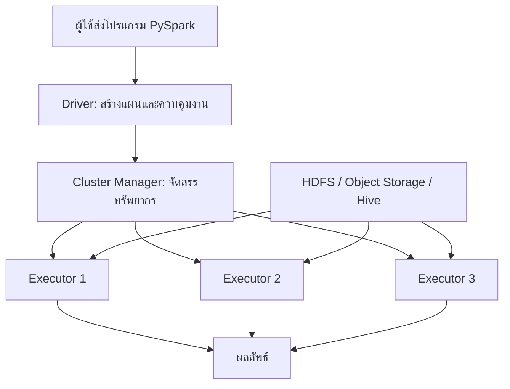
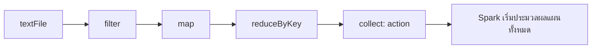
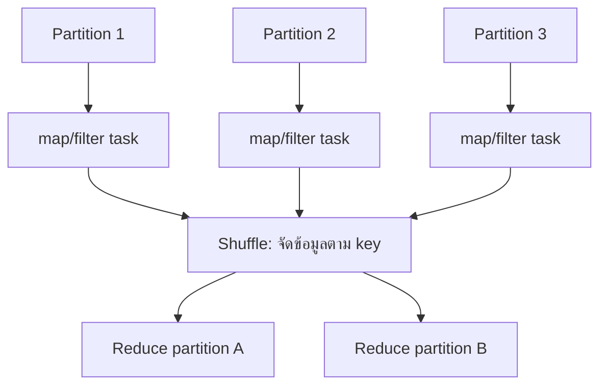

# Apache Spark: จากงานประมวลผลแบบหลายขั้น สู่การคำนวณแบบกระจายที่ต่อเนื่อง

> เอกสารบทนี้เรียบเรียงจาก `lecture_05_spark.pdf` ทั้ง 25 หน้า โดยขยายคำอธิบายให้ผู้อ่านที่เพิ่งเริ่มเรียนมองเห็นว่า Spark ทำงานอยู่ตรงไหน ข้อมูลเดินทางอย่างไร และแต่ละคำศัพท์สัมพันธ์กันอย่างไร ตัวอย่างใช้ PySpark และเน้น RDD ตามขอบเขตของสไลด์

## 1. เหตุใดจึงต้องมี Spark

ก่อนรู้จัก Spark ให้นึกถึงงานวิเคราะห์ข้อมูลหนึ่งงาน เช่น โรงพยาบาลต้องการอ่านรายการเบิกยาหลายปี กรองเฉพาะรายการที่ถูกต้อง รวมยอดตามรหัสยา แล้วนำผลไปคำนวณซ้ำหลายรอบเพื่อสร้างแบบจำลอง งานนี้ไม่ได้มีเพียงคำสั่งเดียว แต่เป็นสายงานที่ผลจากขั้นหนึ่งกลายเป็นข้อมูลเข้าของขั้นถัดไป

MapReduce สามารถประมวลผลข้อมูลขนาดใหญ่แบบกระจายได้ดี แต่เมื่อหนึ่งงานประกอบด้วย MapReduce หลาย job ผลลัพธ์ระหว่างทางมักถูกเขียนลง HDFS แล้ว job ถัดไปจึงอ่านกลับขึ้นมาใหม่ การเขียนและอ่านดิสก์ซ้ำมีต้นทุนสูง โดยเฉพาะงานสองลักษณะต่อไปนี้

- **งานแบบ iterative** ต้องนำข้อมูลเดิมมาคำนวณซ้ำหลายรอบ เช่น machine learning
- **งานแบบ interactive** ผู้ใช้ทดลอง query หรือสำรวจข้อมูลหลายครั้งและต้องการผลตอบกลับเร็ว

Spark เกิดขึ้นเพื่อให้การประมวลผลหลายขั้นต่อเนื่องกันได้สะดวกขึ้น ระบบสร้างแผนการคำนวณทั้งสาย และสามารถเก็บข้อมูลที่ต้องใช้ซ้ำไว้ในหน่วยความจำหรือดิสก์ของเครื่องประมวลผลได้ จึงไม่จำเป็นต้องเขียนผลทุกขั้นลง HDFS เสมอไป

จุดสำคัญคือ Spark เป็น **ระบบประมวลผลแบบกระจาย** ไม่ใช่ระบบจัดเก็บข้อมูลถาวร Spark อ่านข้อมูลจาก HDFS, object storage, Hive, HBase หรือแหล่งอื่น แล้วกระจายงานคำนวณไปยังหลายเครื่อง ส่วนข้อมูลถาวรยังอยู่ใน storage ที่เลือกใช้

## 2. มองภาพ Spark application หนึ่งงาน

สมมติว่ามีไฟล์ธุรกรรมขนาดใหญ่ใน HDFS และต้องการหายอดรวมตามรหัสยา เมื่อส่งโปรแกรม PySpark ระบบไม่ได้ให้เครื่องใดเครื่องหนึ่งอ่านไฟล์ทั้งหมด แต่แบ่งข้อมูลเป็นหลายส่วนและให้หลายเครื่องช่วยกันประมวลผล



ภาพนี้มีผู้เกี่ยวข้องหลักสี่ส่วน

**Driver** คือ process ที่รันโปรแกรมหลักของเรา สร้าง `SparkContext` หรือ `SparkSession` แปลงคำสั่งให้เป็นแผนงาน แบ่งงานย่อย และติดตามผล Driver เปรียบเหมือนผู้ควบคุมโครงการ จึงควรเก็บเฉพาะข้อมูลที่จำเป็น หากดึงข้อมูลทั้งหมดกลับมาที่ Driver ด้วย `collect()` ข้อมูลอาจใหญ่เกินหน่วยความจำและทำให้ application ล้มได้

**Cluster Manager** จัดสรร CPU และหน่วยความจำให้ application สไลด์กล่าวถึง Standalone, YARN และ Mesos สำหรับการเรียนปัจจุบันควรรู้ว่า Spark รองรับ Standalone, YARN และ Kubernetes ส่วน Mesos เป็นบริบททางประวัติศาสตร์จาก Spark รุ่นเก่า

**Worker node** คือเครื่องที่มีทรัพยากรสำหรับทำงาน แต่ตัวที่รันการคำนวณของ Spark จริงคือ **Executor** ซึ่งเป็น process ของ application บน worker นั้น Executor รับ task มาประมวลผล เก็บ partition ที่ cache ไว้ และส่งผลหรือสถานะกลับไปยัง Driver

**Storage** เก็บข้อมูลต้นทางและผลลัพธ์ถาวร Storage ไม่จำเป็นต้องอยู่ในเครื่องเดียวกับ Spark และไม่ใช่ส่วนเดียวกับ Executor

### คำศัพท์ของหนึ่ง application

คำเหล่านี้มักถูกใช้ปนกัน แต่มีระดับต่างกัน

| คำศัพท์ | ความหมายในทางปฏิบัติ |
|---|---|
| Application | โปรแกรม Spark หนึ่งครั้ง ตั้งแต่เริ่ม Driver จนจบ |
| Job | งานที่เกิดขึ้นเมื่อมี action เช่น `count()` หรือ `collect()` |
| Stage | กลุ่ม task ที่ทำต่อเนื่องได้โดยยังไม่ต้องข้ามขอบเขต shuffle |
| Task | หน่วยงานย่อยที่ประมวลผล partition หนึ่งส่วนใน stage หนึ่ง |

ตัวอย่างเช่น RDD มี 8 partitions เมื่อ action เริ่ม stage แรก Spark มักสร้าง 8 tasks เพื่อให้แต่ละ task ดูแลหนึ่ง partition หากมีการจัดกลุ่มข้อมูลด้วย key จนต้อง shuffle ก็จะเกิด stage ถัดไป

## 3. Spark อยู่ร่วมกับ Hadoop อย่างไร

Spark และ Hadoop ไม่ได้เป็นสิ่งที่ต้องเลือกอย่างใดอย่างหนึ่ง คำว่า Hadoop ecosystem ครอบคลุมหลายหน้าที่ เช่น HDFS เก็บข้อมูลและ YARN จัดสรรทรัพยากร ส่วน Spark รับหน้าที่ประมวลผล จึงสามารถใช้ Spark อ่านไฟล์จาก HDFS และให้ YARN จัดสรร cluster ได้

ในภาพรวม Spark ประกอบด้วย Spark Core เป็นแกนหลักสำหรับการกระจายงาน หน่วยความจำ fault recovery และ RDD แล้วมีไลบรารีระดับสูงอยู่ด้านบน ได้แก่ Spark SQL สำหรับข้อมูลเชิงตาราง, Structured Streaming สำหรับข้อมูลที่ไหลเข้าต่อเนื่อง, MLlib สำหรับ machine learning และ GraphX สำหรับกราฟในฝั่ง Scala

สไลด์ใช้ชื่อ Spark Streaming ซึ่งหมายถึงแนวทาง DStream ใน Spark รุ่นก่อน ปัจจุบันงาน streaming ใหม่มักใช้ Structured Streaming เพราะใช้แนวคิด DataFrame และ query engine ร่วมกับงาน batch ได้ง่ายกว่า อย่างไรก็ตามความรู้เรื่อง RDD ยังมีประโยชน์ เพราะช่วยให้มองเห็นกลไกพื้นฐานของการกระจายข้อมูลและ lazy execution

## 4. RDD คืออะไร

RDD ย่อมาจาก **Resilient Distributed Dataset** เป็นชุดข้อมูลที่ถูกแบ่งออกเป็น partitions และกระจายให้เครื่องใน cluster ประมวลผล

ลองนึกถึงไฟล์ธุรกรรมหนึ่งล้านบรรทัด หากเก็บเป็น RDD ที่มีสี่ partitions ข้อมูลจะถูกแบ่งเป็นสี่ส่วน แต่ละ Executor จึงรับผิดชอบเพียงบางส่วน คำว่า distributed จึงไม่ได้แปลว่ามีข้อมูลหนึ่งชุดลอยอยู่ทุกเครื่อง แต่หมายถึงข้อมูลหนึ่งชุดมีหลายส่วนที่ระบบรู้ว่าต้องประมวลผลอย่างไร

คำสามคำในชื่อ RDD บอกคุณสมบัติสำคัญ

- **Dataset** เป็นชุด records ที่นำไปคำนวณได้
- **Distributed** ข้อมูลแบ่งเป็น partitions เพื่อให้หลาย task ทำงานพร้อมกัน
- **Resilient** หาก partition สูญหาย Spark ใช้ lineage ย้อนดูขั้นตอนเดิมแล้วคำนวณ partition นั้นขึ้นใหม่ได้

RDD เป็น **immutable** คือเมื่อสร้างแล้วจะไม่แก้ข้อมูลเดิมโดยตรง คำสั่ง transformation จะนิยาม RDD ใหม่แทน เช่น `filtered = records.filter(...)` ไม่ได้ลบ record ออกจาก `records` แต่สร้างคำอธิบายว่าจะได้ `filtered` อย่างไร คุณสมบัตินี้ทำให้การติดตามที่มาและการกู้คืนข้อมูลชัดเจนขึ้น

### Partition สำคัญกว่าที่เห็น

Partition เป็นหน่วยข้อมูลที่ task ใช้ประมวลผล หากมีข้อมูลมากแต่ partition น้อยเกินไป เครื่องจำนวนมากอาจว่างงาน หาก partition มากเกินไป ระบบเสียเวลาไปกับการจัดการ task จำนวนมาก และถ้าข้อมูลกระจุกอยู่ใน partition เดียว งานทั้งหมดอาจต้องรอ task ที่ช้าที่สุด ปัญหานี้เรียกว่า data skew

จำนวน partition จึงมีผลต่อ parallelism, memory และเวลาในการประมวลผล แต่ไม่ได้หมายความว่ายิ่งมากยิ่งดี ต้องพิจารณาขนาดข้อมูล ทรัพยากร และลักษณะ operation ร่วมกัน

## 5. Transformation, Action และ Lazy Evaluation

RDD operations แบ่งได้เป็นสองกลุ่ม

**Transformation** รับ RDD แล้วนิยาม RDD ใหม่ เช่น `map()`, `filter()`, `flatMap()`, `distinct()` และ `reduceByKey()` การเรียก transformation ยังไม่จำเป็นต้องอ่านข้อมูลหรือคำนวณทันที

**Action** ขอผลลัพธ์จริง เช่น `count()`, `take()`, `collect()` หรือ `reduce()` เมื่อมี action Spark จึงเริ่มสร้าง job และส่ง tasks ไปทำงาน

พิจารณาโค้ดนี้

```python
lines = sc.textFile("hdfs:///data/purchases.csv")
valid = lines.filter(lambda line: line != "")
count = valid.count()
```

สองบรรทัดแรกสร้างคำอธิบายว่าข้อมูลมาจากไหนและจะกรองอย่างไร แต่ยังไม่จำเป็นต้องเปิดอ่านไฟล์ จนถึง `count()` Spark จึงต้องประเมิน transformation ที่จำเป็นและนับผลจริง พฤติกรรมนี้เรียกว่า **lazy evaluation**



ข้อดีของการรอคือ Spark มองเห็นสายการคำนวณก่อนลงมือ ระบบจึงจัดกลุ่มขั้นตอนที่ทำต่อกันได้ และไม่จำเป็นต้องสร้างไฟล์ผลลัพธ์ระหว่างทุก transformation

## 6. จาก DAG ไปเป็น Stage และ Task

Spark บันทึกความสัมพันธ์ของ RDD เป็นกราฟแบบมีทิศทางและไม่วนกลับ เรียกว่า **DAG — Directed Acyclic Graph** ลูกศรบอกว่า RDD หนึ่งเกิดจาก RDD ใด

ความสัมพันธ์ระหว่าง partitions มีสองลักษณะที่ควรรู้

**Narrow dependency** คือ partition ปลายทางอ่านข้อมูลจาก parent เพียงจำนวนน้อย เช่น `map()` และ `filter()` แต่ละ partition ทำงานกับข้อมูลของตนเองได้ จึงต่อหลาย transformations ไว้ใน stage เดียวกันได้บ่อย

**Wide dependency** คือข้อมูลจากหลาย parent partitions ต้องถูกจัดใหม่ข้ามเครือข่าย เช่น `reduceByKey()`, `groupByKey()` หรือการ sort ตาม key ขั้นตอนเคลื่อนย้ายข้อมูลนี้เรียกว่า **shuffle** และมักเป็นเส้นแบ่ง stage



Shuffle มักมีต้นทุนสูงเพราะเกี่ยวข้องกับ network, serialization, memory และ disk จึงควรลดข้อมูลก่อน shuffle เมื่อทำได้ ตัวอย่างเช่น หากต้องการยอดรวมตาม key มักใช้ `reduceByKey()` แทน `groupByKey()` เพราะ `reduceByKey()` สามารถรวมบางส่วนภายใน partition ก่อนส่งข้อมูลข้ามเครือข่าย

## 7. Lineage, Cache และการกู้คืนเมื่อเครื่องล้ม

Spark จดจำว่า RDD เกิดจาก transformations ใด ลำดับนี้เรียกว่า **lineage** สมมติ `clean` เกิดจากการอ่าน `raw` แล้ว filter หาก partition หนึ่งของ `clean` หาย Spark ไม่จำเป็นต้องมีสำเนา RDD ทั้งชุดเสมอไป แต่สามารถอ่าน parent partition ที่เกี่ยวข้องแล้วทำ filter ซ้ำเพื่อสร้างเฉพาะส่วนที่หาย

ความสามารถนี้ต่างจากการทำสำเนาไฟล์ใน HDFS HDFS ปกป้องข้อมูลถาวรด้วย replication ส่วน Spark ปกป้องข้อมูลคำนวณระหว่างทางด้วยการรู้วิธีสร้างใหม่

RDD ไม่ได้ถูก cache โดยอัตโนมัติ หากมี actions สองครั้งบน RDD เดียวกัน Spark อาจคำนวณสายงานเดิมซ้ำ การเรียก `cache()` หรือ `persist()` เป็นการบอกว่าต้องการเก็บ partitions หลังจากคำนวณครั้งแรกไว้ใช้ซ้ำ

```python
clean = raw.filter(is_valid).cache()

row_count = clean.count()       # คำนวณและเริ่มเก็บ clean
sample = clean.take(10)         # ใช้ partitions ที่เก็บไว้ได้
```

ควร cache เมื่อข้อมูลถูกใช้ซ้ำและต้นทุนการสร้างสูง ไม่ควร cache ทุกอย่าง เพราะ memory มีจำกัด เมื่อพื้นที่ไม่พอ Spark อาจ evict partitions และต้องคำนวณใหม่ `persist()` ให้เลือก storage level ได้ เช่น memory, disk หรือทั้งสอง ส่วน **checkpoint** เป็นอีกแนวคิดหนึ่ง ใช้ตัด lineage ที่ยาวมากโดยบันทึกข้อมูลลง storage ที่เชื่อถือได้

## 8. Word Count ตั้งแต่ข้อมูลดิบถึงผลลัพธ์

Word Count เป็นตัวอย่างเล็ก แต่แสดงการเปลี่ยนรูปร่างข้อมูล การจัดกลุ่มตาม key และการเริ่มงานด้วย action ได้ครบ สมมติไฟล์มีสองบรรทัด

```text
spark makes data fast
spark makes analysis possible
```

โค้ด PySpark แบบ RDD เขียนได้ดังนี้

```python
from operator import add

lines = sc.textFile("hdfs:///data/input.txt")

word_counts = (
    lines
    .flatMap(lambda line: line.split())
    .map(lambda word: (word, 1))
    .reduceByKey(add)
)

for word, count in word_counts.collect():
    print(word, count)
```

การเปลี่ยนข้อมูลแต่ละขั้นเป็นดังนี้

| ขั้น | รูปร่างข้อมูลตัวอย่าง |
|---|---|
| `textFile` | `"spark makes data fast"` หนึ่ง record ต่อบรรทัด |
| `flatMap` | `spark`, `makes`, `data`, `fast`, ... |
| `map` | `(spark, 1)`, `(makes, 1)`, ... |
| `reduceByKey` | `(spark, 2)`, `(makes, 2)`, `(data, 1)`, ... |
| `collect` | นำผลขนาดเล็กกลับมาที่ Driver |

`flatMap()` เหมาะกับกรณีหนึ่ง input ให้หลาย outputs เพราะหนึ่งบรรทัดแตกเป็นหลายคำ ส่วน `map()` ในขั้นถัดไปให้หนึ่งคู่ `(word, 1)` ต่อหนึ่งคำ `reduceByKey()` ต้องนำค่าของ key เดียวกันมารวมกันจึงเกิด shuffle และ `collect()` เป็น action ที่ทำให้สายงานทั้งหมดเริ่มคำนวณ

คำว่า “ประมวลผลใน memory” ไม่ได้แปลว่าไฟล์ต้นทางทั้งหมดต้องถูกโหลดเข้า RAM ของ Driver ข้อมูลถูกอ่านและประมวลผลเป็น partitions ใน Executors และ Spark อาจใช้ดิสก์เมื่อจำเป็น

## 9. อ่าน RDD operations จากรูปร่างของข้อมูล

แทนการท่องชื่อ method ให้ถามสามข้อทุกครั้ง: input หนึ่ง record กลายเป็นกี่ records, ต้องนำ records จากหลาย partitions มาพบกันหรือไม่ และผลลัพธ์อยู่ที่ Executors หรือถูกส่งกลับ Driver

### `map()` และ `flatMap()`

`map()` ให้ผลหนึ่งรายการต่อ input หนึ่งรายการ

```python
numbers = sc.parallelize([1, 2, 3])
squares = numbers.map(lambda x: x * x)
# [1, 4, 9]
```

`flatMap()` ให้ศูนย์ หนึ่ง หรือหลายรายการต่อ input แล้วคลี่ผลให้อยู่ใน RDD เดียว

```python
sentences = sc.parallelize(["big data", "fast query"])
words = sentences.flatMap(lambda s: s.split())
# ["big", "data", "fast", "query"]
```

### `filter()` และ `distinct()`

`filter()` เก็บ record ที่เงื่อนไขเป็นจริง จำนวนผลลัพธ์จึงไม่มากกว่า input และปกติทำงานแยก partition ได้

```python
positive = numbers.filter(lambda x: x >= 0)
```

`distinct()` ลบค่าซ้ำ แต่การรู้ว่าค่าซ้ำอยู่คนละ partition หรือไม่ต้องมีการแลกเปลี่ยนข้อมูล จึงอาจเกิด shuffle และแพงกว่า filter อย่างชัดเจน

### `reduce()` กับ `reduceByKey()`

`reduce()` รวมสมาชิกทั้ง RDD จนเหลือค่าเดียว เช่นผลรวมทั้งหมด

```python
total = numbers.reduce(lambda a, b: a + b)
```

`reduceByKey()` ใช้กับคู่ `(key, value)` และรวมค่าแยกตาม key ผลลัพธ์ยังเป็น RDD จึงจัดเป็น **transformation** ไม่ใช่ action

```python
sales = sc.parallelize([("A", 10), ("B", 4), ("A", 7)])
totals = sales.reduceByKey(lambda a, b: a + b)
# RDD: [("A", 17), ("B", 4)]
```

ฟังก์ชันที่ใช้ reduce ควร associative และ commutative เพราะ Spark อาจรวมข้อมูลคนละลำดับกับที่เราเห็นในไฟล์ การบวกเหมาะสม แต่การลบต่อเนื่องอาจให้ผลต่างกันตามลำดับ

### `groupByKey()`

`groupByKey()` รวมค่าทั้งหมดของ key เดียวกันไว้ด้วยกัน เหมาะเมื่อจำเป็นต้องเห็นรายการทุกค่า แต่ถ้าต้องการเพียงผลรวม ค่าเฉลี่ย หรือจำนวน การส่งค่าทั้งหมดข้าม network สิ้นเปลืองกว่า operation ที่รวมบางส่วนก่อน

### `sortByKey()`

การเรียงข้อมูลทั้งชุดตาม key ต้องจัดขอบเขตและเคลื่อนข้อมูลระหว่าง partitions จึงมีต้นทุนสูง ควรเรียงเมื่อผลลัพธ์ต้องใช้ลำดับจริง ไม่ใช่เรียงเพียงเพราะคุ้นเคยจากข้อมูลขนาดเล็ก

### Actions ที่นำผลกลับ Driver

- `take(n)` นำตัวอย่าง n รายการแรกกลับมา เหมาะสำหรับตรวจข้อมูล
- `takeOrdered(n)` นำ n รายการที่เรียงตามเกณฑ์กลับมา
- `collect()` นำทุก record กลับมา ใช้เฉพาะเมื่อมั่นใจว่าผลเล็กพอ
- `count()` คืนจำนวน records
- `foreach()` รันฟังก์ชันกับ records บน Executors ใน cluster ข้อความ `print()` จึงอาจไปอยู่ใน executor logs ไม่ได้ปรากฏที่หน้าจอ Driver

## 10. Closure, Broadcast Variable และ Accumulator

ฟังก์ชันที่ส่งเข้า `map()` หรือ `filter()` เรียกว่า closure ในบริบทนี้ Spark serialize ฟังก์ชันพร้อมตัวแปรภายนอกที่จำเป็น แล้วส่งสำเนาไปยัง Executors การแก้ตัวแปรธรรมดาภายใน task จึงไม่ใช่วิธีอัปเดตตัวแปรเดียวกันบน Driver

สมมติมีชุดรหัสยาที่อนุญาตให้ใช้ในการกรอง หากส่ง collection เดิมไปพร้อมทุก task ซ้ำ ๆ จะสิ้นเปลือง Spark จึงมี **broadcast variable** สำหรับส่งข้อมูลอ่านอย่างเดียวขนาดไม่ใหญ่มากไปยังแต่ละ Executor อย่างมีประสิทธิภาพ

```python
allowed_codes = sc.broadcast({"MED001", "MED002", "MED005"})

valid = records.filter(
    lambda row: row["drug_code"] in allowed_codes.value
)
```

ส่วน **accumulator** ใช้สะสมค่าแบบเพิ่มจากหลาย tasks เช่นนับจำนวนแถวเสีย Executors เพิ่มค่าได้ แต่ Driver เป็นผู้ใช้อ่านผลสุดท้าย

```python
bad_rows = sc.accumulator(0)

def parse(line):
    global bad_rows
    try:
        return int(line)
    except ValueError:
        bad_rows += 1
        return None
```

Accumulator เหมาะกับตัวนับเพื่อสังเกตงาน ไม่ควรใช้เป็นแกนของ business logic เพราะ task อาจถูก retry และลักษณะการประเมินแบบ lazy ทำให้เวลาที่ค่าถูกเพิ่มไม่ตรงกับความคาดหมายหากไม่ได้ออกแบบอย่างระมัดระวัง

## 11. การส่งโปรแกรมด้วย `spark-submit`

โปรแกรม Spark ที่บันทึกเป็นไฟล์สามารถส่งด้วยคำสั่งลักษณะนี้

```bash
spark-submit \
  --master yarn \
  word_count.py \
  hdfs:///data/input.txt \
  hdfs:///data/output
```

ค่า `--master` ระบุ cluster manager เช่น `local[*]` สำหรับทดลองบนเครื่องเดียว, `yarn` สำหรับ cluster ที่ใช้ YARN หรือ URL ของ Spark Standalone การใช้ local mode ช่วยทดสอบ logic แต่ยังไม่แสดงปัญหาทั้งหมดของ cluster เช่น network shuffle, serialization และทรัพยากรหลายเครื่อง

ในโปรแกรมรุ่นใหม่มักเริ่มจาก `SparkSession` ซึ่งเป็นจุดเข้าใช้งาน DataFrame, SQL และความสามารถอื่น ส่วนสไลด์ใช้ `SparkContext` และตัวแปร `sc` เพราะอธิบาย RDD API โดยตรง ทั้งสองไม่ได้เป็นคนละระบบ `SparkSession` สามารถเข้าถึง SparkContext ภายใน application เดียวกันได้

## 12. วิธีอ่านอาการช้าและปัญหาที่พบบ่อย

เมื่อ Spark ช้า ไม่ควรสรุปทันทีว่า RAM ไม่พอ ให้ดูเส้นทางของข้อมูล

**มี shuffle ใหญ่หรือไม่** งาน group, reduce by key, distinct และ sort อาจย้ายข้อมูลข้ามเครือข่ายจำนวนมาก ควรกรองข้อมูลก่อน shuffle และเลือก operation ให้ตรงเป้าหมาย

**ข้อมูลกระจายสมดุลหรือไม่** ถ้า key หนึ่งมีข้อมูลส่วนใหญ่ task ที่รับ key นั้นจะช้ากว่าเพื่อน แม้ cluster มีหลายเครื่องก็ยังต้องรอ task เดียว

**Driver รับข้อมูลมากเกินไปหรือไม่** `collect()` กับข้อมูลขนาดใหญ่รวมข้อมูลจาก cluster มาไว้ process เดียว เสี่ยง memory error ควรบันทึกผลแบบกระจายหรือดึงเพียงตัวอย่าง

**มีการคำนวณซ้ำหรือไม่** หากเรียก actions หลายครั้งบนสาย transformation เดิมและข้อมูลมีราคาแพงในการสร้าง อาจพิจารณา cache แต่ต้องยืนยันว่ามีการ reuse จริง

**partition ใหญ่หรือน้อยเกินไปหรือไม่** task ใหญ่เกินอาจ memory ไม่พอ ส่วน task เล็กจำนวนมหาศาลเพิ่ม scheduling overhead

## 13. ความเข้าใจผิดที่ควรแก้ก่อนนำไปใช้จริง

1. **Spark ไม่ใช่ฐานข้อมูลหรือ file system** Spark ประมวลผล ส่วนข้อมูลถาวรอยู่ในระบบจัดเก็บ
2. **Spark ไม่ได้เก็บ RDD ทุกตัวใน RAM อัตโนมัติ** ต้องเรียก cache/persist และข้อมูลอาจถูกนำออกเมื่อพื้นที่ไม่พอ
3. **Transformation ยังไม่แปลว่าเกิดการคำนวณแล้ว** การประมวลผลเริ่มเมื่อ action ต้องการผลจริง
4. **Executor ไม่ใช่ Worker node** Worker คือเครื่อง ส่วน Executor คือ process ของ application บนเครื่องนั้น
5. **การมีเครื่องมากไม่ได้ทำให้ทุกงานเร็วขึ้นเสมอ** shuffle, skew, serial bottleneck และ overhead อาจเป็นข้อจำกัด
6. **`collect()` ไม่ใช่วิธีดูผลตามปกติสำหรับข้อมูลใหญ่** ใช้ `take()` เพื่อตรวจตัวอย่าง หรือเขียนผลลง storage
7. **Cache ไม่ใช่สำเนาถาวรแบบ HDFS replication** ถ้าส่วนที่ cache หาย Spark ใช้ lineage คำนวณใหม่ได้

## 14. เชื่อมแนวคิดทั้งหมดเข้าด้วยกัน

เมื่อผู้ใช้เขียน transformations Spark จะสร้าง lineage ของ RDD แบบ lazy เมื่อพบ action Driver จึงสร้าง job จาก DAG และแบ่งตามขอบเขต shuffle เป็น stages แต่ละ stage มี tasks ตาม partitions Cluster Manager จัดทรัพยากรให้ Executors รัน tasks หากต้องจัดข้อมูลใหม่ตาม key จะเกิด shuffle หาก partition ระหว่างทางหาย Spark ใช้ lineage คำนวณใหม่ และหากข้อมูลหนึ่งชุดถูกใช้ซ้ำ ผู้พัฒนาสามารถสั่ง cache หรือ persist เพื่อลดการคำนวณซ้ำได้

ประโยคนี้เป็นแกนของบททั้งหมด เพราะเชื่อมคำศัพท์ที่มักถูกจำแยกกันให้เป็นเหตุการณ์เดียวตั้งแต่โค้ดจนถึง cluster

## 15. คำถามฝึกอธิบายพร้อมแนวคำตอบ

### 1. เพราะเหตุใด Spark จึงเหมาะกับงาน iterative มากกว่าการต่อ MapReduce หลาย jobs

Spark สร้างสายการคำนวณหลายขั้นเป็น DAG และสามารถเก็บข้อมูลที่ต้องใช้ซ้ำไว้ใน memory หรือ disk ของ Executors ได้ จึงไม่ต้องเขียนผลทุกขั้นลง HDFS แล้วอ่านกลับมาใหม่เหมือนการต่อ MapReduce หลาย jobs อย่างไรก็ตามความเร็วขึ้นอยู่กับการแบ่ง partition, shuffle, memory และรูปแบบงาน ไม่ได้เกิดจากการใช้ RAM เพียงอย่างเดียว

### 2. จงอธิบายหน้าที่ของ Driver, Cluster Manager และ Executor

Driver รันโปรแกรมหลัก สร้างแผนงาน แบ่งงานและติดตามผล Cluster Manager จัดสรร CPU และ memory ให้ application ส่วน Executor เป็น process บน worker ที่รับ tasks ไปคำนวณ เก็บ partitions ที่ cache และส่งผลกลับ Driver ข้อมูลขนาดใหญ่จึงควรถูกประมวลผลใน Executors ไม่ควรถูก `collect()` กลับ Driver ทั้งหมด

### 3. Transformation และ Action ต่างกันอย่างไร

Transformation เช่น `map`, `filter` และ `reduceByKey` นิยาม RDD ใหม่และถูกบันทึกไว้ใน lineage โดยยังไม่จำเป็นต้องคำนวณทันที Action เช่น `count`, `take` และ `collect` ต้องการผลจริง จึงทำให้ Spark สร้าง job และประมวลผล transformations ที่จำเป็น แนวทางนี้เรียกว่า lazy evaluation

### 4. Lineage ช่วยให้ RDD ทนต่อความเสียหายได้อย่างไร

Lineage บันทึกว่าแต่ละ RDD เกิดจากข้อมูลต้นทางและ transformations ใด หาก partition บางส่วนหาย Spark ย้อนตาม lineage แล้วคำนวณเฉพาะ partition ที่หายขึ้นใหม่ได้ จึงไม่ต้องทำสำเนา RDD ทุกขั้นเหมือนการเก็บไฟล์ถาวร

### 5. เหตุใด `reduceByKey()` มักเหมาะกว่า `groupByKey()` เมื่อต้องการผลรวมตาม key

`groupByKey()` ต้องส่งค่าทั้งหมดของแต่ละ key ผ่าน shuffle แล้วจึงรวมภายหลัง ส่วน `reduceByKey()` รวมค่าบางส่วนภายใน partition ก่อนส่งผ่าน network ทำให้ปริมาณข้อมูลระหว่างเครื่องลดลง ถ้าจำเป็นต้องเห็นค่าทุกรายการจึงค่อยใช้ `groupByKey()`

### 6. เหตุใด `collect()` จึงอันตรายกับข้อมูลใหญ่

ข้อมูลใน RDD กระจายอยู่หลาย Executors แต่ `collect()` ส่งทุก record กลับมาไว้ใน memory ของ Driver เพียง process เดียว หากผลลัพธ์ใหญ่เกิน memory application อาจล้ม ควรใช้ `take()` เพื่อตรวจตัวอย่าง หรือเขียนผลแบบกระจายลง storage

### 7. Cache ควรใช้เมื่อใด

ควรใช้เมื่อ RDD เดียวกันถูกนำไปใช้กับหลาย actions หรือหลายสายงาน และการสร้าง RDD นั้นมีต้นทุนสูง การ cache ข้อมูลที่ใช้ครั้งเดียวมักไม่คุ้ม เพราะกิน memory และเพิ่มภาระจัดการ partitions

## สรุป

Spark ช่วยประมวลผลข้อมูลขนาดใหญ่โดยแบ่งข้อมูลเป็น partitions และกระจาย tasks ไปยัง Executors Driver สร้างแผนจาก transformations และเริ่มงานเมื่อมี action Lazy evaluation ทำให้ Spark เห็น DAG ก่อนคำนวณ ส่วน shuffle เป็นจุดสำคัญที่แบ่ง stages และมักมีต้นทุนสูง RDD ทนต่อความเสียหายด้วย lineage ไม่ใช่เพราะข้อมูลทุกชิ้นมีสำเนาใน memory และการใช้ cache, broadcast หรือ accumulator ต้องเลือกตามหน้าที่ ไม่ใช่ใส่ในทุกโปรแกรม

เมื่อเข้าใจเส้นทาง **โค้ด → DAG → Job → Stage → Task → Partition → Executor** จะสามารถอ่านโปรแกรม Spark อธิบายสถาปัตยกรรม และวิเคราะห์สาเหตุของงานช้าได้โดยไม่ต้องท่องชื่อ components แยกจากกัน

## แหล่งอ้างอิง

- เอกสารประกอบการสอน `lecture_05_spark.pdf` หน้า 1–25
- [Apache Spark RDD Programming Guide](https://spark.apache.org/docs/latest/rdd-programming-guide.html)
- [Apache Spark Cluster Mode Overview](https://spark.apache.org/docs/latest/cluster-overview.html)
- [Apache Spark Documentation](https://spark.apache.org/docs/latest/)

