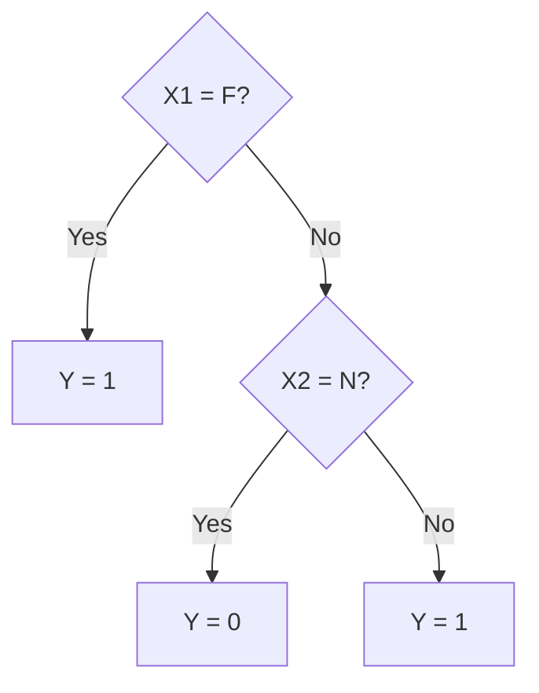
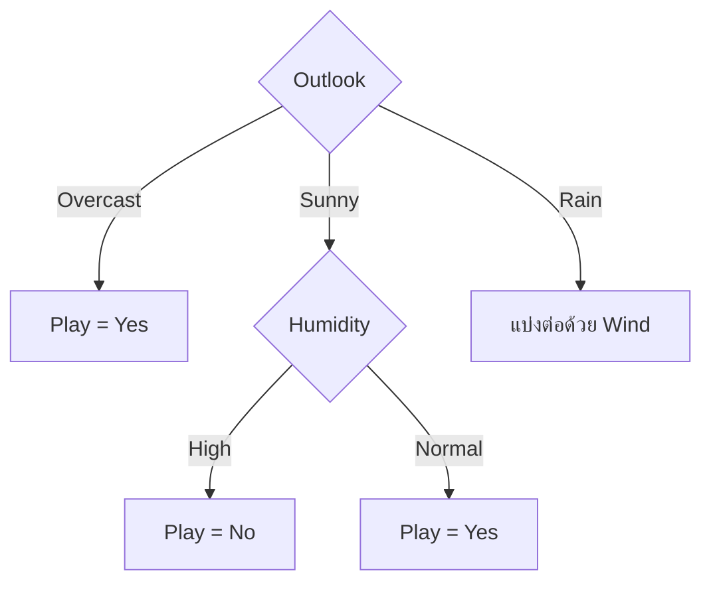
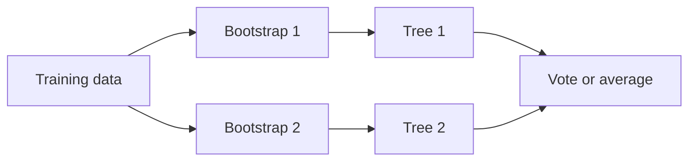

# Decision Tree

Decision Tree เป็น Supervised Learning Method ที่เรียนรู้กฎคำถามแบบลำดับชั้น โมเดลจะค่อย ๆ แบ่งข้อมูลออกเป็นกลุ่มที่มีคำตอบเหมือนกันมากขึ้น จนได้ Prediction ที่ปลายกิ่ง จุดเด่นคือมองเห็นเหตุผลเป็นกฎได้ง่าย แต่ถ้าปล่อยให้ต้นไม้โตมากเกินไปก็สามารถจดจำ Training Data จน Overfit ได้

บทนี้เริ่มจากโครงสร้างของต้นไม้ แล้วค่อยอธิบาย Entropy, Information Gain, Gini Impurity, ID3, C4.5, CART และการควบคุมความซับซ้อน ก่อนเชื่อมกับ Ensemble Methods และเปรียบเทียบกับ [k-Nearest Neighbors](09_knn.md)

> **Learning outcomes:** หลังอ่านบทนี้ควรอธิบายเส้นทางจาก Root ถึง Leaf ได้ คำนวณ Entropy, Information Gain และ Gini จากข้อมูลขนาดเล็กได้ เลือก Split ที่เหมาะสม อธิบายสาเหตุของ Overfitting และแยกความแตกต่างระหว่าง Pruning, Bagging และ Boosting ได้

---

## 1. Decision Tree มองปัญหาอย่างไร

Decision Tree เรียนรู้ชุดคำถามจาก Features ข้อมูลหนึ่งแถวเริ่มที่ **Root Node** แล้วเดินไปตาม Branch ตามคำตอบของแต่ละเงื่อนไข เมื่อถึง **Leaf Node** จะได้ Prediction

พิจารณาข้อมูลตัวอย่างจากสไลด์

| $X_1$ | $X_2$ | $Y$ |
|---|---|---:|
| M | Y | 1 |
| F | Y | 1 |
| M | N | 0 |

กฎที่อธิบายข้อมูลนี้ได้คือ

1. ถ้า $X_1=F$ ให้ทำนาย $Y=1$
2. ถ้า $X_1=M$ และ $X_2=N$ ให้ทำนาย $Y=0$
3. กรณีอื่นให้ทำนาย $Y=1$

กฎเดียวกันเขียนเป็นต้นไม้ได้ดังนี้

ข้อมูลแต่ละแถวเดินเพียงหนึ่งเส้นทาง การสร้างโมเดลจึงเป็นการหาว่า “ควรถาม Feature ใด และใช้เงื่อนไขใดก่อน” เพื่อแยกข้อมูลให้ได้กลุ่มที่บริสุทธิ์ขึ้น

### 1.1 ส่วนประกอบของต้นไม้

- **Root Node** คือคำถามแรกที่ใช้แบ่งข้อมูลทั้งหมด
- **Internal Node** คือคำถามภายในต้นไม้
- **Branch** คือผลของเงื่อนไขที่นำไปยัง Node ถัดไป
- **Leaf Node** คือปลายทางที่ให้ Prediction หรือเก็บการกระจายของ Target
- **Depth** คือจำนวนระดับจาก Root ถึง Node; Depth มากทำให้กฎละเอียดขึ้นแต่เพิ่มความเสี่ยง Overfitting

สำหรับ Classification ใบไม้มักทำนาย Majority Class หรือ Class Probability ส่วน Regression มักทำนายค่าเฉลี่ยของ Target ภายใน Leaf

---

## 2. ความบริสุทธิ์ของ Node

หาก Node หนึ่งมีข้อมูลทุกแถวอยู่ Class เดียวกัน Node นั้นเรียกว่า **Pure Node** เพราะรู้คำตอบแน่นอน แต่ถ้ามีหลาย Classes ปะปนกัน โมเดลต้องวัดว่าปะปนมากเพียงใดก่อนเลือก Split

เกณฑ์ที่พบบ่อยคือ

- Entropy และ Information Gain
- Gini Impurity
- สำหรับ Regression ใช้การลดความคลาดเคลื่อนหรือความแปรปรวน เช่น Squared Error

Entropy และ Gini ไม่ใช่ Evaluation Metric หลัง Predict และไม่ใช่ Confusion Matrix แต่เป็นคะแนนที่ช่วยสร้างต้นไม้โดยวัดคุณภาพของกลุ่มข้อมูลในแต่ละ Node

---

## 3. Entropy: วัดความไม่แน่นอน

Entropy วัดความปะปนของ Classes ภายใน Node

$$
H(S)=-\sum_{i=1}^{K}p_i\log_2p_i
$$

โดย $S$ คือข้อมูลใน Node, $K$ คือจำนวน Classes และ $p_i$ คือสัดส่วนของ Class $i$

- ถ้าทุกแถวเป็น Class เดียวกัน Entropy เท่ากับ 0
- สำหรับ Binary Classification ที่มีสอง Class อย่างละครึ่ง Entropy เท่ากับ 1
- ค่ายิ่งต่ำหมายถึง Node ยิ่งบริสุทธิ์

### 3.1 ตัวอย่าง Play Tennis

ข้อมูล Play Tennis มี 14 วัน โดย Target `play` เป็น `Yes` 9 แถวและ `No` 5 แถว Entropy ที่ Root คือ

$$
H(S)=-\frac{9}{14}\log_2\frac{9}{14}-\frac{5}{14}\log_2\frac{5}{14}\approx0.940
$$

ค่า 0.940 บอกว่า Root ยังปะปนมาก เป้าหมายของ Split คือสร้าง Child Nodes ที่มีความปะปนน้อยลง

| สัดส่วนสอง Classes | Entropy | ความหมาย |
|---|---:|---|
| 100% : 0% | 0 | Pure Node |
| 75% : 25% | 0.811 | มี Class เด่นแต่ยังปะปน |
| 50% : 50% | 1 | ไม่แน่นอนสูงสุดสำหรับสอง Classes |

ข้อควรระวังคือพจน์ที่ $p_i=0$ ถือว่ามีค่าเป็น 0 เพราะขีดจำกัดของ $p_i\log_2p_i$ เข้าใกล้ 0 ไม่จำเป็นต้องคำนวณ $\log_2 0$ โดยตรง

---

## 4. Information Gain: Split ใดลดความไม่แน่นอนได้มากที่สุด

เมื่อแบ่งข้อมูลด้วย Attribute $A$ เราหา Entropy เฉลี่ยของ Child Nodes โดยถ่วงน้ำหนักตามขนาดกลุ่ม แล้วนำไปลบออกจาก Entropy ก่อนแบ่ง

$$
IG(S,A)=H(S)-\sum_{v\in Values(A)}\frac{|S_v|}{|S|}H(S_v)
$$

อ่านเป็นภาษาง่าย ๆ ได้ว่า

> Information Gain = ความไม่แน่นอนก่อนแบ่ง - ความไม่แน่นอนเฉลี่ยหลังแบ่ง

ดังนั้น **Information Gain สูงกว่า ดีกว่า** เพราะแสดงว่า Split นั้นทำให้ Child Nodes บริสุทธิ์ขึ้นมาก

### 4.1 Worked Example: Split ด้วย Humidity

ข้อมูล 14 แถวแบ่งตาม Humidity ได้สองกลุ่ม

- `High` มี 7 แถว: Yes 3 และ No 4
- `Normal` มี 7 แถว: Yes 6 และ No 1

Entropy ของกลุ่ม High คือ

$$
H(S_{high})=-\frac{3}{7}\log_2\frac{3}{7}-\frac{4}{7}\log_2\frac{4}{7}\approx0.985
$$

Entropy ของกลุ่ม Normal คือ

$$
H(S_{normal})=-\frac{6}{7}\log_2\frac{6}{7}-\frac{1}{7}\log_2\frac{1}{7}\approx0.592
$$

ทั้งสองกลุ่มมี 7 จาก 14 แถวเท่ากัน Weighted Entropy หลัง Split คือ

$$
H(S|Humidity)=\frac{7}{14}(0.985)+\frac{7}{14}(0.592)\approx0.789
$$

จึงได้

$$
IG(S,Humidity)=0.940-0.789\approx0.151
$$

เหตุผลที่ต้องถ่วงน้ำหนักคือกลุ่มใหญ่ควรมีผลต่อคุณภาพ Split มากกว่ากลุ่มเล็ก หากเฉลี่ยทุกกิ่งเท่ากัน กิ่งที่มีเพียงไม่กี่แถวจะมีอิทธิพลเกินจริง

### 4.2 เปรียบเทียบ Attributes

| Attribute | Information Gain |
|---|---:|
| Outlook | 0.248 |
| Humidity | 0.151 |
| Wind | 0.048 |
| Temperature | 0.029 |

Outlook มี Gain สูงที่สุด จึงเป็น Root การเลือกนี้เป็น **Greedy Decision** คือเลือกสิ่งที่ดีที่สุด ณ Node ปัจจุบัน โดยไม่ได้ลองต้นไม้ทุกโครงสร้างเพื่อรับประกัน Global Optimum

---

## 5. ID3 สร้างต้นไม้แบบ Recursive

ID3 ใช้ Information Gain เลือก Attribute แล้วทำปัญหาเดิมซ้ำกับข้อมูลในแต่ละ Branch

1. ถ้าข้อมูลใน Node เป็น Class เดียวกันทั้งหมด ให้สร้าง Leaf ของ Class นั้น
2. ถ้าไม่มี Attribute เหลือ ให้สร้าง Leaf เป็น Majority Class
3. คำนวณ Information Gain ของ Attributes ที่เหลือ
4. เลือก Attribute ที่มี Gain สูงสุดเป็น Internal Node
5. แบ่งข้อมูลตามค่าของ Attribute
6. ทำขั้นตอนเดิมซ้ำในแต่ละ Child Node

### 5.1 ติดตาม Branch `Outlook = Sunny`

Sunny มี 5 แถว: No 3 และ Yes 2 จึงยังไม่บริสุทธิ์

$$
H(S_{sunny})=-\frac{3}{5}\log_2\frac{3}{5}-\frac{2}{5}\log_2\frac{2}{5}\approx0.971
$$

เมื่อคำนวณ Attributes ที่เหลือได้ผลโดยประมาณดังนี้

| Attribute ใน Sunny | Information Gain | การแปลผล |
|---|---:|---|
| Humidity | 0.971 | แบ่งแล้วทุก Child บริสุทธิ์ |
| Temperature | 0.571 | บางกลุ่มยังปะปน |
| Wind | 0.020 | ลดความไม่แน่นอนได้น้อย |

Humidity มี Gain เท่ากับ Entropy ก่อนแบ่ง เพราะ Weighted Entropy หลังแบ่งเป็น 0

ภาพนี้แสดงหลัก Recursive Splitting: แต่ละกิ่งกลายเป็นปัญหาย่อย จนได้ Pure Leaf หรือถึงเงื่อนไขหยุด

---

## 6. Gini Impurity

Gini Impurity เป็นอีกวิธีวัดความปะปน และคำนวณได้ง่ายกว่า Entropy

$$
GI(S)=1-\sum_{i=1}^{K}p_i^2
$$

ถ้า Node บริสุทธิ์ Gini เท่ากับ 0 สำหรับ Binary Class ที่ 50:50 จะได้

$$
GI=1-(0.5^2+0.5^2)=0.5
$$

เมื่อตรวจ Split ให้คำนวณ Weighted Gini ของ Child Nodes แล้วเลือกค่าที่ **ต่ำที่สุด**

| Attribute | Weighted Gini |
|---|---:|
| Outlook | 0.342 |
| Humidity | 0.367 |
| Wind | 0.428 |
| Temperature | 0.439 |

Outlook ต่ำที่สุด จึงเป็น Root เช่นเดียวกับผลจาก Information Gain

| คะแนนที่พิจารณา | ทิศทางที่ดีกว่า |
|---|---|
| Information Gain | สูงกว่า |
| Weighted Entropy หลัง Split | ต่ำกว่า |
| Weighted Gini หลัง Split | ต่ำกว่า |

Entropy และ Gini มักให้ผลคล้ายกัน แต่ไม่จำเป็นต้องเลือก Split เดียวกันเสมอ เพราะสูตรตอบสนองต่อสัดส่วน Class ต่างกันเล็กน้อย

---

## 7. ID3, C4.5 และ CART

| Algorithm | แนวคิดสำคัญ | รูปแบบ Split |
|---|---|---|
| ID3 | ใช้ Information Gain และเดิมเน้น Categorical Features | อาจมีหลาย Branch |
| C4.5 | พัฒนาจาก ID3 ให้รองรับ Continuous Data และข้อจำกัดอื่นดีขึ้น | อาจมีหลาย Branch |
| CART | Classification and Regression Trees ใช้ได้ทั้งสองงาน | Binary Split |

สำหรับ Continuous Feature เช่น Age ต้นไม้มักเรียนรู้ Threshold เช่น `Age <= 42.5` แล้วแบ่งข้อมูลเป็นสองฝั่ง ค่า Threshold เป็น Parameter ที่เรียนรู้จาก Training Data

[scikit-learn Decision Trees User Guide](https://scikit-learn.org/stable/modules/tree.html) ระบุว่า Implementation ใช้ CART รุ่นที่ปรับปรุงแล้ว ไม่ได้มี ID3 API โดยตรง จึงควรแยกชื่อ Algorithm ในตำราออกจาก Implementation ที่ใช้จริง

Decision Tree โดยทั่วไปไม่ต้อง Standardize Features เพราะการแปลง Scale ที่รักษาลำดับ เช่น เมตรเป็นเซนติเมตร เปลี่ยนค่า Threshold แต่ยังแบ่ง Observations ชุดเดิมได้ อย่างไรก็ตาม ยังต้องจัดการ Missing Values, Data Types, Categorical Encoding, Class Imbalance และ Data Leakage ตามบริบท

---

## 8. Decision Tree Overfit ได้อย่างไร

หากปล่อยให้ต้นไม้แบ่งต่อโดยไม่มีข้อจำกัด มันอาจสร้าง Leaves ขนาดเล็กมากจนจดจำ Training Examples รายแถว Training Accuracy จึงสูงมาก แต่ผลกับข้อมูลใหม่ลดลง

### 8.1 Pre-pruning

Pre-pruning หยุดการเติบโตก่อนต้นไม้ซับซ้อนเกินไป เช่น

- จำกัด `max_depth`
- กำหนด `min_samples_split`
- กำหนด `min_samples_leaf`
- กำหนด Improvement ขั้นต่ำก่อนยอมให้ Split

การจำกัดมากเกินไปอาจทำให้ Underfitting จึงต้องเลือกค่าจาก Validation หรือ Cross-validation

### 8.2 Post-pruning

Post-pruning ปล่อยให้ต้นไม้เติบโตก่อน แล้วตัด Branch ที่เพิ่มความซับซ้อนแต่ไม่ได้ช่วย Generalization มากพอ แนวคิด Cost-Complexity Pruning เขียนได้ว่า

$$
R_{\alpha}(T)=R(T)+\alpha|T|
$$

- $R(T)$ คือความผิดพลาดของต้นไม้ $T$
- $|T|$ คือจำนวน Leaves
- $\alpha$ คือค่าลงโทษความซับซ้อน

เมื่อ $\alpha$ สูงขึ้น โมเดลให้ความสำคัญกับต้นไม้ขนาดเล็กมากขึ้น อาจยอมให้ Training Error เพิ่มเล็กน้อยเพื่อแลกกับ Generalization ที่ดีขึ้น

Hyperparameters ต้องเลือกจาก Training Data ผ่าน Validation ไม่ควรดู Test Score แล้วปรับซ้ำ เพราะ Test Set จะกลายเป็นส่วนหนึ่งของ Model Selection

---

## 9. จากต้นไม้หนึ่งต้นสู่ Ensemble

ต้นไม้หนึ่งต้นตีความง่าย แต่มี **High Variance**: เปลี่ยน Training Data เพียงบางแถวอาจทำให้ Root Split และโครงสร้างที่เหลือเปลี่ยน Ensemble จึงรวมต้นไม้หลายต้นเพื่อลดข้อจำกัดนี้

### 9.1 Bagging

Bagging ย่อมาจาก Bootstrap Aggregation

1. สุ่ม Training Set หลายชุดแบบ Sampling with Replacement
2. ฝึกต้นไม้หนึ่งต้นต่อหนึ่ง Bootstrap Sample
3. รวมคำตอบด้วย Majority Vote สำหรับ Classification หรือ Average สำหรับ Regression

ต้นไม้เห็นข้อมูลต่างกันจึงผิดต่างกัน การรวมผลช่วยลด Variance ตัวอย่างสำคัญคือ Random Forest ซึ่งเพิ่มการสุ่ม Features ในแต่ละ Split เพื่อทำให้ต้นไม้หลากหลายขึ้น

### 9.2 Boosting

Boosting ฝึก Weak Learners ตามลำดับ โมเดลรอบหลังเน้นตัวอย่างที่รอบก่อนทำผิด แล้วรวม Learners แบบถ่วงน้ำหนัก AdaBoost เป็นตัวอย่างหนึ่งของแนวคิดนี้

| ประเด็น | Bagging | Boosting |
|---|---|---|
| ลำดับการฝึก | หลายโมเดลค่อนข้างอิสระ | รอบหลังแก้ข้อผิดพลาดของรอบก่อน |
| เป้าหมายเด่น | ลด Variance | ลด Bias และสร้างโมเดลรวมที่แข็งแรง |
| การเลือกข้อมูล | Bootstrap Samples | เพิ่มความสำคัญของตัวอย่างที่ผิด |
| ความไวต่อ Noise | มักทนกว่า | อาจไล่ตาม Noise หากควบคุมไม่ดี |

Pruning ลดความซับซ้อนของต้นไม้หนึ่งต้น ส่วน Bagging และ Boosting รวมหลาย Learners จึงไม่ใช่วิธีเดียวกัน

---

## 10. การประเมินและเลือกโมเดล

สำหรับ Classification ให้เริ่มจาก Confusion Matrix แล้วเลือก Metric ตามต้นทุนของความผิดพลาด

- Accuracy เหมาะเมื่อ Classes ค่อนข้างสมดุลและต้นทุน Error ใกล้กัน
- Precision สำคัญเมื่อ False Positive มีต้นทุนสูง
- Recall สำคัญเมื่อ False Negative มีต้นทุนสูง
- F1-score ใช้เมื่อต้องการสมดุล Precision และ Recall

สำหรับ Regression ใช้ MAE, MSE, RMSE หรือ $R^2$ ตามวัตถุประสงค์

ลำดับที่ช่วยป้องกัน Data Leakage คือ

1. แยก Test Set ไว้ตั้งแต่ต้น
2. ใช้ Cross-validation ภายใน Training Set เลือก Tree Complexity และ Hyperparameters
3. Fit Configuration ที่เลือกบน Training Data ทั้งหมด
4. ประเมิน Test Set ครั้งสุดท้ายเพียงครั้งเดียว
5. วิเคราะห์ชนิดของ Errors เพิ่มจาก Metric สรุป

นอกจากคะแนนควรตรวจขนาดต้นไม้, Generalization Gap, Class Distribution ใน Leaves และความสมเหตุสมผลของกฎด้วย

---

## 11. จุดที่มักเข้าใจคลาดเคลื่อน

### “Decision Tree ไม่ต้องเตรียมข้อมูล”

Tree มักไม่ต้อง Scaling แต่ยังต้องจัดการ Missing Values, Data Types, Category Representation, Duplicate Records, Class Imbalance และ Leakage

### “Training Accuracy 100% แปลว่าโมเดลดีที่สุด”

อาจหมายถึงต้นไม้จดจำ Training Data ต้องดู Validation/Test Performance และ Generalization Gap ร่วมด้วย

### “Information Gain สูงแปลว่า Feature สำคัญเชิงสาเหตุ”

Gain บอกว่า Feature ช่วยลดความปะปน ณ Node ภายใต้ข้อมูลนี้ ไม่ได้พิสูจน์ Causal Effect

### “Gini สูงกว่าแปลว่าดีกว่าเหมือน Information Gain”

ไม่ใช่ Information Gain เลือกค่าสูง แต่ Weighted Gini หลัง Split เลือกค่าต่ำ

### “Decision Tree พบต้นไม้ที่ดีที่สุดแน่นอน”

Tree Algorithms ทั่วไปเลือก Split แบบ Greedy จึงหาทางเลือกที่ดี ณ ปัจจุบัน แต่ไม่รับประกัน Global Optimum

---

## 12. คำถามฝึกตอบพร้อมแนวคำตอบ

### ข้อ 1: Entropy ต่างจาก Classification Error อย่างไร

**แนวคำตอบ:** Entropy วัดความปะปนของ Class Distribution ภายใน Node และใช้เลือก Split ระหว่างสร้างต้นไม้ ส่วน Classification Error วัดสัดส่วน Prediction ที่ผิดหลังเลือก Class แล้ว Entropy ตอบสนองต่อการเปลี่ยนสัดส่วนละเอียดกว่า จึงเหมาะกับการเปรียบเทียบ Candidate Splits

### ข้อ 2: คำนวณ Entropy เมื่อ Node มี Yes 3 และ No 1

$$
H=-\frac{3}{4}\log_2\frac{3}{4}-\frac{1}{4}\log_2\frac{1}{4}\approx0.811
$$

Node มี Yes เป็น Class เด่น แต่ยังไม่บริสุทธิ์เพราะมี No หนึ่งแถว

### ข้อ 3: Information Gain สูงหมายถึงอะไร

**แนวคำตอบ:** Split นั้นลด Entropy จาก Parent ไปสู่ Child Nodes ได้มาก Weighted Entropy หลังแบ่งจึงต่ำ อย่างไรก็ตามเป็นการตัดสินใจแบบ Greedy ณ Node ปัจจุบัน

### ข้อ 4: เหตุใดต้องถ่วงน้ำหนัก Impurity ของ Child Nodes

**แนวคำตอบ:** เพื่อให้ Child ที่มีข้อมูลมากมีผลต่อคะแนนมากกว่ากลุ่มเล็ก หากให้ทุก Child น้ำหนักเท่ากัน Split ที่สร้างกิ่งเล็กมากอาจดูดีเกินจริง

### ข้อ 5: ต้นไม้มี Train Accuracy 100% แต่ Test Accuracy 72% ควรทำอย่างไร

**แนวคำตอบ:** Generalization Gap สูงเป็นสัญญาณ Overfitting ควรตรวจ Leakage ก่อน แล้วใช้ Cross-validation เลือก `max_depth`, `min_samples_leaf` หรือ Pruning โดยไม่ปรับจาก Test Set ซ้ำ ๆ อาจเปรียบเทียบกับ Bagging หรือ Random Forest เพื่อลด Variance

### ข้อ 6: Bagging ต่างจาก Boosting อย่างไร

**แนวคำตอบ:** Bagging ฝึกหลายโมเดลจาก Bootstrap Samples ค่อนข้างอิสระแล้วรวมผลเพื่อเฉลี่ยความผันผวน จึงเน้นลด Variance ส่วน Boosting ฝึกตามลำดับโดยให้รอบหลังสนใจข้อผิดพลาดของรอบก่อน สามารถลด Bias ได้แต่ไวต่อ Noise มากกว่าเมื่อควบคุมไม่ดี

### ข้อ 7: ทำไม Decision Tree โดยทั่วไปไม่ต้อง Scaling

**แนวคำตอบ:** Tree แบ่งข้อมูลด้วยลำดับและ Threshold ของ Feature เดียว การแปลง Scale ที่รักษาลำดับเปลี่ยนค่าตัวเลข Threshold แต่ไม่เปลี่ยนว่า Observations ใดอยู่ซ้ายหรือขวา ต่างจาก Distance-based Models ที่ขนาดของ Feature มีผลโดยตรง

---

## 13. Likely Exam Focus

หัวข้อต่อไปนี้คาดจากสิ่งที่สไลด์เน้น ไม่ใช่ข้อมูลข้อสอบจริง

1. อธิบาย Root, Internal Node, Branch, Leaf และ Depth
2. คำนวณ Entropy ของข้อมูลสอง Classes
3. คำนวณ Weighted Entropy และ Information Gain
4. เลือก Root จาก Gain สูงสุดหรือ Weighted Gini ต่ำสุด
5. อธิบาย Recursive Steps และ Stopping Conditions ของ ID3
6. เปรียบเทียบ ID3, C4.5 และ CART
7. อธิบายสาเหตุของ Overfitting และวิธี Pre-pruning/Post-pruning
8. เปรียบเทียบ Bagging กับ Boosting

### ตัวอย่างคำตอบแบบเขียนสอบ

Decision Tree เลือกคำถามที่ทำให้ Child Nodes บริสุทธิ์ขึ้น ถ้าใช้ Entropy จะคำนวณ Entropy ก่อนแบ่ง ลบด้วย Weighted Entropy หลังแบ่ง แล้วเลือก Split ที่ Information Gain สูงสุด หากใช้ Gini จะเลือก Split ที่มี Weighted Gini ต่ำสุด จากนั้นทำขั้นตอนเดิมซ้ำในแต่ละ Subset จนได้ Leaf หรือถึงเงื่อนไขหยุด ต้นไม้ที่ลึกเกินไปอาจ Overfit จึงต้องควบคุมด้วย Maximum Depth, Minimum Leaf Size หรือ Pruning

---

## 14. Integrated Example: เลือกระหว่าง k-NN กับ Decision Tree

สมมติต้องสร้างโมเดล Classification จากข้อมูลลูกค้า 30,000 แถว มี Numerical Features หลาย Scale และต้องอธิบายเหตุผลให้ฝ่ายธุรกิจเข้าใจ

| คำถาม | k-NN | Decision Tree |
|---|---|---|
| ต้อง Scale หรือไม่ | ต้องให้ความสำคัญมาก | โดยทั่วไปไม่จำเป็น |
| Prediction เร็วหรือไม่ | อาจช้าเพราะต้องค้นหา Neighbors | มักเร็วเพราะเดินตาม Nodes |
| อธิบายรายเคส | อธิบายด้วยเพื่อนบ้านที่ใกล้ | อธิบายด้วยเส้นทางกฎ |
| ความเสี่ยงหลัก | Noise, มิติสูง, Distance ไม่มีความหมาย | Overfitting และ Instability |
| Hyperparameters สำคัญ | $k$, Distance, Weights | Depth, Leaf Size, Criterion, Pruning |

ถ้าธุรกิจต้องการกฎที่สื่อสารง่าย Decision Tree เป็น Candidate ที่เหมาะกว่า แต่ยังต้องเปรียบเทียบคะแนนจาก Data Split และ Metric เดียวกัน หากข้อมูลมี Local Pattern ชัด Features ไม่มาก และมีนิยามความคล้ายที่สมเหตุสมผล k-NN อาจให้ผลดีกว่า

การเลือกที่ถูกต้องจึงไม่ใช่เลือกจากชื่อ Algorithm แต่ต้องดู Data Characteristics, Business Cost, Latency, Interpretability และ Validation Performance ร่วมกัน ดูรายละเอียดกลไก Distance-based Model ได้ในบท [k-Nearest Neighbors](09_knn.md)

---

## 15. สรุปท้ายบท

Decision Tree เปลี่ยนข้อมูลเป็นชุดคำถามจาก Root ไปยัง Leaf การสร้างต้นไม้คือการหา Split ที่ลดความปะปนของข้อมูล Entropy และ Gini วัด Impurity ส่วน Information Gain วัดการลดลงของ Entropy หลัง Split

ID3 เลือก Information Gain สูงสุดแล้วแบ่งข้อมูลซ้ำแบบ Recursive ขณะที่ CART ใช้ Binary Split และรองรับทั้ง Classification กับ Regression ต้นไม้หนึ่งต้นอธิบายง่ายแต่ Overfit และไม่เสถียรได้ จึงต้องควบคุมความซับซ้อนด้วย Pre-pruning หรือ Post-pruning และอาจใช้ Bagging หรือ Boosting เมื่อต้องการพลังการทำนายจากหลายต้นไม้

สิ่งสำคัญที่สุดไม่ใช่การจำสูตรแยกส่วน แต่คือการอ่านสูตรเป็นกระบวนการ: วัดความปะปนก่อนแบ่ง ประเมินความปะปนหลังแบ่งแบบถ่วงน้ำหนัก เลือกคำถามที่ทำให้กลุ่มดีขึ้น แล้วหยุดต้นไม้ก่อนที่จะจดจำ Noise

---

## References

- Ekarat Rattagan. *Week 9-2: Decision Trees*, revised October 2, 2026.
- Song, Y. Y., and Ying, L. (2015). [Decision tree methods: applications for classification and prediction](https://pmc.ncbi.nlm.nih.gov/articles/PMC4466856/).
- scikit-learn. [Decision Trees](https://scikit-learn.org/stable/modules/tree.html).
- scikit-learn. [Cross-validation](https://scikit-learn.org/stable/modules/cross_validation.html).
