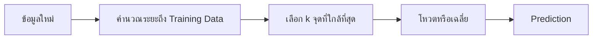
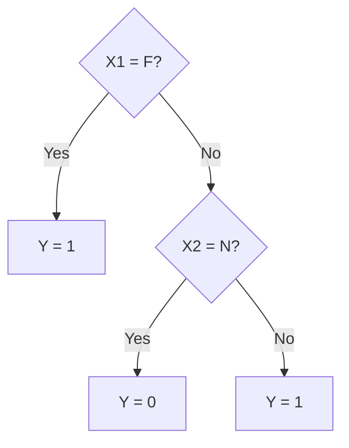
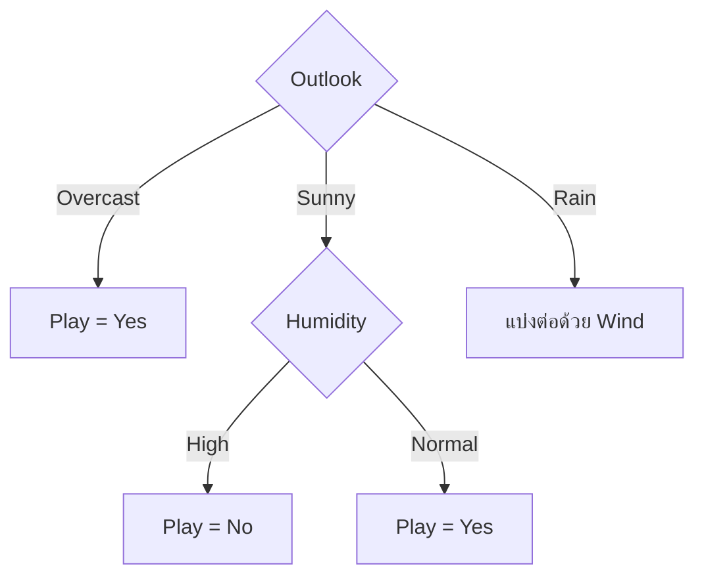
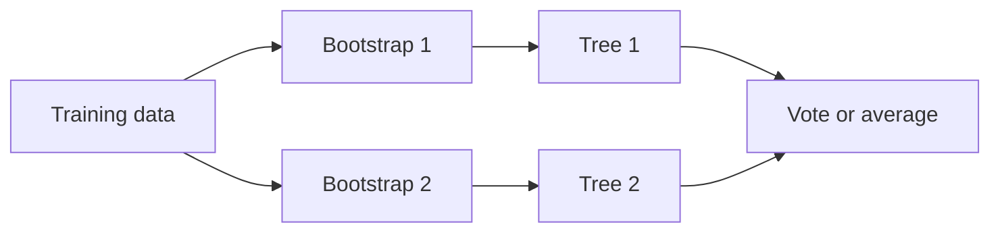

# K-Nearest Neighbors และ Decision Tree

บทนี้พูดถึงโมเดล Supervised Learning สองแบบที่ตอบคำถามเดียวกันด้วยวิธีคิดต่างกันมาก

ถ้ามีข้อมูลใหม่หนึ่งแถวและต้องทำนายคำตอบ **K-Nearest Neighbors (k-NN)** จะย้อนกลับไปดูตัวอย่างในอดีตที่คล้ายกับข้อมูลใหม่นั้น แล้วใช้คำตอบของเพื่อนบ้านช่วยตัดสิน ส่วน **Decision Tree** จะนำข้อมูลใหม่เดินผ่านชุดคำถามทีละข้อ เช่น “Humidity สูงหรือไม่” และ “Wind แรงหรือไม่” จนไปถึงปลายทางที่ให้คำทำนาย

วิธีแรกเชื่อว่า “ตัวอย่างที่คล้ายกันน่าจะมีคำตอบคล้ายกัน” วิธีที่สองเชื่อว่า “ข้อมูลสามารถแบ่งเป็นกลุ่มย่อยด้วยกฎที่เหมาะสม” ทั้งสองวิธีใช้ได้กับ Classification และ Regression แต่สิ่งที่ต้องระวังต่างกัน: k-NN ไวต่อระยะทางและ Scale ของ Feature ส่วน Decision Tree ไวต่อความซับซ้อนของกฎและเกิด Overfitting ได้ง่าย

> **ที่มาของเนื้อหา:** ลำดับหัวข้อ ตัวอย่าง และสมการหลักยึดตามสไลด์ Week 9: k-NN ฉบับวันที่ 20 ตุลาคม 2026 และ Week 9-2: Decision Trees ฉบับวันที่ 2 ตุลาคม 2026 ส่วนคำอธิบายทีละขั้น ตัวอย่างเชื่อมโยง และข้อสังเกตเชิงปฏิบัติเป็นคำอธิบายเพิ่มเติมเพื่อให้เรียนด้วยตนเองได้

---

## 1. วางตำแหน่ง k-NN และ Decision Tree ใน Supervised Learning

Supervised Learning เริ่มจากข้อมูลที่มีทั้ง Feature $X$ และคำตอบ $y$ เราใช้ข้อมูลส่วนหนึ่งฝึกโมเดล แล้วให้โมเดลทำนายคำตอบของข้อมูลใหม่ที่ไม่เคยเห็นมาก่อน

ถ้า $y$ เป็นค่าตัวเลขต่อเนื่อง เช่น ราคา อุณหภูมิ หรือระยะเวลารอ เราเรียกงานนั้นว่า **Regression** แต่ถ้า $y$ เป็นกลุ่ม เช่น ผ่าน/ไม่ผ่าน หรือชนิดของดอกไม้ เราเรียกว่า **Classification**

Linear Regression และ Logistic Regression ที่เรียนมาก่อนสร้างสมการซึ่งมี Parameters ให้เรียนรู้ แต่ k-NN และ Decision Tree ไม่จำเป็นต้องสร้างสมการรูปเดียวกัน

| โมเดล | สิ่งที่เกิดขึ้นเมื่อฝึก | สิ่งที่ใช้ทำนาย |
|---|---|---|
| Linear/Logistic Regression | เรียนรู้ Coefficients | แทนค่าในสมการ |
| k-NN | เก็บ Training Examples และเตรียมการค้นหา | ตัวอย่างใกล้เคียงที่สุด |
| Decision Tree | เรียนรู้ Feature และจุดแบ่งของแต่ละ Node | เส้นทางคำถามจาก Root ถึง Leaf |

ความแตกต่างนี้ช่วยตอบคำถามจากสไลด์ว่า k-NN มี Model Representation และ Cost Function แบบใด คำตอบคือ k-NN ไม่มีสมการสรุปความสัมพันธ์และไม่มี Cost Function สำหรับปรับ Coefficients แบบ Regression แต่ยังต้องมี **Distance Function** เพื่อวัดความคล้าย และมี **Evaluation Metric** เพื่อประเมินผลทำนาย

จุดนี้ต้องแยกคำสามคำให้ชัด:

- **Loss หรือ Cost Function** ใช้กำกับการเรียนรู้ Parameters ของบางโมเดล
- **Splitting Criterion** เช่น Entropy หรือ Gini ใช้เลือกจุดแบ่งของ Decision Tree
- **Evaluation Metric** เช่น MSE, Accuracy หรือ Confusion Matrix ใช้วัดผลทำนาย

MSE เป็นได้ทั้ง Loss และ Evaluation Metric ขึ้นอยู่กับว่าถูกใช้ระหว่าง Training หรือหลังทำนาย ส่วน Entropy ไม่ใช่ Error Matrix แต่เป็นค่าความไม่บริสุทธิ์ที่ช่วยสร้างต้นไม้ และ Confusion Matrix จึงเป็น “Matrix” จริง ๆ เพราะเป็นตารางนับผลทำนายแต่ละประเภท

---

# Part I: K-Nearest Neighbors

## 2. k-NN คืออะไร

ลองนึกถึงคนไข้รายใหม่ที่มีข้อมูลอายุ ค่า BMI และผลตรวจบางรายการ หากเรายังไม่มีสมการซับซ้อน เราอาจเริ่มจากค้นหาคนไข้ในอดีตที่มีลักษณะใกล้เคียง แล้วดูว่าคนเหล่านั้นส่วนใหญ่มีผลลัพธ์อะไร นี่คือแนวคิดของ k-NN

ตัวอักษร $k$ หมายถึงจำนวนเพื่อนบ้านที่ใช้ตัดสิน เช่น $k=3$ หมายถึงเลือก Training Examples ที่ใกล้ข้อมูลใหม่ที่สุดสามแถว

- ถ้าเป็น Classification ใช้การโหวต Class ของเพื่อนบ้าน
- ถ้าเป็น Regression ใช้ค่าเฉลี่ยของ Target ของเพื่อนบ้าน

k-NN จัดเป็น **Instance-based Learning** เพราะยังพึ่งข้อมูลตัวอย่างแต่ละแถวตอนทำนาย และเรียกว่า **Lazy Learning** เพราะงานส่วนใหญ่ไม่ได้เกิดตอน `fit()` แต่เกิดตอนค้นหาเพื่อนบ้านระหว่าง `predict()`

k-NN ยังเป็น **Non-parametric Model** หมายถึงไม่ได้บังคับความสัมพันธ์ให้อยู่ในรูปสมการที่มีจำนวน Parameters คงที่ เช่น เส้นตรง คำว่า Non-parametric ไม่ได้แปลว่าไม่มีค่าต้องกำหนด เพราะ $k$, วิธีวัดระยะ และวิธีให้น้ำหนักเพื่อนบ้านยังเป็น Hyperparameters

### 2.1 ภาพรวมการทำงาน

ให้อ่านภาพจากซ้ายไปขวา ข้อมูลใหม่ไม่ได้ถูกใช้ฝึกโมเดลอีกครั้ง แต่ถูกเปรียบเทียบกับ Training Data ที่มีอยู่ หลังเลือกรายการใกล้ที่สุดแล้วจึงรวมคำตอบของเพื่อนบ้านเป็น Prediction

---

## 3. Distance เปลี่ยนคำว่า “คล้าย” ให้เป็นตัวเลข

k-NN จะทำงานไม่ได้จนกว่าเราจะนิยามว่าข้อมูลสองแถวใกล้กันเพียงใด ถ้า Feature เป็นตัวเลข วิธีพื้นฐานคือ **Euclidean Distance** ซึ่งเป็นระยะเส้นตรงระหว่างสองจุด

$$d(x_i,x_j)=\sqrt{\sum_{r=1}^{m}(x_{i,r}-x_{j,r})^2}$$

ความหมายของสัญลักษณ์มีดังนี้

- $x_i$ และ $x_j$ คือข้อมูลสองแถวที่นำมาเปรียบเทียบ
- $r$ คือ Feature ลำดับที่ $r$
- $m$ คือจำนวน Features
- ถ้าระยะเท่ากับ 0 แสดงว่าทั้งสองแถวมีค่า Features เหมือนกันทั้งหมด

สูตรทำสามอย่างตามลำดับ: หาผลต่างของแต่ละ Feature, ยกกำลังสองเพื่อไม่ให้ค่าบวกกับลบหักล้างกัน, แล้วรวมและถอดรากเพื่อกลับมาเป็นระยะทาง การคำนวณไม่ได้บอกว่าความคล้ายนั้น “ดี” ต่อโจทย์หรือไม่ แต่สะท้อนนิยามความคล้ายที่เราเลือกไว้

---

## 4. ตัวอย่าง k-NN ที่ใช้ได้ทั้ง Regression และ Classification

ใช้ข้อมูลจากสไลด์ดังนี้ โดย $s_5$ เป็นข้อมูลใหม่ที่ยังไม่ทราบคำตอบ

| Sample | $x_1$ | $x_2$ | Target ตัวเลข $y_1$ | Target กลุ่ม $y_2$ |
|---|---:|---:|---:|---|
| $s_1$ | 1 | 10 | 1,000 | yes |
| $s_2$ | 2 | 7 | 1,200 | yes |
| $s_3$ | 3 | 5 | 1,100 | no |
| $s_4$ | 3 | 2 | 2,000 | yes |
| $s_5$ | 2 | 9 | ? | ? |

เราต้องคำนวณระยะจาก $s_5=(2,9)$ ไปยังทุกแถวใน Training Data

### 4.1 คำนวณระยะทีละแถว

$$d(s_5,s_1)=\sqrt{(2-1)^2+(9-10)^2}=\sqrt{2}\approx1.414$$

$$d(s_5,s_2)=\sqrt{(2-2)^2+(9-7)^2}=2$$

$$d(s_5,s_3)=\sqrt{(2-3)^2+(9-5)^2}=\sqrt{17}\approx4.123$$

$$d(s_5,s_4)=\sqrt{(2-3)^2+(9-2)^2}=\sqrt{50}\approx7.071$$

เมื่อนำมาเรียงจากใกล้ไปไกล:

| ลำดับ | Neighbor | Distance | $y_1$ | $y_2$ |
|---:|---|---:|---:|---|
| 1 | $s_1$ | 1.414 | 1,000 | yes |
| 2 | $s_2$ | 2.000 | 1,200 | yes |
| 3 | $s_3$ | 4.123 | 1,100 | no |
| 4 | $s_4$ | 7.071 | 2,000 | yes |

### 4.2 ดูผลเมื่อเปลี่ยน $k$

| $k$ | Neighbors ที่ใช้ | Regression: ค่าเฉลี่ย $y_1$ | Classification: เสียงข้างมาก $y_2$ |
|---:|---|---:|---|
| 1 | $s_1$ | 1,000 | yes |
| 2 | $s_1,s_2$ | 1,100 | yes |
| 3 | $s_1,s_2,s_3$ | 1,100 | yes |
| 4 | ทุกแถว | 1,325 | yes |

ตัวอย่างนี้บังเอิญได้ Class `yes` ทุกค่า $k$ แต่ค่าทำนายแบบ Regression เปลี่ยนไป เพราะเพื่อนบ้านที่ไกลและมี Target สูงถูกนำเข้ามาเฉลี่ยเมื่อ $k$ เพิ่มขึ้น จึงไม่ควรสรุปว่า $k$ ไม่มีผลเพียงเพราะตัวอย่างหนึ่งให้ Class เดิม

---

## 5. เมื่อ Feature เป็น Category: Hamming Distance

Euclidean Distance ต้องใช้การลบตัวเลข แต่ Category เช่น `great`, `normal`, `yes` และ `no` ไม่มีระยะทางตามธรรมชาติ เราจึงใช้ **Hamming Distance** ซึ่งนับจำนวนตำแหน่งที่ค่าต่างกัน

$$H(x_i,x_j)=\sum_{r=1}^{m}I(x_{i,r}\ne x_{j,r})$$

$I$ เป็น Indicator Function มีค่า 1 เมื่อต่างกัน และ 0 เมื่อตรงกัน ระยะที่ต่ำกว่าจึงหมายถึงมี Attributes ตรงกันมากกว่า

สไลด์แบบฝึกหัดฉบับหลังให้ข้อมูลดังนี้

| Sample | Food | Chat | Fast | Price | Bar | Tip |
|---|---|---|---|---|---|---|
| $s_1$ | great | yes | yes | normal | no | yes |
| $s_2$ | great | no | yes | normal | no | yes |
| $s_3$ | mediocre | yes | no | high | no | no |
| $s_4$ | great | yes | yes | normal | yes | yes |
| $s_5$ | great | no | no | high | no | ? |

คำนวณโดยเทียบเฉพาะห้า Features แรก:

- $H(s_5,s_1)=3$ เพราะ `Chat`, `Fast` และ `Price` ต่างกัน
- $H(s_5,s_2)=2$ เพราะ `Fast` และ `Price` ต่างกัน
- $H(s_5,s_3)=2$ เพราะ `Food` และ `Chat` ต่างกัน
- $H(s_5,s_4)=4$ เพราะ `Chat`, `Fast`, `Price` และ `Bar` ต่างกัน

เมื่อ $k=2$ เพื่อนบ้านคือ $s_2$ ซึ่งเป็น `yes` กับ $s_3$ ซึ่งเป็น `no` จึงเกิดผลโหวตเสมอ โมเดลต้องมีกติกาเพิ่มเติม เช่น ให้น้ำหนักจุดที่ใกล้กว่า เปลี่ยน $k$ หรือกำหนด Tie-breaking Rule ที่แน่นอน

> **ข้อสังเกตจากเอกสาร:** ตาราง Categorical Data สองหน้ามีค่า `Tip` ของ $s_2$ และค่า `Price` ของ $s_5$ ไม่ตรงกัน บทเรียนนี้ใช้ตารางหน้าที่สองซึ่งเป็นหน้าที่กำหนดโจทย์ $k=2$ โดยตรง ความไม่สอดคล้องนี้ทำให้ผลลัพธ์ต่างกันได้ จึงควรตรวจ Version ของข้อมูลก่อนคำนวณ

Hamming Distance ถือว่าความไม่ตรงกันทุก Feature มีต้นทุนเท่ากัน ถ้า `Price` สำคัญกว่า `Chat` วิธีนี้อาจไม่สะท้อนโจทย์จริง เราสามารถใช้ Weighted Hamming Distance หรือออกแบบระยะทางให้สอดคล้องกับความหมายทางธุรกิจ แต่ Weight เหล่านั้นต้องเลือกจากหลักฐาน ไม่ใช่ความรู้สึกเพียงอย่างเดียว

---

## 6. ค่า $k$ เปลี่ยนความยืดหยุ่นของโมเดลอย่างไร

เมื่อ $k=1$ ข้อมูลใหม่จะรับคำตอบจากจุดที่ใกล้ที่สุดเพียงจุดเดียว Decision Boundary จึงคดเคี้ยวตาม Training Data และไวต่อ Noise หากจุดหนึ่งติด Label ผิด พื้นที่รอบจุดนั้นอาจถูกทำนายผิดตามไปด้วย

เมื่อ $k$ ใหญ่ขึ้น การตัดสินอาศัยหลายจุดมากขึ้น Noise ของจุดเดียวจึงมีอิทธิพลน้อยลง Boundary จะเรียบขึ้น แต่ถ้า $k$ ใหญ่เกินไป กลุ่มเล็กที่มีรูปแบบเฉพาะจะถูกเสียงส่วนใหญ่กลบ โมเดลจึงเกิด Underfitting

| ค่า $k$ | สิ่งที่เกิดขึ้น | ความเสี่ยงเด่น |
|---|---|---|
| เล็ก | เน้นเพื่อนบ้านใกล้มากและรายละเอียดเฉพาะพื้นที่ | Variance สูง, Overfitting |
| ปานกลาง | สมดุลรายละเอียดกับความเรียบ | ต้องเลือกจาก Validation |
| ใหญ่ | เฉลี่ยข้อมูลกว้างและ Boundary เรียบ | Bias สูง, Underfitting |

สไลด์เสนอค่าเลขคี่เพื่อลดโอกาสเสมอใน Binary Classification และใช้ $\sqrt{N}$ เป็นจุดเริ่มต้นได้ แต่ทั้งสองอย่างเป็นเพียง Heuristic ไม่ใช่คำตอบที่รับประกัน ค่า $k$ ที่เหมาะสมควรเลือกด้วย Cross-validation บน Training Data และเก็บ Test Data ไว้ประเมินครั้งสุดท้าย

เลขคี่ช่วยลด Tie จากจำนวนเสียงใน Binary Classification แต่ยังอาจมีจุดหลายจุดที่ระยะเท่ากัน และ Multiclass Classification ยังเกิดคะแนนเสมอได้

---

## 7. ทำไม Feature Scaling จึงเปลี่ยนคำตอบของ k-NN

k-NN ไม่รู้ความหมายหรือหน่วยของ Feature มันเห็นเพียงตัวเลข สมมติ Feature หนึ่งคือ Population ระดับหลายล้าน แต่อีก Feature คือ Age ระดับหลักสิบ ผลต่างของ Population จะครอบงำ Euclidean Distance แม้ Age จะสำคัญต่อผลลัพธ์มากกว่า

นี่ไม่ใช่หลักฐานว่า Feature ที่มีตัวเลขใหญ่สำคัญกว่า แต่เป็นผลจากหน่วยวัด ดังนั้น Feature ที่ใช้คำนวณระยะควรถูกปรับให้อยู่ใน Scale ที่เปรียบเทียบกันได้

### 7.1 Standardization หรือ z-score

$$z=\frac{x-\mu}{\sigma}$$

เราลบค่าเฉลี่ย $\mu$ แล้วหารด้วยส่วนเบี่ยงเบนมาตรฐาน $\sigma$ ทำให้ Training Feature มีค่าเฉลี่ยใกล้ 0 และส่วนเบี่ยงเบนมาตรฐานใกล้ 1

ข้อความในสไลด์ที่ว่า z-score “Maps to range $(-3,3)$” ควรอ่านอย่างระมัดระวัง Standardization **ไม่ได้บังคับ** ให้ค่าทั้งหมดอยู่ในช่วงนี้ ถ้าข้อมูลใกล้ Normal Distribution ค่าส่วนมากอาจอยู่ระหว่าง -3 และ 3 แต่ Outliers สามารถออกนอกช่วงได้

### 7.2 Min-Max Scaling

$$x'=\frac{x-x_{min}}{x_{max}-x_{min}}$$

สำหรับ Training Data ค่าต่ำสุดจะเป็น 0 และค่าสูงสุดเป็น 1 แต่ข้อมูลใหม่อาจออกนอกช่วง $[0,1]$ หากต่ำกว่าหรือสูงกว่าช่วงที่พบตอน Fit Scaler

### 7.3 ตัวอย่างที่ Scaling เปลี่ยนเพื่อนบ้าน

| Sample | $X_1$ | $X_2$ | Class |
|---|---:|---:|---|
| $s_1$ | 4.5 | 10,000 | yes |
| $s_2$ | 0.1 | 3,000 | no |
| $s_3$ | 0.2 | 3,200 | yes |
| $s_4$ | 4.5 | 3,000 | ? |

ก่อน Scaling และใช้ $k=1$:

$$d(s_4,s_1)=7000$$

$$d(s_4,s_2)=4.4$$

$$d(s_4,s_3)=\sqrt{4.3^2+200^2}\approx200.046$$

เพื่อนบ้านใกล้ที่สุดคือ $s_2$ จึงทำนาย `no` เพราะผลต่างของ $X_2$ มีขนาดใหญ่และครอบงำระยะทาง

ต่อไปทำ Min-Max Scaling โดยใช้ Min และ Max จาก Training Data $s_1,s_2,s_3$ เท่านั้น:

| Sample | $X_1'$ | $X_2'$ |
|---|---:|---:|
| $s_1$ | 1.0000 | 1.0000 |
| $s_2$ | 0.0000 | 0.0000 |
| $s_3$ | 0.0227 | 0.0286 |
| $s_4$ | 1.0000 | 0.0000 |

ระยะใหม่คือ

$$d(s_4,s_1)=1$$

$$d(s_4,s_2)=1$$

$$d(s_4,s_3)\approx0.978$$

หลัง Scaling เพื่อนบ้านใกล้ที่สุดเปลี่ยนเป็น $s_3$ และคำทำนายเปลี่ยนเป็น `yes` ตัวอย่างนี้แสดงว่า Scaling ไม่ใช่การตกแต่งข้อมูล แต่เปลี่ยนเรขาคณิตของ Feature Space และอาจเปลี่ยน Prediction โดยตรง

Scaler ต้อง Fit ด้วย Training Data เท่านั้น ถ้าใช้ทั้ง Dataset ก่อนแบ่ง Train/Test ค่า Min, Max, Mean หรือ Standard Deviation จาก Test Data จะรั่วเข้าสู่ขั้น Training เกิดเป็น Data Leakage

---

## 8. ข้อจำกัดของ k-NN และวิธีรับมือ

### 8.1 Noisy Data และ Outliers

จุดผิดปกติอาจกลายเป็นเพื่อนบ้านใกล้ที่สุดและทำให้ Prediction เปลี่ยน ก่อนลบ Outlier ต้องตรวจว่าเป็นข้อมูลผิดจริงหรือเป็นกรณีหายากที่สำคัญ เพราะการลบทุกค่าที่แปลกอาจทำให้โมเดลมองไม่เห็นผู้ป่วยหรือเหตุการณ์กลุ่มเสี่ยง

Robust Scaling ใช้ Median และ Interquartile Range จึงไวต่อ Outlier น้อยกว่า Mean และ Standard Deviation

$$x' = \frac{x-\mathrm{median}}{\mathrm{IQR}}$$

### 8.2 Prediction ช้าเมื่อ Training Data ใหญ่

เพราะ k-NN ต้องค้นหาเพื่อนบ้านตอน Predict เวลาคำนวณและ Memory จึงเพิ่มตามจำนวน Training Examples โครงสร้างอย่าง KD-tree หรือ Ball-tree ช่วยลดการค้นหาในข้อมูลบางลักษณะ แต่ประโยชน์ลดลงเมื่อมิติสูงมาก เอกสาร [Nearest Neighbors ของ scikit-learn](https://scikit-learn.org/stable/modules/neighbors.html) อธิบายว่าประสิทธิภาพขึ้นกับทั้งจำนวนแถว จำนวน Features และโครงสร้างภายในของข้อมูล จึงไม่มี Search Algorithm เดียวที่เร็วที่สุดทุกกรณี

### 8.3 Storage สูง

k-NN ต้องเก็บ Training Instances ไว้ วิธีบีบอัด Vector เช่น Product Quantization ช่วยลดพื้นที่และรองรับ Approximate Nearest Neighbor Search แต่แลกกับโอกาสที่เพื่อนบ้านที่พบจะไม่ใช่จุดที่ใกล้ที่สุดจริงทุกครั้ง

### 8.4 Curse of Dimensionality

เมื่อจำนวน Features เพิ่ม ปริมาตรของ Feature Space เพิ่มเร็วมาก ข้อมูลจึงกระจายห่างกัน และคำว่า “ใกล้” เริ่มแยกจาก “ไกล” ได้ยาก k-NN ต้องการข้อมูลจำนวนมากขึ้นเพื่อเติมพื้นที่และรักษาคุณภาพของเพื่อนบ้าน

แนวทางรับมือคือเลือก Features ที่มีความหมาย หรือลดมิติ เช่น PCA สำหรับการย่อความแปรปรวนเชิงเส้น และ LDA สำหรับการหาทิศที่ช่วยแยก Class เมื่อมี Labels ส่วน [t-SNE](https://scikit-learn.org/stable/modules/generated/sklearn.manifold.TSNE.html) ถูกอธิบายเป็นเครื่องมือสำหรับ Visualize ข้อมูลมิติสูง จึงไม่ใช่ตัวเลือกเริ่มต้นสำหรับ Preprocessing เพื่อทำนายข้อมูลใหม่ทุกงาน

### 8.5 งานที่ใช้แนวคิด Nearest Neighbors

แนวคิดนี้ถูกใช้กับ Image Geolocation, Data Imputation และ Recommendation Systems แต่คำว่า “เพื่อนบ้าน” ต้องนิยามต่างกันตามงาน เช่น ระบบแนะนำอาจใช้ความคล้ายของพฤติกรรมแทนระยะของข้อมูลประชากร

---

# Part II: Decision Tree

## 9. Decision Tree คืออะไร

Decision Tree สร้างกฎคำถามแบบลำดับชั้น ข้อมูลแต่ละแถวเริ่มที่ **Root Node** แล้วถูกส่งไปตาม Branch ตามคำตอบของเงื่อนไข เมื่อถึง **Leaf Node** จะได้ Prediction

ใช้ตัวอย่างเล็กจากสไลด์:

| $X_1$ | $X_2$ | $Y$ |
|---|---|---:|
| M | Y | 1 |
| F | Y | 1 |
| M | N | 0 |

กฎหนึ่งที่อธิบายข้อมูลนี้ได้คือ

1. ถ้า $X_1=F$ ให้ทำนาย $Y=1$
2. ถ้า $X_1=M$ และ $X_2=N$ ให้ทำนาย $Y=0$
3. กรณีอื่นให้ทำนาย $Y=1$

กฎเดียวกันเขียนเป็นต้นไม้ได้ดังนี้

เริ่มอ่านจาก Root ด้านบน ลูกศรแต่ละเส้นคือคำตอบของคำถาม ข้อมูลหนึ่งแถวจะเดินเพียงหนึ่งเส้นทางจนถึง Leaf ต่างจาก k-NN ซึ่งต้องย้อนกลับไปเทียบกับ Training Examples หลายแถวทุกครั้ง

### 9.1 ส่วนประกอบของต้นไม้

- **Root Node** คือคำถามแรกที่ใช้แบ่งข้อมูลทั้งหมด
- **Internal Node** คือคำถามเพิ่มเติมภายในต้นไม้
- **Branch** คือผลลัพธ์ของเงื่อนไขที่พาข้อมูลไปยัง Node ถัดไป
- **Leaf Node** คือปลายทางที่เก็บ Prediction หรือการกระจายของ Target
- **Depth** คือจำนวนระดับจาก Root ไปยัง Node; ต้นไม้ลึกสร้างกฎละเอียดขึ้นแต่เสี่ยง Overfitting

คำถามสำคัญจึงไม่ใช่เพียง “เขียนกฎอย่างไร” แต่คือ “จาก Features หลายตัว เราควรถามอะไรเป็นข้อแรก” Decision Tree ใช้ค่าความบริสุทธิ์ของกลุ่มตอบคำถามนี้

---

## 10. Entropy: วัดว่ากลุ่มหนึ่งปะปนกันเพียงใด

ใช้ชุดข้อมูล Play Tennis จำนวน 14 วัน ซึ่ง Target `play` มี `Yes` 9 แถวและ `No` 5 แถว

**Entropy** วัดความไม่แน่นอนหรือความปะปนของ Classes

$$H(S)=-\sum_{i=1}^{K}p_i\log_2p_i$$

- $S$ คือชุดข้อมูลใน Node
- $K$ คือจำนวน Classes
- $p_i$ คือสัดส่วนของ Class $i$ ใน Node นั้น

Entropy ต่ำหมายถึงกลุ่มค่อนข้างบริสุทธิ์ ถ้าทุกแถวเป็น Class เดียว Entropy เท่ากับ 0 เพราะไม่ต้องเดาว่าจะพบ Class ใด สำหรับ Binary Classification ที่สอง Classes มีสัดส่วน 50:50 Entropy เท่ากับ 1 ซึ่งเป็นความไม่แน่นอนสูงสุดในกรณีสอง Class

สำหรับ Play Tennis:

$$H(S)=-\frac{9}{14}\log_2\frac{9}{14}-\frac{5}{14}\log_2\frac{5}{14}\approx0.940$$

ค่า 0.940 บอกว่า Root ยังปะปนมาก เป้าหมายของการ Split คือสร้าง Child Nodes ที่มี Entropy ต่ำลง

| สัดส่วน Binary Class | Entropy | ความหมาย |
|---|---:|---|
| 100% : 0% | 0 | บริสุทธิ์ รู้ Class แน่นอน |
| 75% : 25% | 0.811 | ยังปะปน แต่มี Class เด่น |
| 50% : 50% | 1 | ปะปนมากที่สุด |

Entropy ไม่ใช่จำนวนแถวที่ทำนายผิด และไม่ใช่ Confusion Matrix มันเป็นคะแนนของ “กลุ่มข้อมูลใน Node” ระหว่างการสร้างต้นไม้

---

## 11. Information Gain: คำถามใดลดความไม่แน่นอนได้มากที่สุด

ถ้า Split ด้วย Attribute $A$ ข้อมูลจะถูกแบ่งเป็นหลายกลุ่มย่อย เราต้องหาค่า Entropy เฉลี่ยหลังแบ่ง โดยให้น้ำหนักตามขนาดของแต่ละกลุ่ม จากนั้นเปรียบเทียบกับ Entropy ก่อนแบ่ง

$$IG(S,A)=H(S)-\sum_{v\in Values(A)}\frac{|S_v|}{|S|}H(S_v)$$

อ่านสูตรเป็นประโยคได้ว่า

> Information Gain = ความไม่แน่นอนก่อนแบ่ง - ความไม่แน่นอนเฉลี่ยหลังแบ่ง

ถ้า Gain สูง แสดงว่าคำถามนั้นทำให้ Child Nodes บริสุทธิ์ขึ้นมาก จึงเป็น Candidate ที่ดีสำหรับ Split

### 11.1 ตัวอย่างเต็ม: Split ด้วย Humidity

ข้อมูล 14 แถวแบ่งตาม Humidity ได้สองกลุ่ม

- `High` มี 7 แถว: Yes 3, No 4
- `Normal` มี 7 แถว: Yes 6, No 1

Entropy ของกลุ่ม High คือ

$$H(S_{high})=-\frac{3}{7}\log_2\frac{3}{7}-\frac{4}{7}\log_2\frac{4}{7}\approx0.985$$

Entropy ของกลุ่ม Normal คือ

$$H(S_{normal})=-\frac{6}{7}\log_2\frac{6}{7}-\frac{1}{7}\log_2\frac{1}{7}\approx0.592$$

ทั้งสองกลุ่มมีขนาด 7 จาก 14 เท่ากัน Entropy หลัง Split แบบถ่วงน้ำหนักจึงเป็น

$$H(S|Humidity)=\frac{7}{14}(0.985)+\frac{7}{14}(0.592)\approx0.789$$

ดังนั้น

$$IG(S,Humidity)=0.940-0.789\approx0.151$$

Humidity ลดความไม่แน่นอนได้ 0.151 Bits แต่เรายังไม่รู้ว่าเป็น Attribute ที่ดีที่สุดจนกว่าจะเปรียบเทียบกับ Attributes อื่น

### 11.2 เปรียบเทียบ Attributes ทุกตัว

| Attribute | Information Gain |
|---|---:|
| Outlook | 0.248 |
| Humidity | 0.151 |
| Wind | 0.048 |
| Temperature | 0.029 |

Outlook มี Gain สูงที่สุด จึงถูกเลือกเป็น Root การเลือกนี้เป็น Greedy Decision: เลือกทางที่ดีที่สุด ณ Node ปัจจุบัน ไม่ได้ทดลองต้นไม้ทุกโครงสร้างเพื่อรับประกัน Global Optimum

ทำไมต้องถ่วงน้ำหนัก Entropy ของ Child Nodes? เพราะกลุ่มที่มี 10 แถวควรมีผลต่อคุณภาพ Split มากกว่ากลุ่มที่มี 1 แถว หากเฉลี่ยทุกกิ่งเท่ากัน กิ่งเล็กมากจะมีอิทธิพลเกินจริง

---

## 12. ID3 สร้างต้นไม้ซ้ำอย่างไร

หลังเลือก Outlook เป็น Root งานยังไม่จบ เพราะบาง Branch ยังมีทั้ง Yes และ No ปะปนกัน ID3 จะนำข้อมูลในแต่ละ Branch มาคำนวณ Information Gain ใหม่ โดยไม่นำ Attribute ที่ใช้แล้วกลับมาใช้ในรูปแบบดั้งเดิมของ Algorithm

กระบวนการทั่วไปคือ

1. ถ้าข้อมูลใน Node เป็น Class เดียวกันทั้งหมด ให้สร้าง Leaf ของ Class นั้น
2. ถ้าไม่มี Attribute ให้แบ่งต่อ ให้สร้าง Leaf เป็น Majority Class
3. คำนวณ Information Gain ของ Attributes ที่เหลือ
4. เลือก Attribute ที่ Gain สูงสุดเป็น Internal Node
5. แบ่งข้อมูลตามค่าของ Attribute
6. ทำขั้นตอนเดิมซ้ำในแต่ละ Child Node

### 12.1 ติดตาม Branch `Outlook = Sunny`

Sunny มี 5 แถว: No 3 และ Yes 2 จึงยังไม่บริสุทธิ์

$$H(S_{sunny})=-\frac{3}{5}\log_2\frac{3}{5}-\frac{2}{5}\log_2\frac{2}{5}\approx0.971$$

เหลือ Attributes ให้ลองคือ Humidity, Temperature และ Wind

| Attribute ภายใน Sunny | Gain โดยประมาณ | เหตุผล |
|---|---:|---|
| Humidity | 0.971 | High ทั้งหมดเป็น No และ Normal ทั้งหมดเป็น Yes |
| Temperature | 0.571 | บางกลุ่มบริสุทธิ์ แต่ Mild ยังมีทั้ง Yes/No |
| Wind | 0.020 | แบ่งแล้วสองกลุ่มยังปะปนมาก |

Humidity ให้ Gain เท่ากับ Entropy เดิม เพราะหลัง Split Child Nodes ทั้งสองบริสุทธิ์ทั้งหมด

ภาพนี้แสดงเฉพาะเส้นทางสำคัญของตัวอย่าง ไม่ใช่การวาด Nodes ทุกตัว จุดที่ต้องเข้าใจคือ Algorithm กลับมาทำปัญหาเดิมบน Subset ที่เล็กลง จนได้ Leaf หรือเข้าเงื่อนไขหยุด

---

## 13. Gini Impurity: อีกวิธีวัดความปะปน

Gini Impurity ใช้แนวคิดคล้าย Entropy แต่คำนวณง่ายกว่า

$$GI(S)=1-\sum_{i=1}^{K}p_i^2$$

ถ้ากลุ่มบริสุทธิ์ มี Class หนึ่งสัดส่วน 1 และ Classes อื่นเป็น 0 ทำให้ Gini เท่ากับ 0 สำหรับ Binary Class ที่ 50:50 จะได้

$$GI=1-(0.5^2+0.5^2)=0.5$$

เมื่อประเมิน Split เราคำนวณ Gini ของ Child Nodes แล้วถ่วงน้ำหนักตามจำนวนแถว จากนั้นเลือก Split ที่มี **Weighted Gini ต่ำที่สุด** เพราะค่าต่ำหมายถึง Child Nodes บริสุทธิ์กว่า

สำหรับ Play Tennis สไลด์ให้ผลดังนี้

| Attribute | Weighted Gini |
|---|---:|
| Outlook | 0.342 |
| Humidity | 0.367 |
| Wind | 0.428 |
| Temperature | 0.439 |

Outlook มีค่าต่ำที่สุด จึงถูกเลือกเป็น Root เช่นเดียวกับ Information Gain

อย่าสับสนทิศทาง:

- Information Gain: **สูงกว่า** ดีกว่า
- Weighted Entropy หรือ Weighted Gini หลัง Split: **ต่ำกว่า** ดีกว่า

Entropy และ Gini อาจให้ต้นไม้เหมือนกันหลายกรณี แต่ไม่จำเป็นต้องเหมือนกันเสมอ เพราะสูตรให้น้ำหนักกับการกระจายของ Class ต่างกันเล็กน้อย

---

## 14. ID3, C4.5 และ CART ต่างกันอย่างไร

| Algorithm | ลักษณะสำคัญ | รูปแบบ Split |
|---|---|---|
| ID3 | ใช้ Information Gain และเดิมเน้น Categorical Attributes | อาจมีหลาย Branch |
| C4.5 | พัฒนาจาก ID3 ให้รองรับ Continuous Data และประเด็นอื่นดีขึ้น | อาจมีหลาย Branch |
| CART | Classification and Regression Trees; ใช้ได้ทั้งสองงาน | Binary Split |

สไลด์ระบุว่า ID3 ไม่มีให้ใช้โดยตรงใน scikit-learn และอธิบาย CART ว่าเป็น Binary Tree ประเด็นสำคัญคือ API ของ Library ไม่จำเป็นต้องตรงกับชื่อ Algorithm ในตำราทุกคำ โดย [Decision Trees User Guide ของ scikit-learn](https://scikit-learn.org/stable/modules/tree.html) ระบุว่า Library ใช้ CART รุ่นที่ปรับปรุงแล้ว จึงควรอ่านว่า Implementation รองรับ Criterion และ Split แบบใดจริง

สำหรับ Continuous Feature เช่น Age ต้นไม้ไม่ได้สร้าง Branch สำหรับทุกอายุ แต่มักเลือก Threshold เช่น `Age <= 42.5` แล้วแบ่งเป็นสองฝั่ง ค่า Threshold เป็น Parameter ที่เรียนรู้จาก Training Data

Decision Tree โดยทั่วไปไม่ต้อง Standardize Feature เพราะการเปลี่ยน Scale แบบรักษาลำดับ เช่นจากเมตรเป็นเซนติเมตร จะเปลี่ยนค่า Threshold แต่ไม่เปลี่ยนลำดับของ Observations อย่างไรก็ตาม เรายังต้องจัดการ Missing Values, Data Types, Categorical Encoding ตามข้อกำหนดของ Implementation และป้องกัน Data Leakage

---

## 15. ทำไม Decision Tree จึง Overfit ง่าย

ถ้าปล่อยให้ต้นไม้แบ่งต่อโดยไม่มีข้อจำกัด มันสามารถสร้าง Leaves เล็กมากจนจดจำ Training Examples แต่ละแถวได้ Training Accuracy อาจสูงมาก ขณะที่ผลบนข้อมูลใหม่ลดลง

ต้นไม้ลึกไม่ได้แปลว่าเรียนรู้ “ความจริง” มากขึ้นเสมอไป ส่วนหนึ่งของกฎอาจกำลังเรียนรู้ Noise การควบคุมต้นไม้มีสองแนวทาง

### 15.1 Pre-pruning

หยุดการเติบโตก่อนต้นไม้ซับซ้อนเกินไป เช่น

- จำกัด `max_depth`
- กำหนดจำนวนขั้นต่ำก่อน Split
- กำหนดจำนวนขั้นต่ำใน Leaf
- กำหนด Improvement ขั้นต่ำที่ยอมรับได้

### 15.2 Post-pruning

ปล่อยให้ต้นไม้เติบโตก่อน แล้วตัด Branch ที่เพิ่มความซับซ้อนแต่ไม่ได้ช่วย Generalization มากพอ Minimal Cost-Complexity Pruning สร้างสมดุลระหว่างความผิดพลาดกับขนาดของต้นไม้

แนวคิดเชิงสัญลักษณ์เขียนได้ว่า

$$R_{\alpha}(T)=R(T)+\alpha|T|$$

$R(T)$ คือความผิดพลาดของต้นไม้ $T$, $|T|$ คือจำนวน Leaves และ $\alpha$ คือค่าที่ลงโทษความซับซ้อน เมื่อ $\alpha$ สูง เราจะยอมให้ต้นไม้ผิดเพิ่มเล็กน้อยเพื่อแลกกับต้นไม้ที่เล็กและมัก Generalize ได้ดีกว่า

Hyperparameters เหล่านี้ควรเลือกจาก Cross-validation บน Training Data ไม่ควรดู Test Score ซ้ำ ๆ แล้วปรับจนพอใจ เพราะ Test Set จะกลายเป็นส่วนหนึ่งของ Model Selection โดยปริยาย

---

## 16. จากต้นไม้หนึ่งต้นสู่ Ensemble

Decision Tree หนึ่งต้นตีความง่าย แต่ไม่เสถียรนัก การเปลี่ยนข้อมูลฝึกเพียงบางแถวอาจทำให้ Split แรกเปลี่ยนและโครงสร้างส่วนที่เหลือเปลี่ยนตาม Ensemble จึงรวมต้นไม้หลายต้นเพื่อลดข้อจำกัดของต้นไม้เดี่ยว

### 16.1 Bagging

Bagging ย่อมาจาก Bootstrap Aggregation ขั้นตอนคือ

1. สุ่ม Training Set ใหม่หลายชุดแบบ Sampling with Replacement
2. ฝึกต้นไม้หนึ่งต้นต่อหนึ่ง Bootstrap Sample
3. รวมผลด้วย Majority Vote สำหรับ Classification หรือ Average สำหรับ Regression

ต้นไม้แต่ละต้นเห็นข้อมูลต่างกัน จึงทำผิดไม่เหมือนกัน การรวมผลช่วยลด Variance ตัวอย่างสำคัญคือ Random Forest ซึ่งเพิ่มการสุ่ม Features ในแต่ละ Split เพื่อทำให้ต้นไม้มีความหลากหลายมากขึ้น

### 16.2 Boosting

Boosting ฝึก Weak Learners ตามลำดับ โมเดลรอบหลังให้ความสนใจกับตัวอย่างที่รอบก่อนทำผิดมากขึ้น แล้วรวมผลของ Learners ทั้งหมดแบบถ่วงน้ำหนัก AdaBoost เป็นตัวอย่างหนึ่งของแนวคิดนี้

Bagging กับ Boosting จึงต่างกันที่ความสัมพันธ์ระหว่าง Learners:

| ประเด็น | Bagging | Boosting |
|---|---|---|
| ลำดับการฝึก | หลายโมเดลค่อนข้างอิสระ | ฝึกต่อเนื่อง รอบหลังแก้รอบก่อน |
| เป้าหมายหลัก | ลด Variance | ลด Bias และสร้างโมเดลรวมที่แข็งแรง |
| วิธีเน้นข้อมูล | Bootstrap Samples | เพิ่มความสำคัญของตัวอย่างที่ผิด |
| ความไวต่อ Noise | มักทนกว่า | อาจไล่ตามตัวอย่างผิดปกติถ้าควบคุมไม่ดี |

Pruning, Bagging และ Boosting ไม่ใช่วิธีเดียวกัน Pruning ลดความซับซ้อนของต้นไม้หนึ่งต้น ส่วน Bagging และ Boosting รวมหลาย Learners

---

## 17. เปรียบเทียบ k-NN กับ Decision Tree จากกลไกจริง

| ประเด็น | k-NN | Decision Tree |
|---|---|---|
| หลักการ | ตัวอย่างใกล้กันควรมีคำตอบคล้ายกัน | แบ่งข้อมูลด้วยคำถามจนกลุ่มบริสุทธิ์ขึ้น |
| งานตอน Fit | ส่วนใหญ่เก็บข้อมูลและเตรียมค้นหา | เรียนรู้ Feature และ Threshold |
| งานตอน Predict | ค้นหา Neighbors จึงอาจช้า | เดินตามกฎไม่กี่ Nodes จึงมักเร็ว |
| Scaling | สำคัญ เพราะใช้ Distance | โดยทั่วไปไม่จำเป็น |
| รูปร่าง Boundary | Local และยืดหยุ่น | แบ่งพื้นที่ตามแกน Feature |
| จุดแข็ง | เข้าใจง่าย ปรับตาม Local Pattern | อธิบายเป็นกฎ รองรับ Nonlinearity และ Interaction |
| จุดอ่อน | ไวต่อ Scale, Noise, มิติสูง และขนาดข้อมูล | Overfit, ไม่เสถียร และ Greedy |
| Hyperparameters หลัก | $k$, Distance, Neighbor Weights | Depth, Leaf Size, Criterion, Pruning |

เลือก k-NN เมื่อความคล้ายเชิงระยะมีความหมาย จำนวน Features ไม่สูงเกินไป และ Prediction Latency ยังยอมรับได้ เลือก Decision Tree เมื่อต้องการกฎที่สื่อสารได้ มี Nonlinear Interaction หรือ Features มี Scale ต่างกันมาก แต่ต้องควบคุมความลึกและตรวจ Stability

ไม่มีโมเดลใดชนะจากชื่อ Algorithm เพียงอย่างเดียว การเปรียบเทียบที่ยุติธรรมต้องใช้ Data Split เดียวกัน, Evaluation Metric เดียวกัน และ Hyperparameter Selection ที่ไม่แตะ Test Set

---

## 18. การประเมินโมเดลทั้งสองอย่างถูกต้อง

สำหรับ Classification เริ่มจาก Confusion Matrix เพื่อเห็น True Positive, False Positive, False Negative และ True Negative แล้วเลือก Metric ตามต้นทุนของข้อผิดพลาด

- Accuracy เหมาะเมื่อ Classes ค่อนข้างสมดุลและต้นทุนความผิดพลาดใกล้กัน
- Precision สำคัญเมื่อ False Positive มีต้นทุนสูง
- Recall สำคัญเมื่อ False Negative มีต้นทุนสูง
- F1-score ใช้เมื่ออยากสมดุล Precision กับ Recall

สำหรับ Regression ใช้ MAE, MSE, RMSE หรือ $R^2$ ตามคำถาม MSE ลงโทษ Error ขนาดใหญ่มากขึ้นเพราะยกกำลังสอง ส่วน MAE แปลเป็นหน่วยเดียวกับ Target ได้ตรงไปตรงมา

ลำดับ Model Selection ที่ป้องกัน Leakage คือ

1. แยก Test Set ไว้ตั้งแต่ต้น
2. ใช้ Cross-validation ภายใน Training Set เพื่อเลือก $k$, Scaling หรือ Tree Complexity
3. Fit Configuration ที่เลือกบน Training Data ทั้งหมด
4. ประเมิน Test Set หนึ่งครั้งในขั้นสุดท้าย
5. วิเคราะห์ชนิดของ Error เพิ่มจาก Metric สรุป

---

## 19. จุดที่มักเข้าใจคลาดเคลื่อน

### “k-NN ไม่มีการ Train”

ขั้น `fit()` ไม่ได้หา Coefficients แต่ยังต้องตรวจและเก็บ Training Data และบาง Implementation อาจสร้างโครงสร้างช่วยค้นหา จึงควรพูดว่า k-NN มี Training ที่เบาและย้ายภาระส่วนใหญ่ไปที่ Prediction

### “z-score ทำให้ทุกค่าอยู่ระหว่าง -3 ถึง 3”

Standardization ทำให้ Mean ใกล้ 0 และ Standard Deviation ใกล้ 1 แต่ไม่ได้ Clip ค่า ช่วง -3 ถึง 3 เป็นเพียงแนวคิดจากข้อมูลที่มีการกระจายใกล้ Normal

### “Decision Tree ไม่ต้องเตรียมข้อมูล”

Tree มักไม่ต้อง Scaling แต่ยังต้องจัดการ Missing Values, Data Types, Category Representation, Class Imbalance, Duplicate Records และ Leakage

### “Training Accuracy 100% แปลว่าโมเดลดีที่สุด”

คะแนนดังกล่าวอาจเกิดจากต้นไม้จดจำ Training Data ต้องดู Validation/Test Performance และ Generalization Gap ร่วมด้วย

### “Feature Importance แปลว่า Feature เป็นสาเหตุ”

Importance บอกว่าโมเดลใช้ Feature ช่วย Split หรือ Predict ภายใต้ข้อมูลชุดนี้ ไม่ได้พิสูจน์ Causal Effect

---

## 20. โจทย์ฝึกคิดพร้อมแนวคำตอบ

### ข้อ 1: k-NN ต่างจาก Logistic Regression อย่างไร

**แนวคำตอบ:** Logistic Regression เรียนรู้ Coefficients แล้วคำนวณ Probability จากสมการ ส่วน k-NN เก็บ Training Instances และทำนายจากคำตอบของตัวอย่างที่อยู่ใกล้ข้อมูลใหม่ k-NN จึงไม่มีสมการสรุปความสัมพันธ์แบบเดียวกับ Logistic Regression แต่ไวต่อ Distance Metric, Feature Scaling และจำนวนข้อมูลที่ต้องค้นหาระหว่าง Prediction

### ข้อ 2: จากตัวอย่างตัวเลขในหัวข้อ 4 ถ้า $k=3$ ค่าทำนายเป็นเท่าใด

**แนวคำตอบ:** เพื่อนบ้านสามจุดคือ $s_1,s_2,s_3$ เพราะมีระยะ 1.414, 2.000 และ 4.123 ตามลำดับ Regression ได้ $(1000+1200+1100)/3=1100$ ส่วน Classification มี `yes` สองเสียงและ `no` หนึ่งเสียง จึงทำนาย `yes`

### ข้อ 3: เพราะเหตุใด Scaling จึงมีผลต่อ k-NN แต่ไม่ค่อยเปลี่ยน Decision Tree

**แนวคำตอบ:** k-NN ใช้ขนาดผลต่างของ Features โดยตรง Feature ที่มีช่วงกว้างจึงครอบงำ Distance ส่วน Decision Tree เปรียบเทียบค่า Feature หนึ่งกับ Threshold การแปลง Scale ที่รักษาลำดับจะเปลี่ยนตัวเลข Threshold แต่ยังแยก Observations ชุดเดิมได้ อย่างไรก็ตาม Tree ยังต้องมี Data Preparation ด้านอื่น

### ข้อ 4: คำนวณ Entropy เมื่อ Node มี Yes 3 แถวและ No 1 แถว

**แนวคำตอบ:** สัดส่วนคือ $3/4$ และ $1/4$

$$H=-\frac{3}{4}\log_2\frac{3}{4}-\frac{1}{4}\log_2\frac{1}{4}\approx0.811$$

ค่าต่ำกว่า 1 เพราะ Node มี Yes เป็น Class เด่น แต่ยังไม่บริสุทธิ์เพราะมี No ปะปนหนึ่งแถว

### ข้อ 5: Information Gain สูงหมายถึงอะไร

**แนวคำตอบ:** หมายถึง Split นั้นลด Entropy จาก Parent ไปสู่ Child Nodes ได้มาก Child Nodes หลังถ่วงน้ำหนักจึงบริสุทธิ์กว่าก่อนแบ่งมาก อย่างไรก็ตาม Gain เป็นการเลือกแบบ Greedy ที่ Node ปัจจุบัน ไม่รับประกันว่าต้นไม้ทั้งต้นจะเป็น Global Optimum

### ข้อ 6: ต้นไม้มี Training Accuracy 100% แต่ Test Accuracy 72% ควรทำอย่างไร

**แนวคำตอบ:** Gap ที่สูงเป็นสัญญาณ Overfitting ควรตรวจ Leakage และความถูกต้องของ Split ก่อน จากนั้นใช้ Cross-validation เลือก `max_depth`, จำนวนตัวอย่างขั้นต่ำต่อ Leaf หรือ Pruning ไม่ควรปรับซ้ำจาก Test Set และอาจเปรียบเทียบกับ Bagging หรือ Random Forest หากยังต้องการลด Variance

### ข้อ 7: Bagging ต่างจาก Boosting อย่างไร

**แนวคำตอบ:** Bagging ฝึกโมเดลหลายตัวจาก Bootstrap Samples ที่ต่างกันและรวมผลเพื่อเฉลี่ยความผันผวน จึงเน้นลด Variance ส่วน Boosting ฝึก Learners ตามลำดับและให้รอบหลังสนใจข้อผิดพลาดของรอบก่อน จึงสร้างโมเดลรวมที่แก้ Pattern ยากขึ้นได้ แต่ไวต่อ Noise มากกว่าเมื่อควบคุมไม่ดี

---

## 21. Likely Exam Focus

หัวข้อต่อไปนี้คาดจากเนื้อหาที่สไลด์เน้น ไม่ใช่ข้อมูลข้อสอบจริง

1. อธิบายลำดับการทำงานของ k-NN
2. คำนวณ Euclidean Distance และทำนายแบบ Classification/Regression
3. คำนวณ Hamming Distance สำหรับ Categorical Data
4. อธิบายผลของ $k$ ต่อ Overfitting และ Underfitting
5. อธิบายและคำนวณผลของ Feature Scaling
6. คำนวณ Entropy และ Information Gain
7. เลือก Root Node จาก Gain สูงสุดหรือ Weighted Gini ต่ำสุด
8. อธิบาย Recursive Steps และ Stopping Conditions ของ ID3
9. เปรียบเทียบ ID3, C4.5 และ CART
10. อธิบาย Overfitting, Pre-pruning, Post-pruning, Bagging และ Boosting

### ตัวอย่างคำตอบเขียนสอบ: k-NN ทำงานอย่างไร

k-NN เป็น Instance-based, Non-parametric Supervised Learning Method ที่ทำนายข้อมูลใหม่จาก Training Examples ที่อยู่ใกล้ที่สุด ขั้นแรกคำนวณ Distance จากข้อมูลใหม่ไปยัง Training Data แล้วเรียงจากน้อยไปมาก เลือก $k$ จุดที่ใกล้ที่สุด จากนั้น Classification ใช้ Majority Vote ส่วน Regression ใช้ค่าเฉลี่ยของ Target ค่า $k$ เล็กให้ Boundary ยืดหยุ่นและเสี่ยง Overfitting ขณะที่ $k$ ใหญ่เกินไปอาจ Underfit เนื่องจากโมเดลพึ่ง Distance จึงควร Scale Features และเลือก $k$ ด้วย Cross-validation

### ตัวอย่างคำตอบเขียนสอบ: Decision Tree เลือก Split อย่างไร

Decision Tree เลือกคำถามที่ทำให้ Child Nodes บริสุทธิ์ขึ้น สำหรับ Entropy Criterion จะคำนวณ Entropy ก่อนแบ่ง ลบด้วย Weighted Entropy หลังแบ่ง แล้วเลือก Split ที่ Information Gain สูงสุด ส่วน Gini Criterion จะคำนวณ Weighted Gini ของ Child Nodes และเลือกค่าต่ำสุด จากนั้นทำขั้นตอนเดิมซ้ำในแต่ละ Subset จนได้ Leaf หรือถึงเงื่อนไขหยุด ต้นไม้ที่ลึกเกินไปอาจ Overfit จึงต้องควบคุมความซับซ้อนด้วย Depth, Minimum Leaf Size หรือ Pruning

---

## 22. สรุปความสัมพันธ์สำคัญ

k-NN และ Decision Tree เป็น Non-parametric Supervised Learning Methods แต่กลไกต่างกัน k-NN เก็บตัวอย่างไว้แล้วตอบจาก Neighborhood จึงยืดหยุ่นในพื้นที่ใกล้เคียง แต่ต้องนิยาม Distance ให้มีความหมาย ทำ Scaling และรับภาระการค้นหาตอน Prediction

Decision Tree เรียนรู้คำถามที่ลดความปะปนของ Classes แล้วจัดเป็นโครงสร้าง Root, Branch และ Leaf จึงอธิบายเป็นกฎได้ง่ายเมื่อต้นไม้ไม่ใหญ่ แต่การแบ่งแบบ Greedy และการเติบโตลึกทำให้ไม่เสถียรและ Overfit ได้ Entropy, Information Gain และ Gini จึงไม่ใช่ Metrics หลังทำนาย แต่เป็นเครื่องมือที่ช่วยเลือก Split ระหว่างสร้างโมเดล

หัวใจของทั้งสองวิธีไม่ใช่การจำชื่อ Hyperparameters แต่คือการเข้าใจว่า k-NN นิยาม “ความคล้าย” อย่างไร และ Decision Tree นิยาม “กลุ่มที่ดีขึ้น” อย่างไร เมื่อเข้าใจสองคำถามนี้ เราจะคำนวณตัวอย่าง เลือกโมเดล ตรวจข้อผิดพลาด และอธิบายข้อจำกัดได้โดยไม่ต้องท่องขั้นตอนแยกส่วน

---

## References

### เอกสารประกอบการเรียน

- Ekarat Rattagan. *Week 9: K-Nearest Neighbors (k-NN)*, revised October 20, 2026.
- Ekarat Rattagan. *Week 9-2: Decision Trees*, revised October 2, 2026.
- Bhatia, N. (2010). [Survey of Nearest Neighbor Techniques](https://arxiv.org/abs/1007.0085).
- Song, Y. Y., and Ying, L. (2015). [Decision tree methods: applications for classification and prediction](https://pmc.ncbi.nlm.nih.gov/articles/PMC4466856/).

### คำอธิบายเพิ่มเติม

- scikit-learn. [Nearest Neighbors](https://scikit-learn.org/stable/modules/neighbors.html).
- scikit-learn. [Decision Trees](https://scikit-learn.org/stable/modules/tree.html).
- scikit-learn. [Cross-validation](https://scikit-learn.org/stable/modules/cross_validation.html).
