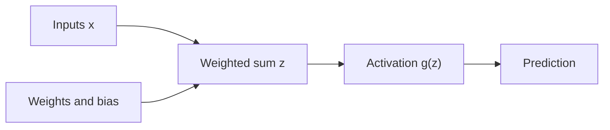
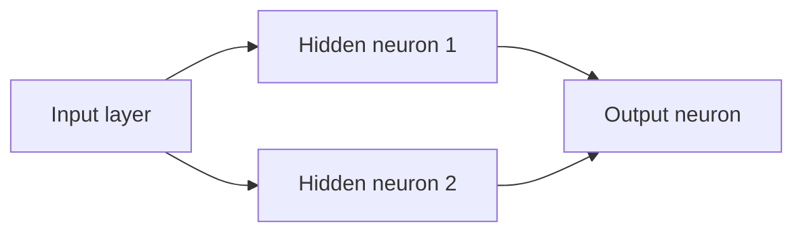
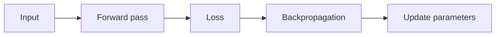
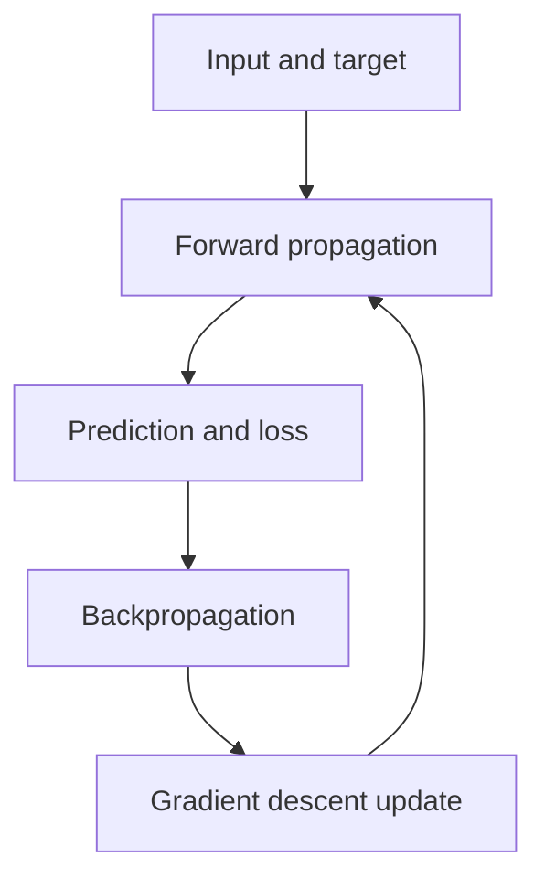

# โครงข่ายประสาทเทียมแบบคลาสสิก (Classical Neural Network)

บทนี้เริ่มจากคำถามง่าย ๆ ว่า หากความสัมพันธ์ระหว่างตัวแปรไม่เป็นเส้นตรง เราจะเพิ่ม Polynomial Features ไปเรื่อย ๆ ได้หรือไม่ ในข้อมูลที่มีตัวแปรเพียงสองตัว วิธีนั้นอาจยังพอใช้ได้ แต่เมื่อข้อมูลเป็นภาพขนาดใหญ่ จำนวนพจน์และจำนวนสัมประสิทธิ์จะเพิ่มขึ้นอย่างรวดเร็ว จนเราไม่สามารถออกแบบ Feature ทุกตัวด้วยมือได้อย่างมีประสิทธิภาพ

Neural Network แก้ปัญหานี้ด้วยการให้โมเดลเรียนรู้ตัวแทนของข้อมูลเป็นลำดับชั้น แต่ละชั้นนำค่าจากชั้นก่อนหน้ามาผสมด้วย Weight และ Bias แล้วผ่าน Activation Function เพื่อสร้าง Feature ใหม่ ก่อนส่งต่อไปยังชั้นถัดไป การฝึกโมเดลจึงมีคำถามสำคัญสามข้อ: โมเดลคำนวณคำตอบอย่างไร วัดความผิดพลาดอย่างไร และรู้ได้อย่างไรว่า Weight แต่ละตัวควรเปลี่ยนไปทางไหน

บทนี้จะตอบคำถามทั้งสามข้อผ่านตัวอย่างเดียวกัน คือการสร้าง Neural Network เพื่อเรียนรู้ฟังก์ชันตรรกะ AND และ XNOR แล้วค่อยขยายแนวคิดไปสู่ Binary Classification และ Multi-class Classification

> **ที่มาของเนื้อหา:** ลำดับหัวข้อและสมการหลักยึดตามสไลด์ Week 9 ส่วนคำอธิบายทีละขั้น ตัวอย่างตัวเลข รูปทั่วไปของ Backpropagation และแนวทางวิเคราะห์ปัญหาเป็นคำอธิบายเพิ่มเติมเพื่อให้เรียนด้วยตนเองได้

---

## 1. ทำไมไม่เพิ่ม Polynomial Features ไปเรื่อย ๆ

สมมติข้อมูลมี Feature จำนวน $n$ ตัว และเราสร้าง Polynomial Features ทุกพจน์ที่มี Degree ไม่เกิน $p$ จำนวนพจน์ทั้งหมด รวม Constant Term จะเท่ากับ

$$N_{terms}=\binom{n+p}{p}=\frac{(n+p)!}{n!p!}$$

ตัวเลขนี้อธิบายปัญหาที่เรียกว่า **Combinatorial Explosion** หรือจำนวนความเป็นไปได้ที่เพิ่มขึ้นเร็วมากเมื่อ $n$ หรือ $p$ เพิ่มขึ้น

ตัวอย่างเช่น หากมี Feature สองตัวคือ $x_1$ และ $x_2$ และใช้ Degree 2 เราจะได้ 6 พจน์ ได้แก่

$$1,\ x_1,\ x_2,\ x_1^2,\ x_1x_2,\ x_2^2$$

จำนวนเพียง 6 พจน์ยังจัดการได้ง่าย แต่ภาพ Grayscale ขนาด $100\times100$ Pixels มี Feature ถึง 10,000 ตัว หากสร้าง Polynomial Features Degree 2 จะมี

$$\binom{10000+2}{2}=50{,}015{,}001$$

พจน์ และหากเป็นภาพสี RGB จำนวน Feature จะเพิ่มเป็น 30,000 ตัว ทำให้ Degree 2 มีมากกว่า 450 ล้านพจน์ ปัญหาไม่ได้มีเพียงเวลาในการคำนวณ แต่ยังรวมถึง Memory, ความเสี่ยงต่อ Overfitting และความยากในการเลือกว่าพจน์ใดมีความหมาย

Neural Network ไม่ได้ทำให้ปัญหาความซับซ้อนหายไป แต่เปลี่ยนจากการกำหนด Feature Combination ล่วงหน้าทุกแบบ มาเป็นการให้โมเดลเรียนรู้ชุดการแปลงที่มีประโยชน์จากข้อมูล การเปลี่ยนแนวคิดนี้คือสะพานจาก Polynomial Model ไปสู่ Representation Learning

> **จุดสำคัญ:** Neural Network ไม่ใช่เพียง Polynomial Regression ที่มีพจน์จำนวนมาก แต่เป็นการประกอบ Linear Transformation และ Nonlinear Activation หลายชั้น ทำให้เรียนรู้รูปแบบที่ซับซ้อนได้โดยไม่ต้องแจกแจงพจน์ Polynomial ทั้งหมดด้วยมือ

---

## 2. จาก Biological Neuron สู่ Artificial Neuron

ชื่อ Neural Network ได้แรงบันดาลใจจากเซลล์ประสาท แต่ Artificial Neuron เป็นแบบจำลองทางคณิตศาสตร์ ไม่ใช่การจำลองสมองอย่างละเอียด สิ่งที่ยืมมาเป็นเพียงแนวคิดว่า หน่วยหนึ่งรับสัญญาณหลายทาง ผสมสัญญาณเหล่านั้น แล้วส่งผลลัพธ์ต่อไป

Artificial Neuron รับ Feature $x_1,x_2,\ldots,x_n$ แต่ละ Feature มี Weight $w_i$ บอกความสำคัญและทิศทางของอิทธิพล จากนั้นรวมค่ากับ Bias $b$

$$z=b+\sum_{i=1}^{n}w_ix_i$$

ค่า $z$ เรียกว่า **Pre-activation** หรือ Weighted Sum จากนั้นนำ $z$ ผ่าน Activation Function $g$ เพื่อได้ Activation หรือ Output ของ Neuron

$$a=g(z)$$

ใน Output Layer เราอาจเขียนผลทำนายเป็น $\hat{y}$ ดังนั้น $\hat{y}=a$ สำหรับ Network ที่มี Output Node เดียว



ให้อ่านภาพจากซ้ายไปขวา ลูกศรหมายถึงค่าที่ถูกส่งไปคำนวณ ไม่ได้หมายถึงลำดับเวลาแบบแยกขาดจากกัน Inputs และ Parameters ถูกใช้ร่วมกันเพื่อสร้าง $z$ แล้ว Activation Function แปลง $z$ เป็น Output

### 2.1 Weight และ Bias ทำหน้าที่ต่างกันอย่างไร

Weight กำหนดว่า Feature แต่ละตัวส่งผลต่อ $z$ มากน้อยและไปในทิศทางใด ถ้า $w_i$ เป็นบวก เมื่อ $x_i$ เพิ่ม ค่า $z$ มีแนวโน้มเพิ่ม ถ้า $w_i$ เป็นลบ ค่า $z$ มีแนวโน้มลด ส่วน Bias เลื่อนจุดตัดหรือ Threshold ของ Neuron โดยไม่ขึ้นกับค่า Input

หากไม่มี Bias เส้นแบ่งการตัดสินใจจะถูกบังคับให้ผ่านจุดกำเนิด ในรูปทั่วไป Decision Boundary ของ Neuron ที่ใช้ Threshold จะเกิดเมื่อ

$$w_1x_1+w_2x_2+b=0$$

ดังนั้น Weight ควบคุมทิศทางของเส้น ส่วน Bias ช่วยเลื่อนตำแหน่งของเส้น

### 2.2 ตัวอย่างคำนวณหนึ่ง Neuron

กำหนด $x_1=1$, $x_2=2$, $w_1=0.5$, $w_2=-0.25$ และ $b=0.1$

$$z=0.1+(0.5)(1)+(-0.25)(2)=0.1$$

ถ้าใช้ Sigmoid Function

$$\sigma(z)=\frac{1}{1+e^{-z}}$$

จะได้

$$\hat{y}=\sigma(0.1)\approx0.525$$

หากตีความเป็น Binary Classification ค่า 0.525 คือ Estimated Probability ของ Class 1 ไม่ใช่คำตอบ 1 โดยตรง เราต้องใช้ Decision Threshold เช่น 0.5 จึงเปลี่ยน Probability เป็น Class Label

---

## 3. Perceptron และข้อจำกัดของเส้นแบ่งแบบเส้นตรง

**Perceptron** ในความหมายกว้างของบทเรียนนี้คือ Network อย่างง่ายที่เชื่อม Input ไปยัง Output โดยตรง เมื่อใช้ Activation แบบ Threshold โมเดลจะตัดสิน Class จากด้านของ Hyperplane ที่ Observation อยู่

สำหรับข้อมูลสองมิติ Hyperplane คือเส้นตรง สำหรับสามมิติคือระนาบ และสำหรับมิติสูงกว่านั้นยังเรียกว่า Hyperplane โมเดลลักษณะนี้จึงแก้ปัญหาที่ **Linearly Separable** ได้ หมายถึงมีเส้นหรือ Hyperplane หนึ่งเส้นที่แยก Class ออกจากกันได้สมบูรณ์

### 3.1 AND แยกด้วยเส้นตรงได้

| $x_1$ | $x_2$ | AND $y$ |
|---:|---:|---:|
| 0 | 0 | 0 |
| 0 | 1 | 0 |
| 1 | 0 | 0 |
| 1 | 1 | 1 |

จุด $(1,1)$ เป็น Class 1 เพียงจุดเดียว เราสามารถวาดเส้นตรงแยกจุดนี้ออกจากอีกสามจุดได้ ตัวอย่าง Rule คือให้ทำนาย 1 เมื่อ $x_1+x_2-1.5>0$ จึงใช้ Weight $w_1=w_2=1$ และ Bias $b=-1.5$ ได้

### 3.2 XNOR แยกด้วยเส้นตรงเส้นเดียวไม่ได้

| $x_1$ | $x_2$ | XNOR $y$ |
|---:|---:|---:|
| 0 | 0 | 1 |
| 0 | 1 | 0 |
| 1 | 0 | 0 |
| 1 | 1 | 1 |

XNOR ให้ค่า 1 เมื่อ Input ทั้งสองเท่ากัน จุด Class 1 จึงอยู่คนละมุมของสี่เหลี่ยม ไม่มีเส้นตรงเพียงเส้นเดียวที่แยกสองจุดนี้ออกจาก Class 0 ได้ นี่ไม่ใช่ปัญหาว่า Training ยังไม่ดีพอ แต่เป็นข้อจำกัดของ Hypothesis Class ของ Single-layer Model

ทางออกคือสร้าง Hidden Layer ให้ Neuron หลายตัวเรียนรู้เส้นแบ่งย่อย แล้วให้ Output Layer รวมผลของเส้นเหล่านั้น การเพิ่มชั้นเพียงอย่างเดียวยังไม่พอ เราต้องมี Nonlinear Activation ด้วย มิฉะนั้น Linear Transformation หลายชั้นจะยุบรวมเป็น Linear Transformation เดียวได้

$$W_2(W_1x+b_1)+b_2=(W_2W_1)x+(W_2b_1+b_2)$$

สมการนี้แสดงว่า ถ้าไม่มี Nonlinearity จำนวนชั้นที่เพิ่มขึ้นไม่ได้ทำให้เส้นแบ่งซับซ้อนขึ้น

---

## 4. Multilayer Perceptron: Network ที่มี Hidden Layer

**Multilayer Perceptron (MLP)** ประกอบด้วย Input Layer, Hidden Layer อย่างน้อยหนึ่งชั้น และ Output Layer

- **Input Layer** รับ Feature โดยปกติไม่ได้เรียนรู้การแปลงเอง
- **Hidden Layer** สร้าง Representation ใหม่จาก Activation ของชั้นก่อนหน้า
- **Output Layer** แปลง Representation สุดท้ายเป็นค่าทำนายที่สอดคล้องกับงาน เช่น Probability ของสอง Class หรือ Probability Distribution ของหลาย Class



ภาพนี้ละ Bias Nodes เพื่อให้อ่านง่าย ในการคำนวณจริงแต่ละ Neuron มักมี Bias ของตัวเอง และลูกศรแต่ละเส้นมี Weight ที่ต้องเรียนรู้

### 4.1 Notation ของ Network

ให้ $a_j^{(l)}$ หมายถึง Activation ของ Node $j$ ใน Layer $l$ และ $w_{i,j}^{(l)}$ หมายถึง Weight ที่เชื่อมจาก Node $j$ ใน Layer $l$ ไปยัง Node $i$ ใน Layer $l+1$ ดังนั้น

$$z_i^{(l+1)}=b_i^{(l)}+\sum_j w_{i,j}^{(l)}a_j^{(l)}$$

$$a_i^{(l+1)}=g(z_i^{(l+1)})$$

สำหรับ Input Layer เรากำหนด $a_j^{(1)}=x_j$ เพื่อให้ใช้สมการเดียวกันต่อเนื่องทุกชั้น

จุดที่มักสับสนคือ Superscript ใน $w_{i,j}^{(l)}$ ไม่ใช่เลขยกกำลัง แต่เป็นหมายเลข Layer ของ Connection ส่วน Subscript $i,j$ บอกปลายทางและต้นทางตามลำดับ การกำหนด Convention อาจต่างกันระหว่างตำรา จึงควรอ่านนิยามก่อนใช้สูตรเสมอ

สไลด์ใช้สัญลักษณ์ $\theta_{i,j}^{(l)}$ สำหรับ Parameter ที่เชื่อม Nodes บทเรียนนี้ใช้ $w_{i,j}^{(l)}$ เพื่อเน้นว่าเป็น Weight ทั้งสองสัญลักษณ์หมายถึง Parameter ชนิดเดียวกัน ส่วน Bias แยกเขียนเป็น $b_i^{(l)}$

### 4.2 Vector Form

เมื่อคำนวณจริง เรารวมค่าของทั้ง Layer เป็น Vector และ Matrix

$$z^{(l+1)}=W^{(l)}a^{(l)}+b^{(l)}$$

$$a^{(l+1)}=g(z^{(l+1)})$$

สมมติ Layer $l$ มี 2 Nodes และ Layer $l+1$ มี 3 Nodes แล้ว $W^{(l)}$ จะมี Shape $3\times2$ เพราะแต่ละแถวเป็น Weight ที่เข้าหา Node ปลายทางหนึ่งตัว การตรวจ Shape เป็นวิธี Debug Neural Network ที่สำคัญมาก

---

## 5. Forward Propagation: จาก Input ไปเป็น Prediction

**Forward Propagation** หรือ Forward Pass คือการคำนวณจาก Input ผ่าน Network ทีละชั้นจนได้ Prediction ยังไม่มีการแก้ Weight ในขั้นนี้

สำหรับ Network ที่มี Input 2 ตัว, Hidden Layer 2 Nodes และ Output 1 Node:

$$z_1^{(2)}=b_1^{(1)}+w_{1,1}^{(1)}x_1+w_{1,2}^{(1)}x_2$$

$$a_1^{(2)}=\sigma(z_1^{(2)})$$

$$z_2^{(2)}=b_2^{(1)}+w_{2,1}^{(1)}x_1+w_{2,2}^{(1)}x_2$$

$$a_2^{(2)}=\sigma(z_2^{(2)})$$

จากนั้น Output Node รับ Hidden Activations ทั้งสอง

$$z_1^{(3)}=b_1^{(2)}+w_{1,1}^{(2)}a_1^{(2)}+w_{1,2}^{(2)}a_2^{(2)}$$

$$\hat{y}=a_1^{(3)}=\sigma(z_1^{(3)})$$

### 5.1 Worked Example ของ Forward Pass

ให้ Input $x=(1,0)$ และกำหนด Parameters ดังนี้

$$W^{(1)}=\begin{bmatrix}1&-1\\0.5&0.5\end{bmatrix},\quad b^{(1)}=\begin{bmatrix}0\\-0.5\end{bmatrix}$$

Hidden Pre-activation คือ

$$z^{(2)}=W^{(1)}x+b^{(1)}=\begin{bmatrix}1\\0\end{bmatrix}$$

เมื่อใช้ Sigmoid จะได้

$$a^{(2)}\approx\begin{bmatrix}0.731\\0.500\end{bmatrix}$$

กำหนด Output Parameters เป็น

$$W^{(2)}=\begin{bmatrix}1&-1\end{bmatrix},\quad b^{(2)}=0$$

ดังนั้น

$$z^{(3)}=(1)(0.731)+(-1)(0.500)=0.231$$

$$\hat{y}=\sigma(0.231)\approx0.557$$

ถ้า Threshold เท่ากับ 0.5 โมเดลทำนาย Class 1 แต่ก่อนสรุปว่าดีหรือไม่ เราต้องเปรียบเทียบ $\hat{y}$ กับคำตอบจริง $y$ ผ่าน Loss Function

---

## 6. Loss Function: โมเดลผิดมากเพียงใด

สำหรับ Binary Classification ที่ Output เป็น Probability จาก Sigmoid เรามักใช้ **Binary Cross-Entropy (BCE)**

$$J=-y\log(\hat{y})-(1-y)\log(1-\hat{y})$$

สไลด์ใช้ $J$ กับตัวอย่างหนึ่ง Observation ในทางปฏิบัติอาจใช้คำว่า Loss สำหรับหนึ่งตัวอย่าง และ Cost หรือ Objective สำหรับค่าเฉลี่ยของหลายตัวอย่าง

ถ้า $y=1$ สมการจะเหลือ

$$J=-\log(\hat{y})$$

ถ้าโมเดลให้ $\hat{y}$ ใกล้ 1 ค่า Loss จะเล็ก แต่ถ้าให้ค่าใกล้ 0 Loss จะสูงมาก ในทางกลับกัน ถ้า $y=0$ สมการจะเหลือ $J=-\log(1-\hat{y})$ จึงลงโทษการทำนาย Probability ใกล้ 1 อย่างรุนแรง

ตัวอย่างก่อนหน้าให้ $\hat{y}=0.557$ หากคำตอบจริงคือ $y=1$

$$J=-\log(0.557)\approx0.585$$

หากโมเดลมั่นใจถูกมากขึ้นเป็น $\hat{y}=0.95$ Loss จะลดเหลือประมาณ 0.051 แต่หากมั่นใจผิดเป็น $\hat{y}=0.05$ Loss จะเพิ่มเป็นประมาณ 2.996

**Cross-Entropy ไม่ใช่ Error Matrix** ทั้งสองอย่างทำหน้าที่ต่างกัน Cross-Entropy เป็นตัวเลขที่ใช้เป็น Objective ระหว่าง Training และเปลี่ยนอย่างต่อเนื่องตาม Probability ส่วน Confusion Matrix เป็นตารางนับผลทำนายถูกและผิดหลังแปลง Probability เป็น Class แล้ว จึงใช้วิเคราะห์ชนิดของความผิดพลาด เช่น False Positive และ False Negative

---

## 7. Backpropagation: Weight ตัวใดควรรับผิดชอบต่อความผิดพลาด

เมื่อรู้ค่า Loss แล้ว เราต้องหาว่าหากปรับ Weight แต่ละตัวเล็กน้อย Loss จะเปลี่ยนอย่างไร ปริมาณนี้คือ Gradient

$$\frac{\partial J}{\partial w_{i,j}^{(l)}}$$

**Backpropagation** เป็น Algorithm สำหรับคำนวณ Gradient ของ Parameters ทุกตัวอย่างมีประสิทธิภาพ โดยใช้ Chain Rule ไล่ย้อนจาก Output Layer กลับไปยังชั้นก่อนหน้า ชื่อ Backpropagation หมายถึงการส่งข้อมูลความผิดพลาดย้อนกลับเพื่อคำนวณ Gradient ไม่ใช่การส่ง Prediction ย้อนกลับ และยังไม่ใช่ขั้นตอน Update Weight เอง



Forward Pass คำนวณ Activation และ Prediction, Loss เปรียบเทียบ Prediction กับ Target, Backpropagation คำนวณ Gradient และ Optimizer ใช้ Gradient เพื่อ Update Parameters

### 7.1 Chain Rule ที่ Output Layer

สำหรับ Weight ที่เชื่อม Hidden Node $j$ ไปยัง Output Node $i$ เราแยกอนุพันธ์เป็นส่วนย่อย

$$\frac{\partial J}{\partial w_{i,j}^{(l)}}=\frac{\partial J}{\partial a_i^{(l+1)}}\frac{\partial a_i^{(l+1)}}{\partial z_i^{(l+1)}}\frac{\partial z_i^{(l+1)}}{\partial w_{i,j}^{(l)}}$$

เมื่อใช้ Sigmoid ร่วมกับ Binary Cross-Entropy พจน์ต่าง ๆ จะยุบเหลือ Error Term ที่เรียบง่ายมาก

$$\delta_i^{(L)}=a_i^{(L)}-y_i$$

สำหรับ Network ที่มี Output เดียวคือ

$$\delta^{(L)}=\hat{y}-y$$

และ Gradient ของ Weight ที่เข้าสู่ Output คือ

$$\frac{\partial J}{\partial w_{i,j}^{(L-1)}}=\delta_i^{(L)}a_j^{(L-1)}$$

ส่วน Gradient ของ Bias คือ

$$\frac{\partial J}{\partial b_i^{(L-1)}}=\delta_i^{(L)}$$

เหตุผลที่ Activation ของ Node ต้นทางปรากฏใน Gradient มาจาก $z_i=\sum_jw_{i,j}a_j+b_i$ ทำให้ $\partial z_i/\partial w_{i,j}=a_j$ ถ้า Node ต้นทางส่งค่าใกล้ศูนย์ Weight เส้นนั้นก็มีผลต่อ Output น้อยในตัวอย่างนั้น

### 7.2 ส่ง Error กลับสู่ Hidden Layer

Hidden Node ไม่มี Target Label โดยตรง เราจึงหาความรับผิดชอบของมันจากสองส่วน: Error ของ Nodes ในชั้นถัดไปที่มันส่งค่าไปหา และความไวของ Activation ของมันเอง

สำหรับ Hidden Node $j$ ใน Layer $l$:

$$\delta_j^{(l)}=g'(z_j^{(l)})\sum_iw_{i,j}^{(l)}\delta_i^{(l+1)}$$

ถ้าใช้ Sigmoid

$$g'(z_j^{(l)})=a_j^{(l)}(1-a_j^{(l)})$$

จึงได้

$$\delta_j^{(l)}=a_j^{(l)}(1-a_j^{(l)})\sum_iw_{i,j}^{(l)}\delta_i^{(l+1)}$$

เมื่อมี Output Node เดียว ผลรวมจะเหลือเพียงหนึ่งพจน์ จึงดูเหมือนสูตรในสไลด์ แต่สูตรที่มีเครื่องหมาย Sum เป็นรูปทั่วไปที่ใช้ได้เมื่อชั้นถัดไปมีหลาย Nodes

หลังหา Delta ของ Hidden Node แล้ว Gradient ของ Weight ยังคงมีโครงสร้างเดิม

$$\frac{\partial J}{\partial w_{j,k}^{(l-1)}}=\delta_j^{(l)}a_k^{(l-1)}$$

จุดนี้คือความสวยงามของ Backpropagation: ทุก Layer ใช้รูปแบบซ้ำกัน คือ Error ของ Node ปลายทางคูณ Activation ของ Node ต้นทาง

### 7.3 ทำไมเรียกว่า Backpropagation

ลำดับการคำนวณจริงมีดังนี้

1. เก็บค่า $z$ และ $a$ จาก Forward Pass ทุก Layer
2. คำนวณ Output Error $\delta^{(L)}$
3. ใช้ Weight เดิมและอนุพันธ์ของ Activation ส่ง Error ย้อนกลับเป็น $\delta^{(L-1)},\delta^{(L-2)},\ldots$
4. ใช้ Delta กับ Activation ที่เก็บไว้เพื่อคำนวณ Gradient ของทุก Weight และ Bias

ควรคำนวณ Gradient ให้ครบก่อน Update Parameters เพราะถ้าเปลี่ยน Weight ระหว่างกำลังส่ง Error ย้อนกลับ สูตรส่วนหลังจะใช้ Parameters คนละชุดกัน

---

## 8. Gradient Descent และการ Update Weight

เมื่อได้ Gradient แล้ว เราปรับ Parameter ไปในทิศตรงข้ามกับ Gradient เพราะ Gradient ชี้ทิศที่ Loss เพิ่มเร็วที่สุด

$$w_{i,j}^{(l)}\leftarrow w_{i,j}^{(l)}-\alpha\frac{\partial J}{\partial w_{i,j}^{(l)}}$$

$$b_i^{(l)}\leftarrow b_i^{(l)}-\alpha\frac{\partial J}{\partial b_i^{(l)}}$$

$\alpha$ คือ **Learning Rate** ซึ่งควบคุมขนาดของการก้าวแต่ละครั้ง

- ถ้า $\alpha$ เล็กเกินไป Loss อาจลดลงช้าและใช้เวลาฝึกนาน
- ถ้า $\alpha$ ใหญ่เกินไป อาจก้าวข้ามบริเวณที่ดี ทำให้ Loss แกว่งหรือ Diverge
- Learning Rate ที่เหมาะสมขึ้นกับ Scale ของข้อมูล, Architecture, Initialization, Optimizer และ Batch Size

### 8.1 ตัวอย่าง Update หนึ่ง Weight

สมมติ Output $\hat{y}=0.557$, Target $y=1$, Activation จาก Hidden Node ตัวแรกเท่ากับ 0.731 และ Learning Rate เท่ากับ 0.1

$$\delta^{(L)}=0.557-1=-0.443$$

Gradient ของ Weight ที่เชื่อม Hidden Node นี้ไป Output คือ

$$\frac{\partial J}{\partial w}=(-0.443)(0.731)\approx-0.324$$

ถ้า Weight เดิมเท่ากับ 1

$$w_{new}=1-(0.1)(-0.324)=1.0324$$

Weight เพิ่มขึ้น เพราะตัวอย่างนี้มี Target เป็น 1 แต่โมเดลให้ Probability เพียง 0.557 การเพิ่ม Weight ที่รับ Activation บวกจาก Hidden Node นี้มีแนวโน้มเพิ่ม Output Logit และ Probability ของ Class 1 ในรอบถัดไป นี่คือการตีความเครื่องหมายของ Gradient ไม่ใช่เพียงแทนตัวเลขตามสูตร

### 8.2 Training Loop ฉบับสมบูรณ์

```text
initialize weights and biases
repeat for each epoch:
    choose a batch of training observations
    forward pass to compute predictions
    compute loss
    backpropagate to compute gradients
    update weights and biases
evaluate on validation data
```

หนึ่ง **Epoch** หมายถึงโมเดลได้ใช้ Training Observations ครบหนึ่งรอบ ส่วน **Batch** คือกลุ่มตัวอย่างที่ใช้คำนวณ Gradient หนึ่งครั้ง ถ้าใช้หนึ่งตัวอย่างต่อครั้งเรียก Stochastic Gradient Descent ในความหมายดั้งเดิม ถ้าใช้ข้อมูลทั้งหมดเรียก Batch Gradient Descent และการใช้กลุ่มขนาดกลางเรียก Mini-batch Gradient Descent ซึ่งเป็นรูปแบบที่นิยมใน Neural Network

---

## 9. Activation Functions

Activation Function เป็นส่วนที่เพิ่ม Nonlinearity ให้ Network หากไม่มีส่วนนี้ หลาย Layers จะยุบเหลือ Linear Model เดียวได้ตามที่พิสูจน์ไว้ก่อนหน้า Activation Function ยังมีผลต่อ Range ของค่าที่ส่งต่อ ความง่ายในการหาอนุพันธ์ และการไหลของ Gradient

### 9.1 Sigmoid

$$\sigma(z)=\frac{1}{1+e^{-z}}$$

Output อยู่ในช่วง $(0,1)$ จึงเหมาะกับ Output Node ของ Binary Classification แต่ใน Hidden Layers ค่าอนุพันธ์อาจเล็กมากเมื่อ $|z|$ สูง ทำให้ Gradient ย้อนกลับไปยังชั้นต้น ๆ เล็กลง ปัญหานี้เรียกว่า Vanishing Gradient

### 9.2 Hyperbolic Tangent หรือ Tanh

$$\tanh(z)=\frac{e^z-e^{-z}}{e^z+e^{-z}}$$

Output อยู่ในช่วง $(-1,1)$ และมีจุดกึ่งกลางที่ศูนย์ แต่ยังเกิด Saturation และ Vanishing Gradient ได้เมื่อ $|z|$ สูง

### 9.3 ReLU

$$\mathrm{ReLU}(z)=\max(0,z)$$

ReLU คำนวณง่ายและมี Gradient เท่ากับ 1 ในด้านบวก จึงมักใช้ใน Hidden Layers อย่างไรก็ตาม ถ้า Neuron อยู่ด้านลบตลอด Gradient จะเป็นศูนย์และอาจหยุดเรียนรู้ เรียกว่า Dying ReLU

### 9.4 Leaky ReLU

กำหนดค่าคงที่เล็ก ๆ $c>0$ เช่น 0.01

$$g(z)=\max(cz,z)$$

ด้านลบจึงยังมี Slope เล็กน้อย ช่วยลดความเสี่ยงที่ Neuron จะไม่มี Gradient ตลอดเวลา

| Activation | Output range | การใช้ทั่วไป | จุดที่ควรระวัง |
|---|---|---|---|
| Sigmoid | $(0,1)$ | Binary Output | Saturation, Vanishing Gradient |
| Tanh | $(-1,1)$ | Hidden Layer ในโมเดลแบบเก่า | Saturation |
| ReLU | $[0,\infty)$ | Hidden Layer | Dying ReLU |
| Leaky ReLU | $(-\infty,\infty)$ | Hidden Layer | ต้องกำหนด Negative Slope |

คำว่า Activation Function ที่ “ดีที่สุด” ไม่มีคำตอบเดียว ต้องเลือกตามตำแหน่งใน Network และชนิดของ Target โดยเฉพาะ Output Activation ต้องสอดคล้องกับความหมายของผลทำนายและ Loss Function

---

## 10. Softmax สำหรับ Multi-class Classification

Binary Classification ใช้ Output Node เดียวกับ Sigmoid ได้ แต่ถ้ามี $K$ Classes ที่เลือกได้เพียง Class เดียว เช่น จำแนกรูปเป็นแมว สุนัข หรือนก เราต้องการ Probability $K$ ค่าและผลรวมเท่ากับ 1

Network สร้างคะแนนดิบของแต่ละ Class เรียกว่า **Logit** โดยใช้ $z_1,z_2,\ldots,z_K$ แล้ว Softmax แปลงเป็น Probability

$$\hat{p}_k=\frac{e^{z_k}}{\sum_{j=1}^{K}e^{z_j}}$$

เพราะทุกพจน์เป็นบวกและหารด้วยผลรวมเดียวกัน เราจึงได้ $0<\hat{p}_k<1$ และ

$$\sum_{k=1}^{K}\hat{p}_k=1$$

### 10.1 Worked Example

สมมติ Logits ของสาม Classes คือ $[2,1,0]$ จะได้ค่าประมาณ

$$e^2=7.389,\quad e^1=2.718,\quad e^0=1$$

ผลรวมเท่ากับ 11.107 ดังนั้น Softmax Probabilities คือประมาณ

$$[0.665,\ 0.245,\ 0.090]$$

โมเดลจึงทำนาย Class แรก แต่ยังแสดงระดับความมั่นใจต่อ Classes อื่นด้วย ในการคำนวณจริงควรลบ Logit ที่มากที่สุดออกจากทุกค่า ก่อนหา Exponential เพื่อป้องกัน Numerical Overflow การลบค่าคงที่เดียวกันไม่เปลี่ยน Softmax Probability

สำหรับ Multi-class Classification มักจับคู่ Softmax กับ Categorical Cross-Entropy

$$J=-\sum_{k=1}^{K}y_k\log(\hat{p}_k)$$

เมื่อ Target เป็น One-hot Vector ผลรวมจะเหลือเฉพาะ Negative Log Probability ของ Class ที่ถูกต้อง

> **แยกให้ออก:** Softmax ใช้เมื่อแต่ละ Observation อยู่ได้หนึ่ง Class จากหลาย Classes ส่วน Multi-label Classification ที่หนึ่ง Observation มีหลาย Labels พร้อมกัน มักใช้ Sigmoid แยกแต่ละ Output Node

---

## 11. การฝึก AND และ XNOR สอนอะไรเรา

AND แสดงให้เห็นว่า Single Neuron สามารถเรียนรู้ Decision Boundary แบบเส้นตรงได้ ส่วน XNOR ทำให้เห็นว่าบางปัญหาไม่ Linearly Separable และต้องใช้ Hidden Layer ร่วมกับ Nonlinear Activation

Hidden Nodes ไม่จำเป็นต้องมีความหมายที่มนุษย์ตั้งชื่อได้เสมอ แต่แต่ละ Node เรียนรู้การตอบสนองต่อรูปแบบบางส่วนของ Input จากนั้น Output Layer จึงผสมรูปแบบเหล่านั้นอีกครั้ง ในภาพจริง แนวคิดเดียวกันขยายจาก Pixel ไปเป็นขอบ รูปร่าง และรูปแบบที่ซับซ้อนขึ้น แม้รายละเอียดของ Architecture สมัยใหม่จะอยู่นอกขอบเขตของบท Classical Network นี้

อย่างไรก็ตาม การมี Hidden Layer ไม่รับประกันว่าโมเดลจะเรียนรู้ได้ดี ผลลัพธ์ยังขึ้นกับ Data, Initialization, Feature Scaling, Learning Rate, จำนวน Nodes, จำนวน Layers, Loss Function และจำนวน Epochs การประเมินต้องใช้ Validation หรือ Test Data ที่ไม่ถูกใช้ในการ Update Weight

---

## 12. ปัญหาที่พบบ่อยและวิธีคิดแก้ไข

### 12.1 Loss ไม่ลดลง

เริ่มจากตรวจว่า Label และ Output Activation ตรงกับงานหรือไม่ เช่น Binary Classification ควรใช้ Sigmoid Output ร่วมกับ Binary Cross-Entropy จากนั้นตรวจ Data Scale, Learning Rate, Shape ของ Matrix, การใส่ Bias และเครื่องหมายของ Weight Update ถ้าใช้บวก Gradient แทนลบ Gradient โมเดลจะเดินขึ้นเนินแทนลงเนิน

### 12.2 Training ดีมาก แต่ Validation แย่

นี่เป็นสัญญาณของ Overfitting โมเดลอาจมี Parameters มากเกินเมื่อเทียบกับข้อมูล วิธีรับมือรวมถึงลดขนาด Network, ใช้ Regularization, Early Stopping, เพิ่มข้อมูลที่เป็นตัวแทนของ Population หรือปรับ Feature และ Data Quality ไม่ควรดู Training Accuracy เพียงค่าเดียว

### 12.3 Gradient เล็กมาก

ใน Deep Network ที่ใช้ Sigmoid หรือ Tanh หลายชั้น อนุพันธ์ที่น้อยกว่า 1 ถูกคูณกันซ้ำ ๆ ทำให้ Gradient ชั้นต้นเล็กมาก วิธีพื้นฐานคือใช้ Activation ที่เหมาะสม เช่น ReLU, Initialization ที่เหมาะสม และ Feature Scaling

### 12.4 Output เป็น NaN

สาเหตุอาจมาจาก Learning Rate ใหญ่, Exponential Overflow, การหา $\log(0)$ หรือ Input มี NaN อยู่ก่อนแล้ว ในทางปฏิบัติ Framework มักรวม Sigmoid กับ Cross-Entropy หรือ Softmax กับ Cross-Entropy ในฟังก์ชันที่ Stable กว่าการคำนวณทีละส่วน

### 12.5 Accuracy สูงแต่โมเดลยังไม่ดี

ถ้า Class Imbalanced โมเดลอาจทำนาย Class ใหญ่เกือบทั้งหมดแล้วได้ Accuracy สูง ควรอ่าน Confusion Matrix, Precision, Recall, F1-score และพิจารณา Threshold ตามต้นทุนของ False Positive กับ False Negative

---

## 13. Neural Network ต่างจาก Linear และ Logistic Regression อย่างไร

| ประเด็น | Linear Regression | Logistic Regression | Neural Network |
|---|---|---|---|
| Output หลัก | ค่าต่อเนื่อง | Probability ของ Class | ขึ้นกับ Output Layer |
| ความสัมพันธ์พื้นฐาน | เชิงเส้นใน Parameters | Linear Logit + Sigmoid | หลาย Linear Transformations + Nonlinear Activations |
| Feature Interaction | ต้องสร้างเพิ่มเอง | ต้องสร้างเพิ่มเอง | Hidden Layers เรียนรู้ Representation ได้ |
| การตีความ | ค่อนข้างตรงไปตรงมา | Coefficient แปลผ่าน Log-odds | Parameters จำนวนมาก ตีความยากกว่า |
| การฝึก | Normal Equation หรือ Gradient Descent | Optimization | Forward Pass + Backpropagation + Optimizer |
| ความเสี่ยง | Underfit เมื่อรูปแบบซับซ้อน | Underfit เมื่อ Boundary ไม่เชิงเส้น | Overfit และ Training ยากขึ้น |

Logistic Regression หนึ่งโมเดลสามารถมองเป็น Neural Network ที่ไม่มี Hidden Layer และมี Sigmoid Output ได้ ความแตกต่างสำคัญจึงไม่ใช่ว่า Neural Network ใช้ Sigmoid แต่คือการมี Hidden Representations และ Nonlinear Composition หลายชั้น

---

## 14. ประวัติศาสตร์แบบเข้าใจเหตุและผล

แนวคิด Neural Network พัฒนามาหลายช่วง ไม่ได้เกิดขึ้นพร้อม Deep Learning สมัยใหม่ จุดสำคัญที่ช่วยเชื่อมเนื้อหาในบทนี้มีดังนี้

- McCulloch และ Pitts เสนอแบบจำลอง Neuron เชิงตรรกะในปี 1943 ทำให้การทำงานแบบรับสัญญาณและตัดสินใจเขียนเป็นคณิตศาสตร์ได้
- Rosenblatt พัฒนา Perceptron ในทศวรรษ 1950 เพื่อเรียนรู้ Weight จากข้อมูล แต่ Single-layer Perceptron มีข้อจำกัดกับปัญหาที่ไม่ Linearly Separable
- งานด้าน Backpropagation ในช่วงทศวรรษ 1970-1980 ทำให้ฝึก Multilayer Networks ได้เป็นระบบ โดย Chain Rule กระจายความรับผิดชอบของ Error ไปยัง Parameters จำนวนมาก
- การเติบโตของข้อมูล, Compute และเทคนิคการฝึกทำให้ Neural Network กลับมาโดดเด่น และพัฒนาต่อเป็นสถาปัตยกรรมเฉพาะทาง เช่น Convolutional, Recurrent และ Transformer Networks

ประวัติศาสตร์ส่วนนี้ควรจำเป็นเหตุผล: ข้อจำกัดของ Linear Separator ทำให้ต้องมี Hidden Layers และการมีหลาย Layers ทำให้ต้องมีวิธีคำนวณ Gradient ที่มีประสิทธิภาพ ซึ่ง Backpropagation เป็นคำตอบ

---

## 15. สรุปกลไกทั้งบทในภาพเดียว



วงจรเริ่มจาก Input และ Target Forward Propagation สร้าง Prediction จาก Parameters ปัจจุบัน Loss วัดความไม่สอดคล้องกับ Target Backpropagation หา Gradient และ Gradient Descent เปลี่ยน Parameters แล้วเริ่มรอบใหม่ จุดสำคัญคือ Backpropagation ไม่ได้เลือกค่าที่ดีที่สุดโดยตรง แต่บอกความชันเฉพาะจุด ส่วน Optimizer เป็นผู้ใช้ข้อมูลนั้นเพื่อก้าวไปยังค่าที่คาดว่าจะลด Loss

### สูตรหลักที่ควรเชื่อมโยงกันได้

1. Weighted Sum: $z^{(l+1)}=W^{(l)}a^{(l)}+b^{(l)}$
2. Activation: $a^{(l+1)}=g(z^{(l+1)})$
3. Binary Cross-Entropy: $J=-y\log(\hat{y})-(1-y)\log(1-\hat{y})$
4. Output Delta สำหรับ Sigmoid + BCE: $\delta^{(L)}=a^{(L)}-y$
5. Hidden Delta: $\delta^{(l)}=g'(z^{(l)})(W^{(l)})^T\delta^{(l+1)}$
6. Weight Gradient: $\partial J/\partial W^{(l)}=\delta^{(l+1)}(a^{(l)})^T$
7. Update: $W^{(l)}\leftarrow W^{(l)}-\alpha\partial J/\partial W^{(l)}$

สูตรเหล่านี้ไม่ใช่หัวข้อแยกจากกัน แต่เป็นวงจรเดียว: สมการ 1-2 สร้าง Prediction, สมการ 3 วัด Error, สมการ 4-6 ส่ง Error ย้อนกลับเป็น Gradient และสมการ 7 ใช้ Gradient ปรับโมเดล

---

## 16. Likely Exam Focus

หัวข้อต่อไปนี้เป็นการคาดการณ์จากจุดที่สไลด์เน้น ไม่ใช่ข้อมูลข้อสอบจริง

- อธิบายว่าเหตุใด Polynomial Features จึงไม่ Scale กับข้อมูลมิติสูง
- วาดและอธิบาย Input Layer, Hidden Layer, Output Layer, Weight, Bias, $z$ และ $a$
- คำนวณ Forward Pass ของ Network ขนาดเล็ก
- อธิบายว่า AND ต่างจาก XNOR ในแง่ Linear Separability อย่างไร
- อธิบายลำดับ Training Process: Forward Pass, Loss, Backpropagation และ Weight Update
- ใช้ Chain Rule หา Gradient ของ Weight ที่ Output Layer
- อธิบายความหมายของ $\delta$, Learning Rate และเครื่องหมายลบใน Gradient Descent
- เปรียบเทียบ Sigmoid, Tanh, ReLU และ Leaky ReLU
- คำนวณ Softmax อย่างง่ายและอธิบายว่าทำไมผลรวมเป็น 1

---

## 17. คำถามฝึกตอบพร้อมแนวคำตอบ

### ข้อ 1: เพราะเหตุใด Neural Network จึงน่าสนใจกว่าการสร้าง Polynomial Features ทุกพจน์สำหรับภาพ

**แนวคำตอบ:** จำนวน Polynomial Features เพิ่มแบบ Combinatorial ตาม $\binom{n+p}{p}$ เมื่อภาพมี Pixels จำนวนมาก แม้ Degree ต่ำก็สร้าง Parameters จำนวนมหาศาล ทำให้ใช้ Memory และเวลาเพิ่ม เสี่ยง Overfitting และต้องกำหนด Interaction ล่วงหน้า Neural Network ใช้ Hidden Layers เรียนรู้ Representation ที่เป็นประโยชน์จากข้อมูลผ่าน Weight และ Nonlinear Activation จึงไม่ต้องแจกแจง Polynomial ทุกพจน์ด้วยมือ อย่างไรก็ตามยังต้องควบคุมขนาด Network และประเมิน Generalization

### ข้อ 2: เหตุใด XNOR จึงต้องการโมเดลที่ซับซ้อนกว่า AND

**แนวคำตอบ:** AND มี Positive Class ที่จุด $(1,1)$ เพียงจุดเดียว จึงใช้เส้นตรงหนึ่งเส้นแยกจาก Negative Class ได้ แต่ XNOR มี Positive Class ที่ $(0,0)$ และ $(1,1)$ ซึ่งอยู่คนละมุม ไม่มีเส้นตรงเส้นเดียวแยกจากอีกสองจุดได้ จึงต้องใช้ Hidden Nodes สร้างเส้นแบ่งย่อยหลายเส้นและใช้ Nonlinear Activation ก่อนรวมผลที่ Output Layer

### ข้อ 3: Forward Propagation, Backpropagation และ Gradient Descent ต่างกันอย่างไร

**แนวคำตอบ:** Forward Propagation ใช้ Parameters ปัจจุบันคำนวณ Activation จาก Input ไปยัง Prediction Backpropagation ใช้ Chain Rule คำนวณว่า Loss ไวต่อ Parameter แต่ละตัวเพียงใด โดยส่ง Error ย้อนจาก Output ไป Hidden Layers ส่วน Gradient Descent ใช้ Gradient ที่ได้มา Update Parameters ในทิศที่ลด Loss ทั้งสามส่วนจึงทำงานต่อเนื่องแต่ไม่ใช่กระบวนการเดียวกัน

### ข้อ 4: แสดงเหตุผลว่า Output Delta ของ Sigmoid ร่วมกับ Binary Cross-Entropy เท่ากับ $\hat{y}-y$

**แนวคำตอบ:** เริ่มจาก $J=-y\log(a)-(1-y)\log(1-a)$ และ $a=\sigma(z)$ จะได้ $\partial J/\partial a=-y/a+(1-y)/(1-a)$ ขณะที่ $\partial a/\partial z=a(1-a)$ เมื่อนำมาคูณตาม Chain Rule และจัดรูป พจน์ $a$ กับ $1-a$ ตัดกัน เหลือ $\partial J/\partial z=a-y=\hat{y}-y$ ผลลัพธ์นี้ทำให้การคำนวณ Output Error เรียบง่าย

### ข้อ 5: ถ้าใช้ Linear Activation ทุก Layer การเพิ่ม Hidden Layers ช่วยให้ Decision Boundary ไม่เป็นเส้นตรงหรือไม่

**แนวคำตอบ:** ไม่ช่วย เพราะ Composition ของ Linear Transformations ยังเป็น Linear Transformation เช่น $W_2(W_1x+b_1)+b_2$ จัดรูปเป็น $W'x+b'$ ได้ Network จึงเทียบเท่า Linear Layer เดียว Nonlinear Activation เป็นสิ่งที่ทำให้หลาย Layers สร้างความสัมพันธ์ซับซ้อนได้

### ข้อ 6: Softmax และ Sigmoid ควรใช้ต่างกันอย่างไร

**แนวคำตอบ:** Sigmoid แปลง Logit แต่ละค่าเป็น Probability อย่างอิสระ จึงใช้กับ Binary Output หรือ Multi-label Classification ที่หลาย Labels เป็นจริงพร้อมกันได้ Softmax ทำให้ Probabilities ของทุก Classes แข่งขันกันและรวมเป็น 1 จึงเหมาะกับ Multi-class Classification ที่หนึ่ง Observation อยู่ได้เพียงหนึ่ง Class

### ข้อ 7: หาก Training Loss ลดลง แต่ Validation Loss เพิ่มขึ้น ควรตีความอย่างไร

**แนวคำตอบ:** โมเดลกำลัง Fit Training Data ดีขึ้นแต่ Generalize ไปยังข้อมูลที่ไม่เคยใช้ได้แย่ลง เป็นสัญญาณของ Overfitting ควรตรวจ Data Split และ Leakage ก่อน แล้วพิจารณา Early Stopping, Regularization, ลด Model Capacity, ปรับ Data Quality หรือเพิ่มข้อมูลที่เป็นตัวแทน ไม่ควรแก้ด้วยการฝึกต่อเพียงอย่างเดียว

---

## 18. สรุปท้ายบท

Neural Network เริ่มจากหน่วยคำนวณง่าย ๆ ที่ทำ Weighted Sum แล้วผ่าน Activation Function ความสามารถที่เพิ่มขึ้นไม่ได้เกิดจาก Neuron ตัวเดียว แต่เกิดจากการประกอบหลาย Neurons และหลาย Layers พร้อม Nonlinearity Forward Propagation สร้าง Prediction, Loss Function วัดความผิดพลาด, Backpropagation ใช้ Chain Rule หา Gradient และ Gradient Descent ใช้ Gradient ปรับ Parameters

AND แสดงขอบเขตของ Linear Separator ส่วน XNOR แสดงเหตุผลที่ต้องมี Hidden Layer และ Nonlinear Activation เมื่อขยายจาก Binary Output ไปหลาย Classes Softmax ทำให้ Output เป็น Probability Distribution ที่รวมเป็น 1 ทั้งหมดนี้เป็นรากฐานของ Neural Network สมัยใหม่ แม้ Architecture จะซับซ้อนขึ้น แต่หลักการ Forward, Loss, Backward และ Update ยังคงเป็นแกนเดิม

---

## References

- Ekarat Rattagan. *Week 9: Neural Network*. DADS6003 Applied Machine Learning, 2026.
- Abiodun, O. I., et al. (2018). State-of-the-art in artificial neural network applications: A survey. *Heliyon, 4*(11), e00938. <https://doi.org/10.1016/j.heliyon.2018.e00938>
- Rosenblatt, F. (1958). The perceptron: A probabilistic model for information storage and organization in the brain. *Psychological Review, 65*(6), 386-408. <https://doi.org/10.1037/h0042519>
- Rumelhart, D. E., Hinton, G. E., and Williams, R. J. (1986). Learning representations by back-propagating errors. *Nature, 323*, 533-536. <https://doi.org/10.1038/323533a0>
